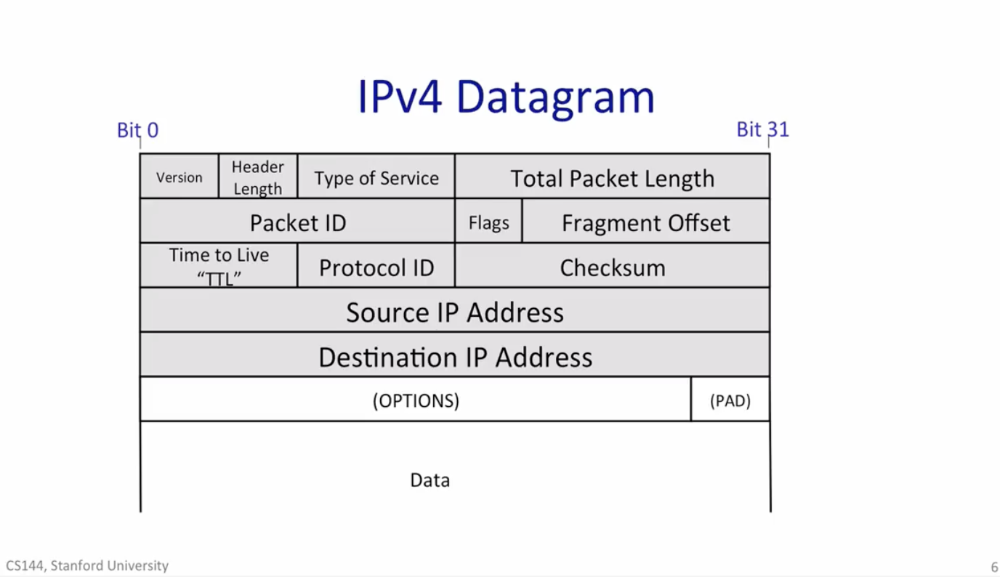

# CS144 学习笔记

> Stanford CS144: Introduction to Computer Networks
> 参考风格：博客园 apachecn/绝不原创的飞龙 整理版
> 语言：中文（专业名词保留英文）
> 范围：章节理论优先，Lab 笔记学完理论后再单独建

## 章节结构

| 文件 | 对应章节 |
|------|---------|
| ch01-internet-and-ip.md | 第 1 章：互联网与 IP 协议简介 |
| ch02-udp-and-tcp.md | 第 2 章：传输层 |
| ch03-routing-and-forwarding.md | 第 3 章：路由与转发 |
| ch04-congestion-control.md | 第 4 章：拥塞控制 |
| ch05-icmp-and-dns.md | 第 5 章：ICMP & DNS |
| ch06-Routing.md | 第 6 章：路由 |
| ch07-Physical-and-Link-Principles.md | 第 7 章：物理层与链路层原理 |
| ch08-resource-management.md | 第 8 章：Resource management |

> 章节顺序以用户实际学习版本为准。哪个文件存在 = 那章在写或写完；不存在的 = 还没学到。

## 协作流程

1. 用户发某一章的截图和要点
2. AI 整理成对应章节 md 文件
3. AI 配上网络找的图 / 自己生成的示意图
4. 用户看完反馈，调整后再进下一章


### 📝 命名约定

- 文件名：`chNN-english-title.md`（如 `ch01-internet-and-ip.md`）
- 章节结构：`# 章名` → `<h3> 1.X 课名 </h3>` → `<h4> 知识点</h4>`，**不出现 H2 也不写"课程内容"这种占位段**

#### 🎯 三层字号硬规则（每章都遵守）

**知识点标题字号必须满足**：

> **课程标题字号 > 知识点标题字号 > 知识点内容字号**

| 层级 | 角色 | 字号 | 写法 |
|------|------|------|------|
| H1 | 章名 | 默认（约 2em） | `# 第 N 章：...` |
| H3 | 课程标题 | `2em` + bold | HTML 标签 |
| H4 | 知识点标题 | `1.5em` + bold | HTML 标签 + 上方 `---` 兜底 |
| 正文 | 知识点内容 | `1em` | markdown 正文 |

**为什么是这套比例**：
- H3 (2em) > H4 (1.5em) > 正文 (1em)，差值 0.5em / 0.5em 拉开三档
- HTML 内联 CSS 万一被某些渲染器忽略，上方 `---` 水平分割线还能保证"知识点"视觉上独立成块

**模板**：

```markdown
# 第 1 章：互联网与 IP 协议简介

<h3 style="font-size: 2em; font-weight: bold;">1.1 一个应用的一天（A Day in the Life of an Application）</h3>

---

<h4 style="font-size: 1.5em; font-weight: bold;">基本通信模型：可靠的双向字节流</h4>

**核心思想**：...

---

<h4 style="font-size: 1.5em; font-weight: bold;">应用示例一：万维网与 HTTP</h4>

**协议介绍**：...
```

#### ➖ H4 之间的 `---` 分割线（硬规则）

> 上一个 H4 标题的内容结束、到下一个 H4 标题之间，**必须加一个 `---` 作为内容分割**。

**位置规范**：

```
[H3 标题]
[空行]
---
[空行]
[H4 #1 标题]
[空行]
[H4 #1 内容段落 / 表格 / 图片]
[空行]
---
[空行]
[H4 #2 标题]
[空行]
[H4 #2 内容段落 / 表格 / 图片]
[空行]
---
[空行]
[H4 #3 标题]
...
```

**为什么加 `---`**：

- 即使 HTML 内联 CSS 字号被某些渲染器忽略，`---` 也能保证每个 H4 **视觉上独立成块**
- 长 H4 + 表格 + 图 + 大段文字的组合，靠 2 全角空格缩进和 H4 标题样式很难拉开层级；`---` 是最稳的视觉分隔
- 跨 H4 切换主题时，给读者一个明显的"换主题"信号

#### 🚫 笔记禁区（每章都遵守）

| 禁区 | 反例 | 为什么 |
|------|------|--------|
| 元信息 blockquote | `> 章节状态` / `> 创建时间` / `> 进度` | 笔记不是 todo，不写元数据 |
| 空占位 HTML 注释 | `<!-- 待填 -->` | 占位 = 偷懒，要么写要么不写 |
| 待填的列表项 | `- [ ]` | 同上 |
| 仅有占位的标题 | H4 下面空着等下次填 | H4 是结构，结构要落实 |
| 进度/emoji 状态标记 | 🔵 / ⏳ / ✅ 标在标题或段落前 | 笔记是看的内容，不是项目管理 |
| **"和 X 的关系 / 对照 X / 呼应 / 再扣回" 类联想段** | 末尾写"**和 1.3 第一个 H4 的关系**：..." / "**对照前面学的字节流模型**" / "**关键观察**：1.2 + 1.3..." | **会让笔记臃肿**——用户反馈明确禁止；前后的自然联系让正文自己表达，不要单独成段 |
| 【类型】label + 一句话 blockquote | H4 标题前加 `【模型】` / `【案例】`，正文第一行是 `> **一句话**：...` | 太套路、太装饰 |
| H2 段 / "课程内容" 占位 | `## 课程内容` 下面空着 | 直接进 H3 / H4，H2 不需要 |

#### ✍️ 写作风格（AI 输出风格）

- **语言简练**：短句为主，少铺垫、少复述。工具调用后直接说结果 / 关键差异 / 关键观察，不写"做了什么 / 原因 / 适用" 三段套话。
- **不用填充词**："漂亮 / 接下来 / 让我们 / 那么" 等过渡词能省就省。
- **要点清单用 `- ` 不用 `**标签**：...` 套壳**。
- **避免长段**：每段不超过 4–5 行。

#### 🎨 画图规则（cs144 风格）

> 当知识点需要"画图说明"时（包结构、流程图、组件关系图、状态机等），**用 `image_synthesize` 生成 cs144 风格图**存到 `images/`，**不要用 monospace / ASCII 框图代替**。

**风格特征**（参考用户给的 4 张样图）：

- **背景**：浅米色，简洁不花
- **主色（Header / 标题 / 关键模块）**：深绿
- **强调色**：橙（接口 1 / 步骤编号 / 结果行 / 警示）
- **警示 / 关键观察**：红色边框（KEY INSIGHT）或红色对话气泡
- **形状**：圆角矩形方块 + 居中标题 + 粗体英文
- **子模块**：白底圆角方框
- **流程**：深绿粗箭头串连，编号用橙色圆圈 + 白色数字

**存放与命名**：

- 路径：`images/chNN-1-X-<知识点名>.png`
- 分辨率默认 `1K`（节省 Mac 存储；用户明确要更精细再升）

#### 📐 图片显示规则

> 画好的图在笔记里怎么**引用**和**排版**——画图风格见上一节 🎨，本节管"画好的图怎么放"。

**统一格式**（每张图都这样写）：

```html


*图：IPv4 头部的 12 字节核心字段。*
```

**4 个硬要求**：

| # | 要求 | 为什么 |
|---|------|--------|
| 1 | 用 HTML ``，**不用** `` | VS Code 不支持 `{width=70%}` 简写；HTML 在 VS Code / GitHub / Typora / Obsidian 都生效 |
| 2 | `width="70%"` 全局统一 | 紧凑档（字段图、字节序、子网掩码、头部结构等） |
| 3 | 加 `style="display: block;"` | 强制图片独占一行，避免图说被挤到图片旁边 |
| 4 | 图片和图说之间**必须空一行** | 否则 markdown 把它们当同一段，图说会跑到图片右边 |

**图说格式**：`*图：...*`（纯斜体两星包，**不用** `>*图：...*` blockquote）

**为什么不用 ``**：

- VS Code 预览里图片始终 100% 宽（控制不了）
- GitHub clone 下来也是 100% 宽
- HTML `` 在两边都是 70% 宽 → **跨平台视觉一致**

**添加新图的标准流程**：

1. 按 `🎨 画图规则` 画图（或用 `image_synthesize` 生成）
2. 存到 `images/chNN-1-X-<topic>.png`（1K 分辨率）
3. 在笔记对应位置插入 HTML 引用（按上面的统一格式）
4. 在图片下方空一行，加 `*图：...*` 图说
5. 用 VS Code 预览检查图说是否独立成行

#### 📋 笔记内容原则

- **忠于用户原文**：笔记内容**尽量按用户给的主要内容来**，不要大幅扩写、添加原文没有的大段。
- **可做优化**：允许做**内容和排版的合理优化**——如：把散乱要点整理成表格、给字段做规范化排版、用 cs144 风格图替代 ASCII 框图、提取关键术语定义、加图说、合并重复段落。
- **不可做**：不要自创"补充小知识"段塞一长串原文没有的内容；不要在末尾写"和 X 的关系 / 对照 / 关键观察" 类联想段（见上一节禁区）。
