# 第 1 章：互联网与 IP 协议简介

<h3 style="font-size: 2em; font-weight: bold;">1.1 应用程序的一天（A Day in the Life of an Application）</h3>

---

<h4 style="font-size: 1.5em; font-weight: bold;">基本通信模型：双向可靠字节流</h4>

**核心思想**：两台计算机各跑一个程序，通过网络通信；**任一方写入数据，经网络传到对端后被读取**，两个方向都成立。

**通信规则**：
- A 写入数据 → 经 Internet 传输 → B 读取
- B 写入数据 → 经 Internet 传输 → A 读取
- **任一方都可以主动关闭连接**（比如浏览器请求完网页就关连接）
- **任一方也可以拒绝连接**（"Connection refused"或长时间无响应）
- **连接可能被对端重置**（浏览器报的 `connection reset by peer` 就是这个）

**关键属性**（记住这三点，是后续 TCP 章节的铺垫）：
- **Bidirectional（双向）**：两端都能读和写
- **Reliable（可靠）**：除非连接断了，否则数据不会丢、不会乱
- **Byte stream（字节流）**：不关心消息边界，写什么读什么——这跟后面要学的 UDP "数据报" 模型完全不同

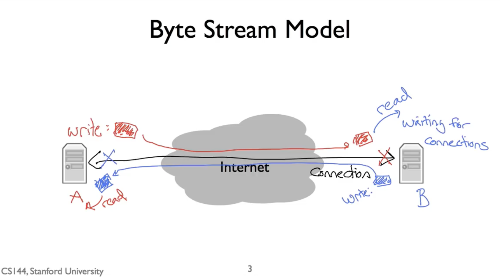

*图：主机 A 和主机 B 通过 Internet 通信。A 写入 → B 读取；B 写入 → A 读取，构成一条双向字节流。*

---

<h4 style="font-size: 1.5em; font-weight: bold;">应用示例一：万维网与 HTTP</h4>

万维网（World Wide Web, WWW）使用 **HTTP（超文本传输协议,HyperText Transfer Protocol）** 作为通信协议。浏览器地址栏里出现 `http://` 前缀时，就意味着当前通信基于 HTTP。

**一次完整的请求-响应过程**（以访问 `http://www.stanford.edu` 为例）：

1. 浏览器向斯坦福服务器发送一个针对根路径 `/` 的 **GET 请求**
2. 服务器校验请求合法后，返回一个由**状态行 + 文档数据**构成的响应
3. 浏览器拿到响应，按 HTML 规则渲染出主页

**请求的原始格式**（客户端发出去的"命令"）：

```text
GET / HTTP/1.1
Host: www.stanford.edu
```

- `GET`：请求方法，表示"我想要读一个资源"
- `/`：请求的资源路径，这里是根路径
- `HTTP/1.1`：协议版本
- `Host:`：告诉服务器访问的是哪个虚拟主机（一台服务器可能托管多个网站）

**响应的起始行**（服务器发回来的"状态码"）：

```text
HTTP/1.1 200 OK
Content-Type: text/html
... 文档正文 ...
```

- `HTTP/1.1 200 OK`：状态行，**200** 是 HTTP 状态码，代表"处理成功"；**OK** 是对应的文字描述
- `Content-Type: text/html`：告诉浏览器正文是 HTML 超文本，按 HTML 规则渲染

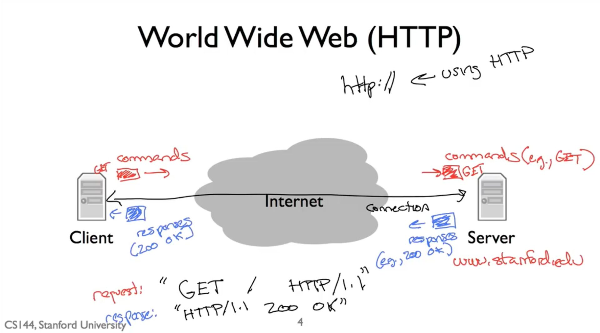

*图：浏览器与斯坦福服务器通过 Internet 通信。客户端发送 GET 命令，服务端返回 200 OK 响应。*

---

<h4 style="font-size: 1.5em; font-weight: bold;">应用示例二：BitTorrent</h4>

**协议介绍**：BitTorrent 是一个用于**分享和交换大文件**的程序。与 HTTP 那种"客户端 → 单台服务器"的模式不同，BitTorrent 客户端会**从多个不同的对等节点（peer）并行获取**同一个文件的不同部分，下载者同时也在为别人提供上传。

**下载流程**（5 步）：

1. **获取元数据**：客户端通过 HTTP 协议从网页下载目标文件的**种子文件**（`.torrent`）。
2. **解析种子信息**：种子文件内含**数据文件的校验信息**，以及**负责协调的跟踪器（Tracker）地址**。
3. **请求节点列表**：客户端向 Tracker 发送请求，获取**当前正在下载或上传该文件的其他客户端（即对等节点）的网络地址**。
4. **建立连接与分块传输**：客户端与返回列表中的部分节点**建立直接连接**，并将文件拆分为多个小块进行**并行下载**。同时，客户端也会**将自己已拥有的块上传给其他节点**——"下载"和"上传"是同时发生的。
5. **动态加入机制**：当新节点加入该下载任务时，Tracker 会将其信息同步给已有节点（包括你的客户端），从而**促成新节点间的数据交互**。这就是 BitTorrent 著名的"**人越多下得越快**"——每个新节点都同时带来新的上传带宽。

**与 HTTP 的关键区别**：

| 维度 | HTTP / 万维网 | BitTorrent |
|------|--------------|-----------|
| 通信对象 | 1 个客户端 → 1 台服务器 | 1 个客户端 → 多个对等节点 |
| 数据流向 | 客户端**只下载** | 节点**同时下载和上传** |
| 带宽瓶颈 | **服务器**的出口带宽 | 节点越多，总带宽**越大** |
| 节点角色 | 客户端 / 服务器，**角色固定** | 每个节点**既是客户端也是服务器** |

**新引入的关键术语**：
- **swarm（蜂群）**：所有正在下载/上传同一文件的客户端集合
- **piece（片）**：被拆分后的小块文件（标注在图的右上角："breaks files into 'pieces'"）
- **Tracker**：协调者，只负责告诉你"还有谁也在下这个文件"，本身不传文件内容

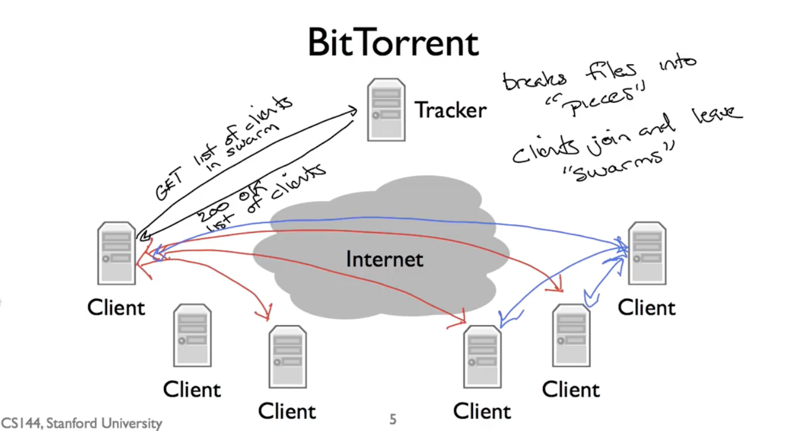

*图：客户端先向 Tracker 发起 `GET list of clients in swarm`，Tracker 返回 `200 OK list of clients`；随后客户端与返回列表中的多个 Client 建立直接连接，互相传输文件 pieces。文件被拆分成"pieces"，节点随时可以加入或离开 swarm。*

---

<h3 style="font-size: 2em; font-weight: bold;">1.2 四层互联网模型（The four layer Internet model）</h3>

---

<h4 style="font-size: 1.5em; font-weight: bold;">四层模型：分层设计的核心思想</h4>

互联网先驱们把网络通信按职责**自下而上**划分为**四个操作层次**：

- **链路层（Link）**：相邻节点之间，沿物理链路的帧传输
- **网络层（Network）**：跨网络，端到端的数据报转发
- **传输层（Transport）**：端到端的可靠字节流 / 报文传输（TCP、UDP）
- **应用层（Application）**：应用协议本身（HTTP、BitTorrent、Skype…）

**为什么要分层**：

- **复用构建块**：应用层不必关心底层走的是以太网还是 Wi-Fi，只调传输层接口就行
- **替换灵活**：换掉某一层的实现（IPv4 → IPv6、TCP → QUIC），其他层几乎不用动
- **故障定位清晰**：出问题能按层排查，不用在巨型单体里翻代码

**四层之间如何协作**（看图最直观）：

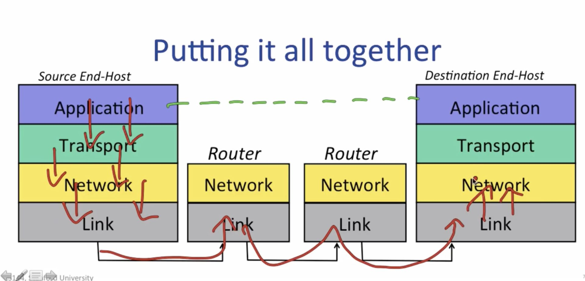

*图：源端主机的数据从应用层出发，逐层向下封装 → 经物理链路 → 路由器（**只解封到网络层就转发**，不碰传输层和应用层）→ 下一段物理链路 → … → 目标端主机再逐层向上解封。途中路由器只用到 Network + Link 两层，端主机四层全用。*

**一个关键观察**：**路由器是"半截"的**——它只跑下两层。端到端的"端到端可靠性"是传输层（TCP）在两端做的，路由器不管。这正是 CS144 整门课要讲清楚的核心分工。

---

<h4 style="font-size: 1.5em; font-weight: bold;">链路层（Link Layer）</h4>

**核心职责**：把**网络层下发的 IP 数据报**封装成**帧（Frame）**，通过**物理链路**（以太网、Wi-Fi 等），在**直接相连的两个相邻节点**之间传输。

**核心区别**（vs 网络层）：

- 链路层：**点到点**（相邻节点之间）
- 网络层：**端到端**（源到目标主机，可能跨多跳）

**数据格式（以太网帧 DIX Ethernet II）**：

链路层传输的基本单位是**帧（Frame）**：

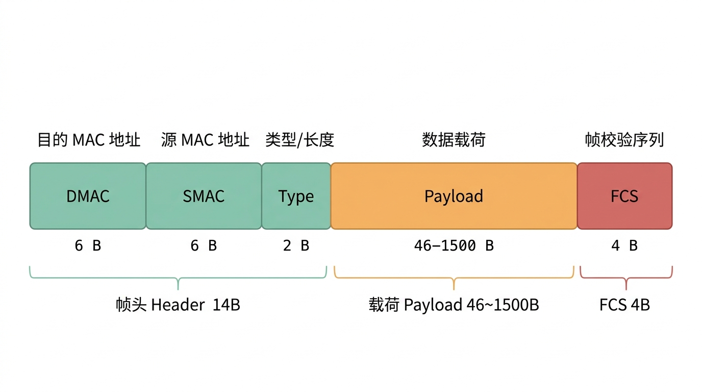

*图：以太网帧 DIX Ethernet II 格式。帧头 14 字节：目的 MAC（6B）+ 源 MAC（6B）+ 类型/长度（2B）；载荷 Payload 46~1500 字节；帧尾 FCS 4 字节（帧校验序列）。*

- **目的 MAC / 源 MAC**：物理网卡地址，链路层靠它判断"这帧是不是给我的"
- **类型/长度**：指明帧里装的是哪种上层协议（IPv4、ARP…）
- **数据/载荷**：装的就是网络层传下来的 IP 数据报
- **校验序列（FCS）**：链路层自己用来检错，错了就丢

**传输机制**：

- **发送方**：按目标 MAC 封装帧头 → 投到物理链路上
- **接收方**：网卡比对帧头的**目的 MAC** 与自己网卡的 MAC：
  - **匹配** → 收下，剥掉帧头/帧尾，把载荷交给网络层
  - **不匹配** → **直接丢弃**（这就是为什么链路层是"点到点"的——它根本不认识目的 IP）

---

<h4 style="font-size: 1.5em; font-weight: bold;">网络层（Network Layer）</h4>

**核心职责**：把**传输层下发的报文段（Segment）**封装成**数据报（Datagram）**，通过一系列**路由节点**，将数据从**源主机跨网络**传输到**目标主机**。

**核心区别**（vs 链路层）：

- 链路层：**相邻节点**之间的帧传输（点到点）
- 网络层：**源主机 → 目标主机**的端到端传输，可能跨越**多个路由器**

**数据格式（IPv4 数据报）**：

网络层传输的基本单位是**数据报（Datagram）**，IPv4 头部的核心字段：

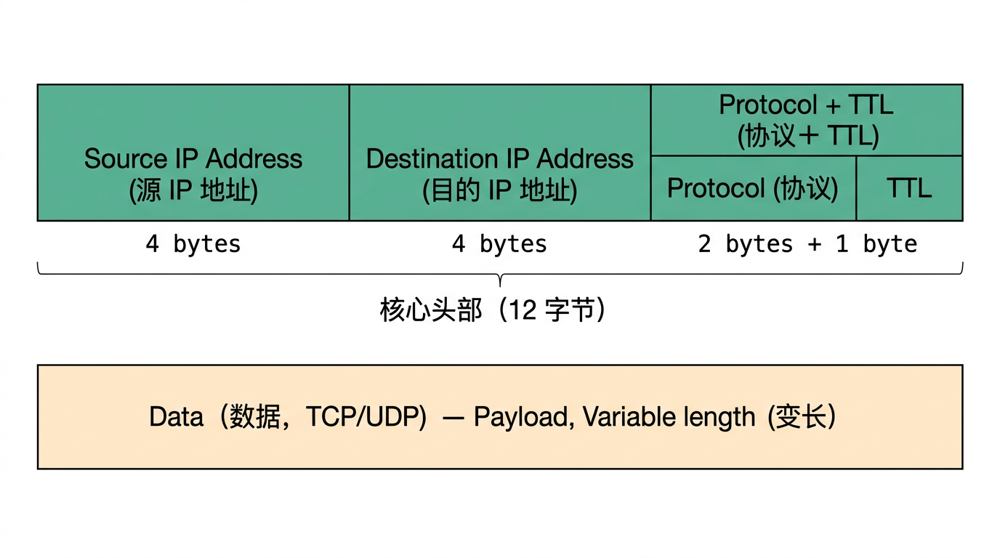

*图：IPv4 核心头部 12 字节：源 IP 地址（4B）+ 目的 IP 地址（4B）+ 协议（2B）+ TTL（1B）；之后是 Data 载荷（TCP/UDP，可变长度）。*

- **源 IP / 目的 IP**：网络层靠它做"端到端"寻址
- **协议**：指明载荷是 TCP 还是 UDP（传输层协议号）
- **TTL（Time To Live）**：每经过一个路由器减 1，归零就丢——防止数据报在环路上无限循环
- **数据**：传输层下发的 TCP 段或 UDP 报文

**传输机制**（4 个关键能力）：

1. **IP 地址寻址**：每个网络接口分配**唯一 IP 地址**，由**网络号**（子网）+ **主机号**（子网内具体主机）组成，通过**子网掩码**区分。
2. **路由转发（Forwarding）**：收到 IP 数据报后，**查询本地路由表**，根据**目的 IP** 决定从哪个接口发出、下一跳是谁。**逐跳（Hop-by-Hop）**——每个路由器只看下一跳，不看整条路径。
3. **分片与重组（Fragmentation & Reassembly）**：当数据报超过下一跳链路的 **MTU（Maximum Transmission Unit，最大传输单元）**时，拆成多个 IP 分片；分片到达**最终目标主机**后才重组（不在中间路由器重组）。
4. **差错与控制（ICMP）**：路由器无法转发、TTL 超时、目标不可达时，用 **ICMP（Internet Control Message Protocol）**向源主机报告错误。`ping` 命令就是基于 ICMP 工作的。

**为什么网络层用"无连接"设计**：

- 每个数据报**独立转发**，路由器不维护"连接状态"
- 优点：简单、路由器开销低、天然支持多路径
- 缺点：**可能丢包、乱序、重复**——这正是后面"传输层（TCP）"要解决的问题（CS144 第 2、3 章会展开）

---

<h4 style="font-size: 1.5em; font-weight: bold;">传输层（Transport Layer）</h4>

**核心职责**：把**应用层下发的数据**封装成**报文段（Segment）**，利用网络层提供的服务，在**源主机和目标主机的应用程序之间**建立**逻辑通信**。

**核心区别**（vs 网络层）：

- 网络层寻址单位是 **IP 地址**（主机之间）
- 传输层寻址单位是 **端口号（Port）**（应用程序之间）
- 一台主机上跑着很多应用，传输层靠"**IP + 端口**"组合（也就是**套接字 / Socket**）区分每条连接

**两大核心协议**：

| 协议 | 连接性 | 可靠性 | 应用场景 |
|------|--------|--------|---------|
| **TCP** | 面向连接 | 可靠、有序 | 网页浏览、文件传输、邮件 |
| **UDP** | 无连接 | 不可靠、无序 | 视频流、在线游戏、DNS 查询 |

**数据格式**：

**TCP 报文段**：

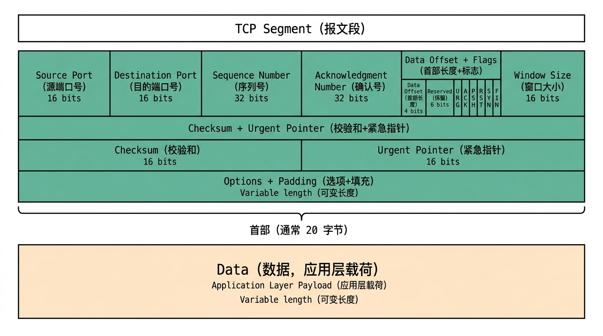

*图：TCP Segment 首部字段分布。首行 6 个固定字段：源端口、目的端口、序列号、确认号、首部长度+标志（含 URG/ACK/PSH/RST/SYN/FIN 6 个控制位）、窗口大小；第二行校验和 + 紧急指针；可选行 Options + Padding；之后是 Data 载荷。*

**UDP 报文段**：

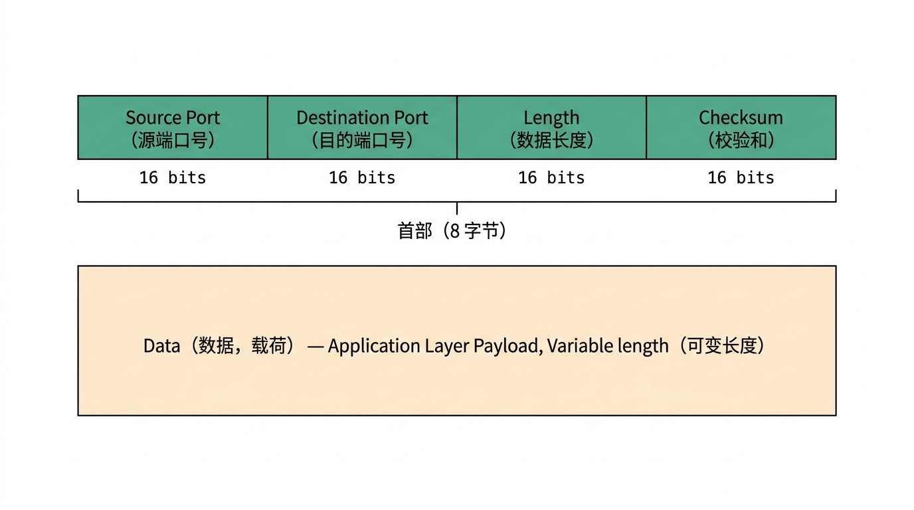

*图：UDP Segment 首部 8 字节，4 个 16 bit 字段：源端口、目的端口、长度、校验和。之后是 Data 载荷（应用层数据，可变长度）。*

---

<h4 style="font-size: 1.5em; font-weight: bold;">应用层（Application Layer）</h4>

**核心职责**：为终端用户提供**网络应用服务**，通过**传输层提供的端到端通信能力**，实现**应用程序之间的数据交换**。

**核心区别**（vs 传输层）：

- 传输层提供**通用的端到端通信原语**（字节流 / 报文）
- 应用层实现**具体的业务逻辑**（网页怎么渲染、邮件怎么投递、文件怎么分块）

应用层**不是单一协议**，而是一组协议的集合：

| 协议 | 全称 | 默认端口 | 传输层 | 用途 |
|------|------|---------|--------|------|
| **HTTP / HTTPS** | 超文本传输协议（安全） | 80 / 443 | TCP | 网页浏览、API 调用 |
| **FTP** | 文件传输协议 | 20（数据）/ 21（控制） | TCP | 文件上传下载 |
| **SMTP** | 简单邮件传输协议 | 25 | TCP | 发送邮件 |
| **POP3 / IMAP** | 邮件接收协议 | 110 / 143 | TCP | 接收邮件 |
| **DNS** | 域名系统 | 53 | UDP（主要）/ TCP | 域名 → IP 解析 |
| **SSH** | 安全外壳协议 | 22 | TCP | 远程登录、安全传输 |
| **DHCP** | 动态主机配置协议 | 67（服务端）/ 68（客户端） | UDP | 自动分配 IP 地址 |

---

<h4 style="font-size: 1.5em; font-weight: bold;">数据在各层的形态：全栈封装流程</h4>

**各层数据单元（PDU, Protocol Data Unit）速查**：

| 层级 | 数据单元 | 英文 | 形态 |
|------|---------|------|------|
| 应用层 | 报文 | Message | 业务数据本身（如 HTTP 请求） |
| 传输层 | 报文段 | Segment | TCP/UDP 头部 + 应用数据 |
| 网络层 | 数据报 | Datagram | IP 头部 + 报文段 |
| 链路层 | 帧 | Frame | 以太网帧头 + 数据报 + 帧尾 |


**发送方向（封装）**：

```text
应用层: [HTTP 请求]                                            ← 报文 (Message)
  ↓ 添加 TCP/UDP 头部
传输层: [TCP 头部 | HTTP 请求]                                 ← 报文段 (Segment)
  ↓ 添加 IP 头部
网络层: [IP 头部 | TCP 头部 | HTTP 请求]                       ← 数据报 (Datagram)
  ↓ 添加 以太网帧头 + 帧尾 (FCS 校验)
链路层: [以太网帧头 | IP 头部 | TCP 头部 | HTTP 请求 | 校验序列] ← 帧 (Frame)
```

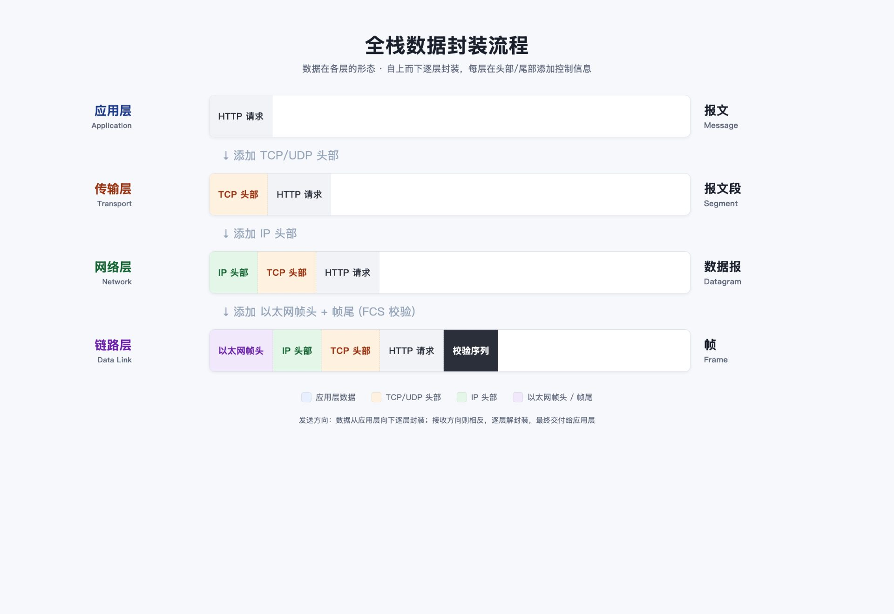

*图：自上而下的封装 + 自下而上的解封装。链路层帧在物理链路上传输；每个中间路由器只解到网络层就重新封装继续转发（剥旧帧头帧尾、换下一段链路的帧头帧尾）。*

**接收方向（解封装）**：链路层剥帧头/帧尾 → 网络层剥 IP 头 → 传输层剥 TCP 头 → 应用层拿到原始 HTTP 请求。**每层只认识自己的头尾，从不拆开看里面装的是什么业务数据**。
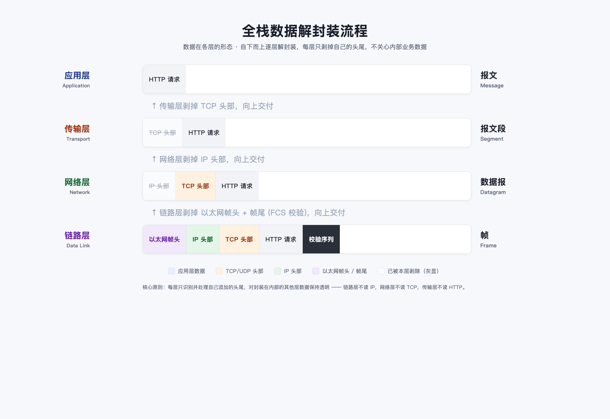

---

<h3 style="font-size: 2em; font-weight: bold;">1.3 IP 服务模型（The IP service model）</h3>

---

<h4 style="font-size: 1.5em; font-weight: bold;">IP 服务的四个核心属性</h4>

IP 服务的特性可以由**四个核心属性**来描述——它们**不是孤立的，而是相互支撑的**：

| 属性 | 英文 | 行为描述 | 关键含义 |
|------|------|---------|---------|
| **数据报** | Datagram | Individually routed packets. Hop-by-hop routing. | 每个包**独立路由**，逐跳（hop-by-hop）转发 |
| **不可靠** | Unreliable | Packets might be dropped. | 包**可能丢失**——IP 不重传、不保证到达 |
| **尽力而为** | Best effort | ...but only if necessary. | 路由器**只在该转发的时候转发**；拥塞时会丢包保网络 |
| **无连接** | Connectionless | No per-flow state. Packets might be mis-sequenced. | 路由器**不维护"流"的状态**；包可能**乱序**到达 |

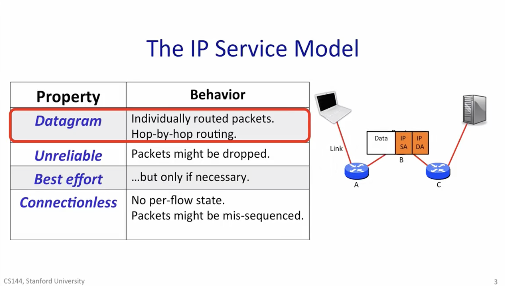

---

<h4 style="font-size: 1.5em; font-weight: bold;">IP 提供的其他关键机制（5 项）</h4>

除上一节讲的"尽力而为的数据报服务"外，IP 还通过**五项关键机制**在**功能性和简单性之间取得平衡**——这五项都是 IP "**用最简单的方式解决最常见的问题**"的体现。

**机制 1：生存时间（TTL, Time To Live）—— 防止无限循环**

- IP 头部设有 **TTL 字段**，常见初始值：**Linux 默认 64**、**Windows 默认 128**、某些 Unix 255
- 数据包每经过一跳路由器，该值**减 1**
- 当 **TTL 归零**时，路由器**直接丢弃**该包

```c
if (ttl == 0) discard();
```

- **解决什么问题**：**路由环路（routing loop）**——A → B → C → A 循环，路由器之间互相指向对方。**没有 TTL 的话，循环的数据包会在网络里永远跑下去**，耗尽所有带宽
- **额外应用**：`traceroute` 工具**故意把 TTL 设为 1、2、3…**，逐跳触发超时丢弃，借 ICMP 差错报文画出整条路径

**机制 2：分片与重组（Fragmentation & Reassembly）—— 适应异构网络**

- 当数据包**超过下一跳链路的 MTU**（Maximum Transmission Unit，最大传输单元）时，**源端或中间路由器**会将其拆分为**多个较小的 IP 分片**
- 接收端利用 IP 头部的**标识符、标志位、片偏移**三个字段，把分片**重新组装**成原始报文

**机制 3：头部校验和（Header Checksum）—— 保障控制信息完整性**

- IP 头部设有**校验和字段**，**只校验头部，不校验载荷**（载荷校验交给传输层 TCP/UDP），校验失败 → **直接丢弃**
- **解决什么问题**：物理链路可能引入比特翻转（电磁干扰、硬件故障…），**头部被破坏**比载荷被破坏**更危险**——目的地址错了就把包送错地方

**机制 4：版本标识（Version）—— 支持协议演进**

- IP 头部**第一个字段**是版本号（4 bit）
- 当前主流：**IPv4**（版本号 = 4，地址 32 位）和 **IPv6**（版本号 = 6，地址 128 位）
- 路由器收到 IP 包后**先看版本号**，决定按 IPv4 还是 IPv6 头部格式解析

**机制 5：可选项（Options）—— 提供扩展能力**

- IP 头部允许携带**可选字段**，支持**时间戳、记录路由（Record Route）、源路由（Source Route）**等扩展功能

---

<h4 style="font-size: 1.5em; font-weight: bold;">IPv4 数据包头部详解</h4>


*图：IPv4 头部从 Bit 0 到 Bit 31 共 32 位一行，从上到下五行（无 Options/Pad），加上可选的 Options + Pad。后面跟 Data 载荷。*

**13 个字段总览表**（按顺序、含位数）：

| # | 字段 | 位数 | 关键作用 |
|---|------|------|---------|
| 1 | Version | 4 | 协议版本（IPv4 = 4） |
| 2 | Header Length (IHL) | 4 | 头部长度（32-bit 字） |
| 3 | Type of Service | 8 | QoS / 拥塞标记 |
| 4 | Total Packet Length | 16 | 整个包总长（含头） |
| 5 | Packet ID | 16 | 分片标识 |
| 6 | Flags | 3 | DF / MF |
| 7 | Fragment Offset | 13 | 分片位置（8 字节单位） |
| 8 | TTL | 8 | 生存时间 |
| 9 | Protocol ID | 8 | 下一层协议号（6=TCP / 17=UDP / 1=ICMP） |
| 10 | Checksum | 16 | 头部校验和 |
| 11 | Source IP | 32 | 源地址 |
| 12 | Destination IP | 32 | 目的地址 |
| 13 | Options + Pad | 0–320 bit | 扩展字段（可选） |
| | **Data** | 可变 | 传输层载荷 |

**前 12 个字段固定 = 160 bit = 20 字节**（无 Options）；有 Options 时头部最多 60 字节。

---

<h3 style="font-size: 2em; font-weight: bold;">1.4 数据包的一生（Life of a Packet）</h3>

---

<h4 style="font-size: 1.5em; font-weight: bold;">TCP 连接起步：三次握手 + 两个地址</h4>

你可能每天都在不知不觉中使用 TCP——浏览器输入网址按下回车的那一刻，Web 浏览器与服务器之间发送和接收的**每一个数据包，几乎都是通过 TCP（传输控制协议）来承载的**。

**三次握手：建立连接的第一步**

在 TCP 的典型操作中，通信双方分为客户端和服务器：

- **服务器**先"守候"在特定端口上，监听连接请求
- **客户端**主动发起连接

建立连接需要三次消息交换——著名的**三次握手**：

| 步骤 | 方向 | 消息 | 含义 |
|------|------|------|------|
| 1 | C → S | **SYN** | 客户端："我想建立连接" |
| 2 | S → C | **SYN-ACK** | 服务器："我收到了，我也准备好了" |
| 3 | C → S | **ACK** | 客户端："好的，连接建立成功" |

简记：**SYN → SYN-ACK → ACK**。3 次交换确保**双方都能发送和接收数据**，为后续可靠传输打底。

**两个地址，缺一不可**

网络层和传输层分工明确：

- **网络层**负责把数据包送达**正确的计算机**（通过 IP 地址）
- **传输层**负责把数据送达**同一台计算机上正确的应用程序**（通过端口号）

| 地址类型 | 作用 | 示例 |
|---------|------|------|
| **IP 地址** | 标识网络中的某台计算机 | 192.168.1.10 |
| **TCP 端口** | 标识该计算机上的某个应用程序 | 80（Web 服务器） |

**举个例子**：访问一个网站时，你的计算机构造 IP 数据包，目标 IP 是 Web 服务器的地址；而在该 IP 数据包内部的 TCP 分段中，目标端口号会被设为 **80**（HTTP 服务的标准端口）。数据包到达服务器后，操作系统按端口号 80 把数据正确交给 Web 服务器程序，而不是邮件服务或其他应用。

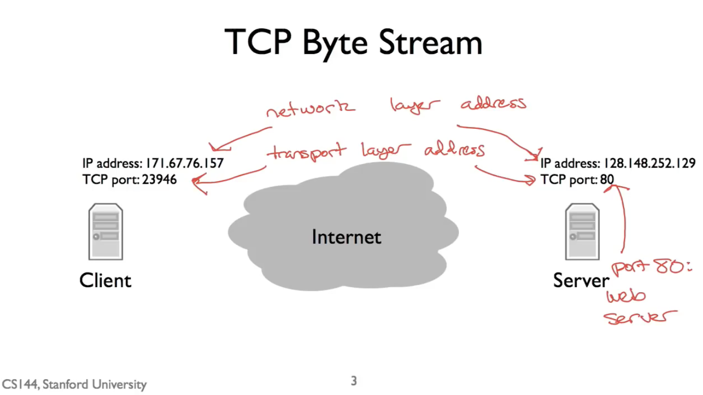

*图：Client（IP 171.67.76.157 + TCP 23946）↔ Server（IP 128.148.252.129 + TCP 80）经 Internet 通信。两层地址各管一段：网络层地址管主机，传输层地址管应用。*

---

<h4 style="font-size: 1.5em; font-weight: bold;">数据包在网络里怎么走：逐跳（Hop-by-Hop）接力</h4>

上一节聊了端到端的连接如何建立，本节聚焦一个更实际的问题：**IP 数据包究竟是怎么从你的设备"走"到目标服务器？**

显然，你的电脑和服务器之间**并没有一根直连的网线**。实际传输中，数据包需要经过一系列**中间设备的接力**，这些设备就是**路由器**。你的设备首先连到最近的一个路由器，而这个路由器又连到其他路由器，层层递进，形成一条由多个**跳（Hop）**组成的转发路径——**每一跳，都代表数据包从一个路由器到下一个路由器的传递过程**。

**以 Wi-Fi 上网为例**：

1. **第一跳是无线传输**：数据包从你的设备发送到 Wi-Fi 接入点（家里的无线路由器）
2. **接入点转发**：接入点收到后，通过有线网络（如光纤或以太网）将数据包转发出去，接入更广泛的互联网
3. **逐跳传递**：从此数据包沿着一条有线链路，在众多路由器之间一跳接一跳地传递，直至抵达目标服务器

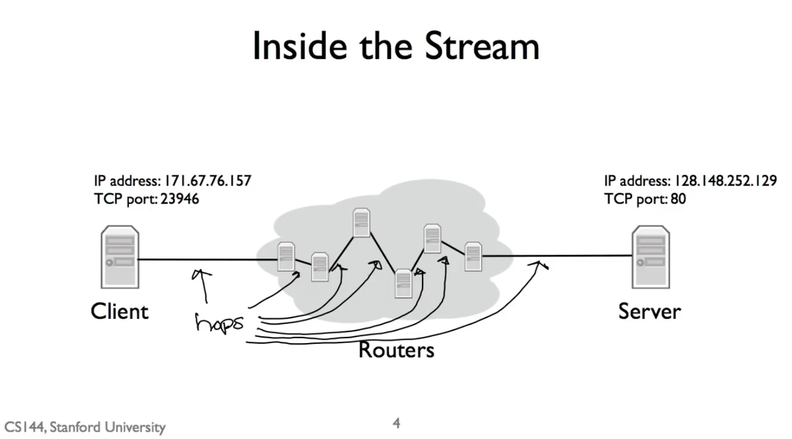

*图：Client（IP 171.67.76.157 + TCP 23946）→ Internet 中的多个 Routers（逐跳转发）→ Server（IP 128.148.252.129 + TCP 80）。图中手写 "hops" 标注每一跳。*

---

<h4 style="font-size: 1.5em; font-weight: bold;">路由器转发数据包：决策 + 转发</h4>

当一个数据包到达路由器时，路由器需要执行**两个核心动作**：

| 动作 | 作用 |
|------|------|
| **决策** | 根据数据包的目的 IP 地址，决定将它发往哪一条链路（即确定下一跳） |
| **转发** | 实际将数据包从选定的链路发送出去 |

两者分工明确：**先决策，后转发，缺一不可**。

**特殊情况**：路由器自身也拥有 IP 地址。如果数据包的目的地**恰好就是路由器本身的 IP 地址**（比如你通过浏览器登录路由器的管理后台），那么路由器**就不会执行转发**，而是将数据包交给自身的内部软件处理。

**路由器具体如何做决策？**

当数据包到达时，路由器会**提取其目的 IP 地址**，然后在**转发表（forwarding table）**中查找**最匹配的条目**——**匹配度越高，优先级越高**。找到匹配条目后，路由器就按该条目指定的链路，将数据包转发出去。

- 路由器（IP 216.239.47.186）收到一个包，提取目的 IP，查这张表
- 命中具体 pattern → 走对应链路；都不命中 → 走 default（兜底）

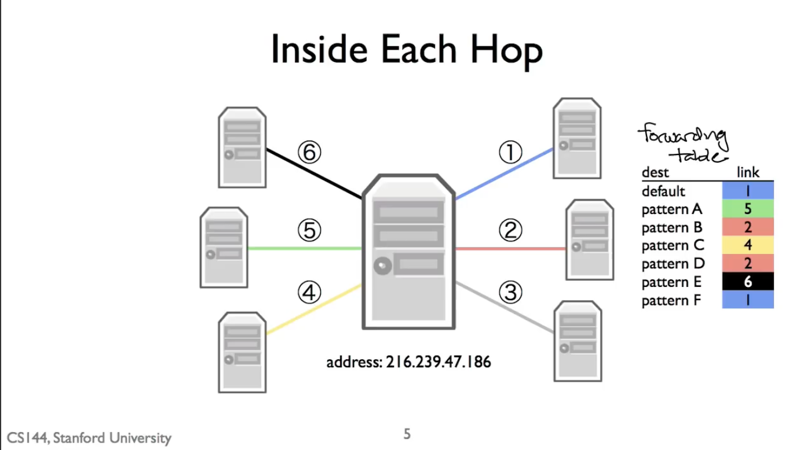

*图：单台路由器（IP 216.239.47.186）周围 6 条编号链路 1–6，右侧是 forwarding table（dest → link）。default 兜底走 1 号链路。*

---

<h3 style="font-size: 2em; font-weight: bold;">1.5 分组交换原理（Packet switching principle）</h3>

---

<h4 style="font-size: 1.5em; font-weight: bold;">分组交换原理：数据报模式</h4>

**分组交换是一种核心的数据传输机制**。基本思想：把待发送的完整数据（文件、图片、视频流）在**源端拆解为多个更小、结构化的离散单元**——这些单元叫**数据包（或分组）**。

**每个数据包都是自包含的独立实体**：
- **载荷（Data）**：被分割后的用户数据片段
- **首部（Header）**：附加的控制信息——**源地址、目的地址、序号、校验和**等

正是这些首部信息，让每个数据包都能在网络中**"自主"寻路**，最终到达目的地。

**最基础形式：数据报模式（Datagram）**：
- 每个数据包被视为**完全独立的事务**
- **不依赖**同一消息中的其他数据包
- 各自依据当前网络节点的状态（**链路拥塞、路由表信息**等）被**逐跳转发并独立选路**

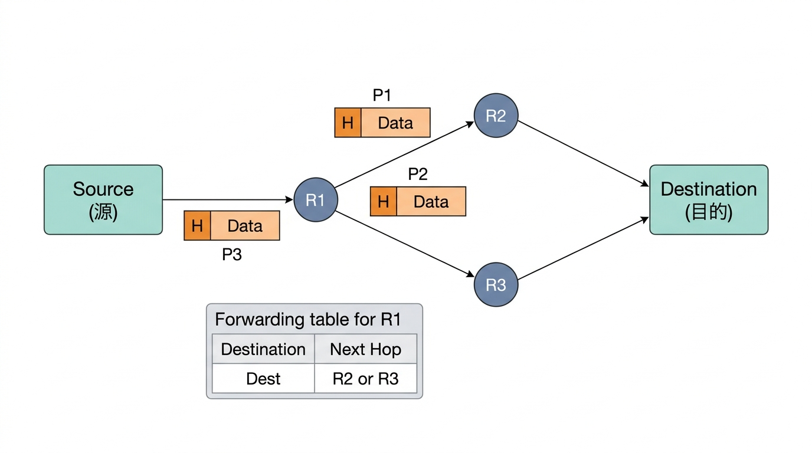

*图：Source 发出 3 个包 P1/P2/P3，每个包都有 H（首部）+ Data（载荷）。R1 按转发表（Dest → R2 or R3）把 P1/P2 转发到 R2，把 P3 转发到 R3；两条路径最终都汇聚到 Destination。*

---

<h3 style="font-size: 2em; font-weight: bold;">1.6 分层原理（Layering principle）</h3>

---

<h4 style="font-size: 1.5em; font-weight: bold;">分层的优点与边界</h4>

**分层**，是指将系统组织成多个分离的功能组件或层的设计方法。这些层按顺序排列和通信。具体而言：

- **每个层只与直接相邻的上层和下层有接口**
- 它为上层提供明确的服务，同时利用下层提供的服务来完成自己的私有处理

**分层的 5 个优点**：

- **模块化与可管理性**：将复杂系统分解为更小、更易管理的模块
- **明确定义的服务**：每一层都为上层提供定义清晰的服务接口
- **代码复用**：上层可以复用下层已经实现的功能，无需重复造轮子
- **关注点分离**：每一层可以专注于自己的核心功能，无需了解其他层的具体实现
- **持续改进**：可以独立地对某一层进行升级、优化或替换，而不会影响整个系统

**针对通信系统（如互联网）的第 6 个关键优势**：

- **对等通信**：通信两端**同一层**的实体（例如，两台电脑上的网络应用层）可以使用下层提供的服务进行**直接"对话"**。就像**邮件例子中的寄件人和收件人**——他们之间在"邮件层"直接对话，但底层怎么寄送、走什么物理链路，他们都不需要关心

---

<h3 style="font-size: 2em; font-weight: bold;">1.7 封装原理（Encapsulation principle）</h3>

上一节介绍了分层模型，本节来看分层思想在数据包中的具体体现——**封装**。

---

<h4 style="font-size: 1.5em; font-weight: bold;">什么是封装</h4>

**当你发送数据时**（例如一个 TCP 段），它并不会单独在网络中旅行。这个 TCP 段会被放入一个 IP 分组中，而 IP 分组又会被放入一个链路层帧（如以太网帧）中。**这个过程就是封装**。

**封装**：将高层协议的数据单元，**作为低层协议数据单元的负载（Payload）进行打包**的过程。

核心关系：高层数据单元 → 成为 → 低层数据单元的负载

---

<h4 style="font-size: 1.5em; font-weight: bold;">封装的数据包结构</h4>

封装后的数据包中，**每个协议层的数据单元通常由三部分组成**：

- **头部（Header）**：包含本层协议的控制信息——如地址、序列号等
- **负载（Payload）**：即来自上层协议封装好的完整数据单元
- **尾部（Trailer）**：部分链路层协议有，用于差错校验等

**从应用层到链路层的封装示例流程**：

```text
浏览器发出的 HTTP GET 请求
              ↓ （封装为 TCP 段的负载）
          TCP 段  [TCP 头 + HTTP GET]
              ↓ （封装为 IP 包的负载）
          IP 包   [IP 头 + TCP 段]
              ↓ （封装为 WiFi 帧的负载）
          WiFi 帧 [帧头 + IP 包 + 帧尾]
```

---

<h3 style="font-size: 2em; font-weight: bold;">1.8 字节序（Byte Order）</h3>

数据包在网络中传输时，多字节字段（如 32 位 IP 地址、16 位端口号）以哪种顺序在链路上"摆"——是字节序要解决的问题。

---

<h4 style="font-size: 1.5em; font-weight: bold;">大端序（Big-Endian）</h4>

- **高位字节先放，低位字节后放**
- 就像写数字 `12345678`——从左往右"先大后小"念
- 又叫**网络字节序**——**IP、TCP、UDP 都用它**

---

<h4 style="font-size: 1.5em; font-weight: bold;">小端序（Little-Endian）</h4>

- **低位字节先放，高位字节后放**
- 就像反过来写 `87654321`——先小后大
- 又叫**主机字节序**——**x86 / x64 电脑都用它**

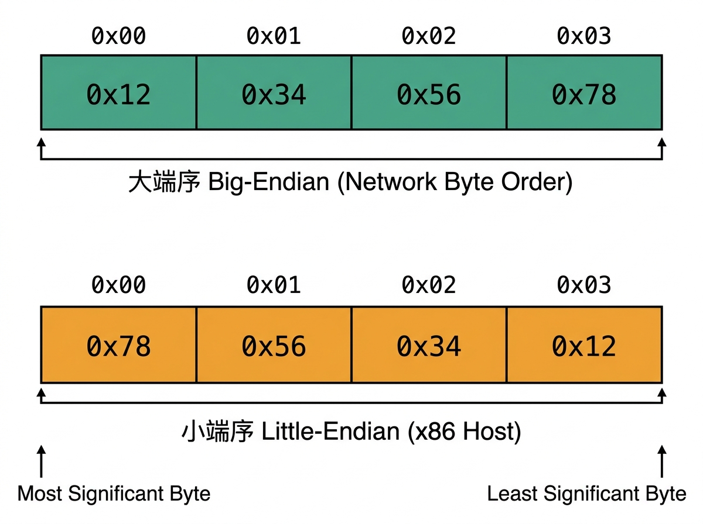

*图：同一组 4 字节（值 `0x12345678`）在内存/网络中的两种排法。绿色=大端序（Network Byte Order），最高位字节 `0x12` 放在最低地址 `0x00`；橙色=小端序（x86 Host），最低位字节 `0x78` 放在最低地址 `0x00`。*

---

<h3 style="font-size: 2em; font-weight: bold;">1.9 IPv4 地址（IPv4 address）</h3>

---

<h4 style="font-size: 1.5em; font-weight: bold;">IPv4</h4>

**核心使命**：为联网设备分配唯一的 **32 位"数字身份证"**，实现精准寻址与数据路由。

- 这 32 位二进制数通常被划分为**四个八位组**
- 采用**点分十进制记法**表示，例如 `192.168.1.42`——便于人们阅读和配置

---

<h4 style="font-size: 1.5em; font-weight: bold;">子网掩码</h4>

除了 IP 地址，网络设备还配有**子网掩码**，用于划分本地网络与外部网络。

子网掩码长度决定了IP地址中"网络号"占多少位。网络前缀 /24 即前24位固定为网络号，对应掩码 255.255.255.0，剩余8位作为主机号。理论上2的8次方等于256个地址，但其中全0地址（网络地址）和全1地址（广播地址）需保留，因此实际可分配给设备的地址数为 256 - 2 = 254 台。

| 子网掩码 | 网络位数 |
| --- | --- |
| `255.255.255.0` | 24 位 |
| `255.255.255.128` | 25 位 |
| `255.255.0.0` | 16 位 |

**判断两台设备是否在同一网络**：将各自的 IP 地址与子网掩码**进行按位与（AND）运算**，若结果相同，则它们**同属一个本地网络**。

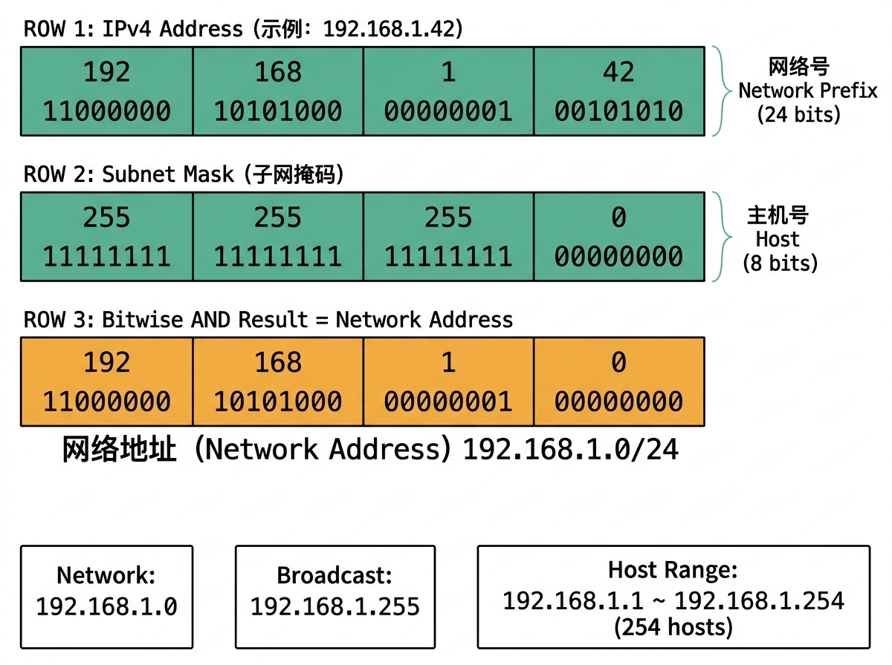

*图：示例 IP `192.168.1.42` 与子网掩码 `255.255.255.0`（/24）按位与，得到网络地址 `192.168.1.0/24`。本网络下：网络号 `192.168.1.0`、广播地址 `192.168.1.255`、可用主机范围 `192.168.1.1 ~ 192.168.1.254`（共 254 台主机）。*

---

<h4 style="font-size: 1.5em; font-weight: bold;">CIDR：无类别域间路由</h4>

为了解决分类地址的僵化问题，IPv4 地址通过 **CIDR（Classless Inter-Domain Routing，无类别域间路由）** 进行了重新结构化。

- 与之前只有固定的 8 位、16 位或 24 位网络前缀不同，**CIDR 允许使用任意长度的前缀**
- 所有 CIDR 前缀都定义了一个地址块，其大小是 **2 的幂次方**
- 表达方式采用**斜线记法**（slash notation），例如 `/16` 或 `/20`

**CIDR 地址块示例**：

| 前缀长度 | 地址块大小 | 计算式 |
| --- | --- | --- |
| `/16` | 65,536 个地址 | `2^(32-16) = 2^16` |
| `/20` | 4,096 个地址 | `2^(32-20) = 2^12` |

---

<h3 style="font-size: 2em; font-weight: bold;">1.10 最长前缀匹配 LPM（Longest Prefix Match）</h3>

---

<h4 style="font-size: 1.5em; font-weight: bold;">路由器转发的基本思路</h4>

路由器转发数据包时，会将**目标 IP 地址**与**路由表中的网络前缀**进行匹配，并选择匹配项对应的接口发出。

---

<h4 style="font-size: 1.5em; font-weight: bold;">LPM 算法的两步规则</h4>

**第一步：判断是否匹配**

- 如果 `(目标 IP 地址 & 子网掩码) == 网络前缀`，则该条目**匹配**

**第二步：多条命中时选最长前缀**

- 当**多个条目同时匹配**时，路由器遵循**最长前缀匹配原则**——选择**子网掩码最长**的条目，因为这代表**最精确的路径**

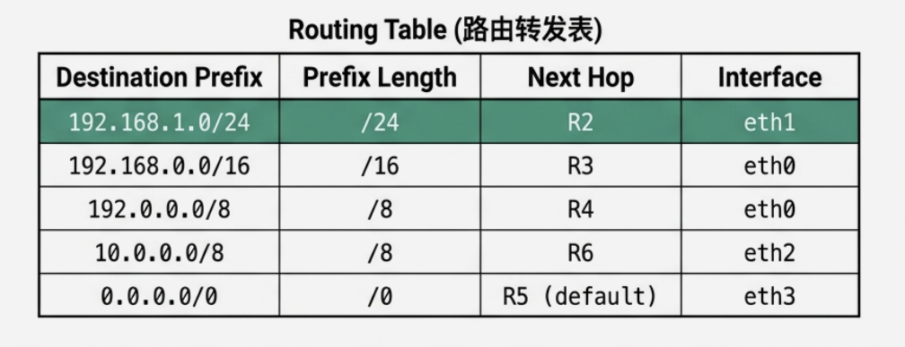

*图：示例路由转发表。最长前缀匹配示例——目标 `192.168.1.42` 同时命中 `192.168.1.0/24`、`192.168.0.0/16`、`192.0.0.0/8` 三条，按 LPM 取最长前缀 `/24` → 下一跳 `R2`、接口 `eth1`。最后一行 `0.0.0.0/0` 是**默认路由（default route）**，作为兜底条目。*

---

<h3 style="font-size: 2em; font-weight: bold;">1.11 地址解析协议 ARP（Address Resolution Protocol）</h3>

---

<h4 style="font-size: 1.5em; font-weight: bold;">从IP寻址到链路层传输：ARP协议的桥梁作用</h4>

在计算机网络中，**不同协议层使用各自独立的寻址体系**。**网络层使用 IP 地址**，用于标识网络中的唯一目标主机，实现**跨网络寻址**；**链路层使用 MAC 地址**（如 48 位以太网地址 `00:13:04:72:02:04`），用于标识具体的网卡，负责在**同一本地网络内进行实际的帧传输**。简而言之，**IP 地址标识"这台主机"**，**MAC 地址标识"这张网卡"**，前者服务于网络层寻址，后者服务于链路层实际传输。

当上层协议（IP）需要将数据交给下层封装发送时，发送方起初只知道目标 IP 地址，却不知道目标主机的 MAC 地址。为了解决这一问题，网络中使用**地址解析协议（ARP）**。ARP 的作用正是**将已知的目标 IP 地址动态解析为对应的 MAC 地址**，从而正确构造链路层帧，将数据发往正确的物理设备。

为了在不同网络层之间传递数据，需要建立 **IP 地址到 MAC 地址的映射关系**。ARP 通过**广播请求和单播回复**的机制，**动态地发现并维护**这种映射关系。同时，每个设备都维护有一个 **ARP 缓存**，用于存储已解析的地址映射，从而**提高通信效率**，避免了每次传输都要重复进行 ARP 查询。

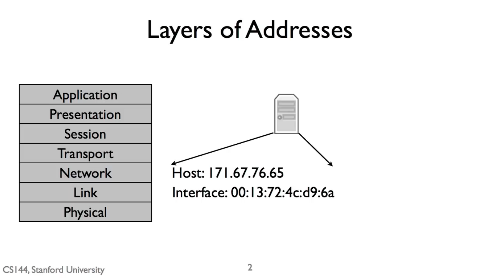

*图：CS144 课件原图。同一台服务器可同时拥有**主机地址**（网络层，示例 `Host: 171.67.76.65`）和**接口地址**（链路层，示例 `Interface: 00:13:72:4c:d9:6a`）。*

---

<h4 style="font-size: 1.5em; font-weight: bold;">地址的耦合与解耦</h4>

**链路层地址**与**网络层地址**在协议设计上**相互独立（解耦）**，但在实际通信中**必须协同工作**。

**关键概念**：

- 准确地说，**IP 地址标识的是主机的网络接口而非整台主机**——一个**多网卡主机拥有多个 IP，每个接口各有一个**
- **子网掩码**用于划分 IP 的网络号和主机号，界定接口所处的**广播域**

**以网关路由器为例**：

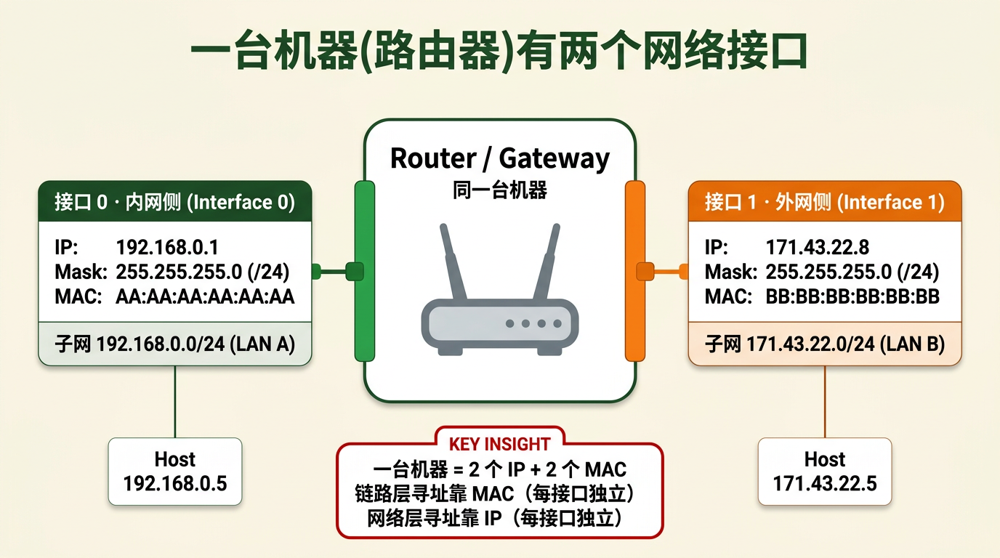

*图：一台路由器有两个网络接口——内网侧（Interface 0，绿色）`192.168.0.1 /24` 接 LAN A（Host `192.168.0.5`），外网侧（Interface 1，橙色）`171.43.22.8 /24` 接 LAN B（Host `171.43.22.5`）；两接口各自独立绑定一对 IP + MAC。*

- 这两个接口**虽然属于同一台设备**，但**各自拥有独立的 IP 和链路层地址**
- 每个接口都**独立绑定一对 IP 与链路层地址**

**两者的关系**：

- **IP 地址**则通过**子网划分**，在不同网络之间进行**逻辑定位**
- **链路层地址**用于在**本地物理链路上寻址**
- **解耦**使 IP 层能**跨越异构物理网络**
- **耦合**体现在最终发送数据帧时，**必须通过 ARP 等协议将目标 IP 实时解析为本地链路上的具体物理地址**

---

<h4 style="font-size: 1.5em; font-weight: bold;">地址解析协议 ARP 核心问题</h4>

**场景**：节点 A（`IP: 192.168.0.5`）想要发送一个 IP 数据包给节点 B（`IP: 171.43.22.5`）。

- A 检查目标地址，发现跟 B **不在同一子网内**（通过子网掩码 `255.255.255.0` 判断）
- 因此 A 需要将数据包**发送给网关**（`IP: 192.168.0.1`）

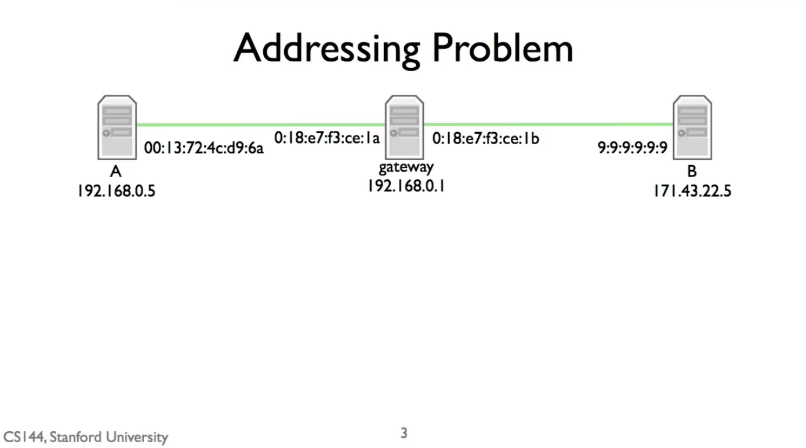

*图：CS144 课件原图。3 节点链路——A（`192.168.0.5`，MAC `00:13:72:4c:d9:6a`）→ gateway（`192.168.0.1`，两个接口 MAC `0:18:e7:f3:ce:1a` / `0:18:e7:f3:ce:1b`）→ B（`171.43.22.5`，MAC `9:9:9:9:9:9`）。**每跳链路层 MAC 都在变**，但 IP 端到端不变。*

**A 构造的 IP 包**：

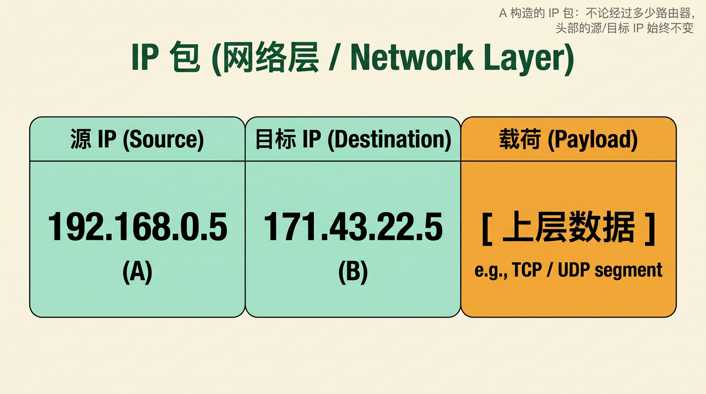

*图：A 构造的 IP 包——三段表格布局：左 `源 IP 192.168.0.5 (A)`、中 `目标 IP 171.43.22.5 (B)`、右 `载荷 [上层数据]`（如 TCP/UDP segment）。不论经过多少路由器，源/目标 IP 始终保持不变。*

**但问题来了**：为了让这个 IP 包在链路上传输，必须将其**封装在一个链路层帧中**。A 还需要知道**网关 `192.168.0.1` 对应的链路层地址（如 MAC 地址）**，才能正确填写帧头。

**ARP 就是为解决这个问题而设计的**：**"如何将网络层 IP 地址映射到链路层 MAC 地址"**。

---

<h4 style="font-size: 1.5em; font-weight: bold;">ARP 工作流程（五步走）</h4>

**1. 检查缓存**

- 当节点需要向某个 IP 地址发送数据时，**首先检查自己的 ARP 缓存**中是否有该 IP 对应的 MAC 记录

**2. 发送 ARP 请求**

- 若缓存未命中，节点会构造一个 **ARP 请求包**
- 包的主要内容："**谁的 IP 是 `X.X.X.X`？请回复我（我的 IP 是 `Y.Y.Y.Y`）**"

**3. 广播请求**

- 节点将该 ARP 请求包**封装到链路层帧中**
- 目的 MAC 地址设置为**广播地址**（如 `FF:FF:FF:FF:FF:FF`），从而让**同一局域网内的所有设备都能收到**该请求

**4. 处理请求与回复**

所有收到广播的节点都会检查请求中的"目标 IP"是否与自己的 IP 匹配：

- **不匹配**：**忽略该请求**，但可以**顺便将发送者的 IP 和 MAC 地址映射记录到自己的 ARP 缓存中**（免费学习）
- **匹配**：该节点（即被询问者）会构造一个 **ARP 回复包**
  - 内容："**我的 IP 地址是 `X.X.X.X`，我的 MAC 地址是 `AA:BB:CC:DD:EE:FF`**"
  - **单播发回请求者**（使用请求包中提供的请求者 MAC 地址）

**5. 更新缓存并发送数据**

- 请求者收到回复后，将 **IP → MAC 映射存入自己的 ARP 缓存**
- 随后用该 MAC 地址**封装链路层帧**，正式发送原本待发的数据包

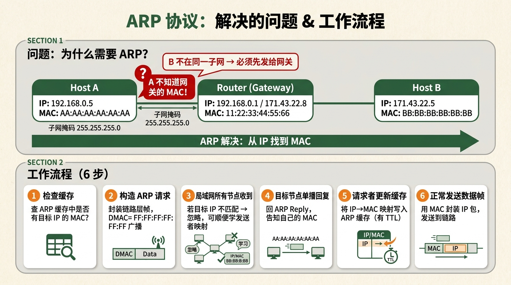

*图：上半部分解释问题——`Host A`（`192.168.0.5`）与 `Host B`（`171.43.22.5`）跨子网，A 必须经过网关（`192.168.0.1 / 171.43.22.8`），但 A 不知道网关的 MAC，ARP 解决的就是"从 IP 找到 MAC"。下半部分工作流程（**图里细分为 6 步**：①检查缓存 ②构造 ARP 请求 ③广播后所有节点收到、不匹配的顺便学习 ④目标节点单播回复 ⑤请求者更新缓存（含 TTL） ⑥正常发送数据帧）。*

---

<h4 style="font-size: 1.5em; font-weight: bold;">ARP 缓存的 TTL 机制</h4>

**ARP 缓存中的条目并非永久有效**——每个条目都有一个**生存时间（TTL）**，**超时后即被删除**。

- 这一机制确保当**网络设备更换**或 **IP 地址重新配置**时，映射信息能够**及时更新**
- 避免因缓存过期而导致通信失败

---

<h4 style="font-size: 1.5em; font-weight: bold;">ARP 数据包格式</h4>

**示例：ARP 请求包关键字段**

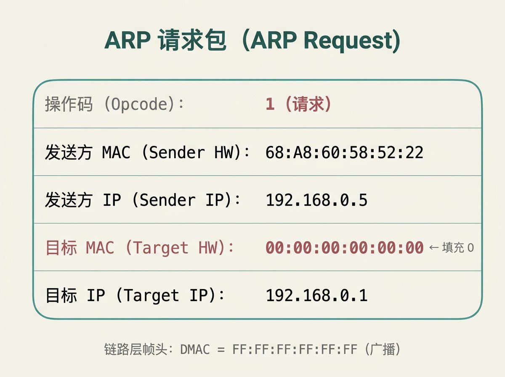

*图：A（`192.168.0.5`，MAC `68:A8:60:58:52:22`）询问网关 `192.168.0.1` 的 MAC。**注意**：**目标 MAC 字段填 0**（因为 A 不知道目标 MAC，构造包时只能填 0），**链路层帧头用广播 DMAC `FF:FF:FF:FF:FF:FF`**——这是请求包的两大特征。*

**示例：ARP 回复包关键字段**

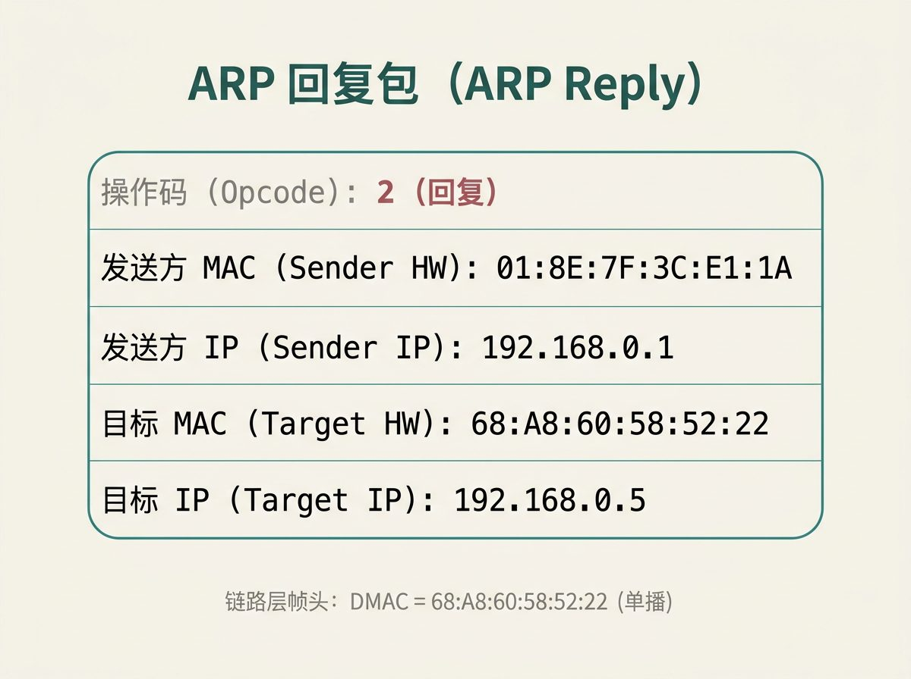

*图：网关 `192.168.0.1`（MAC `01:8E:7F:3C:E1:1A`）回复 A。**注意**：**目标 MAC 字段已填上 A 的真实 MAC**（不再是 0，因为发起请求时 A 已把自己的 MAC 告诉了对方），**链路层帧头用单播 DMAC `68:A8:60:58:52:22`** 直接发给 A，而不是广播。*
