# 第 2 章：传输层

<h3 style="font-size: 2em; font-weight: bold;">2.1 TCP 服务模型（TCP service model）</h3>

---

<h4 style="font-size: 1.5em; font-weight: bold;">TCP 协议概述</h4>

TCP（传输控制协议，Transmission Control Protocol）是一种**功能强大的传输层协议**，它提供**面向连接、可靠的字节流传输服务**。

其核心功能是在通信双方之间**建立逻辑连接**，通过**序列号、确认应答、重传控制**和**流量控制**等机制，将应用程序数据**封装成 TCP 报文段**，确保数据**完整、有序地交付给接收端**，然后交给网络层进行传输。

---

<h4 style="font-size: 1.5em; font-weight: bold;">数据封装与传递</h4>

应用层将数据字节流交给 TCP 层，TCP 将其分段封装为 TCP 段（添加端口号、序列号、校验和等控制信息），再逐层下传：

- **网络层（IP 协议）**：将 TCP 段封装为 IP 数据包，添加源 IP 与目的 IP 地址。
- **链路层**：将 IP 数据包封装为帧（如以太网帧），添加 MAC 地址等链路层信息。
- **物理层**：通过网线、光纤等物理介质将比特流发送出去。

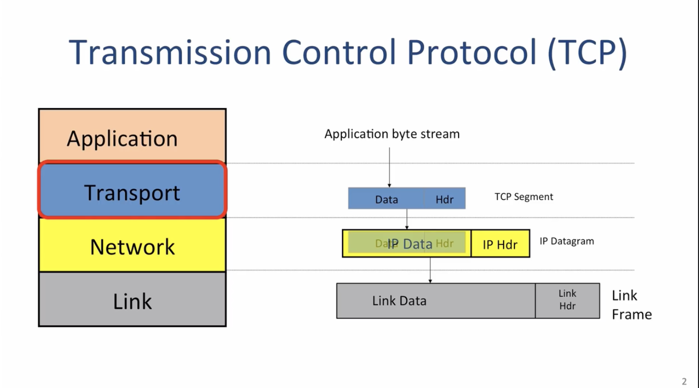

*图：左侧四层协议栈（Transport 层用红框标出，对应 TCP）；右侧是数据自上而下的封装——字节流先变成 TCP 段，再到 IP 数据报，最后变成链路层帧。*

---

<h4 style="font-size: 1.5em; font-weight: bold;">端到端 TCP 通信</h4>

**核心模型**：通信双方各跑一个 TCP 层，端到端通信——中间经过的路由器只有 Network / Link 层在跑，它们只关心"把数据送到下一跳"，不解 TCP 内容。

**Peer TCP layers**：
- 源主机 A 的 TCP ↔ 目的主机 B 的 TCP（双向，全双工，可同时收发）
- 中间的路由器对 TCP 段是**透明的**——只搬运、不解析

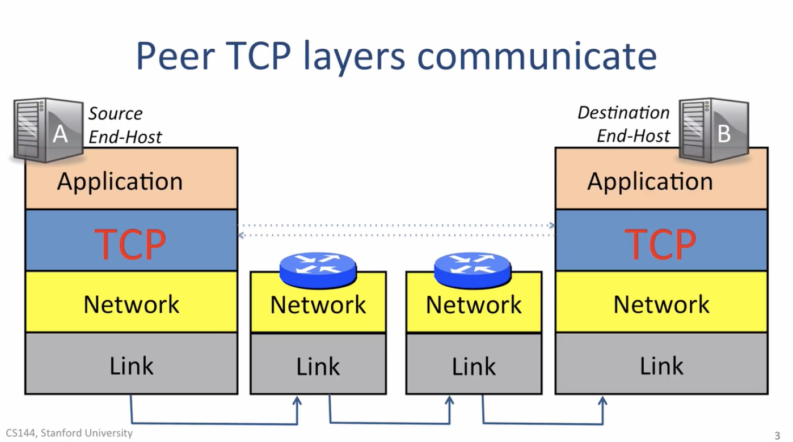

*图：两端主机的 TCP 直接对话（中间虚线双向箭头），中间两台路由器只有 Network / Link 层在跑——对 TCP 透明。*

---

<h4 style="font-size: 1.5em; font-weight: bold;">三次握手建立连接</h4>

TCP 连接通过三次握手过程建立，以确保双方都准备好通信。

**流程**（共三步）：
- **SYN**：主机 A 向主机 B 发送一个 **SYN**（同步）报文，表示希望建立连接，并告知 A 方字节流的初始序列号（例如从 1000 开始）。
- **SYN-ACK**：主机 B 回复一个 **SYN-ACK** 报文。ACK 部分确认收到了 A 的 SYN 请求；SYN 部分表示 B 也希望建立反向连接，并告知 B 方字节流的初始序列号。
- **ACK**：主机 A 最后发送一个 **ACK** 报文，确认 B 的 SYN 请求。至此，**双向连接建立完成**。

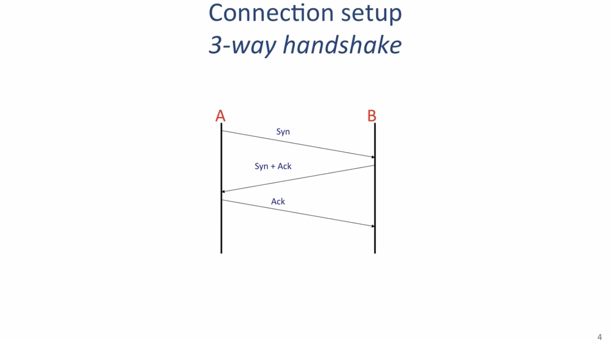

*图：TCP 三次握手时序——A 先发 SYN，B 回 SYN+ACK，A 最后发 ACK，完成三步连接才进入 ESTABLISHED。*

---

<h4 style="font-size: 1.5em; font-weight: bold;">数据传输</h4>

连接建立后，应用程序可以将数据视为**连续的字节流**交给 TCP。TCP 负责将字节流分割成段，确保其**可靠、有序**地送达对端。

即使网络状况不佳，TCP 也能通过**重传**等机制保证数据正确到达。

---

<h4 style="font-size: 1.5em; font-weight: bold;">四次挥手拆除连接</h4>

当通信结束时，需要通过四次挥手来**优雅地**关闭连接。

**流程**（共四步）：
- **FIN**：主机 A 发送 **FIN**（结束）报文，表示 A 没有更多数据要发送了。
- **ACK**：主机 B 回复 ACK，确认 A 的 FIN 请求。此时，**A → B 的数据流关闭**，但 B → A 的通道仍可传输数据。
- **FIN**：当主机 B 也没有数据要发送时，它向 A 发送自己的 **FIN** 报文。
- **ACK**：主机 A 回复最后的 ACK，确认 B 的 FIN。**连接完全关闭**，双方释放资源。

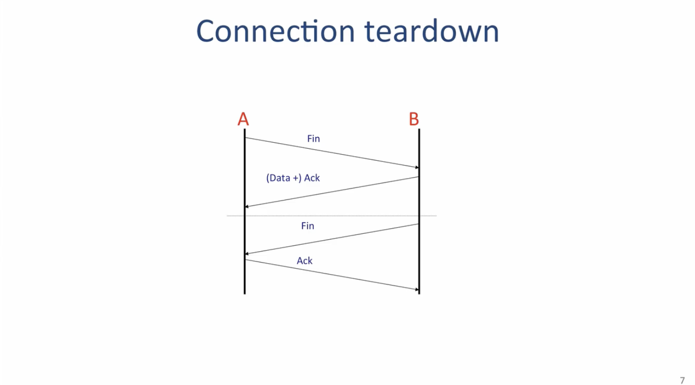

*图：TCP 四次挥手时序——A 发 FIN，B 回 (Data+)ACK；等 B 也没数据了再发 FIN，A 最后回 ACK，连接才完全关闭。*

---

<h4 style="font-size: 1.5em; font-weight: bold;">TCP 提供的两大核心服务</h4>

- **可靠的字节流交付（Reliable byte stream）**：确保数据按顺序、无差错地从一端送达另一端。
- **按序交付（In-order delivery）**：即使网络导致数据包乱序到达，TCP 也能根据序列号重新排序后交给应用。

---

<h4 style="font-size: 1.5em; font-weight: bold;">四种可靠性机制</h4>

为了实现可靠性，TCP 采用了以下四种核心机制：

- **确认与重传（ACK & Retransmission）**：接收方收到数据后发 ACK；发送方在一定时间内未收到 ACK，则会重传该段。
- **校验和（Checksum）**：每个 TCP 头部都包含校验和，用于检测数据在传输过程中是否损坏。

  ```
  // 校验和计算覆盖 TCP 头部和数据
  checksum = calculate_checksum(tcp_header, data);
  ```

- **序列号（Sequence Numbers）**：每个字节在流中都有唯一序列号，用于检测数据丢失、重复和乱序。

  ```
  // 假设初始序列号 (ISN) 为 1000，段携带 500 字节
  segment1.seq = 1000;  // 第一个字节序号
  segment2.seq = 1500;  // 下一个段的起始序号
  ```

- **流量控制（Flow Control）**：接收方通过**通告窗口大小（rwnd）**告知发送方自己还能接收多少数据，防止发送过快导致接收方缓冲区溢出。

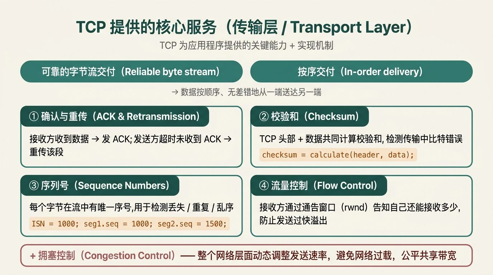

*图：TCP 核心服务与实现机制总览——顶部是两大核心服务（可靠字节流 + 按序交付），中间是四种可靠性机制（确认重传 / 校验和 / 序列号 / 流量控制），底部是拥塞控制。*

---

<h4 style="font-size: 1.5em; font-weight: bold;">TCP 连接的五元组标识</h4>

一个 TCP 连接在互联网上由**五个要素**唯一标识，称为**五元组（5-tuple）**：

`(源 IP 地址, 源端口, 目的 IP 地址, 目的端口, 传输层协议 (TCP))`

- **传输层协议** → 在 **IPv4 头部**的 `Protocol ID` 字段（= `"TCP"`）

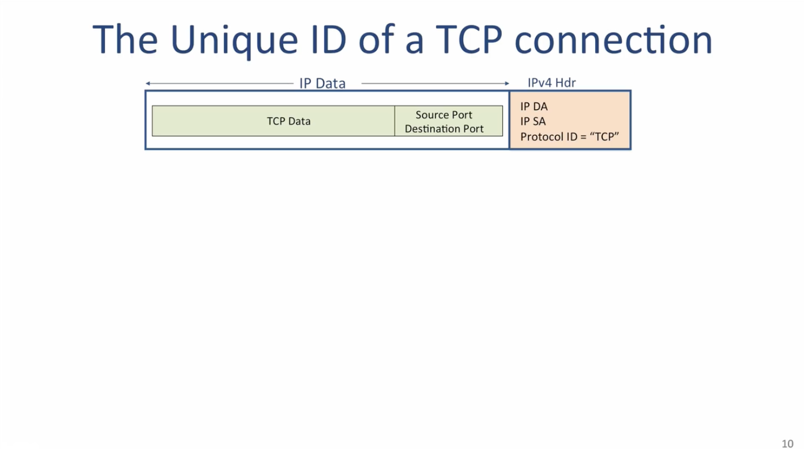

*图：TCP 连接的 5 元组在 IP 报文中的位置——TCP 段（含端口）作为 IP Data 嵌入到 IP 数据报里，IPv4 头部携带源/目的 IP 和 Protocol ID = "TCP"。*

---

<h4 style="font-size: 1.5em; font-weight: bold;">TCP 报文段头部详解</h4>

以下是 TCP 头部中最重要的字段摘要：

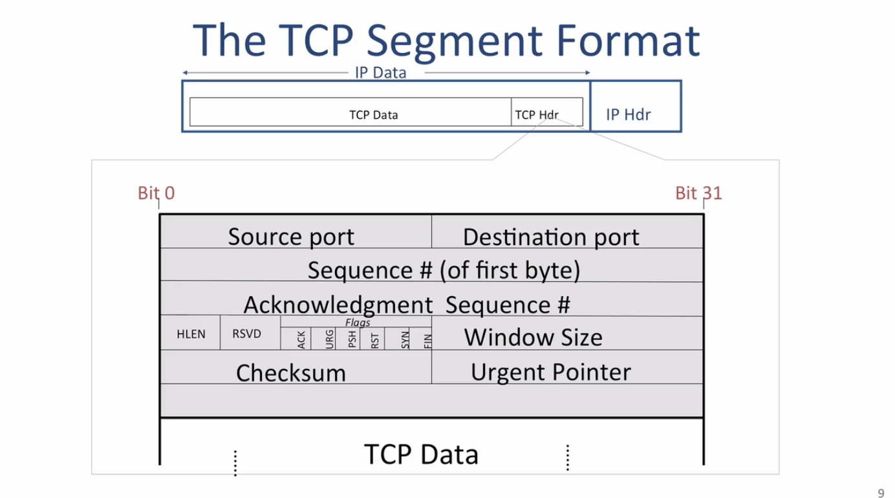

*图：TCP 报文段头部结构——IP Data 里抽出 TCP Hdr，从 Bit 0 到 Bit 31 横向排列；下方是 TCP Data（变长）。*

**字段速查**：

| 字段 | 位数 | 作用 |
|------|------|------|
| `Source Port` | 16 | 标识本地发送进程（发起方随机选择） |
| `Destination Port` | 16 | 标识接收方目标应用（如 Web 80） |
| `Sequence Number` | 32 | 本段数据的第一个字节在字节流中的序号 |
| `Acknowledgment Number` | 32 | 期望收到的下一个字节序号；同时表示该序号之前的数据已正确接收 |
| `Header Length` | 4 | 头部的 32-bit 字数（因含可变的选项字段） |
| `Flags` | 6 | 控制连接：ACK（确认有效）/ SYN（建连同步）/ FIN（拆连）/ PSH（立即交付）/ RST（重置）/ URG（紧急指针） |
| `Window Size` | 16 | 流量控制——从确认号开始，接收方还能接收的字节数 |
| `Checksum` | 16 | 校验范围 = TCP 头部 + TCP 数据部分 |

---

<h4 style="font-size: 1.5em; font-weight: bold;">TCP/IP 端到端传输：分层封装 / 解封装、多路复用 / 解多路复用</h4>

**分层封装与解封装（Encapsulation / Decapsulation）**

A 端 ①②：App 数据 → 加 TCP 头 → **TCP 段** → 加 IP 头 → **IP 包**（每加一层 = 封装）

B 端 ④：IP 包 → 剥 IP 头 → **TCP 段** → 剥 TCP 头 → 交付 App（每剥一层 = 解封装）

---

**多路复用与解多路复用**

**多路复用**：发送端将多个应用进程的数据封装成报文段，并为其赋予包含**源端口号**（标识发送进程）和**目的端口号**（标识接收服务）的头部，最终将这些数据汇聚至网络层，通过同一个 IP 地址的网络接口统一发出。

**多路解复用**：接收端从同一 IP 地址的网络接口收到数据后，提取传输层报文段中的**目的端口号**，依据该端口号将数据准确交付给本地对应的应用进程。

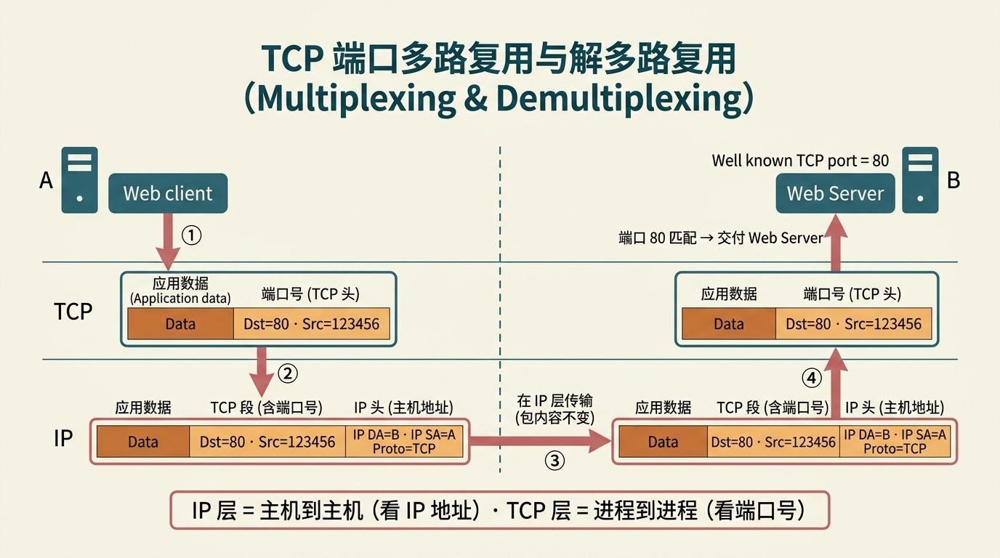

*图：A 端 Web Client ①→② 加 TCP 头（Src=123456, Dst=80）+ IP 头（IP SA=A, IP DA=B）→ ③ IP 层传输（包内容不变）→ B 端 ④ 剥 IP 头 + TCP 头 → 端口 80 匹配 → 交付 Web Server。*

---

<h3 style="font-size: 2em; font-weight: bold;">2.2 UDP 服务模型（UDP service model）</h3>

---

<h4 style="font-size: 1.5em; font-weight: bold;">UDP 协议概述</h4>

UDP（用户数据报协议，User Datagram Protocol）是一种**极其简单的传输层协议**，它提供**无连接、不可靠的数据报交付服务**。

其核心功能是将应用程序数据**封装成 UDP 数据报**，然后交给网络层进行传输。

---

<h4 style="font-size: 1.5em; font-weight: bold;">UDP 服务模型的三大属性</h4>

1. **无连接的数据报服务**：通信前无需建立连接，所有必要信息都包含在单个数据报中。这也意味着**数据包可能以任何顺序到达**。

2. **不可靠的交付服务**：UDP 不向发送方发送确认（ACK），不提供数据是否到达的反馈，也没有检测丢失数据包的机制。如果数据包在途中丢失，UDP 不会通知应用程序，也不会要求源端重传。

3. **无拥塞控制**：UDP 本身不包含调节发送速率的拥塞控制机制。

---

<h4 style="font-size: 1.5em; font-weight: bold;">UDP 数据报头部详解</h4>

以下是 UDP 头部中最重要的字段摘要：

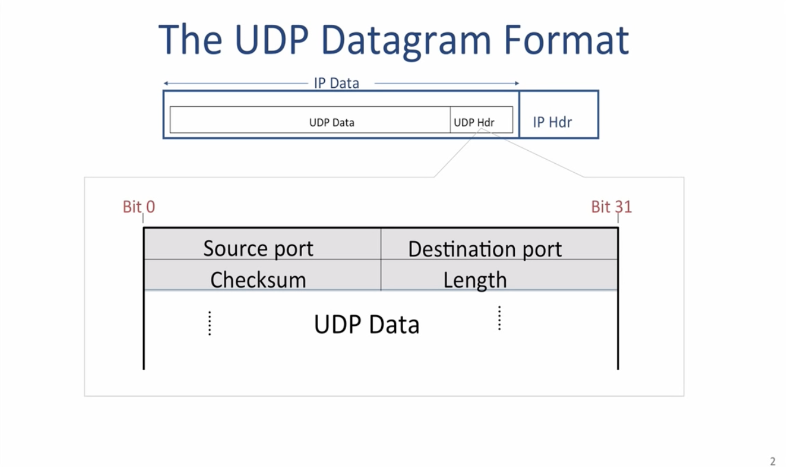

*图：UDP 数据报头部结构——IP Data 里抽出 UDP Hdr，从 Bit 0 到 Bit 31 横向排列；下方是 UDP Data。*

**字段速查**：

| 字段 | 位数 | 作用 |
|------|------|------|
| `Source Port` | 16 | 标识发送端应用进程；远端回复时用此端口作为目的端口 |
| `Destination Port` | 16 | 标识接收端目标应用进程（与 TCP 功能相同） |
| `Length` | 16 | UDP 数据报总长度 = 8 字节（头部）+ 数据长度，至少 8 字节 |
| `Checksum` | 16 | 校验范围 = UDP 头部 + UDP 数据 + IP 头部部分字段（IPv4 时可选，全 0 表示不计算） |

---

<h4 style="font-size: 1.5em; font-weight: bold;">UDP/IP 端到端传输：分层封装 / 解封装、多路复用 / 解多路复用</h4>

**分层封装与解封装（Encapsulation / Decapsulation）**

A 端 ①②：App 数据 → 加 UDP 头 → **UDP 数据报** → 加 IP 头 → **IP 包**（每加一层 = 封装）

B 端 ④：IP 包 → 剥 IP 头 → **UDP 数据报** → 剥 UDP 头 → 交付 App（每剥一层 = 解封装）

---

**多路复用与解多路复用**

**多路复用**：发送端将多个应用进程的数据封装成 **UDP 数据报**，并为其赋予包含**源端口号**（标识发送进程）和**目的端口号**（标识接收服务）的头部，最终将这些数据汇聚至网络层，通过同一个 IP 地址的网络接口统一发出。

**多路解复用**：接收端从同一 IP 地址的网络接口收到数据后，提取 UDP 数据报中的**目的端口号**，依据该端口号将数据准确交付给本地对应的应用进程。

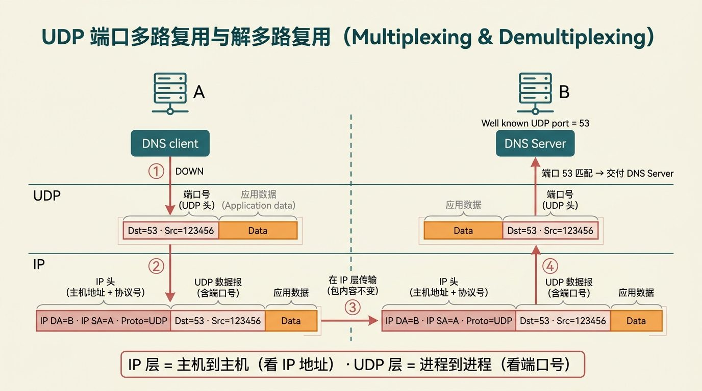

*图：A 端 DNS Client ①→② 加 UDP 头（Src=123456, Dst=53）+ IP 头（IP SA=A, IP DA=B, Proto=UDP）→ ③ IP 层传输（包内容不变）→ B 端 ④ 剥 IP 头 + UDP 头 → 端口 53 匹配 → 交付 DNS Server。*

---

<h3 style="font-size: 2em; font-weight: bold;">2.3 ICMP 服务模型（ICMP service model）</h3>

---

<h4 style="font-size: 1.5em; font-weight: bold;">ICMP 协议概述</h4>

**互联网控制报文协议（ICMP）**是网络层的**"辅助小助手"**，专管**报错和诊断**。IP 协议只管尽力送数据，不保证送达也不给反馈，像**平信丢了不知情**。ICMP 就是给这套系统加上**回执和报错功能**：

- **出问题时**：主动通知原因
- **平时**：可用 `ping`、`traceroute` 主动查网络状况

ICMP 自身的消息也**不保证必达**，但能发出来就会尽力说清问题。它的价值**不是让网络可靠，而是让网络透明**——让你知道**哪里出事了**。

---

<h4 style="font-size: 1.5em; font-weight: bold;">ICMP 概述与工作原理</h4>

ICMP 运行在**网络层之上**，严格来说属于传输层协议。当终端主机或路由器需要报告错误时，它会将相关信息放入 **ICMP 报文的有效载荷**中，然后将其**封装在 IP 数据报中**发送出去。

**ICMP 报文生成的基本过程**：

1. 当路由器或主机需要发送 ICMP 错误报告时，它会**截取触发该报告的原始 IP 数据包的头部**。
2. 同时，它还会**截取该原始 IP 数据包有效载荷的前 8 个字节**。
3. 这些信息（**原始 IP 头 + 前 8 字节数据**）被放入一个**新的 ICMP 报文**中。
4. 该 ICMP 报文被**封装在一个新的 IP 数据包**中，其**源地址是报告者（路由器），目的地址是原始数据包的发送者**。

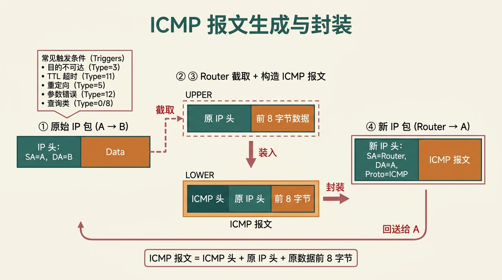

*图：ICMP 报文生成与封装——① 原始 IP 包（A→B）→ ②③ Router 截取原 IP 头 + 前 8 字节数据 + 装入新 ICMP 报文 → ④ 新 IP 包（Router→A，Proto=ICMP），底部公式：ICMP 报文 = ICMP 头 + 原 IP 头 + 原数据前 8 字节。*

---

<h4 style="font-size: 1.5em; font-weight: bold;">Ping 和 Traceroute——ICMP 的两大常用诊断工具</h4>

**Ping：测试连通性 🎯**

`ping` 命令用于测试与另一台主机的连通性和响应时间。其工作原理：

1. 源主机（A）向目标主机（B）发送一个 **ICMP 回显请求**报文。
2. 如果网络通畅且 B 在线，B 在收到请求后会回复一个 **ICMP 回显应答**报文。
3. A 通过计算发送请求和收到应答的时间差，得到**往返延迟**。

命令行示例：

```
ping www.example.com
```

---

**Traceroute：追踪路径 🗺️**

`traceroute` 命令用于发现数据包从源主机到目标主机所经过的路径（路由器），并测量到每一跳的延迟。它巧妙地利用了 **IP 数据包的 TTL 字段**和 **ICMP 的超时消息**。

**工作步骤**：

1. 源主机发送一个 **UDP 数据包**（或 ICMP 回显请求），将其 IP 头中的 **TTL 设置为 1**。
2. 第一个路由器收到后，**TTL 减为 0**，丢弃该包，并向源主机发送一个 **ICMP 超时**报告——源主机由此得知第一个路由器的地址和到它的往返时间。
3. 源主机发送 **TTL=2** 的包，到第二个路由器时 TTL 减为 0 → 记录第二个路由器。此过程**每次 TTL 加 1 重复**，直到包到达目标主机。
4. 包到达目标主机时，traceroute 使用目标上一个**未开放的高端口号**；目标回复 **ICMP 端口不可达**消息，**标志着追踪完成**。

命令行示例：

```
traceroute www.example.com
```

---

<h3 style="font-size: 2em; font-weight: bold;">2.4 端到端原则（End-to-End Principle）</h3>

---

<h4 style="font-size: 1.5em; font-weight: bold;">端到端原则概述</h4>

端到端原则在互联网设计中有**两层含义**：

1. **基本原则（正确性要求）**：若系统设计违背该原则，将数据传输正确性依赖于网络中间节点，则极易导致错误，本质上属于架构缺陷。
2. **强端到端原则（通用性要求）**：该原则更具普适性，主张任何功能若能在端点处完整实现，就应当且只应当在端点实现，网络中间节点不应承担该功能。

---

**基本原则核心论点**

功能正确实现的**唯一可靠主体只能是端点**，因为只有端点才掌握完成该功能所必需的全部信息——包括**业务上下文、应用语义、错误容忍策略**等。

因此，端点必须主动承担起**校验、确认和容错处理的全部职责**，具体涵盖：

- 数据完整性校验
- 业务语义合法性检查
- 超时重传决策
- 幂等性保障
- 最终结果一致性验证

网络的角色仅限于**尽力而为地投递数据**，既无法也无需介入这些验证流程。

**举例**：

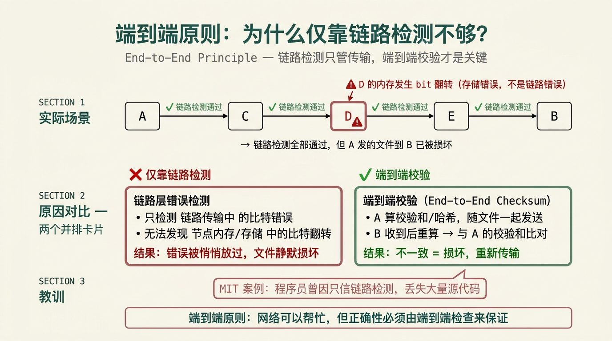

*图：链路检测全通过，但 D 节点内存 bit 翻转（存储错误，不是链路错误），A 发的文件到 B 已被损坏——结果：错误被悄悄放过，文件静默损坏。MIT 案例：曾有程序员因只信链路检测，丢失大量源代码。端到端原则：网络可以帮忙，但正确性必须由端到端检查来保证。*

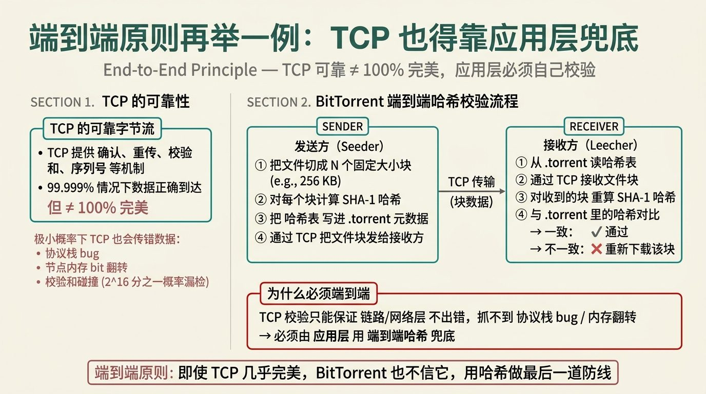

*图：TCP 可靠 ≠ 100% 完美（极小概率下会因协议栈 bug / 节点内存 bit 翻转 / 校验和碰撞出错）——所以 BitTorrent 在应用层用 SHA-1 哈希做端到端校验兜底。端到端原则：即使 TCP 几乎完美，BitTorrent 也不信它。*

---

**强端到端原则核心论点**

基本原则承认：靠性保障、安全加密、语义理解、状态管理、业务逻辑处理等功能必须在端点实现以确保正确性，但网络中间节点可为之提供**性能优化**（如缓存、压缩）。而强端到端原则更进一步：**不仅正确性责任属于端点，连性能优化类功能也不应置于网络内部**，而应当全部推至端点完成。

换言之，网络的任务被严格限定为：**尽可能高效、灵活地传输数据包**。除此之外的一切功能——包括**可靠性保障、安全加密、语义理解、状态管理、业务逻辑处理**等——都应当在网络边缘（即端点）实现，而不是内置于网络中间节点。

---

<h3 style="font-size: 2em; font-weight: bold;">2.5 差错检测（Error detection）</h3>

---

<h4 style="font-size: 1.5em; font-weight: bold;">概述</h4>

网络和设备并非完美，数据传输中可能引入错误（如路由器硬件故障导致**比特翻转**），因此必须能检测出错误，**避免接收损坏的数据**。

现代数据网络主流采用**三种错误检测算法**：

- **校验和（Checksum）**
- **循环冗余校验（CRC，Cyclic Redundancy Check）**
- **消息认证码（MAC，Message Authentication Code）**

三者安全性、强度和适用场景差异显著，理解这些差异对协议设计、配置和故障排查至关重要。

**错误检测的基本思路**：对原始数据**计算一组校验信息**，并将校验信息**附加（或前置）到数据包中**供接收方验证。不同协议实现各异：

- **IPv4**：仅在头部放置校验和，**只保护头部**
- **以太网**：在帧尾附加 CRC
- **TLS**：在记录末尾附加 MAC，**兼顾完整性与真实性**

这些差异反映了**性能、安全性和覆盖范围之间的权衡**。

---

<h4 style="font-size: 1.5em; font-weight: bold;">校验和（Checksum）</h4>

校验和是三种错误检测算法中**最简单的一种**，其核心思想是**对数据包中的所有数据按位求和**。TCP 和 IP 协议均采用校验和进行差错检测。

该方法的主要**劣势**在于错误检测能力较弱——虽然能捕获大部分随机错误，但**特定模式的多位翻转**可能恰好使校验和保持不变，导致**漏报**。理论上，它**仅能可靠保证检测单比特错误**。

尽管如此，简单快速的算法在实际中仍有其价值。由于现代网络中**链路层（如以太网 CRC）已承担了主要的错误检测工作**，IP/TCP 层的校验和**作为第二道防线**，在实际部署中表现得相当有效——它以**极小的开销**提供了**额外的保护**，且在实践中**极少出现漏报导致的问题**。

---

**校验和的计算方法（Internet Checksum）**

IP、UDP 和 TCP 均采用**一补码（One's Complement）**校验和，核心是使用一补码算术对数据包内容进行累加。

**计算步骤**：

1. **初始化**：将数据包的校验和字段置为全零（`0x0000`）。
2. **按字累加**：将数据包按 **16 位（一个字）**为单位依次相加。
3. **端回进位（End-around Carry）**：若累加和超过 $2^{16} - 1$（即 65535 / `0xFFFF`），则将溢出的高位（进位）加回到低位。
   - 例：`60000 + 80000 = 140000` → `140000 − 65535 = 74465` → `+1`（进位）= `74466`
   - 等价于：`sum = (sum & 0xFFFF) + (sum >> 16)`，重复至无进位
4. **按位取反**：完成所有数据累加后，对最终结果按位取反（即翻转所有位）。
5. **填入校验和**：将取反后的值写入数据包的校验和字段。
6. **接收端验证**：将整个数据包（含校验和字段）按同样规则重新累加。若结果为**全 1（`0xFFFF`）**，则校验通过。

**特殊边缘情况**：

- 若计算出的校验和恰好为 `0xFFFF`，**不能**将其设为 `0x0000`——因为 `0x0000` 在协议中保留用于表示"未使用校验和"。
- 当校验和为 `0xFFFF` 时，应**原样保留**为 `0xFFFF`，而非取反归零。

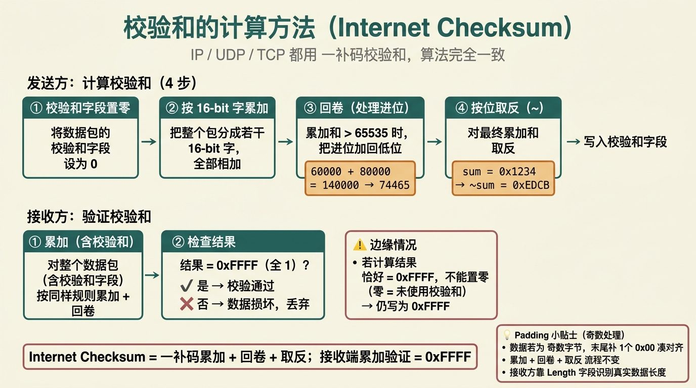

*图：发送方 4 步（置零 → 累加 → 回卷 → 取反）→ 接收方累加验证是否 0xFFFF；边缘情况：0xFFFF 不能置零（0x0000 保留为"未使用"）；Padding 小贴士：奇数字节末尾补 1 个 0x00 凑 16-bit 对齐，累加流程不变。*

---

<h4 style="font-size: 1.5em; font-weight: bold;">循环冗余校验（CRC）</h4>

**CRC 的工作原理**

CRC 将 **n 位消息数据浓缩为 c 位错误检测数据**（`c < n`）。例如：

- **1500 字节**（12,000 位）以太网帧使用 **4 字节（32 位）CRC**
- **USB 和蓝牙**采用 **16 位 CRC**

CRC 算法基于**多项式运算**，需要一个**固定的生成多项式 G(x)**。以 USB 使用的 CRC-16 为例：

$$G(x) = x^{16} + x^{15} + x^2 + 1$$

该多项式通常写作 `0x8005`（二进制 `1000 0000 0000 0101`，省略了最高位的 $x^{16}$ 系数 1）。

CRC 的**检测能力由校验位长度 c 决定，体现在两个方面**：


1. **概率性保障**（针对随机错误 / 长突发）

   对于任意随机数据包，其 CRC 值与正确值匹配的概率为 $2^{-c}$（漏检率）。例如使用 8 位 CRC 时，约 $1/256$（0.4%）的随机数据包会碰巧拥有相同的 CRC 值。**校验位越长，漏检概率呈指数级下降**——这也是**以太网选择 32 位 CRC 而非 16 位的原因之一**。

2. **确定性保障**（针对连续突发错误）

   c 位 CRC 能 **100% 保证检测所有长度不超过 c 的连续突发错误**；对于长度超过 c 的连续突发错误，则退化为概率性保障，漏检率为 $2^{-c}$。

**链路层广泛采用 CRC**，主要基于以下两点优势：

- **健壮性强**：CRC 对**突发错误**（连续多位翻转）的检测能力尤为出色，而**物理信道中的干扰往往以突发形式出现**，这使得 CRC 非常契合链路层的错误环境。
- **硬件实现高效**：CRC 计算可通过简单的**移位寄存器和异或门**实现，能够在数据包读写过程中**实时完成**，几乎不产生额外延迟开销。

---

**CRC 计算与校验步骤**

**发送端**：

1. **左移**：将原始数据 `M(x)` 左移 c 位（c 为 CRC 校验码位数，即生成多项式 $G(x)$ 的最高次幂），末尾补 c 个 0，得到：

$$M'(x) = M(x) \cdot x^c$$

2. **求余**：用 $G(x)$ 对 $M'(x)$ 做**模 2 除法**（本质是异或 / XOR 运算），所得 c 位余数 $R(x)$ 即为 CRC 校验码（若余数不足 c 位，则在左侧补 0）。
3. **组帧**：将 $R(x)$ 附加在原始消息后发送，即发送：

$$M(x) + R(x)$$

**接收端**：将收到的完整帧除以同一个 $G(x)$，若余数为 $0$，则**校验通过**；否则**数据有误**。

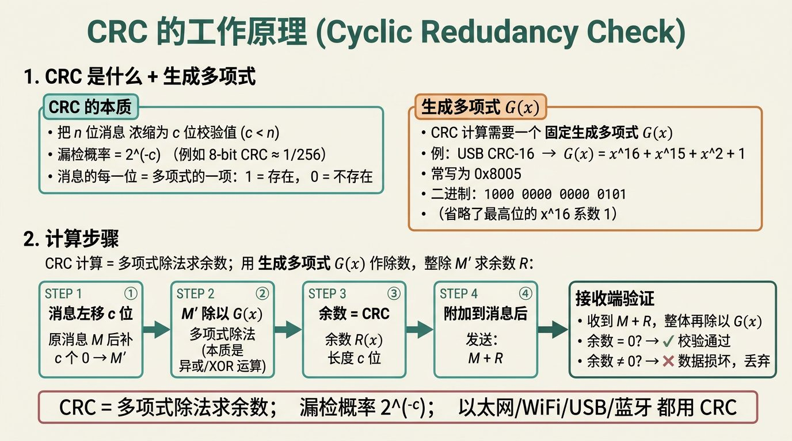

*图：CRC 全流程——1. CRC 本质（n→c）+ 生成多项式 $G(x)$；2. 计算 4 步（左移 → 模 2 除法 → 余数 R = CRC → 附加到消息后发送 $M+R$）+ 接收端整体再除以 $G(x)$ 验证余数是否为 0。底部红框点睛：CRC = 多项式除法求余数；漏检概率 $2^{-c}$；以太网 / WiFi / USB / 蓝牙都用 CRC。*

---

**CRC 计算示例**

以 16 位消息、4 位 CRC 为例走一遍完整流程：

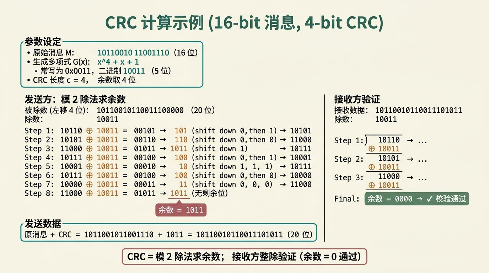

*图：参数设定（消息 M = `10110010 11001110`，$G(x) = x^4 + x + 1$ = `0x0011`，$c = 4$）→ 发送方模 2 除法 8 步求余数 = `1011` → 发送数据 = M + R = `10110010110011101011`（20 位）→ 接收方整除验证余数 = `0000` → 校验通过。*

---

<h4 style="font-size: 1.5em; font-weight: bold;">消息认证码（MAC）</h4>

**概述**

**MAC（消息认证码）**通过将数据包与一个**秘密密钥**结合，生成一个**唯一的校验值**。从理论上讲，**只有持有该密钥的实体才能生成或验证这一 MAC 值**。

当你收到一个数据包，且其 MAC 校验正确时，可以较为确信该数据包**确实来自掌握密钥的另一方**。除非攻击者获得了密钥，否则要**伪造**一个能通过 MAC 验证的新数据包，在**计算上是不可行**的。

正是基于这种**安全特性**，MAC 被广泛集成在**传输层安全协议（TLS）**中——这也是我们通过 **HTTPS** 安全浏览网页时所依赖的**核心技术**。

---

**MAC 的工作原理**

消息认证码（MAC）基于通信双方共享的一个**秘密密钥 S** 工作。

**生成过程**：将消息 `M` 与密钥 `S` 输入 MAC 算法，生成一个认证码 `C`：

```
C = MAC(M, S)
```

**三大核心安全属性**：

- **抗伪造性**：没有密钥 `S`，几乎无法为任何消息 `M` 生成正确的认证码 `C`。
- **抗逆向性**：给定 `C`，无法逆向推算出原始消息 `M`。
- **密钥隐匿性**：即使拥有大量 `(M, C)` 配对，也几乎无法获取关于密钥 `S` 的任何信息。

此外，MAC 算法具有**雪崩效应**——消息 `M` 中一个比特的变化，都会导致认证码 `C'` 发生**完全随机化的剧变**，从而使任何细微篡改都能被轻易察觉。

---

<h3 style="font-size: 2em; font-weight: bold;">2.6 有限状态机（Finite-State Machine）</h3>

---

<h4 style="font-size: 1.5em; font-weight: bold;">FSM 概述</h4>

有限状态机（FSM）是一种用于描述系统行为的**数学模型**，其核心在于系统在任意时刻只能处于**有限数量状态**中的某一个特定状态，例如一个简单的开关仅有"开"和"关"两种状态。

FSM 由**三大要素**构成：**状态**（系统在某一时刻的具体配置）、**事件**（触发状态转换的刺激）以及**动作**（转换时执行的可选行为）。状态间的转换遵循严格的**确定性规则**，表示为"**状态 A --[事件 / 动作]--> 状态 B**"，其中事件是**必须标明**的（不可为空），而动作是**可选的**（可以为空）；并且**同一状态下不能有两个转换由同一个事件触发**，否则会导致二义性；若当前状态下发生的事件没有对应转换，则系统行为被视为**未定义**。

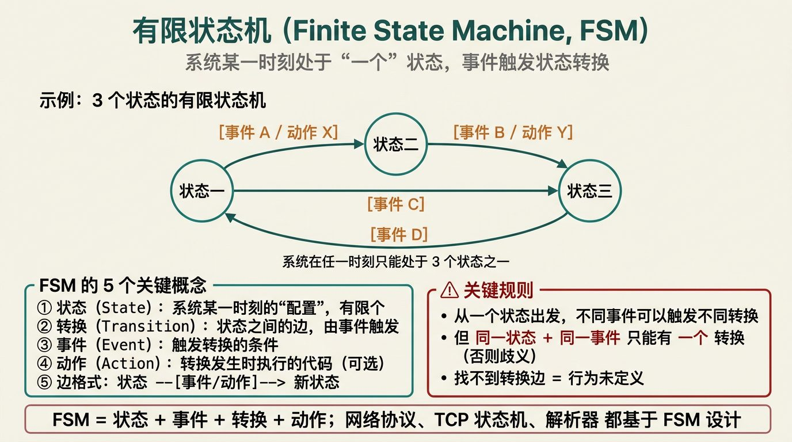

*图：3 个状态的有限状态机示例，展示了状态、事件、动作、转换边及关键规则*

---

<h4 style="font-size: 1.5em; font-weight: bold;">TCP 三次握手状态机</h4>

TCP 三次握手过程可以完整地用**有限状态机**来描述。

**前置条件**：客户端处于 **CLOSED**（尚未开始），服务器已调用 `listen()`，处于 **LISTEN**（监听等待）。

**第 1 步：客户端发起（主动打开）**

| 维度 | 内容 |
| --- | --- |
| 当前状态 | CLOSED |
| 触发事件 | 应用程序调用 `connect()` |
| 执行动作 | 客户端向服务器发送 **SYN** 报文 |
| 状态转换 | CLOSED → **SYN-SENT** |

**第 2 步：服务器响应（被动打开）**

| 维度 | 内容 |
| --- | --- |
| 当前状态 | LISTEN |
| 触发事件 | 服务器收到客户端发来的 **SYN** 报文 |
| 执行动作 | 服务器向客户端回复 **SYN-ACK** 报文 |
| 状态转换 | LISTEN → **SYN-RCVD** |

**第 3 步：客户端确认**

| 维度 | 内容 |
| --- | --- |
| 当前状态 | SYN-SENT |
| 触发事件 | 客户端收到服务器发来的 **SYN-ACK** 报文 |
| 执行动作 | 客户端向服务器发送 **ACK** 报文 |
| 状态转换 | SYN-SENT → **ESTABLISHED** |
| 备注 | 至此，客户端侧已完成连接，可以开始发送数据 |

**第 4 步：服务器收尾**

| 维度 | 内容 |
| --- | --- |
| 当前状态 | SYN-RCVD |
| 触发事件 | 服务器收到客户端发来的 **ACK** 报文 |
| 执行动作 | 无（纯状态切换） |
| 状态转换 | SYN-RCVD → **ESTABLISHED** |
| 备注 | 至此，服务器侧也完成连接 |

**最终状态**：双方均进入 **ESTABLISHED**，TCP 全双工连接建立完毕，可以开始双向数据传输。

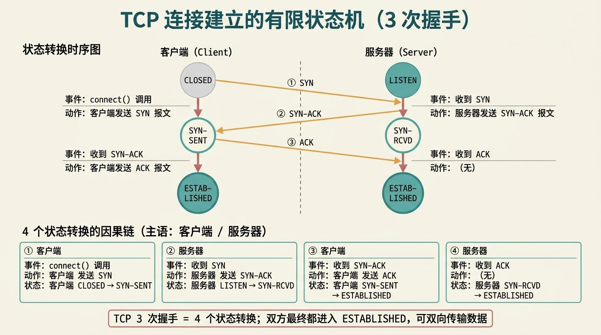

*图：TCP 三次握手的有限状态机视图——4 个状态转换、3 个报文交互，双方最终都进入 ESTABLISHED*

---

<h4 style="font-size: 1.5em; font-weight: bold;">TCP 四次挥手状态机</h4>

TCP 连接关闭同样可以用**有限状态机**来描述，由于关闭是**双向独立**的过程，因此比建立连接更复杂。

**前置条件**：双方均处于 **ESTABLISHED**（连接已建立，正常传输数据中）。

**第 1 步：客户端发起关闭（主动关闭）**

| 维度 | 内容 |
| --- | --- |
| 当前状态 | ESTABLISHED |
| 触发事件 | 客户端应用程序调用 `close()`（主动关闭） |
| 执行动作 | 客户端向服务器发送 **FIN** 报文（"我这边数据发完了"） |
| 状态转换 | ESTABLISHED → **FIN-WAIT-1** |
| 备注 | 此时客户端不再发送应用数据，但仍能接收来自服务器的数据 |

**第 2 步：服务器确认 FIN（被动关闭开始）**

| 维度 | 内容 |
| --- | --- |
| 当前状态 | ESTABLISHED |
| 触发事件 | 服务器收到客户端发来的 **FIN** 报文 |
| 执行动作 | 服务器立即回复 **ACK** 报文（确认收到关闭请求） |
| 状态转换 | ESTABLISHED → **CLOSE-WAIT** |
| 备注 | 服务器仍可继续发送数据，客户端会正常接收并确认 |

与此同时（客户端侧）：

| 维度 | 内容 |
| --- | --- |
| 当前状态 | FIN-WAIT-1 |
| 触发事件 | 客户端收到服务器回复的 **ACK** 报文 |
| 执行动作 | 无（纯状态切换） |
| 状态转换 | FIN-WAIT-1 → **FIN-WAIT-2** |
| 备注 | 客户端至此进入"半关闭"状态，等待服务器也关闭自己那一侧 |

**第 3 步：服务器发起关闭（被动关闭完成）**

| 维度 | 内容 |
| --- | --- |
| 当前状态 | CLOSE-WAIT |
| 触发事件 | 服务器 HTTP 响应发文完成，服务器应用程序调用 `close()`（关闭自己这一侧） |
| 执行动作 | 服务器向客户端发送 **FIN** 报文（"我这边也发完了"） |
| 状态转换 | CLOSE-WAIT → **LAST-ACK** |
| 备注 | 此时服务器也不再发送数据，等待客户端的最后确认 |

**第 4 步：客户端最终确认并进入等待**

| 维度 | 内容 |
| --- | --- |
| 当前状态 | FIN-WAIT-2 |
| 触发事件 | 客户端收到服务器发来的 **FIN** 报文 |
| 执行动作 | 客户端回复最后一个 **ACK** 报文 |
| 状态转换 | FIN-WAIT-2 → **TIME-WAIT** |
| 备注 | 客户端进入 **2MSL 等待期**（约 1~4 分钟），确保最后一个 ACK 不被丢失 |

与此同时（服务器侧）：

| 维度 | 内容 |
| --- | --- |
| 当前状态 | LAST-ACK |
| 触发事件 | 服务器收到客户端回复的最后一个 **ACK** 报文 |
| 执行动作 | 无（纯状态切换） |
| 状态转换 | LAST-ACK → **CLOSED** |
| 备注 | 服务器立即关闭，释放所有资源 |

**最终状态**：双方均进入 **CLOSED**，TCP 连接彻底终止，双方释放所有连接资源，不再进行任何数据传输。

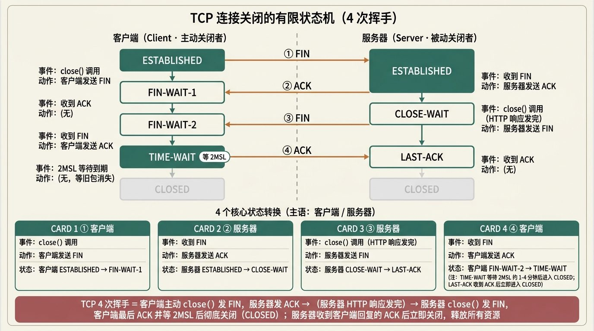

*图：TCP 四次挥手的有限状态机视图——客户端走 FIN-WAIT-1 → FIN-WAIT-2 → TIME-WAIT → CLOSED，服务器走 CLOSE-WAIT → LAST-ACK → CLOSED*

---

<h3 style="font-size: 2em; font-weight: bold;">2.7 停止-等待协议（Stop-and-Wait）</h3>

---

<h4 style="font-size: 1.5em; font-weight: bold;">概述</h4>

**流量控制**旨在解决**发送方速率远超接收方处理能力**时引发的丢包和资源浪费问题。其核心逻辑是：发送方**不应盲目发送**，而**必须与接收方的处理速度相匹配**。实现这一目标的关键在于，**接收方向发送方提供明确的速率反馈**（如减速、加速或维持），从而在避免数据丢失的同时，保障通信的可靠与高效。

---

<h4 style="font-size: 1.5em; font-weight: bold;">两种基本方法</h4>

目前大多数协议主要依靠以下两种方式来实现**流量控制**：

1. **停止-等待协议（Stop-and-Wait）**

    这是**最基础**的实现方式，逻辑**极其简单**。其工作模式为：发送方每发送一个数据包后，**必须等待接收方返回确认（ACK）**，才能继续发送下一个包。

2. **滑动窗口协议（Sliding Window）**

    它允许发送方在**未收到确认**的情况下，**连续发送多个数据包**（数量由"窗口大小"控制），接收方则通过确认和窗口通告来**动态调整**发送方的速率。

---

<h4 style="font-size: 1.5em; font-weight: bold;">停止-等待算法</h4>

**停止-等待协议的关键约束**在于：发送端在任一时刻**最多只能维持一个未完成确认的数据包**，即每发出一帧，必须等待接收端返回确认后方可发送下一帧。

**基本算法**如下：

1. 发送者发送一个数据包。
2. 然后等待接收者的确认（ACK）。
3. 当收到确认后，如果还有更多数据要发送，就发送下一个数据包。
4. 如果等待一段时间（即**超时**）后仍未收到确认，发送者就**假设数据包已丢失**（可能在网络中被路由器丢弃，或确认包被丢弃），然后它**重新发送该数据包**。

---

<h4 style="font-size: 1.5em; font-weight: bold;">停止-等待协议状态机</h4>

**接收者**有一个**单一状态**的有限状态机：

- **事件**：当它收到新数据时。
- **动作**：它为那个数据发送一个确认（ACK）。如果数据是新的，它还将这个数据**传递给上层应用程序**。

**发送者**的有限状态机有**两个状态**：

- **等待数据状态**：在此状态中，协议准备发送数据，但应用程序尚未提供要发送的数据。
    - **事件**：当应用程序调用发送函数时。
    - **动作**：协议发送包含该数据的包（或能装入包的最大数据量），然后进入"**等待 ACK 状态**"。

- **等待 ACK 状态**：在此状态中，有**两个可能的转换**：
    - **事件 1：收到确认（ACK）**
        - **动作**：回到"**等待数据状态**"。如果有更多数据要发送，就发送新数据；如果没有，就等待应用程序再次调用发送。
    - **事件 2：超时**
        - **动作**：**重新发送**之前的数据包，然后继续等待 ACK。

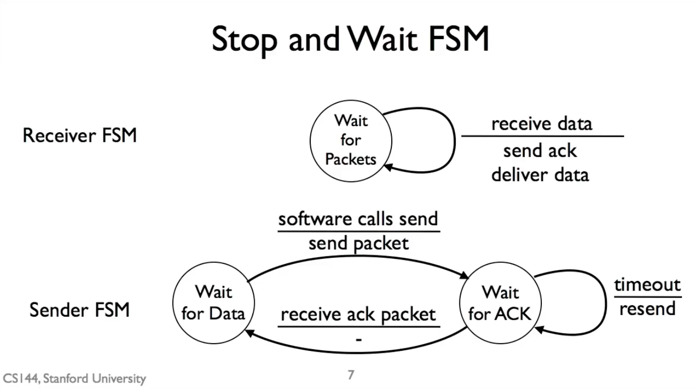

*图：Stop-and-Wait FSM——接收者单状态（自循环 receive data / send ack / deliver data），发送者两状态（Wait for Data ↔ Wait for ACK，含 timeout → resend 自环）*

---

<h4 style="font-size: 1.5em; font-weight: bold;">ACK延迟引发的“确认归属”歧义与1位序列号解法</h4>

**问题场景：ACK 严重延迟引发的歧义**

假设发送者使用停止-等待协议（发一包，等一 ACK，再发下一包）。

**第 1 步：发送 DATA 0**

发送者 → 接收者：**DATA 0**。接收者回复 **ACK 0**，但该 ACK 因网络拥堵迟迟未到达发送者。

**第 2 步：超时重传 DATA 0**

发送者等不到 ACK 0，触发超时，重传 **DATA 0**。此时网络中同时存在**原始 DATA 0** 与**重传 DATA 0**。

**第 3 步：延迟的 ACK 0 到达**

被拥堵的 ACK 0 终于到达。发送者认为 DATA 0 已成功送达，于是发送新数据 **DATA 1**。

**第 4 步：DATA 1 丢失，重传 DATA 0 到达接收者**

DATA 1 在途中**丢失**。重传的 DATA 0 到达接收者。接收者发现该包已收过，于是**再次回复 ACK 0**。

**第 5 步：发送者陷入困惑**

发送者收到 ACK 0，但无法判断：

- 这是确认**重传的 DATA 0**（旧包）？
- 还是确认**新发的 DATA 1**（实际已丢）？

若误判为确认 DATA 1，则不会重传 DATA 1，导致**数据永久丢失**。

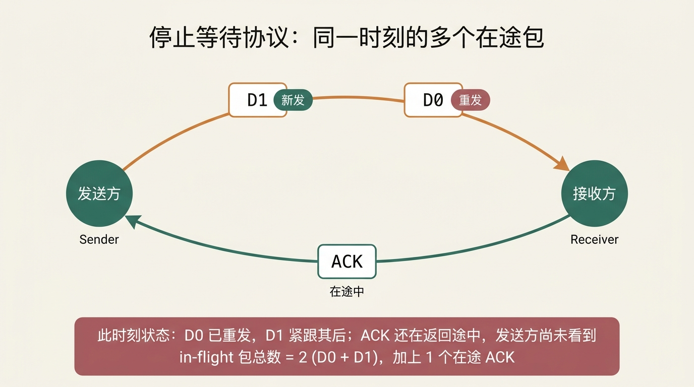

*图：停止-等待协议同一时刻的多个在途包——D0 已重发 + D1 紧跟其后 + ACK 还在返回途中，in-flight 包总数 = 2（D0 + D1）加上 1 个在途 ACK*

---

<h4 style="font-size: 1.5em; font-weight: bold;">解决方案：序列号</h4>

针对上述重复检测的问题，停止-等待协议可以使用一个**一位序列号（1-bit sequence number）**来解决。

**思路**是在所有数据包和确认包中都使用这个一位计数器。例如：

1. 发送者先发送 **数据 0（DATA 0）**。
2. 接收者回复 **确认 0（ACK 0）**。
3. 发送者然后发送 **数据 1（DATA 1）**。
4. 接收者回复 **确认 1（ACK 1）**。

也就是说：

- 发送数据包时**交替编号**：DATA 0 → DATA 1 → DATA 0 → DATA 1 ……
- 接收者回复确认时，使用**与数据包相同的编号**：收到 DATA 0 则回复 ACK 0，收到 DATA 1 则回复 ACK 1。

**带来的效果**：

- **对接收者而言**：通过检查数据包的**序列号**，就能直接判断这是**新数据**（期望收到的序号）还是**重复数据**（已经收过的序号），从而**避免重复递交上层**。
- **对发送者而言**：收到 ACK 时，根据其中的**序列号**（0 或 1）就能明确知道该确认对应的是哪一个数据包，从而**彻底消除**"这个 ACK 到底确认的是谁"的困惑。

---

<h3 style="font-size: 2em; font-weight: bold;">2.8 滑动窗口（Sliding Window）</h3>

---

<h4 style="font-size: 1.5em; font-weight: bold;">滑动窗口协议概述</h4>

滑动窗口协议允许发送方在收到 ACK 之前，**最多连续发送 n 个数据包**（即同时有 n 个包"在飞行中"）。

- 当 **n = 1** 时，**退化为 停止-等待 协议**。

- 当 n 取值合理时，发送方可以**持续发送数据**，将整个**传输管道"填满"**，使**吞吐量达到链路瓶颈带宽的上限**。

---

<h4 style="font-size: 1.5em; font-weight: bold;">发送方规则</h4>

**发送方维护的三个关键变量**

| 缩写 | 英文全称 | 中文含义 |
| --- | --- | --- |
| **LAR** | Last Acknowledgment Received | 最后收到的确认号 |
| **LSS** | Last Segment Sent | 最后发送的段号 |
| **SWS** | Send Window Size（Sender Window Size） | 发送窗口大小 |

---

**发送方窗口边界说明**

- **LAR 本身不在滑动窗口中**，它是窗口的**左边界标记**（位于窗口之外），标识"已经确认的截止位置"。

- 窗口内的数据范围为：**LAR + 1 到 LAR + SWS**（即从 LAR 的下一个序号开始，总共 SWS 个包）。

---

**发送方必须始终遵守的核心约束**：

$$LSS - LAR \le SWS$$

即：最后确认的包为 $n$ 时，发送方**不能发送序号超过 $n + SWS$ 的数据包**。

---

<h4 style="font-size: 1.5em; font-weight: bold;">发送方工作流程</h4>

1. **初始化**：**LAR = -1**，**LSS = -1**。

2. **发送数据**：只要 $LSS - LAR < SWS$，就可以发送下一个数据包（**序号 $LSS + 1$**），并更新 LSS。

3. **收到 ACK**：收到确认号为 $n$ 的 ACK 时，更新 $LAR = n$（假设为累积确认）。窗口随之**向前滑动**，腾出空间发送新数据包。

4. **超时重传**：若超时，**重传 $LAR + 1$ 号数据包**（即窗口中最旧的未确认包）。

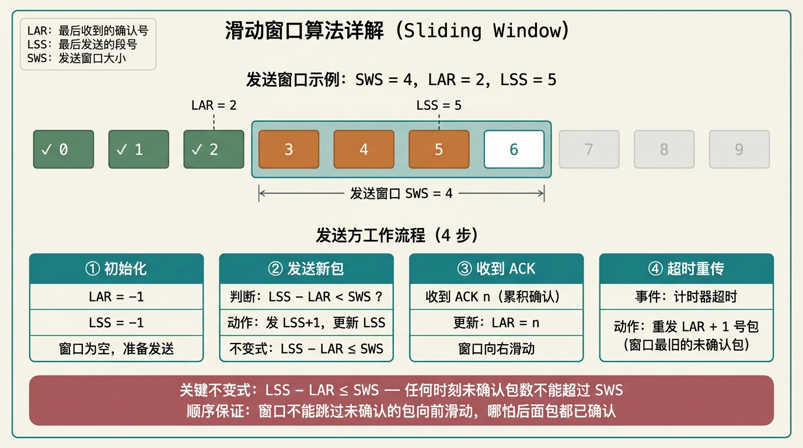

*图：滑动窗口算法详解——窗口快照（SWS=4, LAR=2, LSS=5，序号 0/1/2 已确认 ✓、3/4/5 已发送在飞、6 可发、7/8/9 等待） + 发送方 4 步工作流程 + 关键不变式 $LSS - LAR \le SWS$*

---

<h4 style="font-size: 1.5em; font-weight: bold;">接收方规则</h4>

**接收方维护的三个关键变量**

| 缩写 | 英文全称 | 中文含义 |
| --- | --- | --- |
| **LFR** | Last Frame Received | 最后接收的段号（连续收到的最大数据包序号） |
| **LAS** | Last Acceptable Segment | 最后可接受的段号（愿意接收的最大数据包序号） |
| **RWS** | Receive Window Size | 接收窗口大小 |

---

**窗口边界说明**

**LFR 本身不在滑动窗口中**，它是窗口的**左边界标记**（位于窗口之外），标识"已经按序接收的截止位置"。

窗口内的可接收范围为：**LFR + 1 到 LFR + RWS**。

---

**核心约束**：

$$LAS - LFR \le RWS$$

即：最后按序接收的包为 $n$ 时，接收方**愿意接收序号不超过 $n + RWS$ 的数据包**。

---

<h4 style="font-size: 1.5em; font-weight: bold;">接收方工作流程</h4>

1. **收到数据包**：收到序号为 $seq$ 的数据包。

2. **重复包处理**：如果 $seq \le LFR$，说明是**重复包**，**丢弃它**，但仍需发送一个 ACK（确认号为 $LFR$），以防之前的 ACK 丢失。

3. **超出窗口处理**：如果 $seq > LAS$，说明**超出接收窗口**，**直接丢弃**。

4. **窗口内合法包处理**：如果 $LFR < seq \le LAS$，则**接收该包并缓存**。若 $seq == LFR + 1$（即正是期望的下一个包），则**更新 LFR**，并可能**连续交付一批已按序到达的包**。

5. **回复 ACK**：无论是否接收数据包，接收方**通常会回送一个 ACK**，其中**其中携带的确认号等于当前的 LFR 值**。这表示接收方已成功接收了 $LFR$ 及之前的所有数据，并隐含地期望发送方接下来发送 $LFR + 1$。这就是**累积确认**。

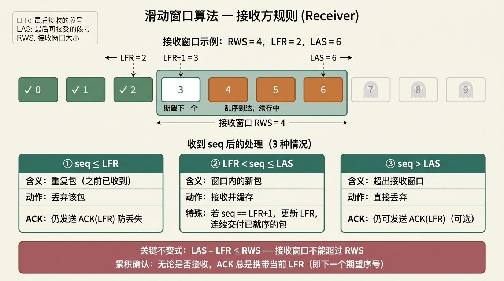

*图：滑动窗口算法——接收方规则（RWS=4, LFR=2, LAS=6，序号 0/1/2 已确认 ✓、3 期望下一个、4/5/6 乱序到达缓存中、7/8/9 超出窗口）+ 收到 seq 后 3 种处理情况 + 关键不变式 $LAS - LFR \le RWS$*

---

<h4 style="font-size: 1.5em; font-weight: bold;">累积确认</h4>

在基本的滑动窗口协议中，确认是**累积性**的。确认号 n 表示接收方已经正确收到了序号 **n 及之前的所有数据**。

- **优点**：简单，**ACK 丢失时冗余的后续 ACK 可以提供相同信息**。

- **缺点**：**无法精确告知哪些包丢失**。现代协议（如 TCP）有**选择性确认（SACK）**作为扩展来解决这个问题。

**注意**：TCP 确认号表示"**期望收到的下一字节序号**"，即确认 $n$ 则回复 $n + 1$。例如，收到 0-99 字节时，ACK 号为 100。

---

<h4 style="font-size: 1.5em; font-weight: bold;">序列号空间大小</h4>

我们需要多大的序列号范围来避免歧义？这与**窗口大小**有关。

- 在"停止-等待"（SWS=1, RWS=1）中，需要 **2 个序列号（0 和 1）**。

- 推广到滑动窗口，所需的序列号空间至少为：

    $$\text{序列号空间大小} \ge SWS + RWS$$

　　这是为了**区分是重传的老数据包，还是延迟到达的新数据包**。这里隐含了一个前提：**发送方和接收方公用同一个序列号空间**，即接收方也是用相同的序号范围来标记期待收到的数据包和缓存乱序到达的包，因此序列号空间必须同时**覆盖发送方可能发出的新包数量**和**接收方可能缓存的乱序包数量**。

　　一个特例是**回退 N 步（Go-Back-N）**协议，其中 **RWS = 1 但 SWS > 1**。此时，任何一个包丢失，发送方都需要**回退并重传其后已发送的整个窗口的数据**，效率较低。此时需要的序列号空间为：

$$\text{序列号空间} = SWS + 1$$

---

**补充说明（序号从 0 开始）**：在实际实现中，序列号通常从 **0 开始编号**。因此，如果计算出的所需序列号空间大小为 N，则实际可用的序列号集合为 **{0, 1, 2, …, N-1}**，共 N 个号码。

例如：

- **停止-等待（N=2）**：序列号为 **0 和 1**。
- **Go-Back-N 中若 SWS=4**，则 **N=5**，序列号为 **0, 1, 2, 3, 4**。

这意味着**最大序列号**（即模运算中的模数）**等于 N**，序列号在达到 N-1 后**回绕到 0**。

---

<h4 style="font-size: 1.5em; font-weight: bold;">TCP 中的滑动窗口</h4>

TCP 利用滑动窗口机制**同时实现流量控制与可靠传输**。

- **流量控制（动态调节发送窗口）**：接收方将自身可用**缓冲区大小**（以字节为单位）填入 TCP 头部中的**窗口大小（Window Size）**字段，并随确认报文一同发回。该值表示**从确认号算起，接收方当前还能接收的字节数**。发送方据此**动态调整其实际可用的发送窗口上限**（即有效 SWS），**避免淹没接收方**。

- **发送约束**：发送方在任何时刻都不得发送**序号超过"确认号 + 接收方通告窗口"的数据包**，确保**已发但未确认的数据量始终不超过对方接收能力**。

- **避免历史包歧义**：TCP 采用 **32 位**的序列号空间，即使在高带宽长延迟（高 BDP）网络中，也能**极大降低旧延迟包与新数据包因序号回绕而产生混淆的风险**，为可靠传输提供充足的序号冗余。

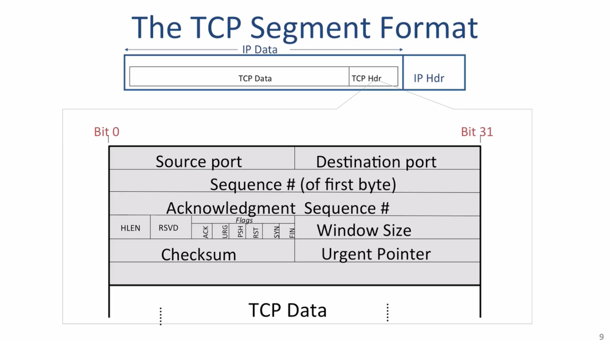

*图：TCP 报文段格式（TCP Segment Format）——源/目的端口、Sequence #（首字节序号）、Acknowledgment Sequence #（确认号）、窗口大小、HLEN/RSVD/Flags（ACK/URG/PSH/RST/SYN/FIN）、Checksum、Urgent Pointer，TCP Data 为载荷*

---

<h3 style="font-size: 2em; font-weight: bold;">2.9 可靠通信-重传策略（Reliable Communication – Retransmission Strategy）</h3>

---

<h4 style="font-size: 1.5em; font-weight: bold;">重传策略概述</h4>

　　在不可靠网络环境下，数据包在传输过程中有可能丢失。为了实现可靠的数据传输，传输协议必须具备**重传机制**。在滑动窗口协议的框架下，针对丢失数据的恢复，衍生出两种经典重传策略：

- **回退 N 帧（Go-Back-N）**——发现丢包就把后面的数据全重发一遍。
- **选择重传（Selective Repeat）**——丢了哪包就只重发哪包，精准高效。

---

<h4 style="font-size: 1.5em; font-weight: bold;">策略一：回退 N 帧（Go-Back-N）</h4>

　　**概述**：回退 N 帧（Go-Back-N, GBN）是一种相对保守的**自动重传请求（ARQ）**协议，其发送窗口大小大于 1，但**接收窗口仅为 1**，即接收方**仅按序接收数据**，对于**乱序到达的包直接丢弃，不予缓存**。

　　**核心处理逻辑**：当发生丢包时，若第 k 号数据包丢失，发送方将回退至该包，并重传从 k 到当前发送窗口右端之间的所有数据包。若在重传过程中**提前收到对 k 号包的确认（ACK）**，则**立即终止本轮重传**，转而基于当前最新的确认状态继续发送新数据。

　　**回退 N 帧（Go-Back-N）工作示例**：

1. 假设发送窗口 n=4，发送包 1、2、3、4。接收窗口 n=1（接收方只按序接收，乱序的包直接丢弃不缓存）。
2. 包 2 丢失。
3. 接收方收到包 1 → 回复 ACK 1；包 3、4 到达后因不是期望的包 2，被丢弃，并重复回复 ACK 1。
4. 发送方收到 ACK 1 → 窗口滑动至 [2, 5]，发送包 5。此时包 2 的计时器仍在运行。
5. 包 2 计时器超时 → 发送方回退至 2，重传整个窗口（包 2、3、4、5）。
6. 重传过程中若收到包 2 的 ACK → 立即中止本轮重传，继续发送新数据。

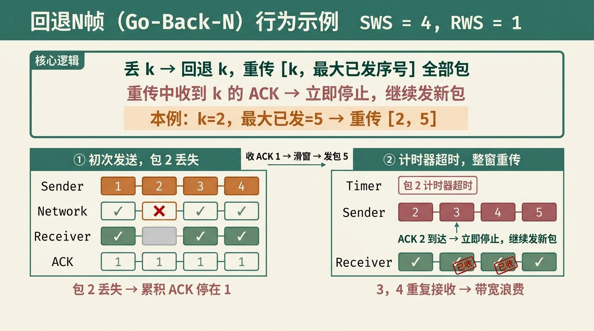

*图：回退 N 帧行为示例（SWS=4, RWS=1）——核心逻辑 + ① 初次发送（包 2 丢失 → 累积 ACK 停在 1）+ ② 计时器超时后整窗重传（重传中 ACK 2 到达 → 立即停止；3、4 重复接收 → 带宽浪费）*

---

<h4 style="font-size: 1.5em; font-weight: bold;">策略二：选择重传（Selective Repeat）</h4>

　　**概述**：选择重传是一种更为乐观的方法。其通常**发送窗口 > 1，接收窗口 > 1**（通常两者相等、缓存乱序包，仅重传丢失包）。它假设：如果一个包丢失，只有那个特定的包丢失了，窗口内的其他包可能已成功送达。

　　**核心处理逻辑**：如果检测到某个包丢失（未收到确认），发送方将**仅重传那个特定的包**，而不是整个窗口。发送窗口收到左边界包的 ACK（按序确认）滑动，接收窗口收到左边界包（期望序号）。**接收方缓存乱序包、ACK 独立、只重传丢失的那个包**。

　　**选择重传（Selective Repeat）工作示例**：

1. 发送方发包 1、2、3、4。
2. 包 2 丢失，包 1、3、4 到达。
3. 接收方（接收窗口 [1, 4]）
- 收到包 1 → 确认 ACK 1，窗口滑动至 [2, 5]。
- 收到包 3（乱序，期望 2）→ 缓存包 3，发送 ACK 3（或 NAK 2）。
- 收到包 4（乱序，期望 2）→ 缓存包 4，发送 ACK 4。
4. 发送方收到 ACK 3、ACK 4 → 知道包 3、4 已到达，但包 2 未确认。
5. 包 2 计时器超时 → 仅重传包 2（而非整个窗口）。
6. 接收方收到包 2 → 缓存中已有包 3、4，可按序交付包 2、3、4，窗口滑动。

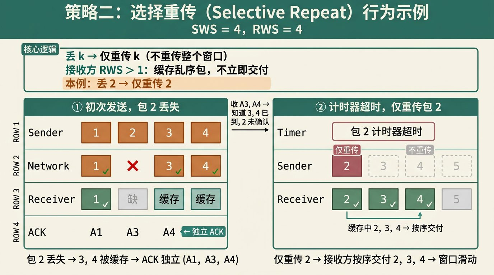

*图：选择重传行为示例（SWS=4, RWS=4）——核心逻辑（丢 k → 仅重传 k；接收方 RWS>1：缓存乱序包，不立即交付）+ ① 初次发送（包 2 丢失 → 3、4 被缓存 → ACK 独立 A1/A3/A4）+ ② 计时器超时（仅重传 2 → 接收方按序交付 2、3、4 → 窗口滑动）*

---

<h3 style="font-size: 2em; font-weight: bold;">2.10 可靠通信-TCP 头部（Reliable Communication - TCP Header）</h3>

---

<h4 style="font-size: 1.5em; font-weight: bold;">概述</h4>

　　**TCP 头部**是附加在 TCP 数据段前面的信息，用于**管理连接、确保数据顺序和完整性**。标准的 TCP 头部长度为 **20 字节**，包含**源端口、目的端口、序列号、确认号**以及**多个控制标志**等重要信息。

---

<h4 style="font-size: 1.5em; font-weight: bold;">TCP 头部结构</h4>

　　标准的 TCP 头部长度为 **20 字节**。其结构通常可视化为**五行**，**每行包含四个八位字节**（即每行 32 bits）。

　　此外，TCP 头部之后还可以包含**选项字段**，但本教程主要关注基本的 20 字节头部结构。

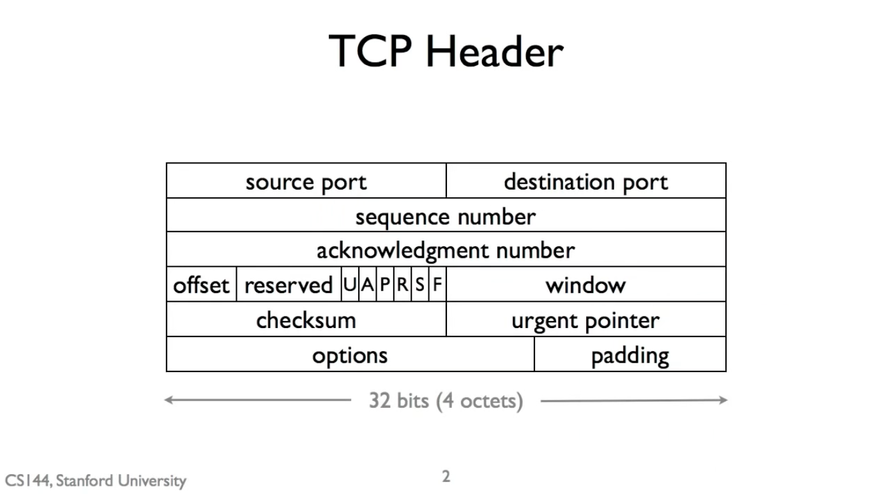

*图：TCP Header 字段布局（20 字节 = 5 行 × 4 八位字节）——source port / destination port / sequence number / acknowledgment number / offset / reserved / U·A·P·R·S·F 标志位 / window / checksum / urgent pointer / options / padding*

---

<h4 style="font-size: 1.5em; font-weight: bold;">TCP 报文段头部字段详解</h4>

| 字段 | 说明 |
| --- | --- |
| **源端口**（Source Port） | 用于**标识发送数据的应用程序**。 |
| **目的端口**（Destination Port） | 用于**标识接收数据的应用程序**。 |
| **序列号**（Sequence Number） | 表示**本数据段中第一个数据字节的编号**。 |
| **确认号**（Acknowledgment Number） | 表示**接收方期望收到的下一个字节的编号**。**等于已成功接收的最后一个字节的序号加 1**。 |
| **ACK**（确认 / Acknowledgment） | 当设置为 1 时，表示**确认号字段有效**。**除了建立连接的初始 SYN 包，TCP 通信中几乎所有的包都应设置此位**。 |
| **SYN**（同步 / Synchronize） | 在**连接建立**时使用。发送方设置此位以**发起连接，并指明其初始序列号**。 |
| **FIN**（结束 / Finish） | 当设置为 1 时，表示**发送方已完成数据发送，希望关闭连接**。 |

---

<h4 style="font-size: 1.5em; font-weight: bold;">TCP 三次握手与数据传输示例</h4>

| 步骤 | 方向 | 标志位 | Seq | Ack | 数据长度 | 解释 |
| :--- | :--- | :--- | :--- | :--- | :--- | :--- |
| 1 | 客户端→服务器 | **SYN** | 100 | — | 无 | 客户端发起连接，ISN=100。**SYN 标志位占 1 个字节的序列号空间**，消耗了序号 100 |
| 2 | 服务器→客户端 | **SYN+ACK** | 500 | 101 | 无 | 服务器回复，ISN=500。**SYN 标志位占 1 个字节的序列号空间**，消耗了序号 500；**Ack=101** 确认收到客户端的 SYN（100），期待客户端下次从 **101** 开始发送 |
| 3 | 客户端→服务器 | **ACK** | 101 | 501 | 无 | 客户端确认收到服务器的 SYN（500），**Ack=501**，期待服务器下次从 **501** 开始发送。此步 **SYN=0（无 SYN 标志）**，为**纯 ACK**，**不消耗序列号**，所以 **Seq 保持为 101**，连接建立完成 |
| 4 | 客户端→服务器 | **ACK** | 101 | 501 | **100 字节** | 客户端发送 100 字节数据，序列号从 **101** 开始（接续第 3 步的 Seq）。由于纯 ACK 不消耗序列号，所以数据从 **101** 开始是正确的。**Ack=501** 保持不变，因为服务器自 SYN 后尚未发送新数据 |
| 5 | 服务器→客户端 | **ACK** | 501 | 201 | 无 | 服务器确认收到客户端的 **100 字节**（序号 **101~200**），**Ack=201**，期待客户端下次从 **201** 开始发送 |
| 6 | 客户端→服务器 | **ACK** | 201 | 501 | **200 字节** | 客户端继续发送 **200 字节**数据，序列号从 **201** 开始（接续第 5 步的 **Ack 期待值 201**）**Ack=501** 仍保持不变，因为服务器依然没有发送新数据，客户端仍在等待服务器从 501 开始发 |

---

<h4 style="font-size: 1.5em; font-weight: bold;">TCP 序列号与确认号核心机制</h4>

| 核心概念 | 归属方向 | 作用 | 关键规则 |
| :--- | :--- | :--- | :--- |
| **Sequence Number** | **本端发送**的数据 | 告诉对方"我这个包里的数据从几号开始" | ① 握手阶段（SYN=1）存放 **ISN**；② 数据传输阶段（SYN=0）存放的是当前数据字节的编号（从 ISN 开始累加） |
| **Acknowledgment Number** | **向对端发送**的数据确认 | 告诉对方"你之前发的数据我收到几号了，下一个请发几号" | 确认号 = 已成功接收的最后一个字节序号 + 1 |
| **SYN 包特殊性** | 控制信号 | 发起连接请求，同步初始序列号 | **不携带数据但消耗 1 个序列号**，因此对方回复的 ACK 必须为 **ISN + 1** |

---

<h3 style="font-size: 2em; font-weight: bold;">2.11 可靠通信—连接建立与拆除（Reliable Communication — Connection Establishment and Teardown）</h3>

---

<h4 style="font-size: 1.5em; font-weight: bold;">连接建立：三次握手（3-Way Handshake）</h4>

　　三次握手模型中，我们有一个**主动发起方**和一个**被动接收方**。主动发起方（如 Web 客户端）发起连接；被动接收方（如 Web 服务器）监听并等待连接请求。

　　以下是握手步骤的分解：

　　**1. SYN**：主动发起方发送一个设置 **SYN=1** 的 TCP 报文段。这表示它希望将被动方的序列号同步到流的起始位置。报文段中包含一个初始序列号，我们称之为 $seq = S_A$。

　　**补充说明（ISN 随机化）**：使用随机化的初始序列号 $S_A$ 而非从 0 开始，主要出于**安全考虑**（防止他人猜测并插入数据），以及**避免网络中延迟的旧报文段造成混淆**。

　　**2. SYN-ACK**：被动接收方回应一个设置 **SYN=1, ACK=1** 的报文段。它说："好的，我收到了你的 SYN。我的起始序列号是 $seq = S_P$。" 同时，它通过 $ack = S_A + 1$ 来确认已收到主动方的 SYN。

　　**关键规则（确认号）**：**确认号 ack 总是期望收到的下一个字节的序列号**。

　　**3. ACK**：主动发起方响应。它不需要再发送 SYN，因为同步已完成。因此它发送一个设置 **ACK=1** 的报文段，其序列号为 $seq = S_A + 1$，确认号为 $ack = S_P + 1$。这表示："我已收到你的 SYN，现在确认这个初始报文段。"

　　**补充说明（0 字节）**：通常这个报文段**长度为 0**（不携带数据），仅用于完成连接建立。

　　**总结**：这就是基本的三次握手过程：**SYN → SYN-ACK → ACK**。至此，一个简单的三次握手完成，双方已同步起始序列号。随后数据传输开始——例如一个 GET 请求包。

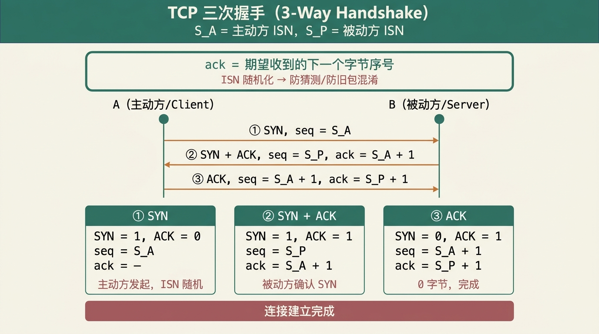

*图：TCP 三次握手（3-Way Handshake）——A 主动方 $S_A$ / B 被动方 $S_P$；① SYN（SYN=1, $seq=S_A$）→ ② SYN+ACK（$seq=S_P$, $ack=S_A+1$）→ ③ ACK（$seq=S_A+1$, $ack=S_P+1$, 0 字节），连接建立完成；ack 总是期望收到的下一个字节序号；ISN 随机化 → 防猜测 / 防旧包混淆*

---

<h4 style="font-size: 1.5em; font-weight: bold;">连接拆除：四次挥手（4-Way Handshake）</h4>

　　当 TCP 发送一个包含 **FIN=1** 的报文段时，意味着**发送方没有更多数据要发送**（流结束）。但 TCP 连接是**双向的**，必须**双方都完成数据发送并交换 FIN 后，连接才能完全终止**。

　　典型的连接拆除（四次挥手）交换过程如下（假设 A 先发起关闭）：

　　**1. FIN from A**：A 发送一个 **FIN=1, ACK=1** 的报文段，序列号为 $seq = S_A$，确认之前的数据。

　　**2. ACK from B**：B 收到后，发送一个 **ACK=1** 的报文段进行确认，$ack = S_A + 1$。

　　**3. FIN from B**：一段时间后，B 也准备关闭，发送自己的 **FIN=1, ACK=1** 报文段，序列号为 $seq = S_B$。

　　**4. ACK from A**：A 收到 B 的 FIN 后，发送最终的 **ACK=1** 报文段进行确认，$ack = S_B + 1$。

　　**补充说明（TIME_WAIT 状态）**：主动发起关闭的一方在发送完最后一个 ACK 后，会进入此状态，并**等待一段时间（通常是 2 倍的最大报文段寿命，约 2 分钟）**，然后才完全关闭连接。

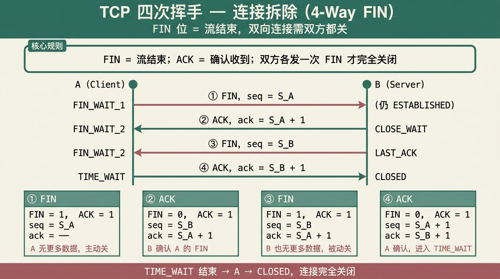

*图：TCP 四次挥手 — 连接拆除（4-Way FIN）——核心规则：FIN = 流结束、ACK = 确认收到、双方各发一次 FIN 才完全关闭；A 状态：FIN_WAIT_1 → FIN_WAIT_2 → FIN_WAIT_2 → TIME_WAIT；B 状态：(仍 ESTABLISHED) → CLOSE_WAIT → LAST_ACK → CLOSED；① FIN（$seq=S_A$, A 主动关）→ ② ACK（$ack=S_A+1$, B 确认 A 的 FIN）→ ③ FIN（$seq=S_B$, B 被动关）→ ④ ACK（$ack=S_B+1$, A 进入 TIME_WAIT）；TIME_WAIT 结束 → A → CLOSED*

---

<h4 style="font-size: 1.5em; font-weight: bold;">TCP 三次握手与数据传输示例</h4>

| 步骤 | 方向 | 标志位 | Seq | Ack | 数据长度 | 解释 |
| :--- | :--- | :--- | :--- | :--- | :--- | :--- |
| 1 | 客户端→服务器 | **SYN** | 100 | — | 无 | 客户端发起连接，ISN=100。**SYN 标志位占 1 个字节的序列号空间**，消耗了序号 100 |
| 2 | 服务器→客户端 | **SYN+ACK** | 500 | 101 | 无 | 服务器回复，ISN=500。**SYN 标志位占 1 个字节的序列号空间**，消耗了序号 500；**Ack=101** 确认收到客户端的 SYN（100），期待客户端下次从 **101** 开始发送 |
| 3 | 客户端→服务器 | **ACK** | 101 | 501 | 无 | 客户端确认收到服务器的 SYN（500），**Ack=501**，期待服务器下次从 **501** 开始发送。此步 **SYN=0（无 SYN 标志）**，为**纯 ACK**，**不消耗序列号**，所以 **Seq 保持为 101**，连接建立完成 |
| 4 | 客户端→服务器 | **ACK** | 101 | 501 | **100 字节** | 客户端发送 100 字节数据，序列号从 **101** 开始（接续第 3 步的 Seq）。由于纯 ACK 不消耗序列号，所以数据从 **101** 开始是正确的。**Ack=501** 保持不变，因为服务器自 SYN 后尚未发送新数据 |
| 5 | 服务器→客户端 | **ACK** | 501 | 201 | 无 | 服务器确认收到客户端的 **100 字节**（序号 **101~200**），**Ack=201**，期待客户端下次从 **201** 开始发送 |
| 6 | 客户端→服务器 | **ACK** | 201 | 501 | **200 字节** | 客户端继续发送 **200 字节**数据，序列号从 **201** 开始（接续第 5 步的 **Ack 期待值 201**）。**Ack=501** 仍保持不变，因为服务器依然没有发送新数据，客户端仍在等待服务器从 501 开始发 |

---

<h4 style="font-size: 1.5em; font-weight: bold;">TCP 传输中 Seq/Ack 保持不变的规则</h4>

　　**核心规则**：在 TCP 传输过程中，若发送方未向接收方发送**新数据**，则**发送方 Seq 不变，接收方 Ack 不变**。

---

<h4 style="font-size: 1.5em; font-weight: bold;">TCP 四次挥手完整过程（含状态迁移）</h4>

| 步骤 | 方向 | 标志位 | Seq | Ack | 数据长度 | 发送方状态变化 | 接收方状态变化 | 解释 |
|------|------|--------|-----|-----|----------|----------------|----------------|------|
| 1 | 客户端 → 服务器 | **FIN** | 201 | 501 | 无 | ESTABLISHED → **FIN_WAIT_1** | ESTABLISHED（不变） | 客户端主动关闭，发送 FIN，消耗序号 201。表示"我不再发数据了"，但仍可收数据 |
| 2 | 服务器 → 客户端 | **ACK** | 501 | 202 | 无 | FIN_WAIT_1 → **FIN_WAIT_2** | ESTABLISHED → **CLOSE_WAIT** | 服务器确认 FIN，Ack=202（201+1）。此时服务器知道客户端不再发数据，但自己可能还有数据要发（若有则继续发），所以进入 CLOSE_WAIT |
| （可选） | 服务器 → 客户端 | 数据（若有） | 501~xxx | 202 | 剩余数据 | 不变（FIN_WAIT_2） | CLOSE_WAIT（不变） | 如果服务器还有未发完的数据，此时可以继续发送，客户端仍接收并确认（因为客户端尚未关闭接收） |
| 3 | 服务器 → 客户端 | **FIN** | 501（或新序号） | 202 | 无 | （被动方不发） | CLOSE_WAIT → **LAST_ACK** | 服务器数据发完，发送 FIN，消耗序号 501（若之前未发数据则 Seq=501；若发了数据则 Seq 相应增加）。表示服务器也准备关闭 |
| 4 | 客户端 → 服务器 | **ACK** | 202 | **502** | 无 | FIN_WAIT_2 → **TIME_WAIT**（持续 2MSL） | LAST_ACK → **CLOSED**（收到 ACK 后） | 客户端确认服务器的 FIN，Ack=502（501+1）。客户端进入 TIME_WAIT，等待 2MSL（确保 ACK 能到达，且让旧报文在网络中消失）。服务器收到 ACK 后立即关闭 |
| 5 | （等待 2MSL 后） | — | — | — | — | TIME_WAIT → **CLOSED** | 已 CLOSED | TIME_WAIT 结束后，客户端正式关闭，释放端口资源 |

---

<h4 style="font-size: 1.5em; font-weight: bold;">完整的 TCP 有限状态机（FSM）</h4>

　　现在，我们把连接建立和拆除的所有状态组合起来，就得到了**完整的 TCP 有限状态机**。它看起来复杂，但可以清晰地分为两大部分：

　　**第一部分：连接建立（5 状态）**

- **CLOSED**：初始状态。
- **LISTEN**：服务器端**被动打开**后进入监听状态。
- **SYN_SENT**：客户端**主动发送 SYN** 后进入的状态。
- **SYN_RCVD**：服务器**收到 SYN 并回复 SYN-ACK** 后进入的状态。
- **ESTABLISHED**：连接建立成功，双方可进行数据传输。

　　**路径包括**：标准三次握手、同时打开（四报文交换）。

　　**第二部分：连接拆除（6 状态）**

- **FIN_WAIT_1**：应用发起关闭，**发送 FIN 后进入**。
- **FIN_WAIT_2**：**收到对方对己方 FIN 的 ACK** 后进入（但未收到对方的 FIN）。
- **CLOSE_WAIT**：**收到对方的 FIN 并发送 ACK** 后进入（己方还未发起关闭）。
- **LAST_ACK**：在 CLOSE_WAIT 状态的应用也发起关闭，**发送 FIN 后进入**。
- **TIME_WAIT**：主动关闭方在**发送完最终 ACK 后进入**，等待 2MSL。
- **CLOSED**：最终状态，连接完全关闭，资源释放。

　　**总结**：

- **建立**：客户端 / 服务器各自路径，最终都到 **ESTABLISHED**。
- **拆除**：主动方（此处为客户端）进 **TIME_WAIT**，被动方（此处为服务器）直入 **CLOSED**。

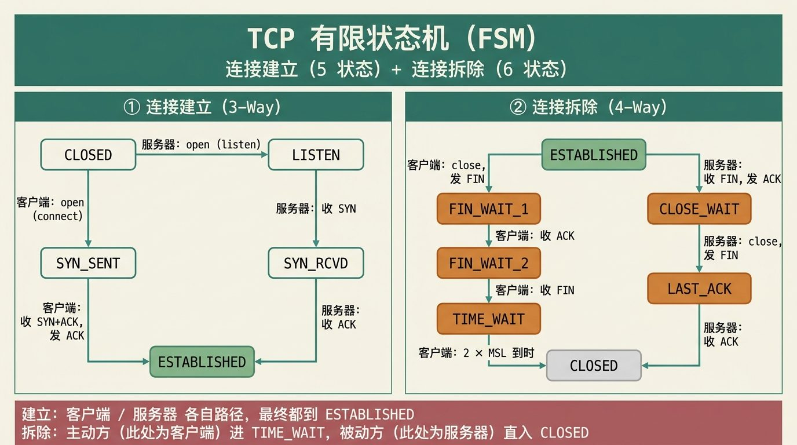

*图：TCP 有限状态机（FSM）——连接建立（5 状态）+ 连接拆除（6 状态）；① 连接建立（3-Way）：CLOSED → LISTEN / SYN_SENT → SYN_RCVD → ESTABLISHED；② 连接拆除（4-Way）：ESTABLISHED → FIN_WAIT_1 / CLOSE_WAIT → FIN_WAIT_2 / LAST_ACK → TIME_WAIT → CLOSED；建立路径：客户端 / 服务器 各自到 ESTABLISHED；拆除路径：主动方进 TIME_WAIT，被动方直入 CLOSED*

