# 第 3 章：路由与转发

<h3 style="font-size: 2em; font-weight: bold;">3.1 网络历史（The History of Networks and the Internet）</h3>

---

<h4 style="font-size: 1.5em; font-weight: bold;">一、早期通信方式（约公元前 1000 年起）</h4>

以**烽火信号塔**和**信使系统**为代表。烽火传递迅速但信息量极少（仅"危险 / 安全"两种状态）；信使、马匹和信鸽能携带更多信息，但速度慢且易被拦截。这些方式受限于**物理距离**和**安全性**。

---

<h4 style="font-size: 1.5em; font-weight: bold;">二、光学电报的突破（18 世纪末）</h4>

克劳德·夏普（Claude Chappe）于 1793 年发明**信号机**（光学电报），利用**可调臂杆**编码字母和数字，实现**光速传输**。法国建成大规模网络，并首次引入**协议**概念，包括：

- **代码**：将消息编码为可传输的形式
- **流量控制**：协调发送与接收节奏
- **同步**：保证双方步调一致
- **错误纠正与重传**：应对传输差错
- **加密**：保障通信安全

这些成为现代网络通信的基石。

---

<h4 style="font-size: 1.5em; font-weight: bold;">三、通信网络的四个发展阶段</h4>

从预定义消息（烽火）→ 可编码任意字母的系统 → 数字代码压缩常见词句 → 为控制信号开发专用代码（即协议），逐步构建了双方通信的标准化规则。

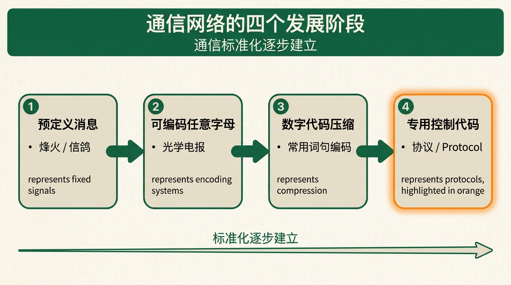

*图：通信网络标准化演进的四个阶段——从固定信号到可编码系统，再到协议化控制。*

---

<h4 style="font-size: 1.5em; font-weight: bold;">四、电话的发明（19 世纪末）</h4>

贝尔（Alexander Graham Bell）于 1876 年传输**首次语音通话**，电话迅速普及，为全球**实时语音通信**奠定基础，也加速了后续网络技术的演进。

---

<h4 style="font-size: 1.5em; font-weight: bold;">五、阿帕网与互联网的诞生（1960 年代起）</h4>

受"星际网络"概念启发，DARPA 推动 **ARPANET** 项目。1969 年，首条消息在**四所大学**间通过 ARPANET 发送，标志着现代互联网的雏形诞生。同期，**分组交换网络**（如 ALOHAnet、CYCLADES）涌现。

---

<h4 style="font-size: 1.5em; font-weight: bold;">六、协议标准化与万维网（1970—1990 年代）</h4>

瑟夫（Vint Cerf）和卡恩（Bob Kahn）提出 **TCP/IP 协议**，1983 年全面部署，统一了网络互联标准。**NSFNET** 连接全美科研机构，主机数量激增。

1990 年，伯纳斯-李（Tim Berners-Lee）发明**万维网**（WWW），1993 年 **Mosaic 浏览器**问世，互联网迅速走向大众，雅虎、谷歌、亚马逊等成为时代标志。

---

**总结**：通信史经历了从**物理信号**→**光学编码**→**电声传输**→**分组交换**→**全球互联**的演进，每一次突破都依赖于**协议创新与标准化**，最终形成了今日覆盖全球、功能丰富的互联网生态。

<h3 style="font-size: 2em; font-weight: bold;">3.2 分组交换-原理：什么是分组交换（What is Packet Switching）</h3>

---

<h4 style="font-size: 1.5em; font-weight: bold;">分组交换的基本过程</h4>

假设左边的笔记本电脑要与右边的服务器通信。在分组交换中，通信过程如下：

  1. 发送方将数据块**封装成分组**，分组包含**数据和头部**。头部中最重要的信息是**目的地地址**。
  2. 分组被送入网络，由沿途的**分组交换机**（如路由器）根据其内部的**转发表**，**逐跳地转发**到目的地。
  3. 每个分组交换机查看分组的目的地址，查询转发表，决定将其发送到哪一个"下一跳"。

例如，一个分组的目的地址是 B。当它到达交换机 S1 时，S1 查询自己的转发表，发现地址 B 的下一跳是 S2，于是将分组发送给 S2。S2 再根据自己的转发表，将分组转发给 S4，最终到达目的地。

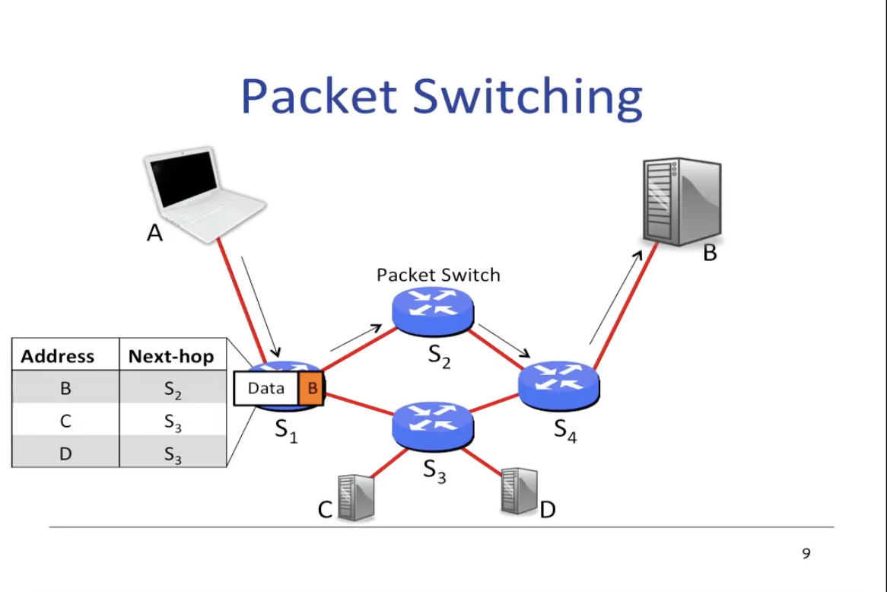

*图：分组交换示意图：分组从 A 出发，经 S1→S2→S4 到达 B。S1 的转发表显示地址 B 的下一跳为 S2。*

---

<h4 style="font-size: 1.5em; font-weight: bold;">分组交换机的关键组件</h4>

分组交换机（如路由器）内部有两个关键部分：

- **转发表**：用于查询每个分组应该被转发到哪个输出链路。
- **缓冲区**：用于临时存储分组。当多个分组同时到达并竞争同一个输出链路时，来不及发送的分组需要在缓冲区中**排队等待**。

---

<h4 style="font-size: 1.5em; font-weight: bold;">分组交换的特点总结</h4>

以下是分组交换的主要特征：

- 分组由路由器根据**本地转发表**单独路由。
- 所有分组**共享链路的全部容量**，**突发流量**可以高效利用带宽。
- 路由器不维护每条通信的特定状态，只维护**通用的转发表**，简化了网络管理。

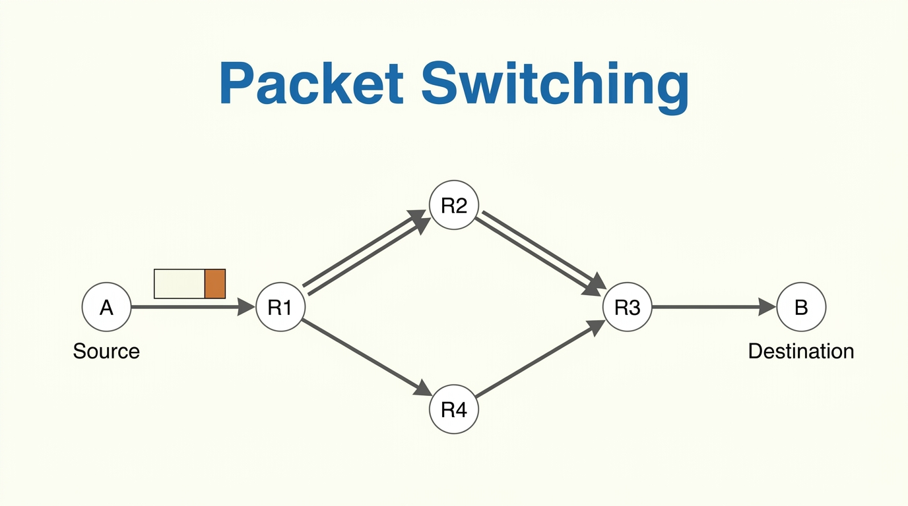

*图：分组从 A（Source）出发，沿 R1→R2→R3（或 R1→R4→R3）逐跳转发到 B（Destination）。每个路由器独立决定下一跳，不维护每条通信的状态。*

<h3 style="font-size: 2em; font-weight: bold;">3.3 分组交换-原理：术语，端到端延迟与排队（Terminology, End-to-End Delay and Queuing）</h3>

---

<h4 style="font-size: 1.5em; font-weight: bold;">传播时延（Propagation Delay）</h4>

传播时延是指**一个比特**在链路上以传播速度 c 从一端旅行到另一端所需的时间。

传播时延 t_l 的计算公式为：

$$t_l = \frac{l}{c}$$

其中：

- **l**：链路长度（米，m）
- **c**：传播速度（米/秒，m/s）

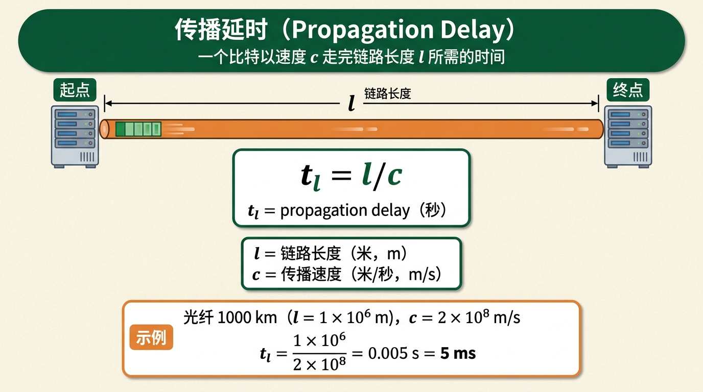

*图：传播时延 $t_l = \frac{l}{c}$：以光纤 1000 km、c = 2×10⁸ m/s 为例，$t_l$ = 5 ms。*

---

<h4 style="font-size: 1.5em; font-weight: bold;">传输时延（Transmission Delay）</h4>

传输时延是指将分组的**第一个比特**放入链路开始，到**最后一个比特**也被放入链路为止所经历的时间。传输时延**仅取决于**数据包的长度和链路的数据率，**与链路的长度或传播速度无关**。

传输时延 t_p 的计算公式为：

$$t_p = \frac{p}{r}$$

其中：

- **p**：数据包的比特长度（比特，bit）
- **r**：链路的数据率（比特/秒，bps），**数据率 r 决定了我们向链路"注入"比特的速度**。速率越高，传输时延越短

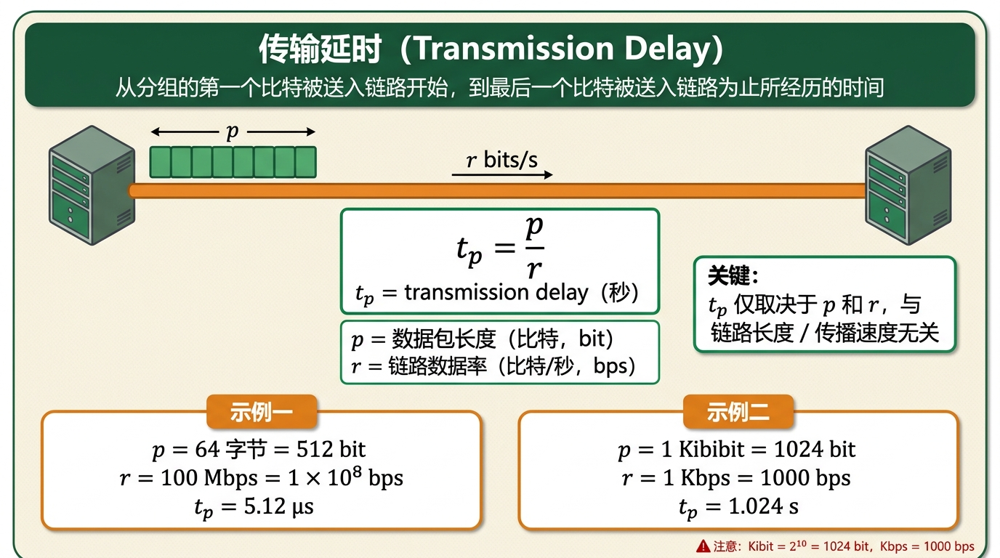

*图：传输时延 $t_p = \frac{p}{r}$：示例一 5.12 μs（100 Mbps 高速链路），示例二 1.024 s（1 Kbps 极慢链路）。*

---

<h4 style="font-size: 1.5em; font-weight: bold;">端到端时延（End-to-End Delay）</h4>

端到端时延是指从源主机在链路上发送数据包的**第一个比特**开始，到目的主机接收到数据包的**最后一个比特**为止所经历的总时间。

在由多个**存储转发**路由器（交换机）构成的路径上，总时延是路径上每一段链路（或称"跳"）的时延之和。对于每一跳 i，其贡献的时延包括：

- 在该链路上的**传播时延** l_i / c
- 在该链路上的**传输时延** p / r_i

因此，不考虑排队时延的端到端时延 T 的表达式为：

$$T = \sum_i \left( \frac{l_i}{c} + \frac{p}{r_i} \right)$$

让我们通过一个时间线图来详细理解这个过程。假设数据包从 A 经过交换机 S1、S2 到达 B，穿越了三条链路：

1. **第一跳（A → S1）**：第一个比特需要 l_1 / c 时间到达 S1；在 p / r_1 时间后，最后一个比特被放入链路；在时间 l_1/c + p/r_1，整个数据包到达 S1。S1 作为**存储转发**设备，需要等待整个包到达后才开始处理并转发（所以**传播时延和传输时延不会重叠**）。
2. **第二跳（S1 → S2）**：重复类似过程。第一个比特需要 l_2 / c 时间从 S1 到达 S2；最后一个比特在 p / r_2 时间后到达 S2。
3. **第三跳（S2 → B）**：过程同上。

将每一跳的时延相加，就得到了**总端到端时延**。

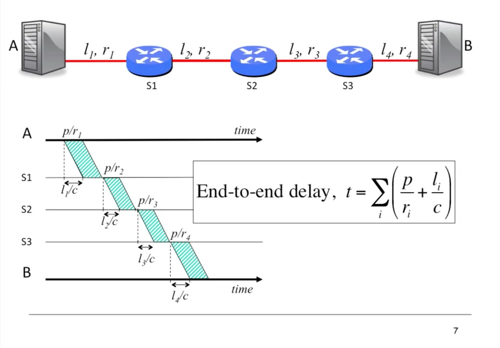

*图：端到端时延时间线：3 跳路径（A→S1→S2→B），每跳独立叠加传播时延 l_i/c 和传输时延 p/r_i；存储转发要求整包到达下一跳后才开始转发，两种时延不重叠。*

---

<h4 style="font-size: 1.5em; font-weight: bold;">排队时延（Queuing Delay）</h4>

然而在分组交换网络中，链路是被多个用户的数据包共享的。这就引入了端到端时延中的**第三个组成部分：排队时延**。

当多个数据包同时到达一个路由器，并希望使用同一个出站链路时，它们必须进行"**竞争**"。路由器内部设有**包缓冲区**（或**队列**）。数据包按照**先到先服务**（FIFO）的原则在队列中等待链路空闲。

排队时延 Q_i(t) 是指数据包在路由器 i 的队列中等待被转发的时间。这个时间值 t 表示它是一个**随时间变化**的量。

- 缓冲区的作用：缓冲区可以避免在链路拥塞时立即丢弃数据包。缓冲区越大，**丢包的可能性越低**。

- 排队时延的特性：排队时延是**不确定的（非确定性的）**。它取决于同一时刻网络中有多少其他用户也在发送数据，以及他们的流量模式。如果队列前面有 N 个包，你的包就需要等待大约 N × (p / r) 的时间。

因此，包含排队时延的、更完整的端到端时延表达式为：

$$T = \sum_i \left( \frac{p}{r_i} + \frac{l_i}{c} + Q_i(t) \right)$$

在这个表达式中，**只有 Q_i(t) 是随机变量**，其他部分（传输时延和传播时延）都是**确定的**。

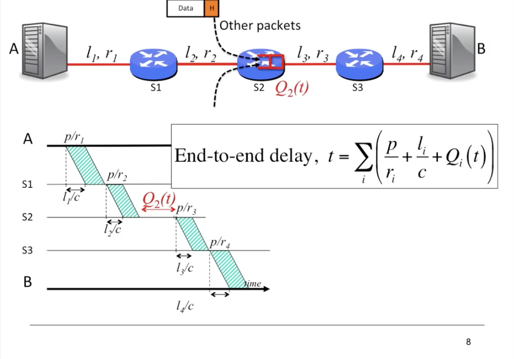

*图：排队时延 Q_2(t) 示意：S2 路由器因"Other packets"竞争同一出站链路而产生 Q_2(t) 等待；时间线显示在 S2 之后引入额外的排队时延，最终端到端时延公式为 $t = \sum_i \left( \frac{p}{r_i} + \frac{l_i}{c} + Q_i(t) \right)$。*

<h3 style="font-size: 2em; font-weight: bold;">3.4 分组交换-原理：播放缓冲区（Playback Buffer Principle）</h3>

---

<h4 style="font-size: 1.5em; font-weight: bold;">播放缓冲区概述</h4>

大多数应用（如网页浏览、邮件）不关心延迟的微小波动，只求尽快完成。实时应用（如流媒体视频、语音）则必须关注排队延迟，因为它会导致数据包到达时间不确定。

应用无法预知数据包何时到达，因此无法保证按时交付音视频样本。

为解决此问题，客户端会使用**播放缓冲区**，提前积累一定数据，以平滑网络延迟波动，保证连续播放。

---

<h4 style="font-size: 1.5em; font-weight: bold;">延迟的约束</h4>

延迟受两端约束：

- **下限**：传播与打包延迟（固定）。
- **上限**：所有路由器缓冲区排队延迟总和（实际意义有限，可能极大）。

到达曲线**非递减**，且**瞬时接收速率受最后链路带宽限制**。

---

<h4 style="font-size: 1.5em; font-weight: bold;">播放缓冲区机制</h4>

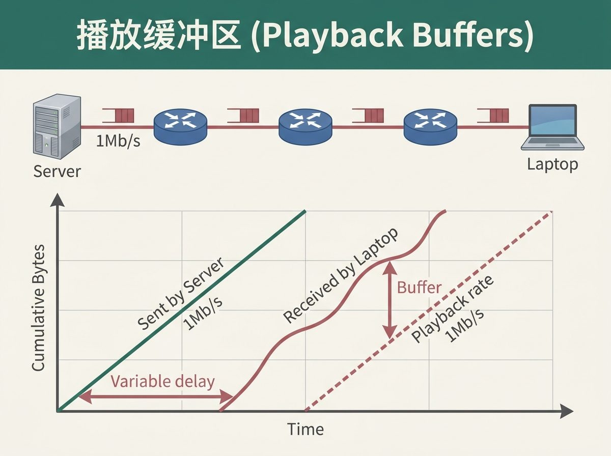

图表各元素的含义如下：

- **青色直线 = "Sent by Server"**（1 Mb/s 恒定发送）
- **红色波折线 = "Received by Laptop"**（受可变排队时延影响，起始点偏右）
- **红色虚线 = "Playback rate"**（1 Mb/s 恒定播放，再晚一些开始）
- **"Variable delay"**：水平双箭头（X 轴方向，发送起点 → 接收起点）—— 传播时延
- **"Buffer"**：竖直双箭头（同一时刻，"Received" 与 "Playback rate" 之间的纵向距离）—— 已收到但未播放的字节数 ✓

---

<h3 style="font-size: 2em; font-weight: bold;">3.5 分组交换原理 - 简单确定性队列模型（Simple Queueing Model）</h3>

---

<h4 style="font-size: 1.5em; font-weight: bold;">概述</h4>

我们可以将一个路由器的输出队列想象成一个"桶"。数据包（或字节）像水一样流入这个桶，并以一个固定的速率从桶中流出（即通过输出链路发送出去）。

关键变量定义：

- **A(t)**：表示到时间 t 为止，累计到达队列的字节数。
- **D(t)**：表示到时间 t 为止，累计从队列离开的字节数。
- **r**：输出链路的固定服务速率（单位：字节/秒）。
- **q(t)**：在时间 t，队列中暂存的字节数，即队列的占用率。其计算公式为：

$$q(t) = A(t) - D(t)$$

通过绘制 A(t) 和 D(t) 随时间变化的累积曲线图，我们可以直观地看到：

- 任何时刻 t 的**队列长度 q(t)**，就是两条曲线在 t 时刻的**垂直距离**。
- 一个在时刻 t 到达的字节所经历的**排队延迟 d(t)**，就是该字节对应的 A(t) 和 D(t) 之间的**水平距离**（假设队列遵循**先进先出 FIFO** 原则）。

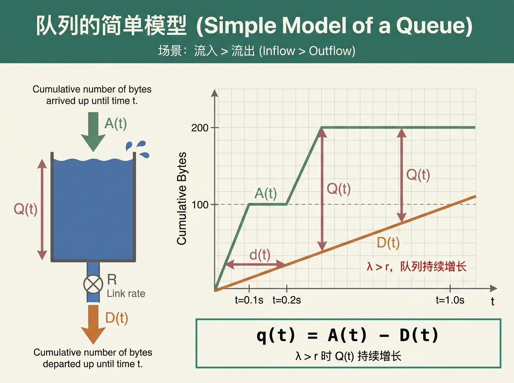

*图：队列的简单模型：左侧"桶"的比喻，Q(t) 表示桶中水量；右侧 A(t)/D(t) 累积曲线图，Q(t) = 两条曲线的垂直距离（队列长度），d(t) = 水平距离（排队延迟），当 λ > r 时 Q(t) 持续增长。*

---

<h4 style="font-size: 1.5em; font-weight: bold;">计算平均队列占用率</h4>

**问题设定**：

- 数据包以**每秒 1 个**的间隔到达。
- 每个数据包长度为 **100 位**。
- 数据包到达速率为 **1000 位/秒**（即发送一个包需 0.1 秒）。
- 队列的输出链路速率 **r** 为 **500 位/秒**。
- **求解**：队列的平均占用率是多少？

**分析与解答**：

　　我们可以分析一个周期（1 秒）内的队列行为：

　　在第一个 0.1 秒内，数据包以 1000 位/秒的速率到达，但只能以 500 位/秒的速率离开。因此，队列在此期间以 1000 - 500 = **500 位/秒**的速度累积。0.1 秒后，数据包到达完毕，队列开始以 500 位/秒的速度清空。清空累积的 100 位数据需要 100 / 500 = **0.2 秒**。

　　因此，在一个 1 秒的周期内，队列有数据的时间为 0.1 + 0.2 = **0.3 秒**，空闲时间为 **0.7 秒**。

　　在队列有数据的 0.3 秒内，其占用率从 0 位线性增长到 100 位，再线性下降回 0 位。因此，平均队列占用率可以计算为：

$$\text{平均占用率} = \frac{0.5 \times 100 \text{ 位} \times 0.3 \text{ 秒}}{1 \text{ 秒}} = 15 \text{ 位}$$

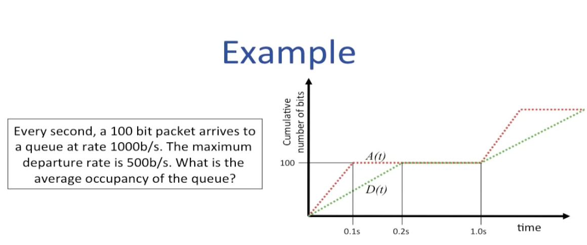

*图：队列平均占用率示例：每 1 秒到达 1 个 100 位包（到达速率 1000 b/s），离开速率 500 b/s。曲线显示 0.1 秒累积到 100 位、0.2 秒清空、剩余 0.7 秒空闲。平均占用率 = 15 位。*

---

<h4 style="font-size: 1.5em; font-weight: bold;">整包传输 vs. 分包流水线：端到端延迟公式推导与对比</h4>

为了聚焦于**传输延迟**和**流水线效应**，我们先做简化假设（忽略传播延迟、处理延迟、排队延迟）：

- 消息总长度：**M**（位）
- 数据包大小（方案 B）：**P**（位），且 P < M
- 路径上的链路数（跳数）：**N**（即图中 R1 → R2 → … → RN）
- 第 i 条链路的传输速率：**rᵢ**（bps）

　　**方案 A：不拆分（整包存储转发）**

　　**工作方式**：整个 M 位的消息作为一个完整的数据包。每个路由器必须**完整收到整个包后**，才能开始向下一跳转发。因此，**同一时刻只有一条链路在工作，无并行**。

　　**总延迟公式**：

$$T_A = \sum_{i=1}^{N} \frac{M}{r_i}$$

　　如果所有链路速率相同（均为 r），则简化为：

$$T_A = N \cdot \frac{M}{r}$$

　　**方案 B：拆分为小数据包（流水线传输）**

　　**工作方式**：将消息拆分为 K = M/P 个小数据包。路由器收到一个完整的小包后，即可立即转发，**无需等待后续小包**。这样，多个链路可以同时传输不同的小包，形成流水线。

　　**总延迟公式（通用形式）**：

$$T_B = \underbrace{\sum_{i=1}^{N} \frac{P}{r_i}}_{\text{第一个包的端到端延迟}} + \underbrace{\left(\frac{M}{P} - 1\right) \cdot \max_{1 \le i \le N}\left(\frac{P}{r_i}\right)}_{\text{剩余包的流水线间隔}}$$

　　**特殊情况：所有链路速率相同（均为 r）**

　　当 r₁ = r₂ = … = r_N = r 时：

$$T_B = N \cdot \frac{P}{r} + \left(\frac{M}{P} - 1\right) \cdot \frac{P}{r}$$

　　化简得：

$$T_B = \frac{M + (N-1) \cdot P}{r}$$

　　**物理含义**：

- 第一个包必须完整走完所有 $N$ 条链路（耗时 $N \times P / R$）。
- 此后，每过 $P / R$ 时间，就会有一个新包到达终点。
- 总共有 $M / P$ 个包，所以后面还有 $(M/P - 1)$ 个时间间隔。

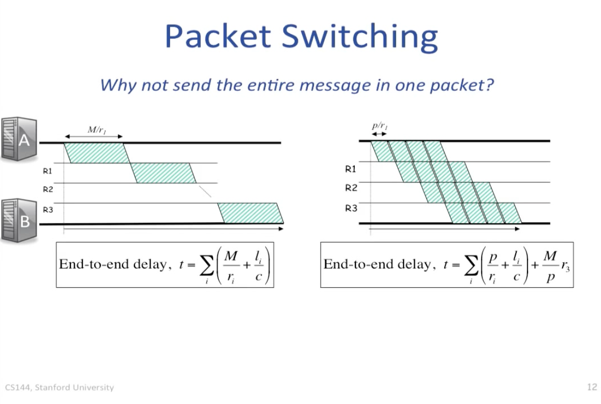

*图：Packet Switching 对比——左侧方案 A（整包 M/r₁ 串行传输，端到端时延 t = Σ (M/rᵢ + lᵢ/c)）vs 右侧方案 B（拆分成 p/r₁ 小包流水线传输，端到端时延 t = Σ (p/rᵢ + lᵢ/c) + M/p · r₃）。右侧链路利用率明显高于左侧。*

---

<h4 style="font-size: 1.5em; font-weight: bold;">共享链路的高效利用（统计复用 Statistical Multiplexing）</h4>

最后，我们探讨分组交换的另一个核心优势：**统计复用**。它允许多个数据流高效地共享同一条物理链路。

想象一个路由器，有 $N$ 条输入链路（速率均为 $r$）和一条输出链路（速率也为 $r$）。如果所有输入链路同时满速率发送，输出链路将无法处理，**必然导致丢包**。但现实中，数据流的到达通常是**突发且不规律**的。

**统计复用增益**就来源于这种不规律性。多个流同时达到峰值的概率较低，因此它们的**总平均到达速率**可能远低于 $N \times r$。只要这个平均速率低于输出链路的速率 $r$，网络就能正常处理。即使短时间内总速率超过 $r$，路由器中的**缓冲区**也可以暂时存储多余的数据包，平滑流量波动。

因此，统计复用使得我们能够用一条链路承载多个数据流，提高了链路资源的整体利用率。这是分组交换网络效率远高于传统电路交换网络的重要原因之一。

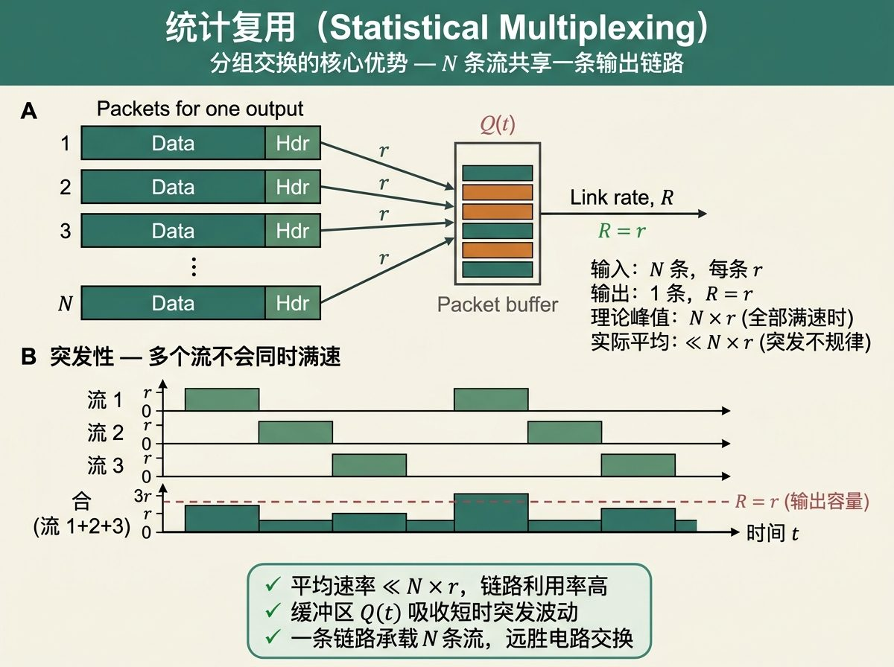

*图：统计复用（Statistical Multiplexing）——上方 A：N 条输入链路（每条 r）共享一条输出链路（R = r），通过 Packet buffer Q(t) 吸收突发；下方 B：流 1/2/3 突发性到达不同时刻，合并后总速率 ≪ N×r；底部要点：平均速率 ≪ N×r 利用率高 / 缓冲区吸收短时突发 / 一条链路承载 N 条流远胜电路交换。*

<h3 style="font-size: 2em; font-weight: bold;">3.6 分组交换—原理：排队模型特性（Characteristics of Queueing Models）</h3>

---

<h4 style="font-size: 1.5em; font-weight: bold;">排队模型概述</h4>

网络可看作由**队列（缓冲区）**和**链路**组成。用户流量汇聚后，数据包到达时间呈现**随机性**，因此用**随机过程**建模。

**排队论**就是研究这类随机队列的数学工具，虽复杂，但能揭示网络延迟和拥塞的核心规律。

---

<h4 style="font-size: 1.5em; font-weight: bold;">特性一：突发性增加延迟</h4>

假设有一个最简单的到达过程：数据包以精确的每秒一个的固定间隔到达，**完全没有随机性**。同时，服务（数据包离开）的机会也是每秒一次。

在这种情况下，队列占用率 $Q(t)$ 要么是 0，要么是 1。**平均队列占用率在 0 和 1 之间**。

现在，考虑一个更具突发性的场景：到达率仍然是平均每秒一个包，但数据包以突发形式到达。例如，每 5 秒到达 5 个包，然后安静 5 秒。服务机会仍然是每秒一次。

虽然平均到达率和离开率相同，但队列占用率现在可以在 **0 到 5 之间**变化。这意味着**平均队列占用率和占用率的方差都增加了**。

**核心结论**：即使平均速率不变，数据包到达的突发性也会导致队列变长，从而增加延迟。

---

<h4 style="font-size: 1.5em; font-weight: bold;">特性二：确定性最小化延迟</h4>

这本质上是**第一个特性的反面**。它表明，在相同的平均到达率下，**完全确定性的、周期性的到达过程**所产生的平均等待时间，比任何**随机到达过程都要短**。

**核心结论**：周期性的、确定的到达过程能产生**最小的平均延迟**。

---

<h4 style="font-size: 1.5em; font-weight: bold;">特性三：Little 定律</h4>

对于任何**稳定的排队系统**（即没有数据包丢失），都存在一个简单的关系。设：

- $\lambda$ 为**平均到达率**（例如，数据包/秒）。
- $L$ 为系统中**顾客（数据包）的平均数量**（包括正在排队和正在被服务的）。
- $D$ 为顾客（数据包）在系统中经历的**平均延迟**。

　　**Little 定律**指出：

$$L = \lambda \cdot D$$

　　**核心结论**：这个通用关系式 $L = \lambda \cdot D$，连接了平均队列长度、平均到达率和平均延迟。我们可以利用这个公式进行转换计算。例如，如果我们测量出平均队列长度 $L$ 并知道到达率 $\lambda$，就可以估算出平均延迟 $D$。这个定律在后续分析中会非常有用。

---

<h4 style="font-size: 1.5em; font-weight: bold;">泊松过程简介</h4>

**泊松过程**是一种常见的到达过程模型。如果一个到达过程是泊松过程，那么：

- 在长度为 $t$ 的时间间隔内，恰好有 $k$ 个事件（数据包）到达的概率为：

$$P(N(t) = k) = \frac{(\lambda t)^k \cdot e^{-\lambda t}}{k!}$$

- **连续到达之间的时间间隔是相互独立的**。
- 在间隔 $t$ 内到达事件数的**期望值**是 $\lambda t$，其中 $\lambda$ 是**平均到达率**。

　　**注意**：泊松过程能很好地模拟**大量独立随机事件的聚合**，例如电话呼叫到达交换机、放射性原子衰变等。然而**网络中的数据包到达通常不是泊松过程**。实际的网络流量具有**显著的突发性**，数据包常常成群到达，前后数据包之间并不独立。泊松过程更适合建模**新通信流的开始**（如新的网页请求），而不是聚合后的数据包流本身。因此，使用基于泊松的模型时需要**格外小心**。

---

<h4 style="font-size: 1.5em; font-weight: bold;">特性四：M/M/1 队列模型</h4>

基于泊松过程，一个最经典和简单的排队分析模型是 **M/M/1 队列**。

- 第一个 **M** 代表**马尔可夫（Markov）到达过程**，即**泊松到达**。这意味着在任意固定时长（比如 1 秒）内，到达路由器的**数据包数量**服从泊松分布。
- 第二个 **M** 代表**马尔可夫服务过程**，即**指数服务**。这意味着路由器（或链路）处理**每个数据包**的耗时（把包从队列中取出并发送出去的时间）服从指数分布。
- **1** 代表只有**一个服务器**（例如，一条出站链路）。

　　由于其假设（泊松到达、指数服务时间），M/M/1 队列的数学分析相对简单，并能给出直观的结果。

　　**核心公式**：对于一个 M/M/1 队列，数据包通过系统的**平均延迟** $D$ 为：

$$D = \frac{1}{\mu - \lambda}$$

　　其中：

- $\mu$ 是**服务率**（例如，链路每秒能发送的数据包数）。
- $\lambda$ 是**到达率**（$\lambda < \mu$ 系统才能稳定）。

　　**平均队列长度** $L$ 可以通过 Little 定律得出：

$$L = \lambda \cdot D = \frac{\lambda}{\mu - \lambda}$$

　　**关键洞察**：从公式可以看出，当**负载** $\rho = \lambda / \mu$ 趋近于 1 时，分母 $(\mu - \lambda)$ 趋近于 0，导致平均延迟 $D$ 和平均队列长度 $L$ **急剧增加，趋向于无穷大**。这形象地展示了当系统接近饱和时，延迟会**爆炸性增长**。

　　**核心结论**：M/M/1 队列模型是一个基于泊松到达和指数服务时间的简化分析模型。虽然真实的网络队列并非严格的 M/M/1，但这个简单模型能为我们提供关于延迟与负载关系的重要直觉：当系统利用率（负载）$\rho = \lambda / \mu$ 接近 100% 时，平均等待时间会趋向无穷大。

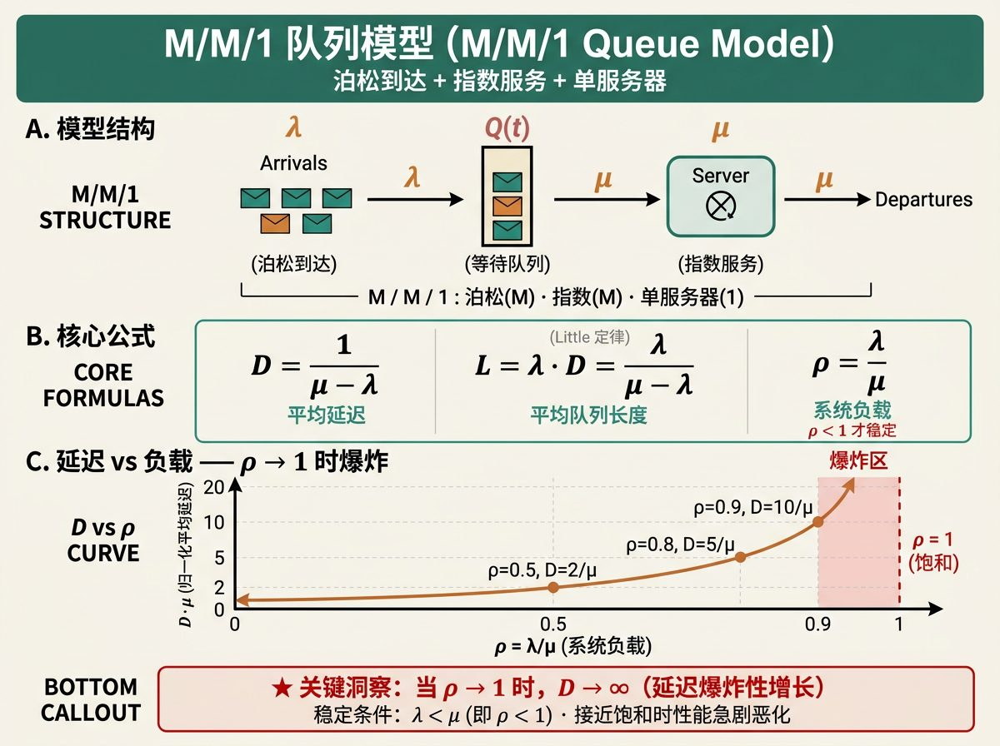

*图：M/M/1 队列模型——A 模型结构（Arrivals λ → Q(t) 等待队列 → Server μ → Departures，泊松到达 + 指数服务 + 单服务器）；B 核心公式（D = 1/(μ−λ)、L = λ·D = λ/(μ−λ)、ρ = λ/μ，ρ<1 才稳定）；C 延迟 vs 负载曲线（ρ→1 时 D→∞ 爆炸区）；底部洞察：ρ→1 时延迟爆炸性增长，稳定条件 λ<μ。*

---

<h3 style="font-size: 2em; font-weight: bold;">3.7 分组交换—实践：交换与转发（一）Switching and Forwarding (I)</h3>

---

<h4 style="font-size: 1.5em; font-weight: bold;">通用分组交换机结构</h4>

分组交换机处理数据包通常包含**三个主要阶段**：

1. **地址查找**：当数据包到达时，首先查看其**目的地址**，通过查询**转发表**来确定数据包应该从哪个出口链路或端口发出。
2. **头部更新**：根据需要进行头部字段的更新。例如，互联网路由器需要**减少 TTL**（生存时间）并**重新计算校验和**。
3. **排队与转发**：将数据包放入**输出端口的缓冲区**中排队，等待在出口链路上发送。这是因为多个数据包可能**同时竞争同一个出站链路**。

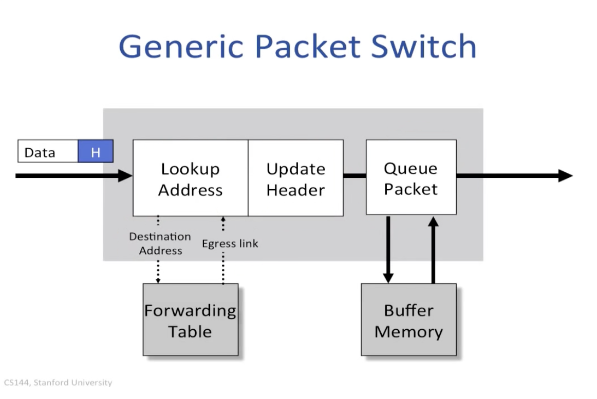

*图：通用分组交换机（Generic Packet Switch）——三阶段流水线：**Lookup Address**（查目的地址 → Forwarding Table 决定 Egress link）→ **Update Header**（更新头部字段，如 TTL 减 1 + 重算 checksum）→ **Queue Packet**（Buffer Memory 排队，等出站链路空闲）；Data + H 输入，左侧 Forwarding Table 决策出口，右侧 Buffer Memory 暂存。*

---

<h4 style="font-size: 1.5em; font-weight: bold;">多端口分组交换机</h4>

一个典型的分组交换机拥有**多个输入和输出端口**。数据包从输入端口进入，经过上述处理后，会通过一个共享的内部交换结构（如总线）被传送到正确的输出端口队列。如果多个数据包目的地相同，它们将在输出队列中缓冲，依次发送。

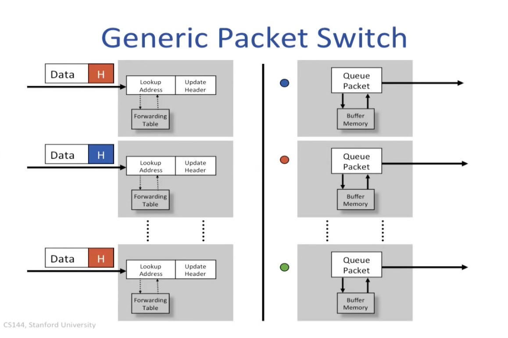

*图：多端口分组交换机（Generic Packet Switch）——左侧 N 个输入端口（每个含 Data+H、Lookup Address、Update Header、Forwarding Table），通过中间**共享交换结构**（垂直线 / 总线）传送到右侧对应的输出端口（每个含 Queue Packet、Buffer Memory）；图中蓝/红/绿三个点表示不同数据包在共享结构中被路由到不同的输出端口（同色点对应相同目的地的输出队列）。*

---

<h4 style="font-size: 1.5em; font-weight: bold;">以太网交换机</h4>

以太网交换机是专门处理**以太网帧**的分组交换机，以太网交换机必须执行以下**四个基本操作**：

1. **检查帧头**：检查每个到达帧的**以太网目的地址**。
2. **查表转发**：若目的地址存在于转发表中，则将帧转发到**对应的输出端口**（或多个端口，如广播情况）。
3. **广播未知帧**：若目的地址不在转发表中，则向**除接收端口外的所有其他端口广播**该帧。
4. **学习地址**：通过检查到达帧的**以太网源地址**来学习并填充转发表。当交换机首次看到某个源地址的帧从某个端口进入时，它就知道未来发送给该地址的帧应从该端口转发。

其转发表查找基于**精确匹配**。例如，一个表项可能如下所示：

$$\text{目的地址: } \texttt{00:1A:2B:3C:4D:5E} \rightarrow \text{转发端口: } 7$$

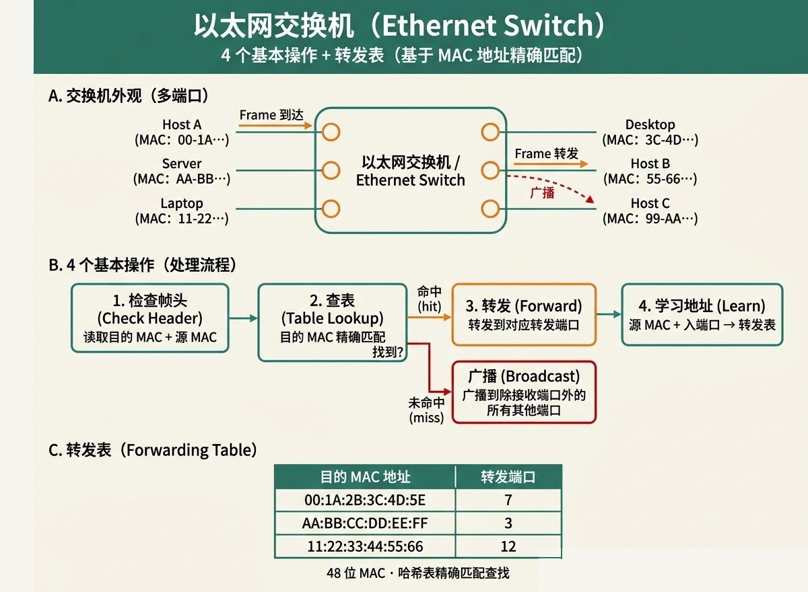

*图：以太网交换机 Stanford 课件（A 交换机外观与多端口转发 / B 4 个基本操作 / C 转发表精确匹配）*

---

<h4 style="font-size: 1.5em; font-weight: bold;">IP 路由器</h4>

路由器处理的是 **IP 数据包**，其操作比以太网交换机更复杂。互联网路由器需要执行以下**七个基本操作**：

1. **检查帧目的地址**：确认到达的以太网帧的目的 MAC 地址是否属于本路由器。若不是，则**丢弃**。
2. **检查 IP 版本**：检查 IP 头部的版本号是否为 4（IPv4）。
3. **处理 IP 头部**：减少 TTL 值，并据此更新 IP 头部校验和。
4. **检查 TTL**：若 TTL 减为 0，则**丢弃数据包**。
5. **查找路由表**：根据目标 IP 地址查询路由表，执行**最长前缀匹配**，从而确定下一跳地址及对应的输出端口。
6. **重新封装**：将 IP 数据包封装进一个新的以太网帧中。
7. **解析下一跳地址**：通过 **ARP** 等协议，找出下一跳路由器接口的 MAC 地址，并将其作为新以太网帧的目的地址。

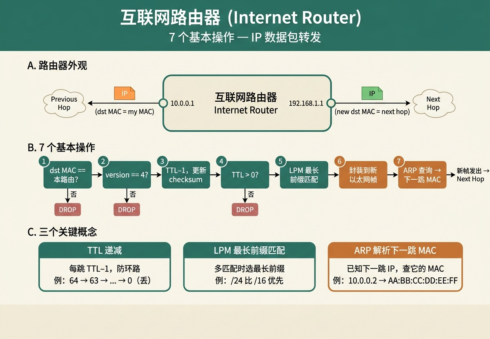

*图：互联网路由器（Internet Router）——A 路由器外观（Previous Hop → 10.0.0.1 → 互联网路由器 Internet Router → 192.168.1.1 → Next Hop；dst MAC = my MAC 进入，新 dst MAC = next hop 出去）；B 7 个基本操作流水线（dst MAC 检查 → version==4 检查 → TTL-1 更新 checksum → TTL>0 检查 → LPM 最长前缀匹配 → 封装新以太网帧 → ARP 查询下一跳 MAC），其中前 3 步失败则 DROP；C 三个关键概念（TTL 递减防环路 64→63→...→0 丢；LPM 最长前缀匹配 /24 优先 /16；ARP 解析下一跳 MAC 例 10.0.0.2 → AA:BB:CC:DD:EE:FF）。*

---

<h4 style="font-size: 1.5em; font-weight: bold;">地址查找机制</h4>

无论是交换机还是路由器，**地址查找都是核心操作**。我们已经看到，以太网交换机使用**精确匹配**，而互联网路由器使用**最长前缀匹配**。

**最长前缀匹配详解**：在 IP 路由中，地址不是单个主机地址，而是代表一个**网络范围的前缀**。例如：

- 前缀 65.0.0.0/8 匹配所有第一个八位组为 65 的 IP 地址。
- 前缀 128.9.0.0/16 匹配所有前 16 位为 128.9 的 IP 地址。

当一个目的 IP 地址**同时匹配多个前缀**时，路由器会选择前缀长度最长（即最具体）的那条路由。例如，地址 128.9.16.14 同时匹配 128.9.0.0/16 和 128.9.16.0/24，但会选择更长的 128.9.16.0/24 作为匹配项。

---

<h3 style="font-size: 2em; font-weight: bold;">3.8 分组交换—实践：交换与转发（二）Switching and Forwarding (II)</h3>

<h4 style="font-size: 1.5em; font-weight: bold;">输出队列交换机</h4>

包交换器在确定数据包的目标端口后，需要将其传输到对应的输出端口，以便通过正确的出站链路发送。这个过程被称为**交换**或**转发**。最简单的交换架构是**输出队列交换机**。在这种设计中，数据包在通过交换背板后，会在**输出端口处排队等待发送**。

以下是其**工作流程**：

1. **数据包到达交换机**：其头部信息（如颜色所示）指示**目标输出端口**。
2. **交换逻辑转发**：交换逻辑将数据包通过**内部背板**发送到对应的输出端口。
3. **输出端口缓冲**：若输出链路繁忙，数据包将在该端口的**输出队列**中按 **FIFO** 顺序等待发送。

这种架构的**主要挑战**在于对**缓冲内存速度**的要求极高。最坏情况下，所有 $n$ 个输入端口的数据包可能**同时**要发往**同一个输出端口**。这意味着：

- 写入队列的速率可能高达 $n \times r$（$r$ 为端口速率）。
- 从队列读取的速率仅为 $r$。
- 因此，输出端口的缓冲内存需要能以 $(n+1) \times r$ 的**聚合速率**运行。

对于端口数量 $n$ 很大的交换机，这严重**限制了其可扩展性**。

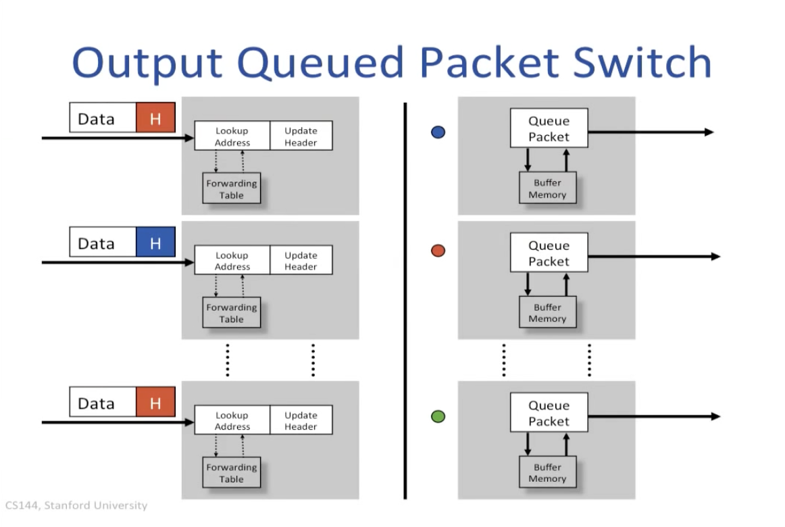

*图：输出队列交换机（Output Queued Packet Switch，Stanford 课件）——左侧 $n$ 个输入端口各有 Data + 头标 H（颜色 = 目的端口）、Lookup Address / Update Header / Forwarding Table 模块；数据包通过中间背板路由到右侧对应输出端口的 Queue Packet + Buffer Memory 队列，按 FIFO 顺序发送；最坏情况下所有输入同时涌向同一输出，导致内存读写速率差为 $(n+1) \times r$。*

---

<h4 style="font-size: 1.5em; font-weight: bold;">输入队列交换机</h4>

为了解决**输出队列交换机**对**内存速度**的苛刻要求，一种自然的思路是将队列从**输出端移动到输入端**，这就构成了**输入队列交换机**。

以下是其**工作流程**：

1. **输入端口缓冲**：数据包到达输入端口后，先在**输入队列**中缓冲。
2. **交换调度器决策**：交换调度器决定哪个输入队列的数据包可以通过**背板**发送。
3. **输出链路空闲判断**：只有当前输出链路空闲时，对应目标端口的数据包才能被发送。

这种设计的**优势**在于，每个输入端口的缓冲内存只需处理**本端口**的流量。其读写速率从 $(n+1) \times r$ **降低到了** $2 \times r$，**大大降低了对内存速度的要求，提高了交换机的可扩展性**。

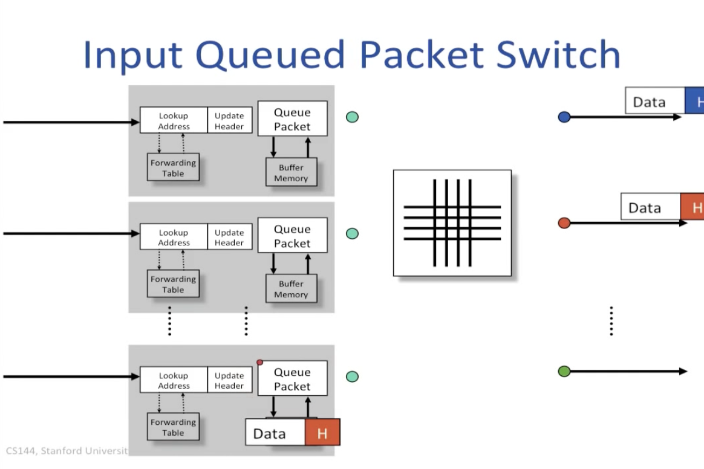

*图：输入队列交换机（Input Queued Packet Switch，Stanford 课件）——左侧 $n$ 个输入端口各带 Lookup Address / Update Header / Forwarding Table / Queue Packet + Buffer Memory；数据包先在输入端口排队等候；中间为交换背板（crossbar 网格）；右侧为 $n$ 个输出端口，下方示意一个 Data + H 头标包正从某输入队列被调度到对应输出端口。*

---

<h3 style="font-size: 2em; font-weight: bold;">3.9 分组交换—原理：速率保证（Rate Guarantee）</h3>

<h4 style="font-size: 1.5em; font-weight: bold;">FIFO 队列的缺点</h4>

FIFO 队列有时被称为"所有输入的免费竞争区"。如果流向该队列的流量来自多个输入源，那么在任何发生拥塞的时刻，数据包都会在这个 FIFO 队列中排队，**发送速率最高的流将获得输出链路的最大使用份额**。

这意味着，如果某个流能够以高速率发送大量数据包，它就可能**独占输出链路**，而其他低速率的流则可能被完全"挤出"，几乎无法获得服务。这种行为模式鼓励了"不良行为"——每个流都倾向于尽可能快地发送数据包，以最大化自己获得的带宽份额，这对网络整体是**不友好**的。

此外，FIFO 队列**无法区分数据包的重要性**。无论是紧急的控制流量、重要的视频数据还是普通的背景流量，都按照到达的先后顺序被处理。这可能导致**低延迟要求**的流量（如实时视频）因为排队在后面而经历高延迟。

---

<h4 style="font-size: 1.5em; font-weight: bold;">两种替代方案概述</h4>

鉴于 FIFO 队列的上述问题，本视频将描述**两种替代方案**：

1. **严格优先级**：为特定流量提供**更高的优先级**。
2. **速率保证**：为每个流保证一定的**输出链路带宽份额或速率**。

本质上，我们将把之前简单的**单一队列**替换为更**复杂的调度机制**。

---

<h4 style="font-size: 1.5em; font-weight: bold;">方案一：严格优先级</h4>

在严格优先级方案中，我们将**单一队列**替换为一个**高优先级队列**和一个**低优先级队列**。

当数据包到达时，交换机会根据其**包头中的信息**（例如 IP 头中的"服务类型"字段）决定将其放入高优先级队列还是低优先级队列。**分类的依据**可以是：

- 视频流量比电子邮件更重要。
- 网络控制流量比普通数据流量更重要。
- 付费用户的流量比普通用户的流量更重要。

**工作原理**：

1. 数据包根据**分类**被放入相应的队列。
2. 调度器**始终优先服务高优先级队列**中的数据包。
3. 只有当**高优先级队列为空**时，调度器才会服务低优先级队列。

**结果**：高优先级流量完全"看不到"低优先级流量的存在，仿佛拥有一个**私有网络**。这对于需要绝对优先级的流量（如关键控制信令）非常有效。

**潜在问题**：如果高优先级流量过大，它可能长时间**独占链路**，导致低优先级流量被"**饿死**"（完全得不到服务）。因此，严格优先级通常只在高优先级流量**相对较少**的场景下使用。目前许多交换机和路由器都支持此功能。

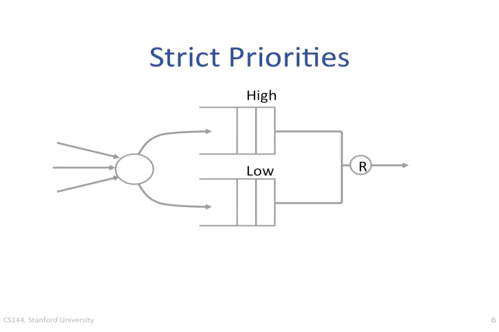

*图：严格优先级调度（Strict Priorities，Stanford 课件）——左侧 3 条输入流汇入分类器（O），按包头字段分成 High / Low 两个队列；两个队列的输出经调度器（R）合并到单一出口链路。规则：High 队列始终先服务，仅当 High 队列为空时才服务 Low 队列。风险：High 流量过大会导致 Low 队列被"饿死"。*

---

<h4 style="font-size: 1.5em; font-weight: bold;">方案二：加权公平队列与速率保证</h4>

如果我们不希望总是严格优先服务于某个队列，而是希望为不同流量**按比例分配**有保障的**带宽份额**，就需要引入更**精细的调度机制**。

例如，我们希望**队列 1** 获得的带宽是**队列 2** 的两倍。假设共有 $N$ 个队列，每个队列 $i$ 被赋予一个**权重** $w_i$。那么，在出站链路总速率 $R$ 的限制下，队列 $i$ 应获得的**保证服务速率** $R_i$ 为：

$$R_i = \frac{w_i}{\sum_{j=1}^{N} w_j} \times R$$

　　其中 $j$ 从 1 到 $N$。

当所有**数据包长度相同**时，实现这一调度相对简单：我们可以采用"轮询"服务策略，每轮依次访问各个队列，并从队列 $i$ 中发送 $w_i$ 个单位的数据（单位可以是比特或完整数据包）。这样，从**长期**来看，每个队列所获得的服务比例将与其权重成正比，从而实现按权重的带宽分配。

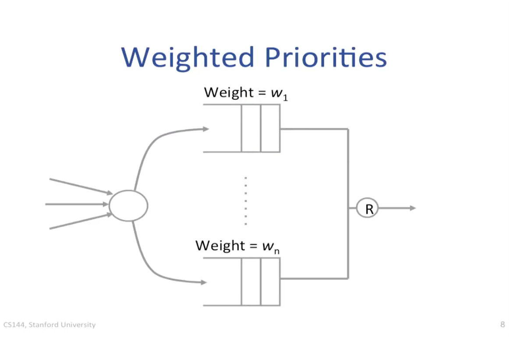

*图：加权优先级调度（Weighted Priorities，Stanford 课件）——左侧 $N$ 条输入流汇入分类器（O），按权重分成 $N$ 个队列（Weight = $w_1$ 到 Weight = $w_n$）；$N$ 个队列的输出经调度器（R）合并到单一出口链路。按权重轮询：每轮依次访问各队列，从队列 $i$ 发送 $w_i$ 个单位数据，长期服务比例与权重成正比。*

---

<h4 style="font-size: 1.5em; font-weight: bold;">WFQ 调度规则（变长包处理）</h4>

然而在实际网络中，**数据包长度是可变的**（例如从 64 字节到 1500 字节不等）。若按完整数据包进行服务，长数据包会占用更长的发送时间，从而**破坏各队列之间按权重分配带宽的比例关系**。因此，必须将包长纳入调度考量，以防止长包持续挤占短包的服务机会。

为了解决这一问题，我们引入一个**思想实验**：假设系统能够按**比特**为单位服务数据包。在此理想模型中，系统以"**轮次**"推进，每轮中队列 $i$ 可获得 $w_i$ 比特的服务。当一个数据包的所有比特都被服务完毕时，该包才被认为"**完成**"。那么在真实的按包发送系统中，应以何种顺序发送这些完整的数据包，才能最接近上述按比特服务的理想公平状态？**答案是**：按照这些数据包在按比特服务模型下计算出的完成时间（轮次）进行排序和发送。

设数据包 $k$ 的长度为 $L_k$，其所属队列的权重为 $w$（即每轮中该队列可获得 $w$ 比特的服务）。在理想比特服务模型中，若该包开始的轮次为 $S_k$，则其完成轮次 $F_k$ 为：

$$F_k = S_k + \frac{L_k}{w}$$

对于每个新到达的数据包 $k$，其开始时间 $S_k$ 由以下**递推关系**决定：

- 若队列中已有前一个包 $k-1$，则需**等待其完成**。
- 若队列为空，则可**立即开始**（取决于到达时间）。

因此：

$$S_k = \max(\text{到达时间}, F_{k-1})$$

随后再使用上式计算出 $F_k$。调度器会持续维护每个队列队首数据包的完成时间 $F$。每次需要发送数据包时，调度器从所有队列中选取**具有最小 $F$ 值**（即在理想比特模型中**最先完成**）的数据包进行实际发送。该算法称为**加权公平队列（Weighted Fair Queuing, WFQ）**。

可以证明，在 WFQ 调度下：

1. 每个队列 $i$ 实际获得的**长时期平均服务速率** $R_i$ 无限接近其**保证速率** $\frac{w_i}{\sum w_j} \times R$。
2. 每个数据包在实际包系统中**离开的时间**，与其在理想比特模型中**完成的时间**之差，不会超过 $\frac{L_{max}}{R}$，其中 $L_{max}$ 是网络中的**最大可能包长**。

这意味着 WFQ 不仅提供了良好的**长期带宽保证**，也控制了**短期内的延迟抖动**。

---

<h3 style="font-size: 2em; font-weight: bold;">3.10 分组交换—原理：延迟保证（Delay Guarantee）</h3>

<h4 style="font-size: 1.5em; font-weight: bold;">延迟保证概述</h4>

端到端延迟保证是指网络系统能够为数据包从源节点到目的节点的完整传输过程，提供**确定性的最大延迟上界**，并确保该上界在所有网络负载条件下均不被违反端到端延迟保证依赖于对排队行为的精确控制。加权公平队列等调度机制为各数据流分配确定的服务份额并按权重排序，使每个数据包在每一跳的排队时延都被约束在已知范围内，进而将逐跳延迟累积为可预测的端到端延迟。

---

<h4 style="font-size: 1.5em; font-weight: bold;">端到端延迟方程</h4>

首先，**回顾端到端延迟方程**。该方程描述了数据包从网络一端到另一端的延迟，它是以下分量的函数：

- **传输时延（Transmission Delay）**：**固定分量**，等于**包长度**除以**链路速率**。
- **传播时延（Propagation Delay）**：**固定分量**，等于**链路长度**除以**光速**。
- **排队时延（Queuing Delay）**：**可变分量**，通常不受我们直接控制。

为了提供端到端延迟保证，我们需要控制路径上每个路由器的排队时延 $Q_1(t), Q_2(t), Q_3(t)$ 。

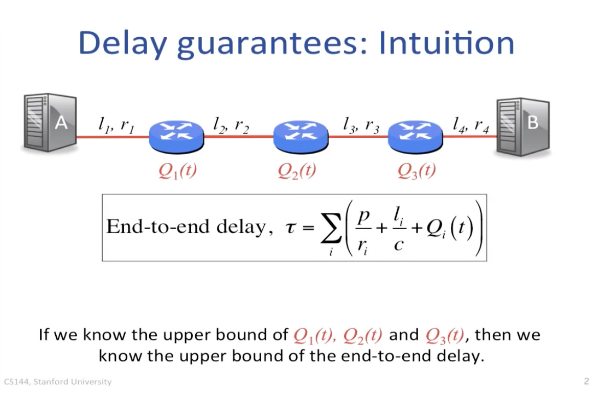

*图：延迟保证直觉（Delay guarantees: Intuition，Stanford 课件）——主机 A 经 3 个路由器到主机 B，每段链路有长度 $l_i$、速率 $r_i$ 和队列 $Q_i(t)$；端到端延迟公式 $\tau = \sum_i \left( \frac{p}{r_i} + \frac{l_i}{c} + Q_i(t) \right)$；只要知道 $Q_1(t), Q_2(t), Q_3(t)$ 的上界，就能知道端到端延迟的上界。*

---

<h4 style="font-size: 1.5em; font-weight: bold;">控制单个路由器的时延（加权公平队列 WFQ ）</h4>

如果我们知道路径上每个排队时延（$q_1, q_2, q_3, \ldots$）的上限，那么整体端到端延迟也就有了上限。本节我们来看看如何控制单个路由器的排队时延。在路由器内部，通过**加权公平队列（WFQ）**，我们可以为特定队列分配一个**保证的服务速率** $R_i$。如果我们同时知道该队列**缓冲区的大小** $B$，那么数据包通过该路由器的**最大时延** $Q_{i_{\max}}$ 就被限制为 $\frac{B}{R_i}$。

**核心概念**：

- **服务速率** $R_i$ 由 WFQ 权重决定：$$R_i = \frac{w_i}{\sum_{j=1}^{N} w_j} \times R$$
- **最大排队时延**：$Q_{i_{\max}} \leq \frac{B}{R_i}$。

因此，通过选择**缓冲区大小** $B$ 和利用 WFQ 控制**服务速率** $R_i$，我们可以控制单个路由器的延迟。

---

<h4 style="font-size: 1.5em; font-weight: bold;">防止数据包丢失（流量整形）</h4>

仅仅控制延迟还不够。如果队列缓冲区溢出导致数据包被丢弃，就无法实现真正的"**保证**"。因此，我们必须确保缓冲区不会溢出。

我们使用一个简单的**确定性队列模型**来分析。**累积到达过程** $A(t)$ 和**累积离开过程** $D(t)$ 之间的**垂直距离**代表**队列占用** $Q(t)$，**水平距离**代表**延迟** $d(t)$。

为了防止溢出，我们需要确保在任何时间间隔 $T$ 内，在该间隔内系统能承受的最大到达量，即 $A(t+T) - A(t) \leq B + R_i \cdot T$。其中 $B$ 是**缓冲区大小**，$R_i$ 是**服务速率**。

如果这个条件始终满足，那么队列**永远不会溢出**，且最大延迟 $d_{\max}$ 也受限于 $\frac{B}{R_i}$。

---

<h4 style="font-size: 1.5em; font-weight: bold;">流量整形：漏桶算法</h4>

那么，如何确保数据流满足"在任何时间间隔 $T$ 内，$A(t+T) - A(t) \leq B + R_i \cdot T$"这个条件呢？答案是通过**流量整形**。

一种广泛使用的技术是 **$\sigma$-$\rho$ 调节**，其中 $\sigma$ 代表允许的**突发量**（对应缓冲区大小 $B$），$\rho$ 代表**长期平均速率**（对应服务速率 $R_i$）。满足此约束的流量称为"**$\sigma$-$\rho$ 调节**"流量。

在实践中，常用**漏桶算法**来实现 $\sigma$-$\rho$ 调节。其工作原理如下：

1. **令牌生成**：系统以恒定的速率 ρ 向桶中添加令牌（可以理解为“通行证”），桶的容量上限为 σ，满了则多余令牌丢弃。
2. **数据发送**：每个数据包到达时，必须从桶中取出等同于其数据大小的令牌数量。
3. **两种结果**：

   - 令牌足够：数据包立即被转发（漏出）。
   - 令牌不足：数据包被丢弃或暂存在队列中等待（取决于实现），直到桶中积累足够令牌。

最终效果：通过这个机制，无论输入流量多么突发，输出流量都变得平滑，严格满足 “任何时间间隔 T 内，发送数据量 ≤ σ + ρ × T” 的约束，即长期平均速率不超过 ρ，且最大突发量不超过 σ。

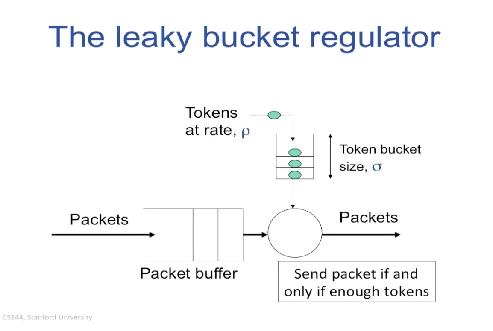

*图：漏桶调节器（The leaky bucket regulator，Stanford 课件）——令牌以速率 $\rho$ 滴入容量为 $\sigma$ 的令牌桶；输入数据包经 Packet buffer，到达时从令牌桶取等量令牌才被发送；规则："Send packet if and only if enough tokens"。*

---

<h4 style="font-size: 1.5em; font-weight: bold;">端到端延迟保证系统</h4>

现在，我们将所有部分组合起来，构建一个完整的端到端延迟保证系统。

1. **流量源端**：使用**漏桶调节器**对发出的流量进行**流量整形**，使其符合约定的 $(\sigma, \rho)$ 参数。
2. **网络路径上的每个路由器**：

   - 使用**加权公平队列**为该流量对应的队列分配保证的**服务速率** $R_i$（需满足 $R_i \geq \rho$）。
   - 为该队列配置足够大的**缓冲区** $B_i$（需满足 $B_i \geq \sigma$）。

3. **延迟计算**：端到端总延迟是**固定延迟**（包化延迟 + 传播延迟）与**所有路由器队列延迟上限**之和。每个路由器的队列延迟上限为 $\frac{B_i}{R_i}$。

通过这种方式，只要流量源遵守约定，网络就能提供有上限的端到端延迟保证。像 **RSVP（资源预留协议）**这样的协议就是用来在端到端之间**协商和设置这些参数** $(\sigma, \rho, R_i, B_i)$ 的。

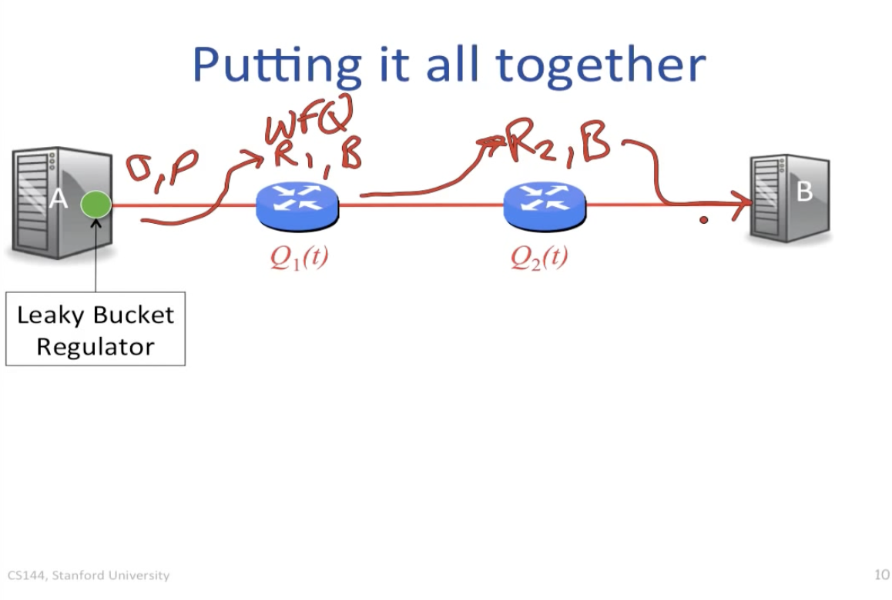

*图：Putting it all together（Stanford 课件）——主机 A 经 Leaky Bucket Regulator（参数 $\sigma, \rho$）整形后，通过 2 个路由器（每个都有 WFQ、$R_i$、$B$、$Q_i(t)$）到达主机 B。端到端延迟 = 固定延迟 + 所有队列 $\frac{B_i}{R_i}$ 之和。*

