# 第 4 章：拥塞控制

<h3 style="font-size: 2em; font-weight: bold;">4.1 拥塞控制—基础</h3>

---

<h4 style="font-size: 1.5em; font-weight: bold;">网络拥塞</h4>

网络拥塞是指网络中的数据流量超过了网络设备（如路由器）的**处理能力**，导致数据包**延迟增加、丢失**，甚至网络性能**急剧下降**的现象。拥塞可能发生在不同的时间尺度上。

以下是**三种常见的时间尺度**示例：

1. **极短时间尺度（包碰撞）**：当两个或多个数据包几乎同时到达路由器并竞争同一个输出链路时，会发生**瞬时排队**。其中一个数据包被立即发送，另一个则进入**缓冲区排队**，造成短暂的队列堆积。
2. **中等时间尺度（流级别）**：在往返时间（RTT）或数个 RTT 的时间尺度上，例如一个 TCP 连接在下载文件。如果多个数据流（flow）的发送速率之和超过了某条链路的容量，缓冲区就会**持续累积并最终溢出**。假设链路容量为 $C$，两个流的发送速率分别为 $r_1$ 和 $r_2$，当 $r_1 + r_2 > C$ 时，就会发生拥塞。
3. **长时间尺度（人类活动周期）**：例如在高峰时段，大量用户同时访问某个热门网站（如新闻站点），导致连接到该服务器的链路过载。

在拥塞控制中，我们主要关注和试图解决的是**第二种时间尺度——流级别的拥塞**，因为我们有机会通过**反馈机制**调整发送端的速率。

---

<h4 style="font-size: 1.5em; font-weight: bold;">拥塞的影响与反馈效应</h4>

让我们通过一个具体例子深入理解拥塞的影响。假设源 A 和源 B 都希望以 12 Mbps 的速率向目的地 X 发送数据。然而，路由器 R 到 X 的链路容量只有 12 Mbps。

设置参数如下：

- A 发送速率：$r_A = 12$ Mbps
- B 发送速率：$r_B = 12$ Mbps
- 链路容量：$C = 12$ Mbps

显然，总到达速率 $r_A + r_B = 24$ Mbps 大于离开速率 $C = 12$ Mbps。根据确定性排队模型，队列长度 $q(t)$ 将随时间线性增长：

$$q(t) = (r_A + r_B - C) \cdot t$$

最终，路由器的缓冲区会溢出，导致数据包被丢弃。这些被丢弃的包通常需要重传，而重传又会向网络中注入更多的流量，从而进一步加剧拥塞，形成一个使情况恶化的**正反馈循环**。因此，拥塞控制的核心目标之一就是避免网络进入这种状态。

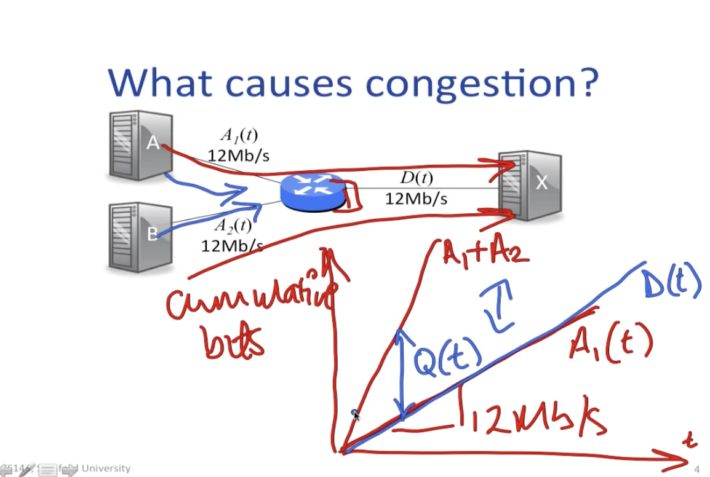

*图：What causes congestion?（Stanford 课件）——源 A、B 各以 12 Mb/s 发送，路由器到 X 链路 12 Mb/s；累积到达 $A_1(t) + A_2(t)$ 远超离开 $D(t)$，队列 $Q(t)$ 持续增长（12 Mb/s 斜率差），最终缓冲溢出 → 重传 → 拥塞加剧**正反馈循环**。*

---

<h4 style="font-size: 1.5em; font-weight: bold;">公平分配问题</h4>

当多个流共享一个瓶颈资源时，如何公平地分配带宽成为一个关键问题。假设链路容量为 $C$，有两个流竞争，它们期望的速率分别为 $r_1$ 和 $r_2$。

一种直观的公平分配方式是 **"最大最小公平"（Max-Min Fairness）**。其定义是：一种速率分配是最大最小公平的，当且仅当**无法在不降低一个更低速率的流的速率的情况下，去提高任何一个流的速率**。

在单个瓶颈链路的简单情况下，最大最小公平意味着：

- 如果每个流的需求都超过其公平份额（即 $r_1 > C/2$ 且 $r_2 > C/2$），则每个流获得 $C/2$。
- 如果某个流的需求小于其公平份额（例如 $r_1 < C/2$），则它获得其所需速率 $r_1$，剩余的带宽 $(C - r_1)$ 再在剩余流之间公平分配。

以下通过一个三流示例演示最大最小公平分配的具体计算过程。设链路容量 $C = 1$ Mbps，三个流的需求分别为：流 A = 0.5 Mbps，流 B = 0.8 Mbps，流 C = 0.2 Mbps。

1. **初始公平份额**：$C/3 = 1/3 \approx 0.33$ Mbps（三等分链路容量）。
2. **满足低需求流**：流 C 需求 $0.2$ Mbps $< 0.33$ Mbps，未达公平份额，故满足其需求，分配 $0.2$ Mbps。剩余带宽 $1 - 0.2 = 0.8$ Mbps。
3. **重算公平份额**：剩余的 $0.8$ Mbps 在 A 和 B 之间均分，新的公平份额为 $0.8 / 2 = 0.4$ Mbps。
4. **判断 A、B 是否满足**：流 A 需求 $0.5$ Mbps $> 0.4$ Mbps，未达新公平份额，分配 $0.4$ Mbps；流 B 需求 $0.8$ Mbps $> 0.4$ Mbps，分配 $0.4$ Mbps。

最终分配：(A: $0.4$ Mbps, B: $0.4$ Mbps, C: $0.2$ Mbps)，总和 $1$ Mbps $= C$，符合最大最小公平原则（Max-Min Fairness）。

---

<h4 style="font-size: 1.5em; font-weight: bold;">网络拥塞的必然性与设计目标</h4>

在分组交换网络中，一定程度的拥塞是**不可避免甚至有益**的。它意味着**网络资源**（链路、缓冲区）得到了充分利用。如果缓冲区总是空的，虽然延迟低，但链路利用率也低，是一种资源浪费。拥塞控制的目标不是彻底消除拥塞，而是将其控制在一个合理的水平，在**高吞吐量**和**低延迟**之间取得平衡。

以下是拥塞控制机制的四个核心目标：

1. **高吞吐量（High Throughput）**：有效利用网络带宽，保持链路繁忙，使数据快速传输完毕。
2. **公平性（Fairness）**：通常依据**最大最小公平**准则，确保竞争同一瓶颈资源的各流量能获得公平的带宽份额，同时保护小流量。
3. **快速收敛与响应（Responsiveness）**：能快速感知网络状态变化（如新流量加入或旧流量离开），并相应调整发送速率，以充分利用可用带宽或缓解拥塞。
4. **分布式部署（Distributed）**：算法应能分布式运行，不依赖于中央控制器，以保证可扩展性和鲁棒性。

---

<h3 style="font-size: 2em; font-weight: bold;">4.2 拥塞控制—基础 2</h3>

---

<h4 style="font-size: 1.5em; font-weight: bold;">终端主机的拥塞控制</h4>

接下来，我们探讨在没有任何网络支持的情况下，仅在终端主机上实现拥塞控制。这种方法的核心思想是：发送主机通过观察网络行为（如数据包丢失、延迟增加等），自行推断拥塞状况并调整发送行为。

TCP 协议正是这样做的，因为 IP 协议默认不提供拥塞指示。TCP 在终端主机上实现拥塞控制，它会对主机可观测到的事件做出反应，特别是数据包丢失。TCP 利用其滑动窗口机制来控制**网络中在途未确认**的数据包的数量。

---

<h4 style="font-size: 1.5em; font-weight: bold;">TCP 滑动窗口回顾</h4>

滑动窗口定义了字节流中三个关键部分：

1. 已发送且已被确认的数据
2. 允许发送但尚未发送的数据（在窗口内）
3. 已发送但尚未确认的数据（即"未完成"数据）

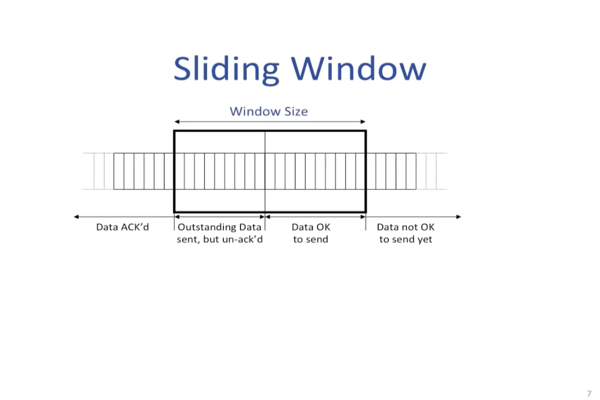

*图：Sliding Window 三段划分（Stanford 课件）——窗口大小 = 允许发送但未确认的最大数据量；当 RTT 等于用窗口数据填满网络管道所需时间时，数据可连续发送不间断。*

滑动窗口大小决定了发送端允许发送但尚未确认的数据包的  数量。当往返时间（RTT）恰好等于用窗口数据填满网络管道所需的时间时，即发送窗口内最后一个数据包发出时，第一个数据包的ACK正好返回，此时数据流可无缝衔接，实现网络带宽的充分利用。

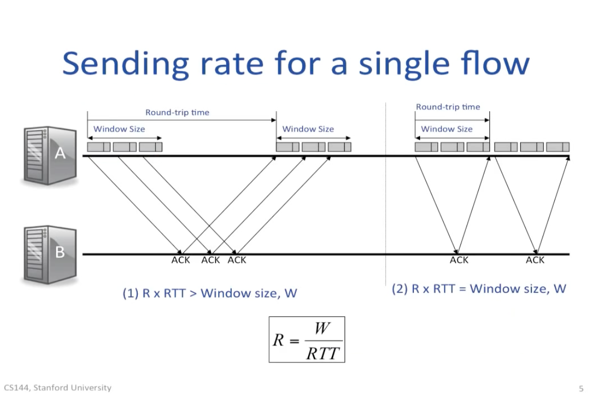

*图：单流发送速率与 RTT 关系（CS144 Stanford 课件第 5 页）——当窗口数据量恰好填满 RTT 内的网络管道时，发送端才能持续不断发送；此时 R = W/RTT，链路达到 100% 利用。*

---

<h4 style="font-size: 1.5em; font-weight: bold;">TCP 拥塞控制</h4>

TCP 利用窗口机制来调整网络里"已发出但未收到确认"的数据包的数量，从而进行拥塞控制。TCP 发送方会维护两个窗口值：

- 接收窗口（Advertised Window）：由接收方通告，防止发送方压倒接收方。
- 拥塞窗口（Congestion Window）：由发送方根据网络拥塞状况自行计算得出，通常缩写为 cwnd。

实际发送窗口的大小是上述两者中的较小值，即 $\text{Window size} = \min\{\text{Advertised Window}, \text{Congestion Window}\}$。当网络拥塞时，通常由 cwnd 主导。

---

<h4 style="font-size: 1.5em; font-weight: bold;">TCP 拥塞窗口算法：AIMD（加性增乘性减）</h4>

TCP 发送方使用 AIMD 算法来调整 拥塞窗口（cwnd）的大小，从而实现流量控制。

以下是 AIMD 的工作原理：

- 加性增：当网络传输顺畅、无丢包时，TCP 发送方每收到一个 ACK，便将 拥塞窗口（cwnd）大小增加 1 MSS，实现缓慢而线性的增长。
公式表示：$cwnd = cwnd + 1$ （每经过一个 RTT）

- 乘性减：当网络拥塞，TCP 发送方检测到数据包丢失的情况，发送方立即将 拥塞窗口（cwnd）大小减半，实现快速而剧烈的下降。
公式表示：$cwnd = cwnd / 2$ （检测到丢包时立即执行）

---

<h4 style="font-size: 1.5em; font-weight: bold;">TCP 锯齿波：加性增与乘性减的交替</h4>

如果将 拥塞窗口（cwnd）随时间的变化绘制出来，我们会看到一个典型的"锯齿"形状：

1. cwnd 在成功传输期间线性增长（加性增）
2. 当发生丢包时，cwnd 突然减半（乘性减）
3. 然后 cwnd 再次开始线性增长，如此循环

这种模式被称为 TCP 锯齿波 或 AIMD 锯齿波。它形象地展示了 TCP 如何探索并适应网络可用带宽：缓慢增加以利用空闲带宽，一旦拥塞则快速后退。

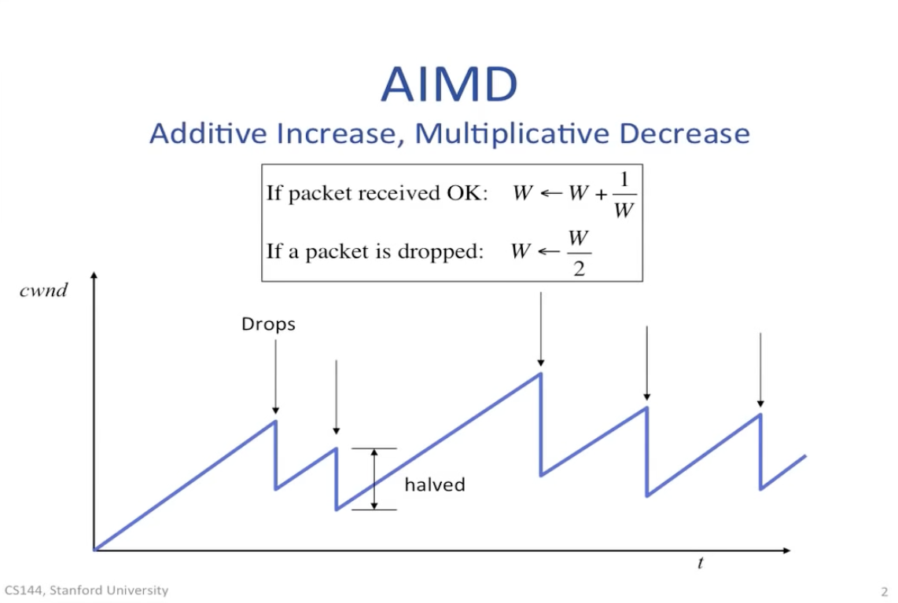

*图：AIMD 锯齿形 cwnd(t)（Stanford 课件）——线性增长 $W \leftarrow W + 1/W$ + 丢包减半 $W \leftarrow W/2$，循环形成"锯齿"。*

---

<h3 style="font-size: 2em; font-weight: bold;">4.3 拥塞控制—单条 AIMD 数据流的动态分析（ Dynamic Analysis of a Single AIMD Flow）</h3>

---

<h4 style="font-size: 1.5em; font-weight: bold;">概述</h4>

在本节中，我们将通过分析网络中单条 AIMD 数据流的动态变化，来理解 TCP 如何在没有网络明确支持的情况下，仅通过端主机调节 拥塞窗口（cwnd）大小来应对拥塞。

---

<h4 style="font-size: 1.5em; font-weight: bold;">AIMD 算法回顾</h4>

AIMD 算法通过调节 TCP 发送方 拥塞窗口（cwnd）的大小 w，从而控制网络中"在途字节"的数量。其核心规则如下：

- 加性增：每当 TCP 发送方成功收到一个 ACK 时，窗口大小增加一个单位。公式：$w = w + 1$

- 乘性减：每当 TCP 发送方检测到数据包丢失（视为拥塞信号）时，窗口大小减半。公式：$w = w / 2$

AIMD（加性增乘性减）算法通过控制 拥塞窗口 的大小来管理网络拥塞，本质上就是调节网络中"已发出但未收到确认"的数据包数量。

当网络畅通时，它会逐步增加窗口，允许发送更多在途数据包以充分利用带宽；一旦网络过载（例如路由器缓冲区溢出导致丢包），AIMD 就会快速缩减窗口，强制减少在途数据包的数量，从而减轻网络负担，避免持续拥塞。

---

<h4 style="font-size: 1.5em; font-weight: bold;">单条 AIMD 数据流动态分析</h4>

我们观察一个 AIMD 流通过单个瓶颈链路的动画模拟。网络结构如下：源主机和目的主机之间有一个路由器，其出口链路（右侧）是瓶颈，速度慢于入口链路（左侧）。

以下是模拟中的关键组件和行为：

- 拥塞窗口 (w)：图中红线，代表源端允许的未确认数据包数量，它随时间变化。
- 路由器缓冲区：位于瓶颈链路前，用于暂存无法立即转发的数据包。
- 数据包流：蓝色数据包从源流向目的地。
- 确认包流：红色确认包从目的地返回源端，用于触发后续数据包的发送（自时钟驱动）。

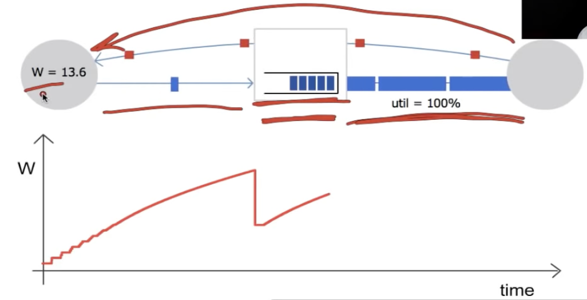

*图：单流 AIMD 动态模拟（Stanford 课件截图）——上方网络拓扑 w=14.6 / 出口链路 util=100%；下方 cwnd(t) 锯齿波形。*

单流 AIMD 动态分析：

1. 当 拥塞窗口 w 较小时，数据包填满传输链路，缓冲区为空。
2. 随着 w 被"加性增"规则调大，由于链路已满，额外的数据包只能进入缓冲区，导致缓冲区占用率上升。
3. 最终，缓冲区会满并发生丢包。触发"乘性减"规则，w 减半，源端发送速率骤降，缓冲区开始排空。
4. 之后，w 再次开始缓慢增长，循环往复。

这个过程中有一个关键现象：尽管 拥塞窗口 w 呈锯齿状振荡，但瓶颈链路的利用率始终保持在 100%。数据包的发送速率基本保持恒定。

---

<h4 style="font-size: 1.5em; font-weight: bold;">核心动态与观察</h4>

通过分析模拟，我们可以得出关于单条 AIMD 流的几个重要观察：

1. 窗口与延迟同步：拥塞窗口 w 的增加会导致缓冲区排队的数据包增多，从而增加数据包的往返时间（RTT，即就是数据包从发出到收到对方确认回复的总耗时）。

2. 发送速率恒定：发送速率 $R = \dfrac{W}{RTT}$。由于 W 和 RTT 同步变化，它们的比值 $\dfrac{W}{RTT}$ 在实际中近似为一个常数，这解释了为何瓶颈链路能始终保持繁忙。最后发送速率 R 无限趋近于瓶颈带宽 C，并尽可能长久地维持在这个状态。
- 变化（动态调整）的变量：W（滑动窗口大小）和 RTT（往返时间）。

- 不变（维持恒定）的变量：R（发送速率）和 C（瓶颈链路带宽）。

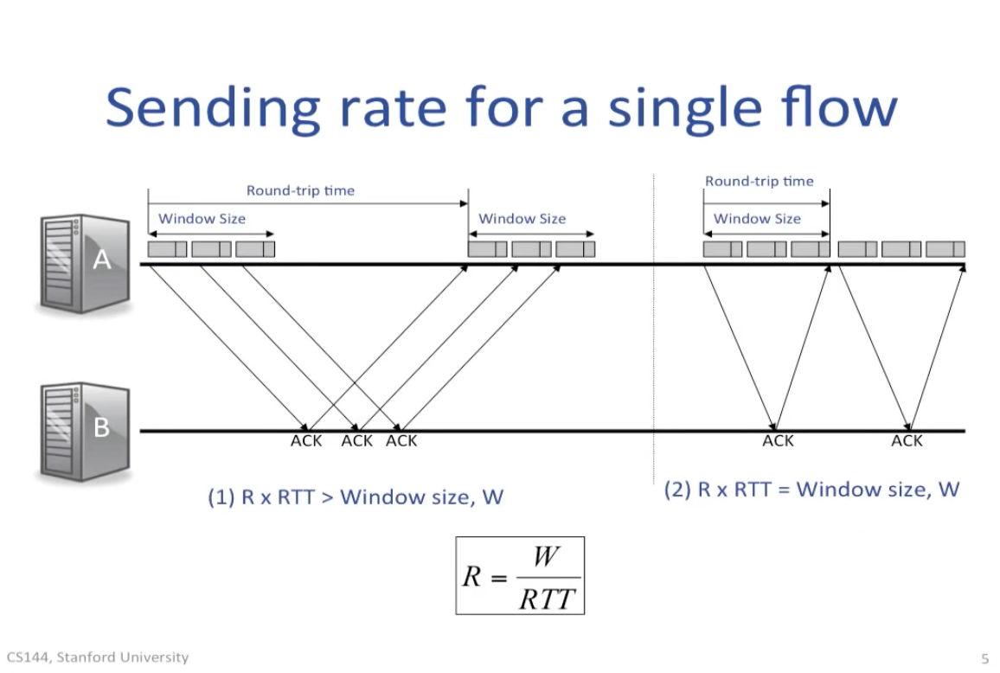

*图：单流发送速率（CS144 Stanford 课件第 5 页）——(1) R × RTT > W 链路未满；(2) R × RTT = W 链路 100% 利用。底部公式 $R = \dfrac{W}{RTT}$。*

3. 缓冲区大小的重要性：为了使 AIMD 流高效工作（即保持 100% 链路利用率），路由器需要足够大的缓冲区。理想的最小缓冲区大小应为 $RTT \times C$，其中 C 是瓶颈链路的容量（带宽）。这个大小的缓冲区可以吸收窗口 w 减半期间未被链路消耗的数据包，防止缓冲区变空导致链路闲置。

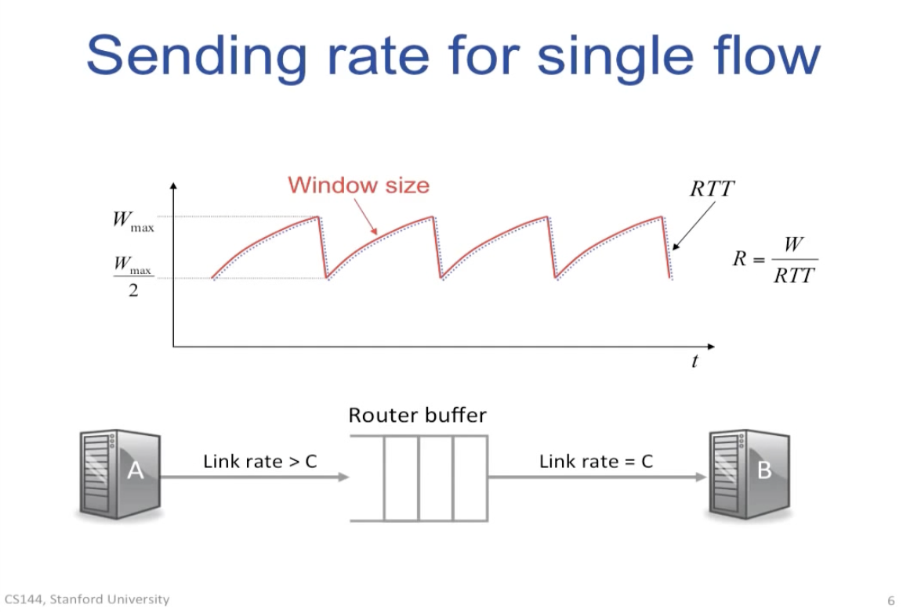

*图：单流 W(t) 与 RTT 同步（CS144 Stanford 课件第 6 页）——W(t) 锯齿、Router buffer 吸收 w 减半期间的多余数据。*

---

<h3 style="font-size: 2em; font-weight: bold;">4.4 拥塞控制—多条 AIMD 数据流算法（AIMD with Multiple Flows）</h3>

---

<h4 style="font-size: 1.5em; font-weight: bold;">概述</h4>

AIMD（加性增乘性减）算法通过调整 TCP 拥塞窗口 大小来控制网络中"在途数据包"（即已发送但未确认的数据包）的数量，从而间接管理拥塞。本节中我们来看看 AIMD 在网络中存在大量并发数据流时如何工作。

---

<h4 style="font-size: 1.5em; font-weight: bold;">数据流吞吐量的计算</h4>

数据流的吞吐量，即每秒发送的字节或数据包数量，可以通过其窗口大小和 RTT 计算，即 $R = \dfrac{W}{RTT}$。在每个 RTT 周期内，发送的数据量等于当前的窗口大小。

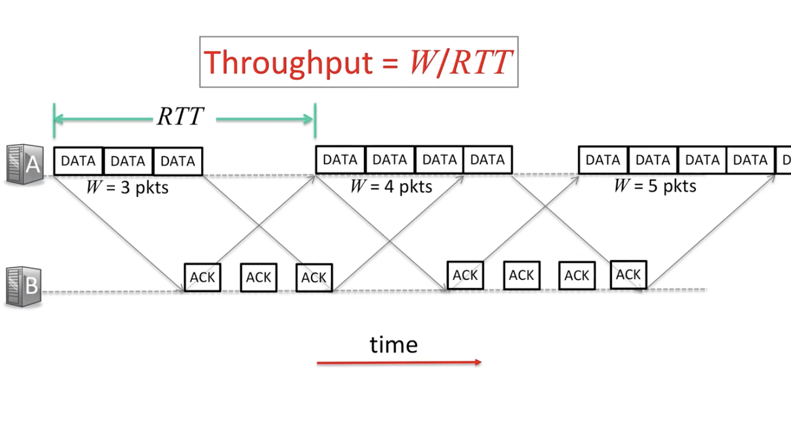

*图：数据流吞吐量 = W/RTT（Stanford 课件）——A→B 之间每个 RTT 周期内可发送 W 个 DATA 包，对应 W 个 ACK 返回；发送量随窗口增长（3 → 4 → 5 pkts）线性增加。*

---

<h4 style="font-size: 1.5em; font-weight: bold;">多条 AIMD 数据流</h4>

在互联网的真实环境中，路由器通常需要同时处理成千上万条数据流。当网络中存在大量流量时，路由器的缓冲区中会混杂来自不同数据流的众多数据包，此时，任何单一数据流的数据包通常只占缓冲区总容量的一小部分。

同时，由于缓冲区几乎始终处于高度占用状态，数据包经历的排队延迟相对稳定。因此，一个合理的假设是：在多流场景下，数据流的往返时间（RTT）基本保持恒定。

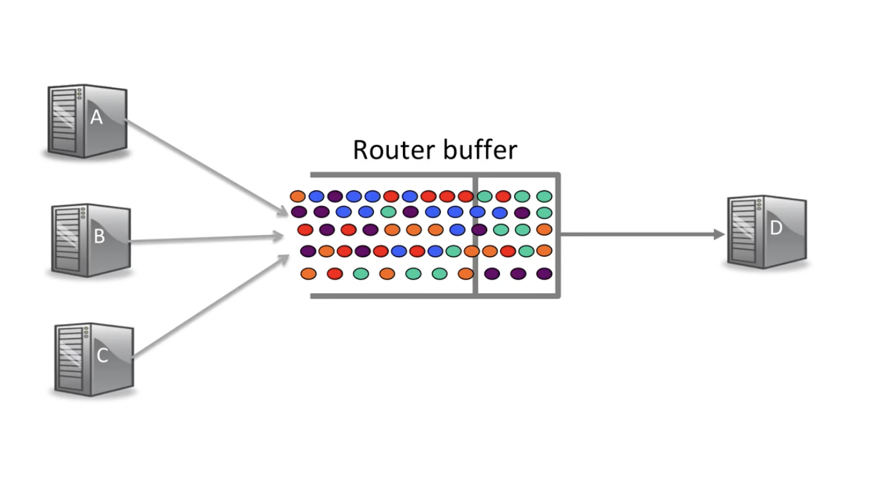

*图：多流共享瓶颈链路（Stanford 课件）——A、B、C 多个发送方共用同一个路由器缓冲区；缓冲区中不同流的数据包混合排队，任意单流只占一小部分。*

---

<h4 style="font-size: 1.5em; font-weight: bold;">单条 AIMD 吞吐量分析</h4>

在单条 AIMD 数据流场景下，拥塞窗口的"锯齿"状变化与往返时间（RTT）保持同步。$\text{Throughput} = \dfrac{W(t)}{RTT(t)} = \text{constant}$，其中 W 为当前拥塞窗口大小，RTT 为数据流往返时间（由传播时延、传输时延和排队时延三部分共同构成）。

窗口大小 W 与 往返时间 RTT 同步波动，二者的比值在实际观测中近似维持恒定。值得注意的是，在单流情形下，窗口大小增大时会加剧排队时延，进而推高 RTT，这一耦合效应使得吞吐量曲线的顶部边缘呈现弯曲特征。

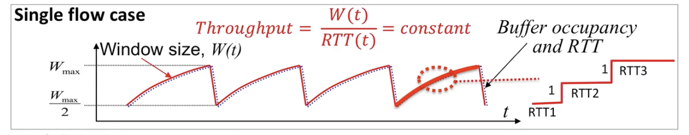

---

<h4 style="font-size: 1.5em; font-weight: bold;">多条 AIMD 吞吐量分析</h4>

在多条 AIMD 数据流共存的场景下，路由器的缓冲区通常处于高度占用状态，这使得数据包所经历的排队延迟变化较小，趋于稳定。因此，可以合理假设在多流环境中，往返时间（RTT）近似保持恒定。

对于单条数据流，其瞬时吞吐量可表示为：
$\text{Throughput}(t) = \dfrac{W(t)}{RTT(t)}$

其中 W(t) 为当前拥塞窗口大小，RTT(t) 为当前往返时间。在 RTT 近似为常数 R 的前提下，上式简化为：
$\text{Throughput}(t) \propto W(t)$

因此，在 RTT 恒定的条件下，数据流的平均吞吐量与其平均窗口大小成正比，窗口大小的变化直接反映了吞吐量的变化趋势。

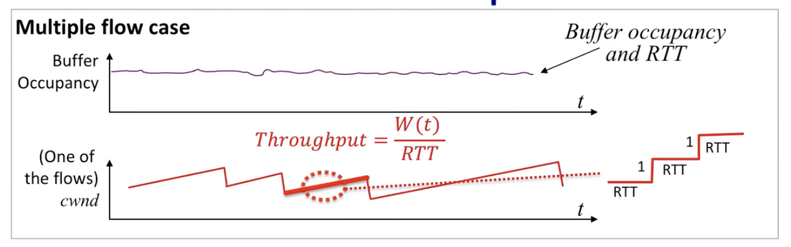

*图：多流 AIMD 吞吐量分析（Stanford 课件）——多流共存时 Buffer Occupancy 始终接近满载 → 排队延迟稳定 → RTT 几乎恒定 → Throughput ∝ W(t) 与 cwnd 锯齿同形。*

---

<h4 style="font-size: 1.5em; font-weight: bold;">吞吐量与丢包率的关系</h4>

我们通过几何方法推导吞吐量 T、往返时间 RTT 和丢包概率 p 之间的关系。

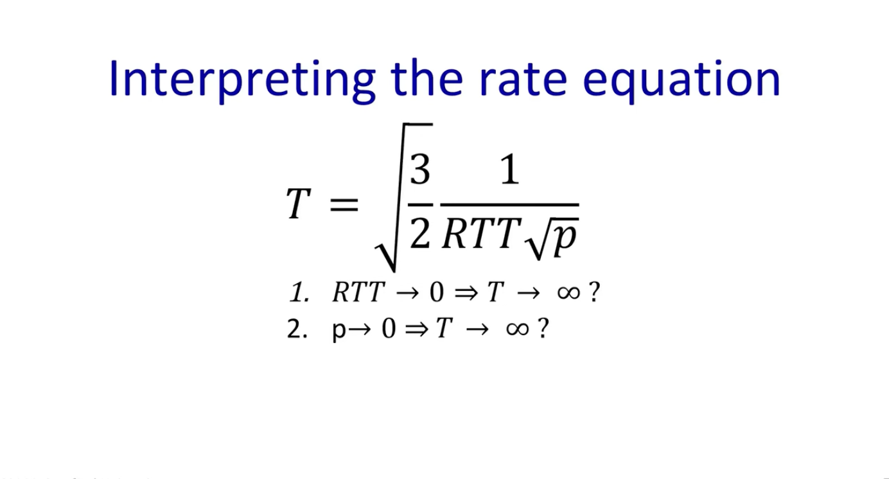

这个简洁的公式揭示了 AIMD 在多流环境下的两个关键特性：

1. 吞吐量与往返时间成反比：$T \propto \dfrac{1}{RTT}$
   这意味着与更远（RTT更大）的服务器通信时，流获得的吞吐量会更低。这通常被视为AIMD的一个缺点，因为它"惩罚"了距离更远的流量。

2. 吞吐量与丢包率的平方根成反比：$T \propto \dfrac{1}{\sqrt{p}}$
   当丢包率 p 趋近于0时，吞吐量 T 理论上会趋近于无穷大。这正反映了AIMD的行为：如果没有丢包信号，发送方的窗口就会无限增长，失去"刹车"机制。这再次印证了丢包是AIMD进行拥塞控制的核心信号。

---

<h3 style="font-size: 2em; font-weight: bold;">4.5 拥塞控制—TCP Tahoe 的超时估算与自我时钟</h3>

---

<h4 style="font-size: 1.5em; font-weight: bold;">TCP 发送方发送速率</h4>

TCP 发送速率由流量控制（Flow Control）和拥塞控制（Congestion Control）共同决定。**最终发送窗口 = min（接收窗口 rwnd， 拥塞窗口 cwnd）**。

- 流量控制（Flow Control）：目的是防止发送方发送过快，导致接收方的缓冲区溢出。这是一个端到端的机制，由接收方通过 ACK 报文中的 rwnd 字段来告知发送方。

- 拥塞控制（Congestion Control）：目的是防止网络中的路由器因流量过载而崩溃。这是发送方根据对网络状况的推测，自主进行的速率调整。

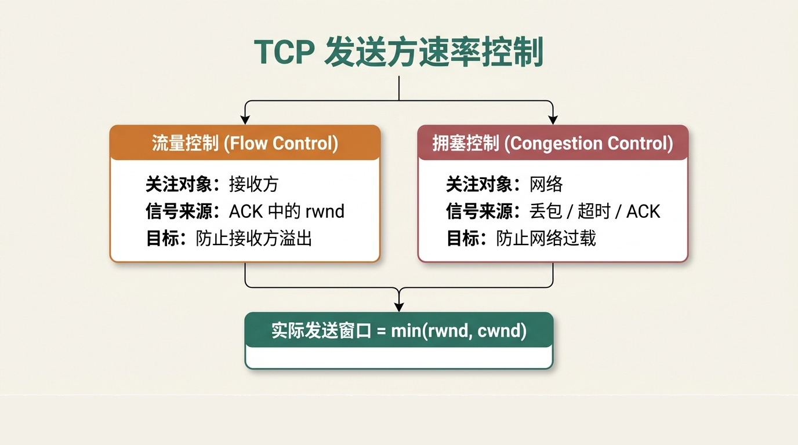

---

<h4 style="font-size: 1.5em; font-weight: bold;">网络拥塞的产生</h4>

用一条横跨美国的数据传输路径来比喻，数据从旧金山发往波士顿，途中经过多个路由器，每个路由器都有输入队列来缓存待转发的数据包。

- 正常情况：发送速率适中时，数据包平稳流过各路由器，队列长度稳定，丢包率极低。

- 拥塞发生：当发送速率超过路径中某个"瓶颈"路由器的处理能力时，该路由器的队列开始堆积。若发送方持续高速发送，队列最终溢出，新到达的数据包被丢弃。

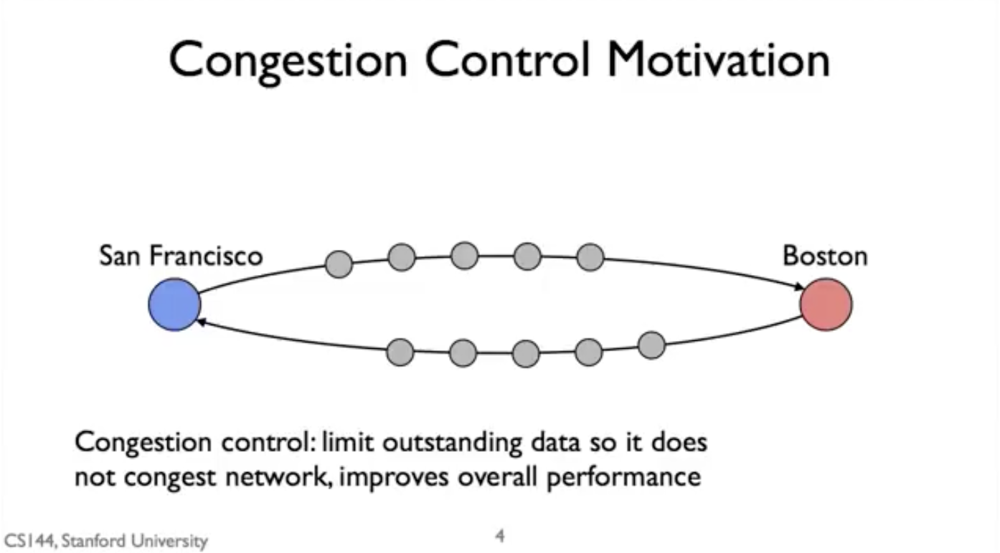

---

<h4 style="font-size: 1.5em; font-weight: bold;">网络拥塞的后果</h4>

网络拥塞带来的数据包丢失会触发 TCP 重传，这不仅增加了传输延迟，还因相同数据被多次发送而进一步加剧网络负担，形成恶性循环，严重时甚至引发"拥塞崩溃"——网络吞吐量急剧下降，几乎无法正常工作。

---

<h4 style="font-size: 1.5em; font-weight: bold;">拥塞控制的目标</h4>

拥塞控制的核心目标可分解为两层：一是动态调节发送窗口，使其向网络承载上限靠拢；二是确保调节过程不越过该上限，避免引发拥塞。最终追求的理想状态是链路"繁忙但不过载"，以实现吞吐量的最大化。

---

<h4 style="font-size: 1.5em; font-weight: bold;">早期 TCP 的“拥塞崩溃”与 Tahoe   的改进</h4>

早期 TCP 的发送速率完全由接收方在 ACK 报文中通告的“接收窗口”（rwnd）决定。然而，该窗口仅反映接收端缓存的可用容量，与中间网络的真实承载能力无关。因此，在三次握手完成后，发送方会一次性将整个接收窗口的数据全部注入网络，完全无视路径中路由器和链路的实际传输状况。

这种“爆发式”发送极易引发网络拥塞：大量数据包在瓶颈链路处堆积，导致路由器缓存迅速溢出，进而引发频繁丢包和超时重传。然而，此时网络早已饱和，重传包只会令拥塞雪上加霜，形成恶性循环。

最终，网络链路被重复传输的数据包填满，真正的有效数据却难以通过，导致传输延迟显著增加，有效吞吐量极低。这就是早期 TCP 所引发的"拥塞崩溃"现象——网络看似繁忙，实际传输效率却极为低下。

后来 Van Jacobson 为 TCP 引入了三项重大改进，彻底改变了上述局面：

1. 拥塞窗口（Congestion Window）
2. 更好的超时估计（Timeout Esitmation）
3. 自我计时（Self-Clocking）

---

<h4 style="font-size: 1.5em; font-weight: bold;">TCP Tahoe 的窗口控制与拥塞管理</h4>

TCP 发送方的实际发送能力由两个窗口共同决定：

| 窗口类型 | 作用 | 控制方 |
|---------|------|--------|
| 接收方窗口（rwnd） | 防止发送方压垮接收方应用缓存 | 接收方通告 |
| 拥塞窗口（cwnd） | 防止发送方压垮网络链路 | 发送方自主维护 |

**实际发送窗口 = min(rwnd, cwnd)**，两者取最小，确保发送方既不淹没接收方，也不拥塞网络。

---

TCP Tahoe 通过 慢启动 和 拥塞避免 两种状态来管理窗口增长：

| 状态 | 目标 | 窗口增长速度 | 触发条件 |
|------|------|-------------|---------|
| **慢启动** | 快速探测可用带宽的起点 | 指数增长（每个RTT翻倍） | 连接建立 或 丢包恢复后 |
| **拥塞避免** | 接近网络容量时温和增长，防止拥塞 | 线性增长（每个RTT +1 MSS） | 超过慢启动阈值（ssthresh） |

---

<h4 style="font-size: 1.5em; font-weight: bold;">慢启动状态（Slow Start）的工作原理</h4>

当 TCP 进入慢启动状态时，其拥塞窗口被设置为 1个 MSS。此后，每收到一个新的确认，拥塞窗口就增加 1个 MSS。

代码逻辑描述：

```
cwnd = 1 MSS
for each new ACK received:
    cwnd += 1 MSS
```

这意味着拥塞窗口呈指数增长：1, 2, 4, 8, 16... 虽然名为"慢启动"，但相比旧方法（立即发送整个窗口），其增长是受控的；相比后续的"加性增"，其增长又是快速的。

---

<h4 style="font-size: 1.5em; font-weight: bold;">拥塞避免状态（Congestion Avoidance）的工作原理</h4>

当 拥塞窗口（cwnd）> 慢启动阈值 （ssthresh） 时，TCP 进入拥塞避免状态。此时每个 RTT（往返时间） 周期内，拥塞窗口仅增加 1 个 MSS，增长速度极为平缓。

假设 当前拥塞窗口 cwnd = W（即 W 个报文段），这意味着：在一个 RTT 内，发送方可以发送 W 个报文段，相应地会收到 W 个 ACK。因此：

$$\text{每个ACK的增量} = \dfrac{\text{总增量}}{\text{ACK数量}} = \dfrac{1}{W} \text{（个MSS）}$$

---

<h4 style="font-size: 1.5em; font-weight: bold;">拥塞窗口调整的触发条件</h4>

状态切换条件：当 `cwnd > ssthresh`  时，TCP 从**慢启动**进入**拥塞避免**状态。


TCP 发送方根据三种信号将拥塞窗口在两种状态间转换：

| 当前状态 | 收到新ACK | 收到3个重复ACK | 发生超时 |
|---------|----------|---------------|---------|
| **慢启动** | 保持慢启动<br>`cwnd += 1` | 退回慢启动<br>`ssthresh = cwnd/2`<br>`cwnd = 1` | 退回慢启动<br>`ssthresh = cwnd/2`<br>`cwnd = 1` |
| **拥塞避免** | 保持拥塞避免<br>`cwnd += 1/cwnd` | 退回慢启动<br>`ssthresh = cwnd/2`<br>`cwnd = 1` | 退回慢启动<br>`ssthresh = cwnd/2`<br>`cwnd = 1` |

**统一规则**：丢包信号（3个重复ACK或超时）触发相同的响应——记录当前窗口一半为新的阈值，重置拥塞窗口（cwnd）大小为1，重新进入慢启动。

<table>
<tr>
<td width="56%">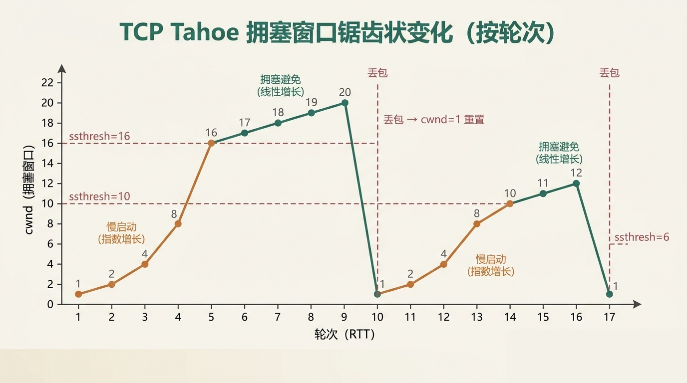</td>
<td width="44%">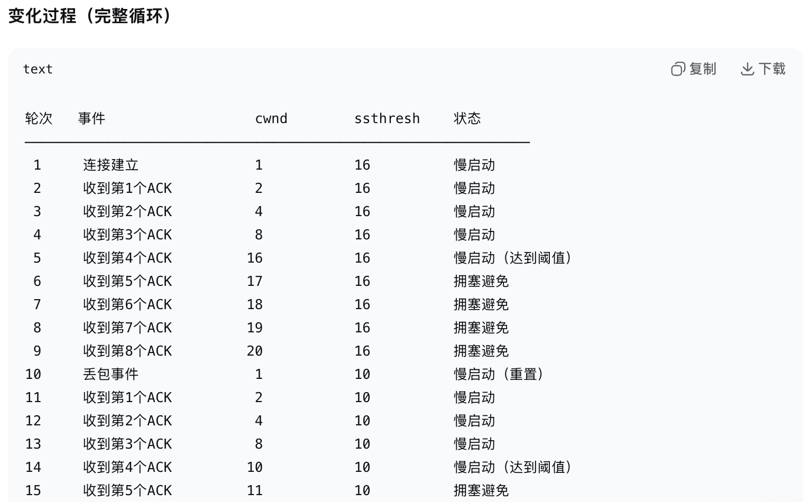</td>
</tr>
</table>

---

<h3 style="font-size: 2em; font-weight: bold;">4.6 拥塞控制—超时估算与自我时钟</h3>

---

<h4 style="font-size: 1.5em; font-weight: bold;">超时估算（Timeout Esitmation）概述</h4>

RTO（Retransmission Timeout，重传超时） 是 TCP 发送方在发出数据包后，等待接收方确认（ACK）的最长时间。如果超过这个时间仍未收到 ACK，发送方就认为数据包丢失，触发超时重传。

RTO 的设定直接影响传输效率：RTO 过小，易因正常延迟抖动触发不必要的重传和慢启动；RTO 过大，则丢包时发送方等待过久，导致链路空闲、带宽浪费。因此，精确且动态适应的 RTO 是保障网络性能的关键。

理想情况下，如果网络中的往返时间（RTT）是恒定不变的，那么 RTO 只需略大于 RTT 即可，因为确认包（ACK）理应在数据发出后的一个 RTT 内返回。然而，现实中的 RTT 并非恒定：

- 网络延迟具有高度动态性。

- 随着数据流填充沿途路由器的队列，RTT 会因负载变化而显著改变。

- 其他流量源的突发也会大幅影响队列延迟。

面对这些"噪声"，我们必须建立一套稳健的方法，来准确判断究竟该等待多久才假设数据包已丢失。

---

<h4 style="font-size: 1.5em; font-weight: bold;">早期 TCP 的不足（TCP Tahoe 之前）</h4>

早期的 TCP 采用了一种较为简单直接的 RTT 估计方法：

1. 它维护一个单一的平滑变量 $R$ 作为 RTT 估计值

2. 每次收到新 ACK 时，测量本次实际 RTT（记为 $M$），并用指数加权移动平均（EWMA）更新：$R = \alpha \times R + (1 - \alpha) \times M$（其中平滑因子 $\alpha$ 通常取 0.875）

3. 如果某个数据段在 $2R$ 时间内未收到确认，则判定为丢失并触发重传

这个方法的核心缺陷在于：它假设 RTT 的方差是 $R$ 的一个固定常数倍（即固定为 2 倍）。这种静态倍数无法适应复杂多变的网络环境，导致在 RTT 波动大时要么过早重传（造成带宽浪费），要么在 RTT 稳定时等待过久（降低吞吐量）。

---

<h4 style="font-size: 1.5em; font-weight: bold;">TCP Tahoe 的改进：引入方差估计</h4>

为了克服上述缺陷，TCP Tahoe 在 RTO 计算中引入了延迟方差估计，使其能动态适应网络变化。其核心机制如下：

1. 维持 RTT 平滑估计：继续使用 EWMA 公式计算平均 RTT（$R$），与早期算法一致。
2. 计算测量误差：每次获得新测量值 $M$ 时，计算当前误差 $\text{Err} = M - R$。
3. 估计方差：对误差的绝对值（代表偏差幅度）应用另一个 EWMA，得到方差估计值 $V$（注意，它跟踪的是平均偏差，而非标准差的平方）。
4. 计算最终 RTO：最终的重传超时值由均值与方差组合得出：$RTO = R + 4 \times V$ 

这一改进的成效：

- 当 RTT 非常稳定时，$V$ 值很小，RTO 仅略大于平均 RTT，减少了不必要的等待。

- 当 RTT 剧烈波动时，$V$ 值随之增大，RTO 会自动调大，从而有效避免因网络抖动而触发不必要的重传和慢启动，极大地提升了拥塞控制的稳健性。

---

<h4 style="font-size: 1.5em; font-weight: bold;">自我时钟（Self-Clocking）概述</h4>

自我时钟：接收方立即发送确认的策略，使得确认的到达节奏反映了网络的可用带宽。发送方据此节奏发送新数据，实现了传输速率与瓶颈带宽的自动匹配，并控制了网络中的在途数据量。

自时钟的核心思想：根据接收到的确认来定时发送新的数据包。其概念模型如下：

1. 发送方有一个"大管道"，可以快速产生数据包。
2. 网络中间存在一个瓶颈链路。
3. 快速发送的数据包经过瓶颈链路时会被"拉伸"，在时间上间隔开来到达接收方。
4. 接收方每收到一个数据包，就发送一个确认。
5. 这些确认包经过瓶颈链路返回发送方时，其到达间隔反映了接收方收到数据包的间隔，即瓶颈链路允许的速率。
6. 发送方只有在收到一个确认后，才发送一个新的数据包。

通过这种方式，发送方发送数据包的速率会自动匹配网络瓶颈链路所能处理的速率，从而避免一次性注入大量数据包导致队列溢出和拥塞。这实现了"管道填充而不溢出"的目标。

此外，接收方应积极发送确认（例如重复确认），这为发送方提供了重要的网络状态信号（如丢包），并帮助其维持自时钟节奏。

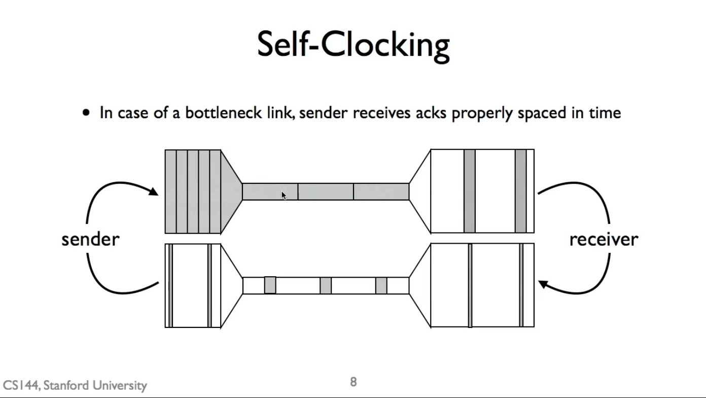

*图：Self-Clocking 概念图——发送方、瓶颈链路、接收方，ACK 在时间上分散到达发送方*

---

<h3 style="font-size: 2em; font-weight: bold;">4.7 拥塞控制—TCP Reno 与 TCP New Reno</h3>

---

<h4 style="font-size: 1.5em; font-weight: bold;">概述</h4>

TCP Reno 与 TCP Tahoe 的唯一区别在于对三次重复 ACK 确认的响应：Reno 执行快速恢复，将拥塞窗口（cwnd）减半；Tahoe 则将拥塞窗口（cwnd）设为 1 并进入慢启动。而在超时场景下两者行为完全一致，均将拥塞窗口（cwnd）设为 1，慢启动阈值（ssthresh）设为当前拥塞窗口（cwnd）的一半。

---

<h4 style="font-size: 1.5em; font-weight: bold;">TCP Tahoe</h4>

TCP Tahoe 的处理方式是统一策略：无论遇到超时还是三次重复 ACK 确认，Tahoe 都执行以下动作：

1. 将慢启动阈值（ssthresh）设为当前拥塞窗口（cwnd）的一半
2. 将拥塞窗口（cwnd）大小重置为 1
3. 重新进入慢启动阶段

唯一区别在于重传时机：收到 3 个重复 ACK 时，发送方不等 RTO 超时，立即重传推断丢失的数据包（快速重传）；而超时则需等待 RTO 到期后再重传。


*图：TCP Tahoe 的拥塞窗口行为——每次丢包（含超时或三次重复 ACK 确认）都将 cwnd 降为 1，重新进入慢启动（指数增长）→ 拥塞避免（线性增长）*

---

<h4 style="font-size: 1.5em; font-weight: bold;">TCP Reno</h4>

TCP Reno 的处理方式则是差异化策略：Reno 假设三次重复 ACK 确认仅意味着单个数据包丢失，其他数据包仍正常到达，网络状况尚未严重恶化，因此对此事件采取不同措施：

1. 将慢启动阈值（ssthresh）设为当前拥塞窗口（cwnd）的一半
2. 将拥塞窗口（cwnd）大小减半，而非重置为 1 —— 这一阶段称为快速恢复
3. 立即重传被判定丢失的数据包，无需等待超时


*图：TCP Reno 的拥塞窗口行为——三次重复 ACK 触发 cwnd 减半并保持拥塞避免（提升吞吐量），而超时仍触发 cwnd 降为 1 并重启慢启动*

这一差异带来的核心优势是：在发生三次重复 ACK 确认后，TCP Reno 仍保持在拥塞避免阶段，无需退回慢启动，使拥塞窗口维持在更高水平。因此，TCP Reno 的整体吞吐量显著高于 TCP Tahoe。

---

<h4 style="font-size: 1.5em; font-weight: bold;">TCP New Reno</h4>

TCP New Reno 的核心改进集中在快速恢复阶段，它对拥塞窗口（cwnd）进行了更精细的动态调整，以提高链路利用率。而在超时处理机制上，它则与Reno和Tahoe保持一致。

快速恢复阶段的窗口调整策略如下：

　　**1. 进入快速恢复**

　　当发送方收到三次重复 ACK 确认时，判定数据包丢失，触发快速恢复。此时，拥塞窗口减半（即设置为慢启动阈值），进入恢复状态。

　　**2. 窗口临时膨胀（Inflating）**

　　在快速恢复期间，每收到一个额外的重复确认，拥塞窗口就临时增加一个MSS（最大报文段大小）。

　　**目的**：重复确认表明接收端仍持续收到后续数据包，网络并未完全阻塞。通过小幅膨胀窗口，发送方可以在等待重传确认的同时，继续发送新数据包，从而避免网络管道在RTT（往返时间）内出现空闲，提升吞吐量。

　　**3. 窗口恢复（Deflating）**

　　当发送方收到对重传数据包的正确确认（即一个新的、非重复的ACK）时，立即退出快速恢复，并将拥塞窗口恢复为进入快速恢复时减半后的目标值。

　　**目的**：及时将窗口回调至合理大小，防止网络因窗口膨胀而过载，确保拥塞控制的有效性。

---

<h3 style="font-size: 2em; font-weight: bold;">4.8 TCP 拥塞控制—AIMD 原理详解</h3>

---

<h4 style="font-size: 1.5em; font-weight: bold;">概述</h4>

在本节课中，我们将深入探讨TCP拥塞控制的核心算法——加性增、乘性减（AIMD）。我们将从网络中的根本矛盾出发，理解AIMD为何能有效平衡链路利用率与用户公平性，并通过可视化图形直观感受其收敛过程。

---

<h4 style="font-size: 1.5em; font-weight: bold;">网络的核心矛盾：效率 vs 公平</h4>

网络中存在一对永恒冲突的需求：

- 服务提供商希望最大化链路利用率，希望网络时刻被数据填满，没有任何空闲带宽，从而获得最大投资回报。

- 用户希望网络资源能公平分配。如果只有一个连接占满整个管道，其他用户将无法接受。

因此，拥塞控制算法的终极目标是：让网络运行在接近满载的高效状态，同时保证多个竞争流能收敛到公平的带宽份额（例如，n个流各占1/n）。这既能避免网络崩溃，又能保障数据传输的效率与公正性。

---

<h4 style="font-size: 1.5em; font-weight: bold;">理想目标：最优拥塞窗口</h4>

一个连接的理想发送速率（拥塞窗口）应为带宽与延迟的乘积，即最优拥塞窗口 = 带宽（B） × 延迟（D），这个值被称为带宽延迟积（BDP）。

- 如果带宽为 10 MB/s，延迟为 100 ms，则窗口应为 1 MB。

- 如果带宽为 6 MB/s，延迟为 90 ms，则窗口应为 540 KB。

原理：当每个连接的拥塞窗口都等于带宽延迟积（BDP）时，每个RTT内发出的数据量恰好能填满链路，既不会造成空闲，也不会导致溢出。此时，所有连接的总发送速率正好等于链路容量，从而实现带宽的充分利用，同时避免过度排队和丢包。

---

<h4 style="font-size: 1.5em; font-weight: bold;">Chiu-Jain Plot：吞吐率轨迹图</h4>

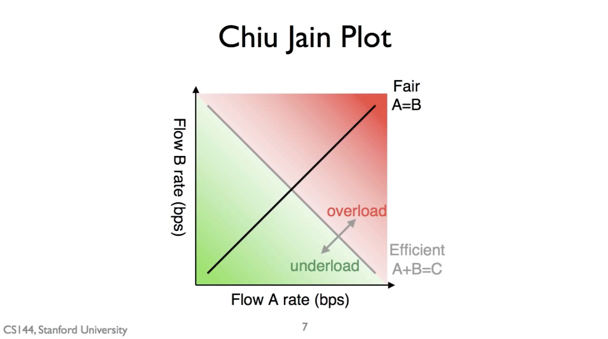

*图：Chiu-Jain Plot——两流速率空间的几何分析，公平线与效率线交点即同时满足公平与效率的最优点*

坐标轴：

- X 轴：流量 A 的速率
- Y 轴：流量 B 的速率

两条参考线：

- 公平线（A = B）：两个流速率相等
- 效率线（A + B = C）：链路被完全利用

区域含义：

- 效率线右侧：过载，触发拥塞控制
- 效率线左侧：负载不足，链路闲置

目标：流量从任意起点出发，最终收敛到两条线的交点，即同时满足公平与效率。

---

<h4 style="font-size: 1.5em; font-weight: bold;">AIMD 的收敛过程</h4>

AIMD 通过周期性振荡，将流量逐步推向理想交点。

以 t₁ 时刻为例：此时流量 B 速率远高于公平份额，流量 A 速率远低于公平份额。

工作循环：

- 加性增：两个流线性增加拥塞窗口，速率沿 45° 方向上升
- 触发过载：总速率触及效率线后继续增加，网络缓冲区溢出，开始丢包
- 乘性减：两个流检测到丢包后，均按比例（如减半）缩小窗口
- 关键效应：速率高的流绝对减少量更大（B 减少得比 A 多），使新状态点（t₃ 时刻）更接近公平线
- 再次加性增：从新起点重新开始线性增长，进入下一轮循环

收敛效果：随着时间推移，每次乘性减都让高速流"损失"更多，低速流"追赶"更多，两者差距不断缩小。最终，多个竞争流的速率会在公平线附近持续小幅振荡——通过加性增缓慢逼近链路容量，偶尔因过载而乘性后退。

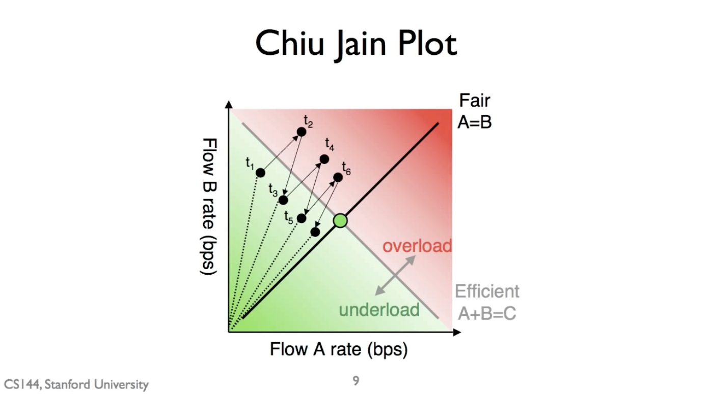

*图：AIMD 在 Chiu-Jain Plot 中的收敛轨迹——加性增沿 45° 方向移动、乘性减向原点方向收缩的锯齿形循环，逐步逼近公平线与效率线的交点*

---

<h4 style="font-size: 1.5em; font-weight: bold;">从轨迹图到收敛：AIMD 如何平衡效率与公平</h4>

通过吞吐量轨迹图可视化分析两个竞争流的行为，可以看出理想收敛点位于公平线（A = B）与效率线（A + B = C）的交点，即同时满足资源公平分配与链路高利用率的最佳平衡点。

AIMD 通过周期性的加性增探索可用带宽，逐步逼近链路容量；一旦检测到拥塞，立即通过乘性减快速降低负载，且速率高的流退让更多，从而不断缩小各流间的差距。这种反复"试探—后退—再试探"的机制，能有效引导网络流量收敛到公平与效率的均衡状态，是互联网拥塞控制的核心基石之一。

---

<h3 style="font-size: 2em; font-weight: bold;">4.10 拥塞控制（Congestion Control）</h3>

---

<h4 style="font-size: 1.5em; font-weight: bold;">流量控制（Flow Control）vs 拥塞控制（Congestion Control）</h4>

| 特性 | 流量控制 | 拥塞控制 |
| :--- | :--- | :--- |
| **关注点** | 端到端（接收方主机） | 网络核心（路由器和链路） |
| **目标** | 防止发送方数据过载接收方的处理能力  | 防止过多数据包过载网络中间设备（如路由器），避免队列溢出造成丢包  |
| **控制对象** | 发送速率应适配接收方的接收窗口（rwnd）  | 发送速率应适配网络的承载能力（拥塞窗口 cwnd）   |

---

<h4 style="font-size: 1.5em; font-weight: bold;">网络拥塞的原理</h4>

拥塞原理：网络拥塞的本质是路由器的接收速率持续高于其转发速率，导致数据包在缓冲区中不断堆积。若此状态长期持续，缓冲区将最终溢出，从而引发数据包丢失。

**设计目标：最大最小公平性**

- 一种理想的公平性标准：在不降低较低速率流的前提下，无法再提升较高速率流的吞吐量。
- 网络的目标是实现公平，同时保持高利用率。

---

<h4 style="font-size: 1.5em; font-weight: bold;">TCP 拥塞控制的核心算法：AIMD（加性增、乘性减）</h4>

**AIMD 算法核心机制**

- 加性增：当网络传输顺畅、无丢包时，TCP 发送方每收到一个 ACK 确认时，便将 拥塞窗口（cwnd）增加 1 个 MSS（最大报文段大小），实现缓慢而线性的增长，缓慢探测网络容量。 公式表示：cwnd = cwnd+1（每经过一个 RTT）
- 乘性减：当网络拥塞，TCP 发送方检测到数据包丢失的情况，发送方立即将 拥塞窗口（cwnd）大小减半，实现快速而剧烈的下降，迅速减轻网络负担。 公式表示：cwnd = cwnd/2（检测到丢包时立即执行）

---

<h4 style="font-size: 1.5em; font-weight: bold;">TCP 吞吐量（Throughput）公式</h4>

$$
T = \sqrt{\frac{3}{2}} \cdot \frac{1}{RTT \cdot \sqrt{p}}
$$

其中 p 为丢包率。该公式揭示了丢包率越高，吞吐量下降越剧烈。

---

<h4 style="font-size: 1.5em; font-weight: bold;">TCP 拥塞控制的实践实现</h4>

TCP 拥塞控制的核心机制是拥塞窗口（cwnd）。一个 TCP 流在网络中已发送但尚未确认的字节数，受限于接收方窗口（rwnd）与拥塞窗口（cwnd）中的较小值，即：

$$
\text{已发送未确认字节数} = \min(rwnd, cwnd)
$$

而实际的发送速率，则由拥塞窗口（cwnd）和往返时间（RTT）共同决定。

---

<h4 style="font-size: 1.5em; font-weight: bold;">拥塞窗口（cwnd）的两大核心状态</h4>

| 状态 | 英文 | 作用 |
| :--- | :--- | :--- |
| **慢启动** | Slow Start | cwnd 从 1 个 MSS 开始，每经过一个 RTT 翻倍（1 → 2 → 4 → 8 → ...），呈指数增长，以快速探测网络容量上限。 |
| **拥塞避免** | Congestion Avoidance | cwnd 线性增长，每个RTT增加1个MSS，缓慢逼近网络容量上限。 |

拥塞窗口（cwnd）的两大核心状态，本质上描述的是拥塞窗口（cwnd）的增长方式。


