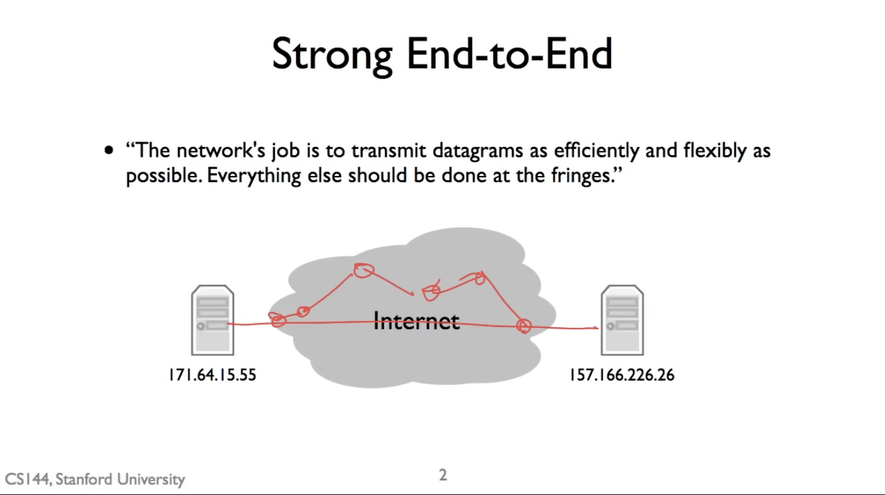
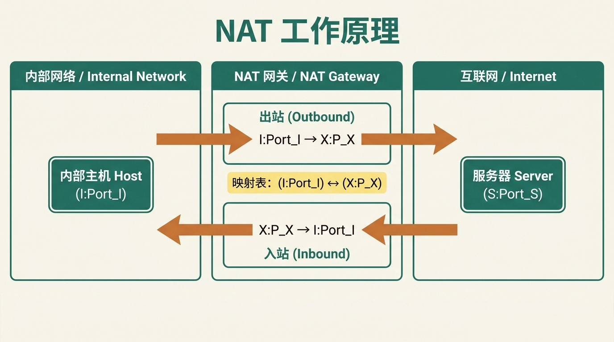
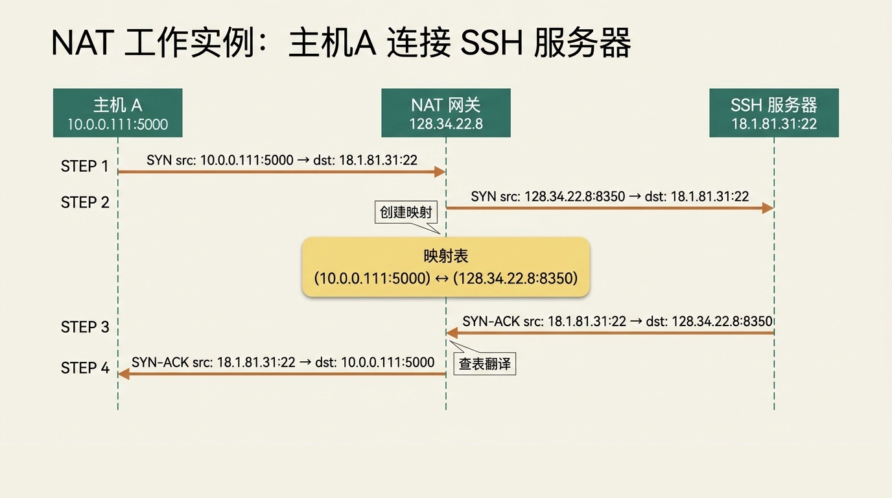
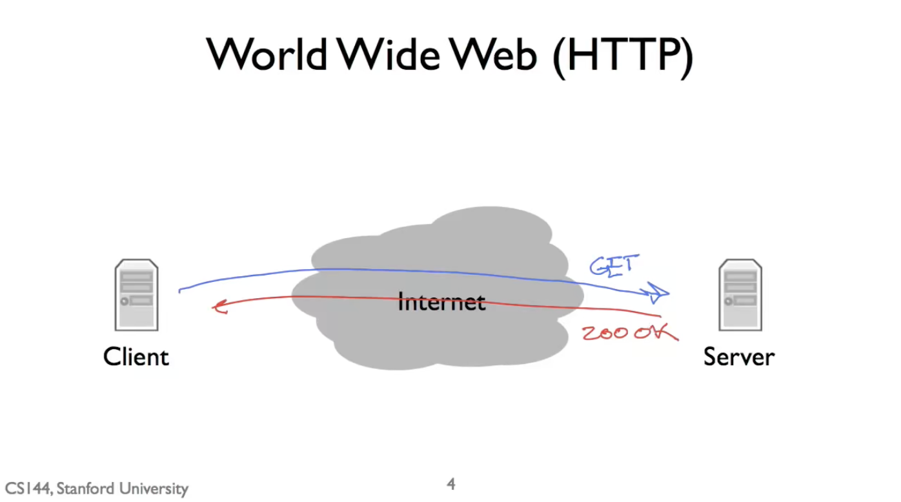
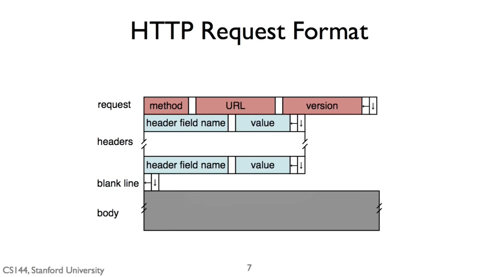
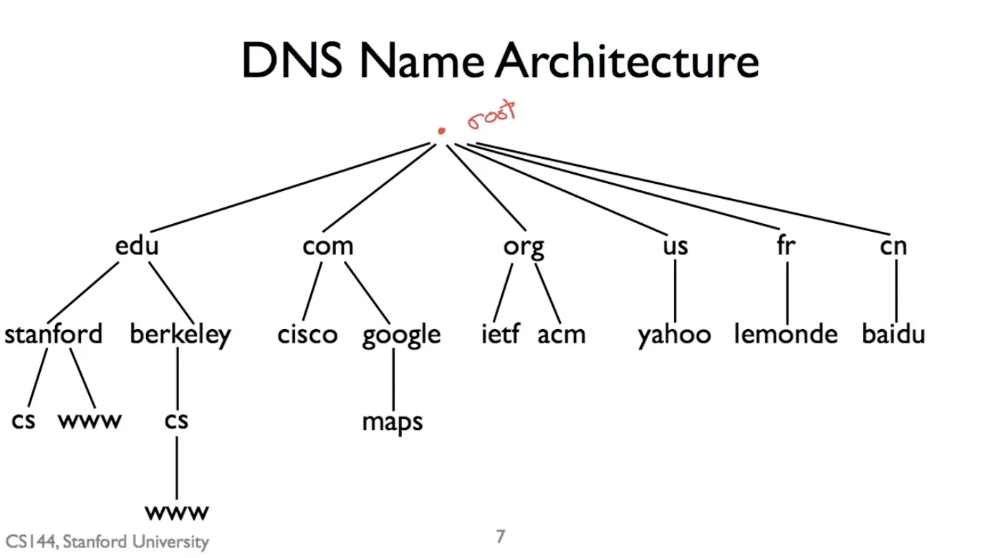
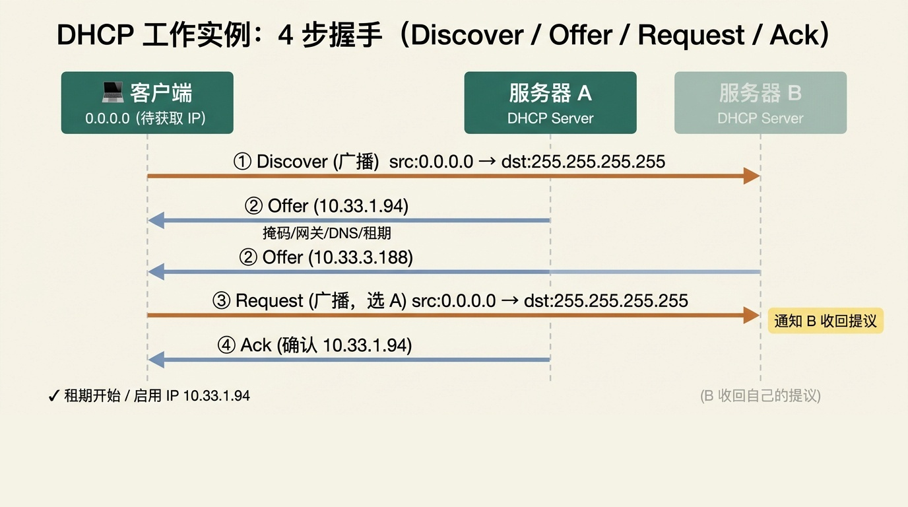

# 第 5 章：应用层 与 NAT

<h3 style="font-size: 2em; font-weight: bold;">5.1 NAT（Network Address Translation，网络地址转换）简介</h3>

---

<h4 style="font-size: 1.5em; font-weight: bold;">端到端原则（End-to-End Principle）</h4>

根据端到端原则，网络的核心任务是尽可能高效、灵活地传输数据包，而所有智能和复杂功能都应放在网络的边缘（即终端主机）。在这个模型中，两个拥有 IP 地址的主机之间的所有网络设备，其职责仅仅是**找到最佳路径并转发数据包**。

将智能置于网络边缘的好处：

- 便于添加新功能
- 不会引入复杂的依赖关系

一旦开始在网络中间（即核心路径上）添加功能，就会引入依赖性和复杂性，使整个系统变得更加臃肿和难以维护。然而 NAT 是一个强有力的例证，其最初在 RFC 1631 中定义，说明在网络中间添加某些功能可以带来显著的好处，但同时也引入了新的复杂性。




*图：Strong End-to-End 原则——网络核心只负责转发数据包，智能放在网络边缘。*

---

<h4 style="font-size: 1.5em; font-weight: bold;">NAT 的工作原理</h4>

NAT（Network Address Translation，网络地址转换） 是一种把私有 IP 地址转换成公共 IP 地址的技术，主要用于解决 IPv4 地址不够用的问题。

工作流程：

1. **出站数据包（从内部到互联网）**：当你的电脑（内部地址，例如 I）发送一个数据包到互联网上的服务器（地址 S）时，数据包首先到达 NAT。
2. **地址重写**：NAT 会重写这个数据包的源地址：将源地址从你的内部私有地址 I 和端口，改为 NAT 自己的公共地址 X 和一个由 NAT 分配的新端口（例如 P_X）。

<div align="center">

| 阶段 | 源地址 | 目标地址 |
| :---: | :---: | :---: |
| 原始数据包 | I:Port_I | S:Port_S |
| 重写后数据包 | X:P_X | S:Port_S |

</div>

3. **状态记录**：NAT 会在其内部创建一个映射表，记录 $(I:Port_I) \leftrightarrow (X:P_X)$ 的对应关系。
4. **入站数据包（从互联网到内部）**：当互联网上的服务器 S 回复数据包时，它会发送到 X:P_X。
5. **反向翻译与转发**：NAT 收到这个目标为 X:P_X 的数据包后，查询其映射表，找到对应的内部地址 I:Port_I，然后将数据包的目标地址重写为 I:Port_I，并将其转发到你的电脑。



*图：NAT 工作原理——出站重写源地址，入站反向翻译目标地址，映射表贯穿其中。*

---

<h4 style="font-size: 1.5em; font-weight: bold;">NAT 工作实例分析</h4>

**场景**：主机 A（10.0.0.111:5000）连接 SSH 服务器（18.1.81.31:22）

以下是连接建立过程中数据包地址的变化步骤：

1. **主机 A 发起连接**：主机 A 发送 TCP SYN 包。
   源: 10.0.0.111:5000 → 目标: 18.1.81.31:22
2. **左侧 NAT 进行出站翻译**：NAT 收到包，创建映射 $(10.0.0.111:5000) \leftrightarrow (128.34.22.8:8350)$，并重写包。
   源: 128.34.22.8:8350 → 目标: 18.1.81.31:22
3. **服务器回复**：SSH 服务器向 NAT 的公共地址回复 SYN-ACK 包。
   源: 18.1.81.31:22 → 目标: 128.34.22.8:8350
4. **左侧 NAT 进行入站翻译**：NAT 根据映射表，将包目标地址翻译回主机 A 的地址。
   源: 18.1.81.31:22 → 目标: 10.0.0.111:5000



*图：NAT 工作实例——4 步走完一次 TCP 连接建立的全过程。*

---

<h4 style="font-size: 1.5em; font-weight: bold;">NAT 的状态管理</h4>

NAT 的核心在于维护连接状态，通常采用 "按需创建" 的策略。

基本模型：

- NAT 不会预先创建任何映射
- 只有当它从内部接口收到一个目的地为外部网络 IP 的数据包时，才会动态地为这个 (内部IP:端口, 协议) 元组分配一个 (外部IP:端口) 元组，并创建映射记录
- 随后，利用这个映射来处理返回的数据包

---

<h3 style="font-size: 2em; font-weight: bold;">5.4 NAT 操作</h3>

---

<h4 style="font-size: 1.5em; font-weight: bold;">NAT 映射机制</h4>

NAT 的核心功能是在 NAT 设备自身的内部接口与外部接口之间建立地址映射，将内部网络的 IP 端口转换为外部网络可见的 IP 端口。

映射建立过程示例：

<div align="center">

| 步骤 | 说明 |
| :---: | :---: |
| 观察出站包 | 内部主机  10.0.0.1:10001  发往外部服务器  S:80  |
| 分配外部地址 | NAT 分配外部端口，如 6641 |
| 建立映射 | 10.0.0.1:10001 → 128.34.22.8:6641 |

</div>

此后，服务器返回至 128.34.22.8:6641 的数据包，会依据映射被翻译并转发回 10.0.0.1:10001。

---

<h4 style="font-size: 1.5em; font-weight: bold;">NAT 对未映射数据包的处理</h4>

NAT 本身也是一个 IP 设备，即使没有端口映射，也需像普通路由器/主机一样响应请求。

处理原则：

- 若目的端口在 NAT 本身上有服务运行（如 Web 管理界面），则正常响应。
- 若目的端口无服务，通常拒绝连接（如发送 TCP RST）或返回 ICMP 错误。

简言之：NAT 仅在数据包触发已存在映射或需创建新映射时，才执行特殊地址转换。

---

<h4 style="font-size: 1.5em; font-weight: bold;">映射的生命周期管理</h4>

映射不会永久存在，需管理创建与销毁以避免端口资源耗尽。

<div align="center">

| 协议 | 映射创建 | 映射销毁 |
| :---: | :---: | :---: |
| UDP | 内网设备主动访问外网时 | 无连接终止信号，依赖超时计时器（如 30 秒或更长） |
| TCP | 内网设备主动访问外网时 | 观察到 FIN 握手正常终止可立即回收；异常中断则依赖超时 |

</div>

---

<h3 style="font-size: 2em; font-weight: bold;">5.5 HTTP（HyperText Transfer Protocol）协议</h3>

---

<h4 style="font-size: 1.5em; font-weight: bold;">超文本（Hypertext）</h4>

HTTP 协议的核心——"超文本"。超文本是一种文档格式，它允许在文档中同时包含格式信息和内容信息。与微软 Word 或 PDF 等二进制格式不同，超文本完全由 ASCII 文本构成，这意味着你可以用任何文本编辑器查看其内容。

以下是一个来自维基百科页面的超文本摘录示例：

```html
<h2>历史</h2>
<p>HTTP 最初旨在传输文档，现在已被用于许多其他事情，如 <a href="http://www.w3.org/pub/WWW/">流媒体</a> 等。</p>

```

在基本层面上，超文本文档就是一个文本文档，浏览器根据文档中特殊的格式命令（称为"标记"）来显示它。例如，`<h2>` 标签表示这是一个二级标题，应以更大的字体显示。超链接则是一种特殊的标记，表示标签内的内容在被点击时，应加载指定的 URL。

超文本文档的独特之处在于，它可以通过标记引用并嵌入其他文件（如图片），而无需将这些文件的数据直接存储在文档中。

---

<h4 style="font-size: 1.5em; font-weight: bold;">HTTP 的基本模型</h4>

HTTP 采用客户端-服务器模型，以文档为中心进行通信。

基本流程：

1. 客户端（如浏览器）向服务器建立一个 TCP 连接
2. 客户端通过该连接发送一个 HTTP 请求
3. 服务器接收并处理请求
4. 服务器通过同一个连接发送一个 HTTP 响应回客户端
5. 客户端读取响应，这可能促使它发出更多请求（例如获取页面中嵌入的图片）

HTTP 协议本身也是由 ASCII 文本构成的，人类可读。最常见的请求方法是 GET，用于请求页面。



*图：World Wide Web（HTTP）—— 客户端通过 Internet 向服务器发 GET 请求。*

---

<h4 style="font-size: 1.5em; font-weight: bold;">HTTP 请求格式</h4>

HTTP 请求格式由以下四部分组成：

<div align="left">

| 部分 | 说明 |
| :---: | :---: |
| 请求行 | 包含方法（如 GET）、请求的 URL 和 HTTP 版本号 |
| 请求头 | 零个或多个头部行，每行包含字段名和对应的值 |
| 空行 | 用于分隔头部和主体 |
| 请求主体 | GET 请求通常为空；POST 等请求包含要提交的数据 |

</div>



*图：HTTP 请求格式——4 部分：请求行 / 请求头 / 空行 / 请求主体。*

---

<h4 style="font-size: 1.5em; font-weight: bold;">GET 请求完整示例</h4>

```http
GET /full-duplex/index.html HTTP/1.1      ← 请求行
Host: www.stanford.edu                    ← 请求头
User-Agent: Mozilla/5.0                   ← 请求头
If-Modified-Since: Wed, 21 Oct 2022 07:28:00 GMT   ← 请求头
                                          ← 空行
                                          ← 请求主体（GET 请求为空）
```

注意：GET 请求虽然主体为空，但空行仍然存在，它是请求头部结束的标志。

---

<h4 style="font-size: 1.5em; font-weight: bold;">POST 请求完整示例</h4>

```http
POST /login HTTP/1.1                      ← 请求行
Host: www.example.com                     ← 请求头
Content-Type: application/x-www-form-urlencoded   ← 请求头
Content-Length: 25                        ← 请求头
                                          ← 空行
username=abc&password=123                 ← 请求体
```

Content-Type 和 Content-Length 是描述请求体的头部字段

空行之后才是真正的数据

---

<h4 style="font-size: 1.5em; font-weight: bold;">HTTP 响应格式</h4>

HTTP 响应格式由以下四部分组成：

<div align="left">

| 部分 | 说明 |
| :---: | :---: |
| 状态行 | 包含 HTTP 版本、状态码（如 200）和状态短语（如 OK） |
| 响应头 | 零个或多个头部行 |
| 空行 | 用于分隔头部和主体 |
| 响应主体 | 请求的实际内容，如 HTML 文档 |

</div>

---

<h4 style="font-size: 1.5em; font-weight: bold;">HTTP 响应格式示例</h4>

```http
HTTP/1.1 200 OK                                  ← 状态行
Content-Type: text/html                          ← 响应头
Content-Length: 1234                             ← 响应头
Last-Modified: Wed, 21 Oct 2022 07:28:00 GMT     ← 响应头
                                                 ← 空行
<!DOCTYPE html>                                  ← 响应主体
<html>                                           ← 响应主体
...                                              ← 响应主体
</html>                                          ← 响应主体
```

---

<h4 style="font-size: 1.5em; font-weight: bold;">HTTP 请求时间计算</h4>

**场景与参数**：

- 客户端通过 HTTP 请求一个包含 1 个 HTML 文件和 3 张图片的网页
- 往返时间（RTT）：4 秒
- 链接带宽：2 Mbps (即 2 * 10^6 比特每秒)
- HTML 文件大小：100 字节
- 每张图片大小：100 字节
- 连接模型：非持久 HTTP，无并行 TCP 连接

**核心计算原理**：

- TCP 连接建立：每次传输文件前需要三次握手，消耗 1 个 RTT（三次握手中，客户端发出 SYN 后等 1 个 RTT 收到 SYN-ACK 即可发送数据，第三次 ACK 捎带数据一起走，不额外耗时，因此从客户端视角连接建立只消耗 1 个 RTT）
- 文件传输时间：文件大小 / 带宽，需统一单位（1 字节 = 8 比特）
- 文件 请求+响应 传播时间：HTTP 请求传播	0.5 RTT，HTTP 响应传播	0.5 RTT

**分步加载过程**：

1. 获取 HTML 文件：1 RTT 握手 + 1 RTT 请求/响应 + 传输时间
2. HTML文件加载后，客户端解析发现需要图片，于是开始为第一张图片建立新的TCP连接。过程与第一步完全类似。
3. 获取第二、第三张图片：依次进行，无并行

**计算传输时间**：

- 带宽 = 2 Mbps = 2 × 10⁶ bps
- 文件大小 = 100 字节 × 8 = 800 比特
- 单个文件传输时间 = 800 / (2 × 10⁶) = 0.0004 秒，远小于 1 个 RTT（4 秒），可忽略。

**计算总时间**：

- 获取 HTML：2 RTT
- 获取图片 1：2 RTT
- 获取图片 2：2 RTT
- 获取图片 3：2 RTT
- 总 RTT 数量 = 8 RTT
- 总时间 = 8 × 4 秒 = 32 秒

**总结**：

- 非持久 HTTP 且无并行时，每个独立文件的获取都需要完整的 TCP 连接建立和请求-响应周期。
- 传输时间远小于 RTT 时，总时间主要由网络延迟累加决定。

---

<h3 style="font-size: 2em; font-weight: bold;">5.6 HTTP/1.1 长链接（Keep Alive）</h3>

---

<h4 style="font-size: 1.5em; font-weight: bold;">HTTP/1.0 的工作方式及其局限性</h4>

**HTTP/1.0 工作方式**：

HTTP 是一种请求-响应协议。在HTTP/1.0 中，客户端请求一个文档需要：

1. 打开一个 TCP 连接
2. 发送 GET 请求
3. 服务器返回响应（如 200 OK）和文档内容
4. 连接立即关闭

**局限性**：

- 请求第二个文档（如图片）时，必须打开全新的连接早期网页内容以文本为主、图片少时尚可接受，但对于包含文本和两张图片的页面，加载时间可能超过 500 毫秒，大量时间消耗在反复建立和关闭 TCP 连接上。
- 每个新连接的 TCP 拥塞窗口都处于初始状态，无法增长，无法充分利用网络带宽。

**HTTP/1.0 请求示例**：

```http
GET /index.html HTTP/1.0
Host: www.example.com
```

---

<h4 style="font-size: 1.5em; font-weight: bold;">HTTP/1.1 的解决方案：持久连接</h4>

通过在请求和响应报文中添加特定头部字段来实现。

**客户端请求**：

```http
GET /index.html HTTP/1.1
Host: www.example.com
Connection: keep-alive
```

Connection: keep-alive 提示服务器：希望在本次响应结束后保持连接打开。
服务器可根据自身情况决定是否遵从。

**服务器响应**：

```http
HTTP/1.1 200 OK
Content-Type: text/html
Connection: keep-alive
Keep-Alive: timeout=5, max=100
```

响应中也包含 Connection 头部，告知客户端最终决定。
若同意保持连接，还会通过 Keep-Alive 头部告知连接保持多久。

- timeout=5：连接保持 5 秒
- max=100：最多处理 100 个请求

---

<h4 style="font-size: 1.5em; font-weight: bold;">HTTP/1.1 持久连接：核心优势总结</h4>

**连接复用**：

- 客户端可在同一连接上连续发送更多请求，无需重新建立连接
- 客户端仍可打开多个并行连接

**性能提升**：

HTTP/1.1 比 HTTP/1.0 更快，性能提升源于：

- 避免重复建立连接的开销
- 允许 TCP 拥塞窗口增长，提高数据传输效率

---

<h3 style="font-size: 2em; font-weight: bold;">5.8 DNS（Domain Name System，域名系统）</h3>

---

<h4 style="font-size: 1.5em; font-weight: bold;">典型 URL 组成</h4>

```text
http://cs144.stanford.edu/index.html
└─┬─┘ └───────┬────────┘ └───┬───┘
应用协议      主机名          文件路径
```

---

<h4 style="font-size: 1.5em; font-weight: bold;">DNS 的诞生与设计目标</h4>

域名系统（DNS）其基本任务是：将人类可读的名称映射到地址（最初是 IP 地址，现在可以映射到更多类型的值）。

DNS 的设计考虑了以下几个关键因素：

- 处理海量记录：理论上需要能处理数十亿级别的映射记录。

- 分布式控制：不应由一个中心机构管理所有名称。例如，斯坦福大学可以管理 stanford.edu 下的名称，而亚马逊可以管理 amazon.com 下的名称。
- 鲁棒性（Robustness）：系统不应因单个节点的故障而整体崩溃。

使这个分布式、层次化且鲁棒的系统成为可能，主要依赖于两个关键特性：

- **以读为主的数据库**：名称到地址的映射被读取的频率远高于被更新的频率。主机名和 IP 地址的绑定关系相对稳定。

- **宽松的一致性**：允许映射变更的传播存在一定延迟。即，并非所有用户都需要立即看到最新的变化。

这两个特性共同允许 DNS 进行广泛的缓存。一旦某个查询结果被获得，就可以在本地缓存一段时间，并用于回答后续相同的查询，从而极大地减轻了根服务器的压力并提高了响应速度。

---

<h4 style="font-size: 1.5em; font-weight: bold;">DNS 的层次化命名架构</h4>

为了实现分布式管理，DNS 采用了层次化的命名结构。我们都对此很熟悉：

- **根域（Root）**：位于最顶层，用一个点 . 表示，对应根域名服务器。

- **顶级域（TLD）**：位于根域之下，例如 .com、.org、.edu、.cn（国家代码顶级域）。

- **二级域（SLD）**：在顶级域之下，例如 stanford.edu、baidu.com。

- **子域（Subdomain）**：域的所有者可以进一步创建子域，例如 cs.stanford.edu（斯坦福大学下的计算机科学系），www.google.com（谷歌公司下的万维网服务）。

**关键机制**：

- **区域（Zone）与授权**：每个层次（根、TLD、域名、子域名）都可以作为一个独立的"区域"进行管理。上级区域可以将子区域的管理权授权给下级。例如，根服务器将 .edu 区域的管理权授权给 .edu 的服务器；.edu 服务器又将 stanford.edu 区域的管理权授权给斯坦福大学的 DNS 服务器。

- **服务器复制**：每个区域都可以由多台复制的服务器提供服务，而非单点。这提供了高可用性和鲁棒性。即使一台服务器宕机，其他副本仍能应答查询。



*图：DNS Name Architecture——根域（root）→ TLD（edu/com/org/us/fr/cn）→ 二级域（stanford/berkeley/cisco/...）→ 子域（cs/www/maps）的层次化命名结构。*

---

<h4 style="font-size: 1.5em; font-weight: bold;">DNS 根服务器</h4>

**数量与标识**：根区域由标记为 A 到 M 的 13 组根服务器提供服务。

**任播技术（Anycast）**：

- 这 13 组服务器通过任播技术被高度复制。
- 全球有数百台物理服务器共享这 13 个 IP 地址。
- 用户的查询会自动路由到离自己最近的一台根服务器实例。

**鲁棒性**：这种设计使根服务器极其健壮，能够抵御大规模 DDoS 攻击。

---

<h4 style="font-size: 1.5em; font-weight: bold;">DNS 查询示例</h4>

**目标**：客户端查询 www.stanford.edu 的 IP 地址。

**查询步骤**：

1. **客户端 → 本地解析器（递归查询）**：客户端向配置的本地 DNS 解析器（通常由 ISP 或网络管理员提供）发送递归查询："请告诉我 www.stanford.edu 的 IP 地址。"

2. **解析器 → 根服务器（非递归查询）**：假设解析器缓存为空，首先向根服务器发送非递归查询："请问，负责 .edu 域的服务器是谁？"

3. **根服务器 → 解析器**：根服务器回复 .edu TLD 服务器的 IP 地址列表。解析器缓存此结果。

4. **解析器 → .edu TLD 服务器（非递归查询）**："请问，负责 stanford.edu 域的服务器是谁？"

5. **.edu TLD 服务器 → 解析器**：回复斯坦福大学 DNS 服务器的 IP 地址列表。解析器缓存此结果。

6. **解析器 → stanford.edu 权威服务器（非递归查询）**："请问，www.stanford.edu 的 IP 地址是什么？"

7. **stanford.edu 权威服务器 → 解析器**：回复：www.stanford.edu 的 IP 地址是 X.X.X.X 。解析器缓存此最终结果。

8. **解析器 → 客户端**：解析器将最终 IP 地址 X.X.X.X 返回给客户端。

---

<h4 style="font-size: 1.5em; font-weight: bold;">DNS 查询流程总结</h4>

DNS 查询始于客户端向解析器发起递归查询：

- 解析器可能直接从缓存中回答

- 或者代表客户端向外部 DNS 服务器发起一系列非递归查询

- 最终将结果缓存并返回给客户端

---

<h3 style="font-size: 2em; font-weight: bold;">5.11 DHCP（Dynamic Host Configuration Protocol，动态主机配置协议）</h3>

---

<h4 style="font-size: 1.5em; font-weight: bold;">DHCP 概述</h4>

DHCP（Dynamic Host Configuration Protocol，动态主机配置协议）负责自动为网络中的设备分配必要的网络配置信息，让设备能够“即插即用”；在家用/企业 IPv4 场景下，它分配的通常是内网地址，出网再由网关做 NAT 地址转换。


---

<h4 style="font-size: 1.5em; font-weight: bold;">主机通信的必要配置</h4>

一台主机要在 IP 网络上通信，必须获取以下四项核心信息：

<div align="left">

| 配置项 | 作用 |
| :---: | :---: |
| IP 地址 | 主机在网络中的唯一标识，用于发送和接收数据包 |
| 子网掩码 | 区分哪些设备属于同一个本地子网 |
| 网关路由器地址 | 当目标不在本地子网时，数据包需要发送到的"下一跳"地址 |
| DNS 服务器地址 | 将人类可读的域名（如 www.cnn.com）转换为机器可读的 IP 地址 |

</div>

---

<h4 style="font-size: 1.5em; font-weight: bold;">网关地址 vs 公网 IP 地址</h4>

网关地址是路由器朝内的 LAN 口地址，是内网设备出网时把数据包发往的“出口”，由厂商出厂设置或用户手动修改决定；公网 IP 地址是路由器朝外的 WAN 口地址，是它对外通信时使用的全球唯一地址。

<div align="left">

| 名称 | 地址 | 属于谁 | 作用 |
|---|---|---|---|
| 网关地址（LAN 口） | 192.168.8.1 | 路由器的 LAN 口 | 内网设备把出网数据包发给它 |
| 公网 IP / WAN 口地址 | 运营商分配的公网 IP | 路由器的 WAN 口 | 路由器做 NAT 后，对外显示的源地址 |

</div>

---

内网主机访问外网时，过程可分为三步：

1. 交给网关：内网主机把数据包交给默认网关 192.168.8.1。

2. 替换源地址：网关路由器收到数据包后，把内网的源 IP 换成自己的公网 IP，把源端口换成一个未被占用的新端口，并在 NAT 表中记录这条映射关系。
   ```text
   内网 192.168.8.15:12345  ←→  公网 IP:54321
   ```
3. 发往互联网：替换完成后，路由器再把数据包发往互联网。

　

---

<h4 style="font-size: 1.5em; font-weight: bold;">DHCP 工作原理</h4>

DHCP（动态主机配置协议）通过客户端/服务器模型，动态地为客户端分配网络配置。服务器为配置信息设置一个"租期"，客户端可在租期结束前续租，从而实现高效的资源管理。

其基本交互流程通常称为 DORA 过程：

1. **DHCP Discover**：客户端首次加入网络时，广播"DHCP 发现"消息，寻找网络中的 DHCP 服务器。

2. **DHCP Offer**：收到发现消息的 DHCP 服务器回应"DHCP 提供"消息，其中包含一个可用 IP 地址及其他配置参数。

3. **DHCP Request**：客户端从多个"提供"中选择一个，并向该服务器广播"DHCP 请求"消息，正式申请该配置。

4. **DHCP Acknowledge**：被选中的服务器发送"DHCP 确认"消息，正式将配置分配给客户端，租期开始。

此外，还有一个可选步骤：

- **DHCP Release**：客户端可主动发送"DHCP 释放"消息，提前归还 IP 地址。不过在实践中，客户端通常只是等待租期过期。

---

<h4 style="font-size: 1.5em; font-weight: bold;">客户端广播 DHCP Discover 消息</h4>

客户端刚接入网络时：

- 没有合法 IP 地址：源 IP 只能是 0.0.0.0
- 不知道 DHCP 服务器的 IP 地址
- 不知道 DHCP 服务器的 MAC 地址

因此无法进行单播，只能把消息发给"所有人"，即广播（Broadcast）。

---

IP 层广播数据包的具体封装方式：

<div align="left">

| 字段 | 值 |
| :---: | :---: |
| 源 IP | 0.0.0.0 |
| 目的 IP | 255.255.255.255（受限广播地址） |
| 源端口 | UDP 68（DHCP 客户端端口） |
| 目的端口 | UDP 67（DHCP 服务器端口） |

</div>

---

MAC 层广播数据包的具体封装方式：

<div align="left">

| 字段 | 值 | 说明 |
| :---: | :---: | :---: |
| 源 MAC | 客户端自己的 MAC | 用于服务器识别客户端 |
| 目的 MAC | FF:FF:FF:FF:FF:FF | 广播 MAC 地址 |

</div>

---

<h4 style="font-size: 1.5em; font-weight: bold;">消息交换示例</h4>

假设网络中有 1 个客户端和 2 台 DHCP 服务器（A、B）：

```text
客户端   → 广播        : DHCP Discover
服务器A  → 客户端      : DHCP Offer (IP: 10.33.1.94)
服务器B  → 客户端      : DHCP Offer (IP: 10.33.3.188)
客户端   → 广播        : DHCP Request (请求服务器A的配置)
服务器A  → 客户端      : DHCP Ack (确认分配 10.33.1.94)
```

DHCP 分配 IP 的四个步骤：




*图：DHCP 工作实例——4 步握手（Discover / Offer / Request / Ack）完整流程：客户端广播 → A、B 各自 Offer → 客户端选 A 并广播 Request → A 发 Ack 确认（IP 10.33.1.94，租期开始），B 收回自己的提议。*

---

<h4 style="font-size: 1.5em; font-weight: bold;">DHCP 分配 IP 的四个步骤</h4>

1. **Discover（客户端 → 广播）**：客户端刚入网、还没有 IP，于是广播发送 DHCP Discover（源 0.0.0.0，目标 255.255.255.255）寻找 DHCP 服务器。
2. **Offer（服务器 A、B → 客户端）**：服务器 A 和服务器 B 收到后，各自从地址池中选一个可用 IP，分别回复 DHCP Offer（如 A 提议 10.33.1.94，B 提议 10.33.3.188），其中还包含子网掩码、网关、DNS、租期等配置。
3. **Request（客户端 → 广播）**：客户端从多个 Offer 中选择 A，并广播发送 DHCP Request，既正式向 A 申请该配置，也通知落选的 B 可以收回它的提议。
4. **Ack（服务器 A → 客户端）**：服务器 A 收到后回复 DHCP Ack 正式确认，客户端启用该 IP，租期开始；服务器 B 则回收自己刚才提议的 IP。