# 第 6 章：路由

<h3 style="font-size: 2em; font-weight: bold;">6.1 路由：泛洪、源路由与生成树（Flooding, Source Routing, and Spanning Tree ）</h3>

---

<h4 style="font-size: 1.5em; font-weight: bold;">概述</h4>

无论使用第三层 IP 地址路由，还是第二层以太网地址与交换机转发，核心问题始终相同：

- 数据包应由谁选择路径（源主机还是网络）
- 依据什么指标选择路径（最短、最不拥堵、随机还是最安全可靠）

接下来将介绍解决这一基本问题的几种技术，并探讨不同的路径选择指标。

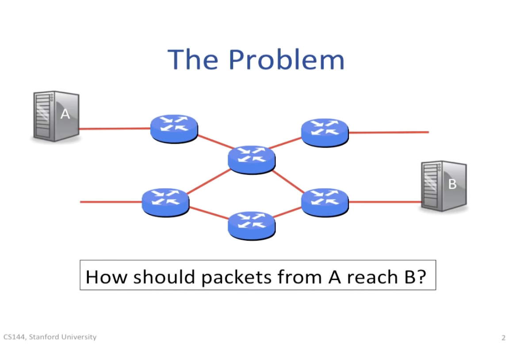


---

<h4 style="font-size: 1.5em; font-weight: bold;">泛洪路由（Flooding Routing）</h4>

洪泛是确保数据包能到达网络中所有目的地（包括目标B）的最简单方法。

泛洪路由的工作原理：

1. 每个路由器在收到数据包后，会将其从所有接口转发出去（除了数据包到达的那个接口）。
2. 这个过程会逐跳重复，数据包会迅速扩散到整个网络。
3. 这种方法效率很低，所有链路都可能被重复使用多次，并且数据包可能形成环路，永远循环下去。
4. 为了防止数据包无限循环，通常会使用跳数限制或生存时间（TTL）字段，就像 IP 协议中所做的那样。

洪泛路由的优点是简单，不需要路由器维护网络拓扑状态。但由于其效率低下，通常只在特定情况下使用，例如当网络拓扑未知或不可信时，或者在某些过渡时期。

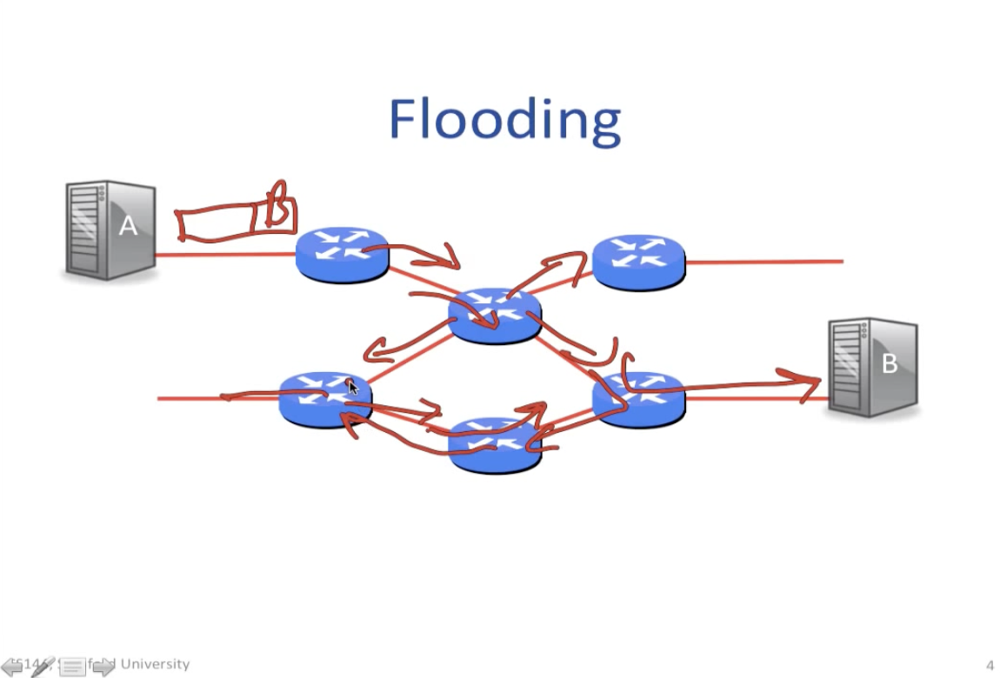


---

<h4 style="font-size: 1.5em; font-weight: bold;">源路由（Source Routing）</h4>

源路由是指由发送方主机决定路径，源节点在数据包头部填入希望数据包经过的一系列路由器。

源路由的工作原理：

- 源节点在数据包头部填充它希望数据包经过的一系列路由器（即路径）。
- 例如：主机 A 向主机 B 发送数据，指定路径 R1 -> R3 -> R6 -> B。
- 沿途路由器只需按列表依次转发。

特点：

- 是端到端原则的实际例子，所有路径决策由终端主机做出。
- 网络本身不需要支持复杂功能。网络本身不需要支持复杂功能。
- 主机必须知晓网络拓扑并自行选择路径。
- 数据包处理是变长的，可能携带很长的地址列表。

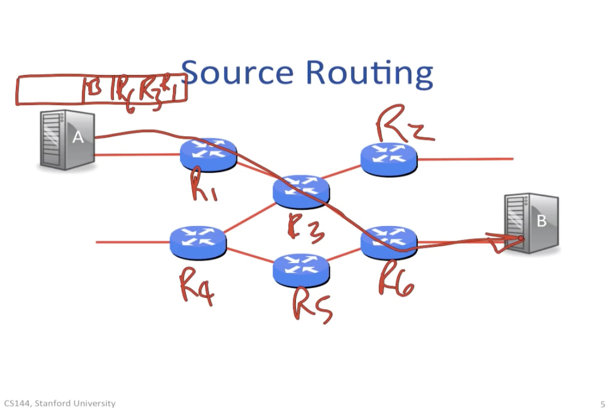

---

<h4 style="font-size: 1.5em; font-weight: bold;">转发表与逐跳路由（Forwarding Table and Hop-by-Hop Routing）</h4>

与源路由由主机决定路径不同，转发表与逐跳路由意味着网络本身已知晓路径，各路由器依据转发表逐跳转发。

工作原理：

- 例如从 A 发送包到 B，路径为 S1 -> S2 -> S4 -> B。
- 每个路由器（S1、S2、S4）的转发表中都需要有相应条目，指明去往目的地 B 的下一跳地址。

与源路由的关系：

- 可视为对源路由的一种优化。
- 让网络承担常见的路由功能，比源路由更高效。

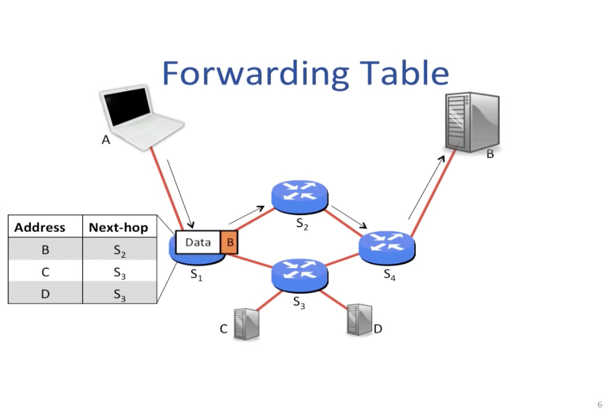


---

<h4 style="font-size: 1.5em; font-weight: bold;">生成树（Spanning Tree）</h4>

填充转发表时，通常的做法是构建生成树，以确保无环路地覆盖所有节点。

生成树（Spanning Tree）：

- 一张覆盖网络中所有节点的图。
- 是一棵"树"，没有环路。
- 确保可以到达每个目的地，同时避免数据包陷入循环。

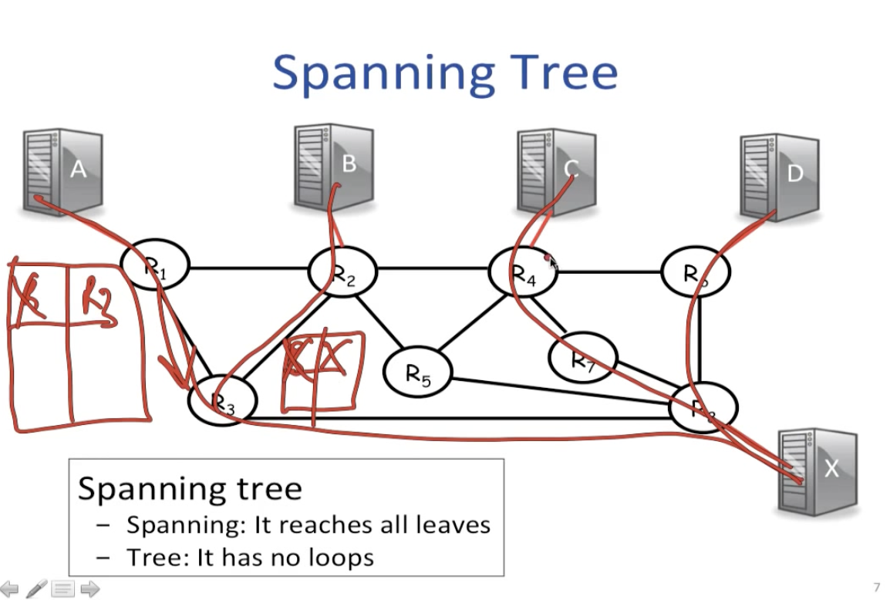


---

<h4 style="font-size: 1.5em; font-weight: bold;">最短路径生成树（Shortest Path Spanning Tree）</h4>

最短路径生成树的构建：

1. **赋予链路成本**：按选定指标为每条链路赋予成本（Cost），形成带权图。
2. **计算最短路径**：为每个源到目的地组合寻找成本总和最小的路径。
3. **计算复杂度**：

- 简单网络：可直观计算。
- 复杂拓扑（如互联网骨干网）需自动化路由算法：路由器通过路由协议交换网络状态信息，运行路由算法计算最优路径，最终将转发条目填入转发表。

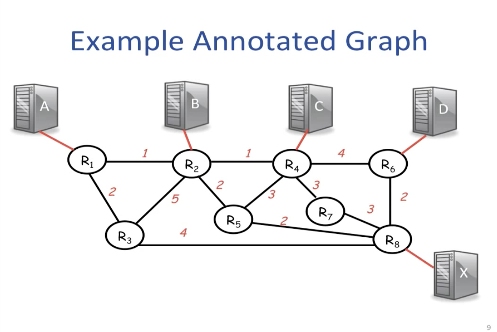

路径选择指标：

| 指标 | 说明 |
|------|------|
| 最短距离 | 最小化地理距离或链路物理长度 |
| 最少跳数 | 最小化经过的路由器数量 |
| 最低延迟 | 选择历史延迟最小的路径 |
| 最大吞吐量 | 选择负载最轻或最不拥堵的路径 |
| 最高可靠性 | 选择历史故障最少的路径 |
| 最低成本 | 选择使用成本（如资费）最低的路径 |
| 最安全 | 选择安全记录最好的路径 |

---

<h4 style="font-size: 1.5em; font-weight: bold;">其他路由类型</h4>

除单播（一对一）和最短路径树外，还有两类重要路由类型。

**多路径路由（Multipath Routing）**:允许将去往同一目的地的流量分散到多条路径上，用于负载均衡。

**优点**：

- 平衡网络负载
- 提高可靠性
- 提高资源利用率

**注意事项**：不同路径延迟可能不同，可能导致数据包乱序到达，通常由更高层协议（如 TCP）来处理乱序问题。

**广播与组播（Broadcast and Multicast）**：用于一对多通信。

| 类型 | 说明 |
|------|------|
| 广播 | 发送给网络中的所有主机 |
| 组播 | 发送给一组特定的主机（如视频流发送给所有订阅者） |

---

<h3 style="font-size: 2em; font-weight: bold;">6.2 路由：距离向量路由（Distance Vector Routing）与贝尔曼-福特算法（Bellman-Ford Algorithm）</h3>

---

<h4 style="font-size: 1.5em; font-weight: bold;">距离向量路由(Distance Vector Routing)</h4>

距离向量路由是一种分布式路由协议。其核心思想是：

1. 每个路由器维护一个距离向量，记录自己到网络中所有其他路由器的当前已知最短距离。
2. 路由器之间周期性交换这些信息，并利用贝尔曼-福特算法不断迭代更新，最终所有路由器收敛，各自得到到达目的地的最低成本路径。
3. 这些路径合在一起，构成一棵以该目的地为根的最短路径树。

特别说明：距离向量路由计算的是最短路径树（SPT），而不是最小生成树（MST）。两者的区别在于：

- 最短路径树（SPT）：让每个路由器到达目标的最短距离分别最小。每个路由器关心的是“我到目标有多远”，**所有路由器到同一个目标的路径，构成一棵以该目标为根的最短路径树。**
- 最小生成树（MST）：让整棵树所有边的总成本最小，不关心任意两点之间的路径成本。

所以，距离向量路由的目标不是让整棵树的边权总和最小，而是让每个路由器到达目标的最短距离分别最小。

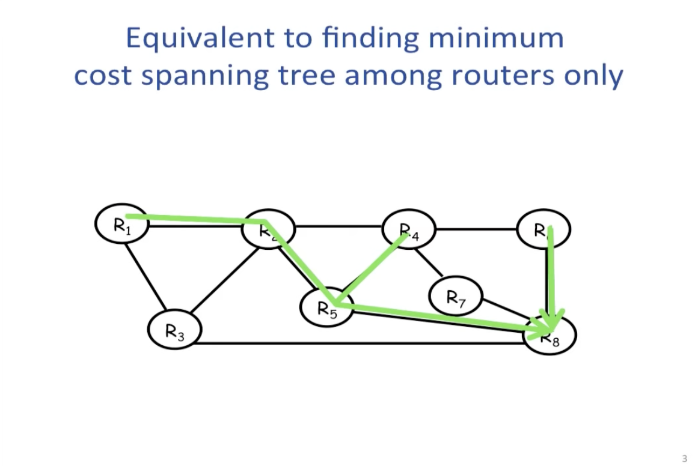

---

<h4 style="font-size: 1.5em; font-weight: bold;">贝尔曼-福特算法（Bellman-Ford Algorithm）</h4>

本节我们将讲解贝尔曼-福特算法构建网络中所有路由器到同一个目标（目标路由器R8）的最短路径树的步骤。

步骤如下：

**初始状态**：每个路由器 Ri 维护一个值 Ci，表示它当前所知到达目标路由器 R8 的最小成本。初始时，所有 Ci 都被设置为无穷大（∞）。目标路由器 R8 自身的值为 0，即 C(R8) = 0，作为信息扩散的起点。

**更新规则**：每隔固定时间t秒，每个路由器Ri会执行以下操作：

1. 向所有邻居路由器发送自己的当前 Ci 值。
2. 从每个邻居 Rj 接收其到达 R8 的成本 Cj。
3. 按以下规则更新自己的 Ci：

**更新公式为**：

$$C_i = \min(C_i, \text{cost}(R_i, R_j) + C_j)$$

其中，Ci 是 Ri 到 R8 的当前最短距离估计，cost(Ri, Rj) 是路由器 Ri 到邻居路由器 Rj 的直接链路成本，Cj 是 Rj 到 R8 的当前最短距离估计。

**收敛**：只要学习到更低的路径成本，路由器就会更新自己的Ci。这个过程不断重复，直到所有路由器的Ci值不再变化，此时算法收敛，每个路由器都找到了到达R8的最短路径。

<table>
<tr>
<td align="center">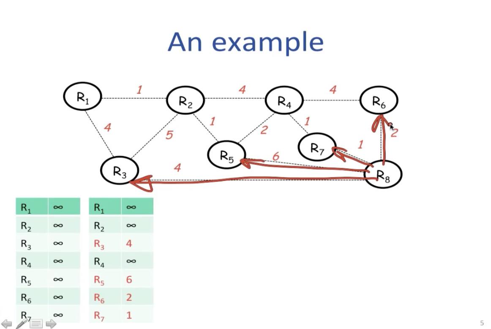</td>
<td align="center">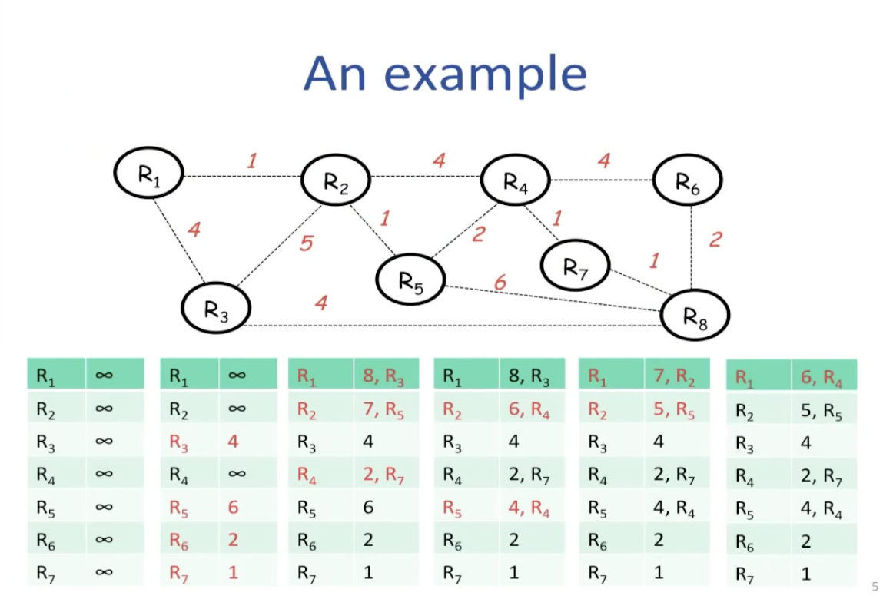</td>
</tr>
</table>

---

<h3 style="font-size: 2em; font-weight: bold;">6.3 路由：迪杰斯特拉算法（Dijkstra Algorithm）</h3>

---

<h4 style="font-size: 1.5em; font-weight: bold;">链路状态算法的基本思想</h4>

每个路由器向网络中所有其他路由器广播链路状态信息。广播内容包括：

- 哪些链路连通、哪些中断
- 每条链路的成本

最终，每个路由器都能获得一张完整的网络拓扑图。路由器基于这张拓扑图独立运行Dijkstra算法，计算从自身到所有其他路由器的最短路径。

---

<h4 style="font-size: 1.5em; font-weight: bold;">迪杰斯特拉算法（Dijkstra Algorithm）</h4>

Dijkstra 算法是链路状态算法的典型代表。每台路由器都拥有全网拓扑图，各自独立计算，最终得到以自己为根的最短路径树，进而生成自己的路由表。

核心步骤：

1. 初始化：将源节点（如路由器 R8）加入"最短路径树"集合，计算所有直接邻居到源节点的路径成本。
2. 选择节点：从尚未加入树的节点中，选择到源节点路径成本最低的节点。
3. 更新路径：将该节点加入最短路径树，检查通过它能否以更低成本到达其他未加入树的邻居节点，若能则更新其路径成本。
4. 重复：重复步骤 2 和 3，直到所有节点都加入最短路径树。

---

<h4 style="font-size: 1.5em; font-weight: bold;">算法实例演示</h4>

假设有一个包含 8 个路由器（R1–R8）的网络，以 R8 为源节点计算最短路径树：

1. 起始集合包含 R8。候选节点为 R3、R5、R6、R7。其中 R7 到 R8 成本最低（成本 1），首先将 R7 加入树中。
2. 最短路径树包含 {R8, R7}。候选节点更新为 R3、R5、R6（原候选）以及 R4（通过 R7 可达）。R4 和 R6 到 R8 的成本均为 2（如 R8→R7→R4，成本 1+1=2），选择 R6 加入。
3. 最短路径树包含 {R8, R7, R6}。继续从候选节点（R3、R5、R4）中选择成本最低的节点加入。

以此类推，直到所有节点都被加入树中，最终得到从 R8 到所有其他路由器的最小成本生成树。

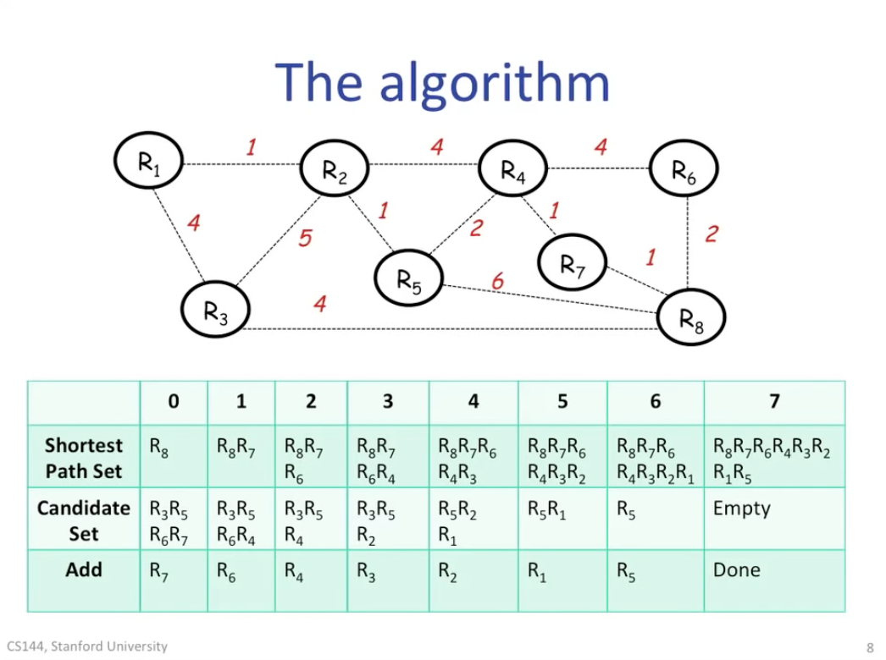

*图：Dijkstra 算法示例：上方为包含 8 个路由器（R1–R8）的网络拓扑图，下方为从 R8 出发的完整迭代过程表（共 7 步迭代：第 1 步加 R7、第 2 步加 R6、第 3 步加 R4、第 4 步加 R3、第 5 步加 R2、第 6 步加 R1、第 7 步加 R5）。*

---

<h4 style="font-size: 1.5em; font-weight: bold;">Dijkstra 算法的特性与实际问题</h4>

关于Dijkstra算法，有几个重要的特性需要了解：

| 特性 | 说明 |
|------|------|
| **时间复杂度** | 需运行 n 次迭代（n 为路由器数量），每次选择一个节点。最简单实现的时间复杂度为 **O(n²)**。 |
| **应对网络变化** | 链路状态变化（故障或成本改变）时，发现变化的路由器会广播给全网，所有路由器收到更新后重新运行 Dijkstra 算法，基于新拓扑计算最短路径树。该机制**避免了"坏消息传播慢"的问题**。 |
| **实际应用** | Dijkstra 算法是 **OSPF（开放最短路径优先）协议**的基础，在互联网中被广泛使用。 |

---

<h3 style="font-size: 2em; font-weight: bold;">6.4 路由：互联网（RIP、OSPF）与自治系统（Autonomous Systems）</h3>

---

<h4 style="font-size: 1.5em; font-weight: bold;">自治系统（Autonomous Systems）</h4>

由于互联网规模庞大、包含数百万台路由器，路由信息的管理变得十分困难。为了解决这一问题，互联网被划分为多个自治系统（AS）。

互联网由众多自治系统（AS）组成，每个AS独立管理，运行自己的内部路由协议（如RIP或OSPF）。

自治系统（Autonomous Systems）是互联网层级结构的基本单元，指：

- 由单一机构管理
- 使用共同路由策略
- 由一组路由器网络组成

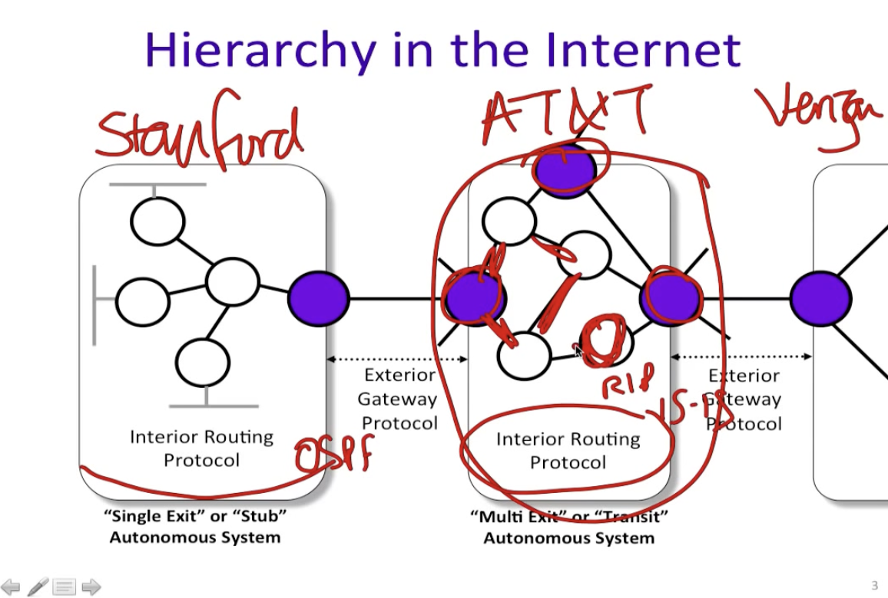

*图：互联网层级结构：左侧为单出口（Stub）自治系统（如 Stanford，使用 OSPF），中间为多出口（Transit）自治系统（如 AT&T，内部含 RIP / OSPF / BGP 标注）。各 AS 之间通过外部网关协议（Exterior Gateway Protocol）互联。*

---

<h4 style="font-size: 1.5em; font-weight: bold;">自治系统内部路由协议：内部网关协议（IGP）</h4>

自治系统（Autonomous Systems）内部路由器使用的协议称为内部网关协议（IGP），以下是两种主要的内部路由协议：

| 协议 | 要点 |
|------|------|
| **路由信息协议（RIP）** | 基于距离向量算法（贝尔曼-福特），每30秒广播路由更新，180秒未收到邻居更新则路径失效，其中 RIP 更新路由成本的公式为：$$D_x(y) = \min_v \{ c(x,v) + D_v(y) \}$$ |
| **开放最短路径优先协议（OSPF）** | 基于链路状态算法（迪杰斯特拉），通过洪泛广播链路状态信息，所有路由器构建一致拓扑图后各自计算最短路径树 |

---

<h4 style="font-size: 1.5em; font-weight: bold;">数据包如何离开自治系统</h4>

数据包在自治系统（Autonomous Systems）内部完成路由之后，如何转发到其他 AS，取决于该自治系统（Autonomous Systems）属于单出口还是多出口类型。

| 类型 | 处理方式 |
|------|----------|
| **单出口 AS（默认路由）** | 对于目标地址不在本 AS 内的数据包，AS 内的所有路由器将其转发给一个指定的默认路由器（即边界网关） |
| **多出口 AS（出口选择）** | 内部路由器需要为每个外部目标前缀选择使用哪个出口点 |

常见的出口选择策略：

| 策略 | 说明 |
|------|------|
| **热土豆路由** | 将数据包发送到离本路由器最近的出口点，以最快速度将包送出本 AS |
| **基于目的地的路由** | 选择离最终目的地最近或成本最低的出口点，但需要在 AS 内传播更多外部路由信息 |

---

<h4 style="font-size: 1.5em; font-weight: bold;">自治系统间的互联：边界网关协议（BGP）</h4>

自治系统（AS）内部的路由协议无法处理 AS 间的路由。因此，所有 AS 必须使用统一的外部网关协议进行互联，这就是边界网关协议（BGP）。

所有 AS 通过 BGP 相互连接，以交换路由信息并实现全球互联。

BGP（当前版本为 BGP-4）的设计，是为了解决互联网这个复杂、无严格层次结构的网状网络中的特殊问题：

| 特性 | 说明 |
|------|------|
| **策略性** | 各 AS 有不同的商业目标和策略（如偏好某个供应商、成本考虑），BGP 允许这些策略保持本地化和私有 |
| **可达性优于最优性** | 目标更多是找到一条可达的路径，而非计算理论上的"最短"路径，因为各 AS 对链路成本的衡量标准不同 |
| **信任与安全** | AS 之间可能存在竞争或不完全信任的关系，BGP 需要在这种环境下工作 |

---

<h4 style="font-size: 1.5em; font-weight: bold;">互联网的整体结构图</h4>

综合以上内容，我们可以描绘出互联网的大致分层结构，这种结构形成了"提供商-客户"关系链，数据流量通常自上而下流动，并伴随结算关系。为了节省成本，同层的ISP之间也可能直接建立连接。

| 层级 | 位置 | 特点 |
|------|------|------|
| **第一层 ISP** | 顶层 | 数量很少（全球约十几个），之间完全互联，通常采用免费对等互联，互不结算费用 |
| **区域 ISP** | 中层 | 覆盖一个国家或地区，向上连接一个或多个第一层 ISP，向下连接多个接入 ISP |
| **接入 ISP** | 底层 | 直接为最终用户（家庭、企业）提供互联网接入服务 |

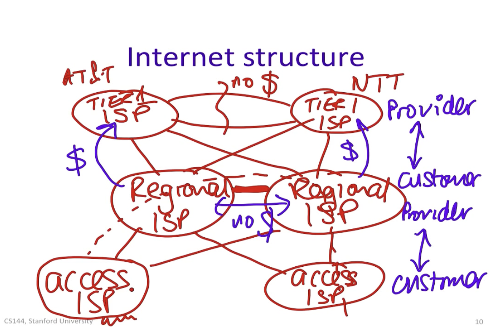

*图：互联网整体结构示意：顶层为 Tier-1 ISP（如 AT&T、NTT），彼此无结算互联（no $）；中层为 Regional ISP（覆盖国家或地区）；底层为 Access ISP（服务最终用户）。付费结算（$）沿 Provider → Customer 方向自上而下流动。*

---

<h3 style="font-size: 2em; font-weight: bold;">6.5 路由：边界网关协议（BGP）</h3>

---

<h4 style="font-size: 1.5em; font-weight: bold;">BGP 基础知识</h4>

互联网由无数个独立的网络（自治系统）组成，例如：

```text
[中国电信AS]  [中国联通AS]  [Google AS]  [亚马逊AS]  [某大学AS] ...
```

互联网由众多各自独立管理、互不隶属的自治系统（AS）构成，若没有BGP，这些 AS 之间便无法交换路由信息，互联网将沦为一座座孤岛。

因此，边界网关协议（BGP）是互联网中连接不同自治系统（AS）的关键外部路由协议，其核心作用在于：使全球范围内数以万计的 AS 之间能够相互通告各自可达的网络前缀，并依据各 AS 自身的路由策略，在众多可选路径中遴选出最优路径，从而保障全球互联网的互联互通与稳定运行。

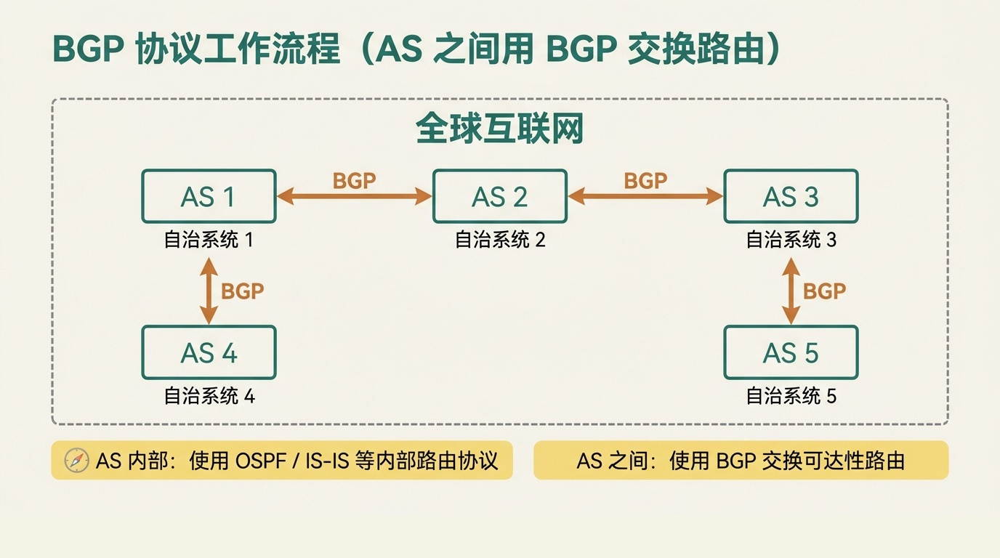

*图：BGP 协议工作流程示意：在全球互联网中，5 个自治系统（AS 1/2/3/4/5）通过 BGP 两两互联（AS1↔AS2、AS2↔AS3、AS1↔AS4、AS3↔AS5）。其中，AS 内部使用 OSPF / IS-IS 等内部路由协议，AS 之间使用 BGP 交换可达性路由。*

---

<h4 style="font-size: 1.5em; font-weight: bold;">BGP 的三大核心作用</h4>

作用一：路由信息交换

每个自治系统的边界路由器通过 BGP 向相邻自治系统通告其可达的网络前缀。例如：

```text
本 AS 可到达网络 171.6.1.0/24，可通过本AS抵达该网络。
```

相邻自治系统接收该通告后，再将其转告自身的邻居，如此逐跳传播，最终使全球路由信息得以扩散。

```text
AS-A 通告 171.6.1.0/24 → AS-B → AS-C → AS-D
```

由此，任一自治系统均可获知到达全球各网段的路径信息。

作用二：路径选择

到达同一目的地往往存在多条可选路径。例如：

```text
路径A：[AS7018, AS6341, AS1129]  ← 途经3个AS
路径B：[AS7018, AS3549]          ← 途经2个AS
```

BGP 依据一系列路径属性（如LOCAL_PREF、AS_PATH长度、MED等），按照确定的优先级顺序进行决策，遴选出最优路径，从而保证全网路径选择的一致性与可预测性。

作用三：策略控制

策略控制是 BGP 最强大也最复杂的职能。各 AS 可基于自身利益自主决定流量方向，常见策略为：客户路由优先（可收益）> 对等路由次之（免费结算）> 提供商路由最后（需付费），并可借助流量工程主动引导路径。由此，各 AS 得以自主决策，同时维持全球互联互通。

---

<h3 style="font-size: 2em; font-weight: bold;">6.6 路由：多播（Multicast）</h3>

---

<h4 style="font-size: 1.5em; font-weight: bold;">多播的概述</h4>

普通情况下，数据包从一个源发送到一个目的地，这叫单播。

但有些场景需要把同一份数据同时发给一组特定的主机，比如：

- 视频会议：一个人说话，其他参会者都要听到
- 网络电视：多个用户同时观看同一个频道

如果源主机一个一个地分别发送，效率太低。**多播就是让网络帮助复制数据包**，源只发一份，网络负责把它送到所有需要的主机。

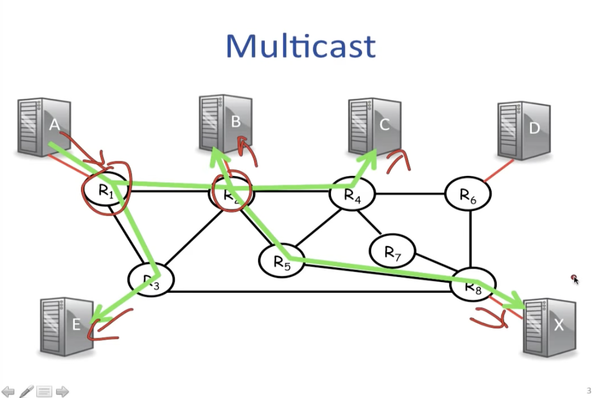

*图：组播示意：源主机 A 发出一个数据包，网络（路由器 R1/R2/R3/R4/R5/R8 等节点）在链路上根据需要复制数据包，将同一份内容送达所有订阅了相应组播组的主机（B、C、D、E、X 等）。*

---

<h4 style="font-size: 1.5em; font-weight: bold;">最基础的方法：泛洪（Flooding）</h4>

泛洪的思路很简单：路由器收到数据包后，从除了进来那个接口之外的所有接口发出去，这样数据包能到达网络中的每个角落。

问题：如果网络中有环路，数据包会永远循环，无法停止。

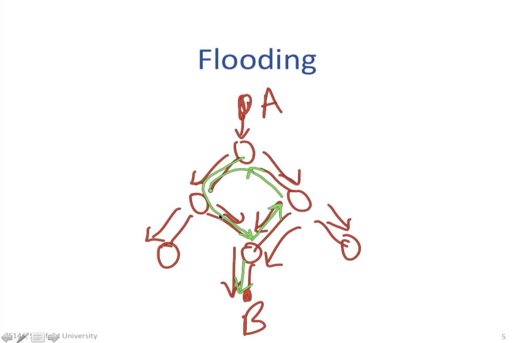

*图：泛洪（Flooding）示意：源主机 A 发出的数据包被路由器从所有非输入接口复制扩散出去，直到到达目标主机 B。如果网络中有环路，数据包会永远循环无法停止。*

---

<h4 style="font-size: 1.5em; font-weight: bold;">聪明的解决方案：反向路径广播（RPB）</h4>

核心思想：网络在发送多播之前，已经有一套从源到所有主机的最短路径树（单播路由协议算出来的）。

RPB 利用这棵树来判断：数据包从某个接口进来，这个数据包进来的接口，是不是我回程去源方向时会用的那个接口？

- 是 → 说明数据包走的是正确方向，接受它，并从其他所有接口转发出去
- 不是 → 说明数据包走错了路，直接丢弃

这样就能避免环路，因为数据包只会沿着已经建好的最短路径树流动。

为什么叫"反向"？

因为它用的是从源到目的地的生成树，但判断时看的是从自己到源的单播路径，方向正好相反。

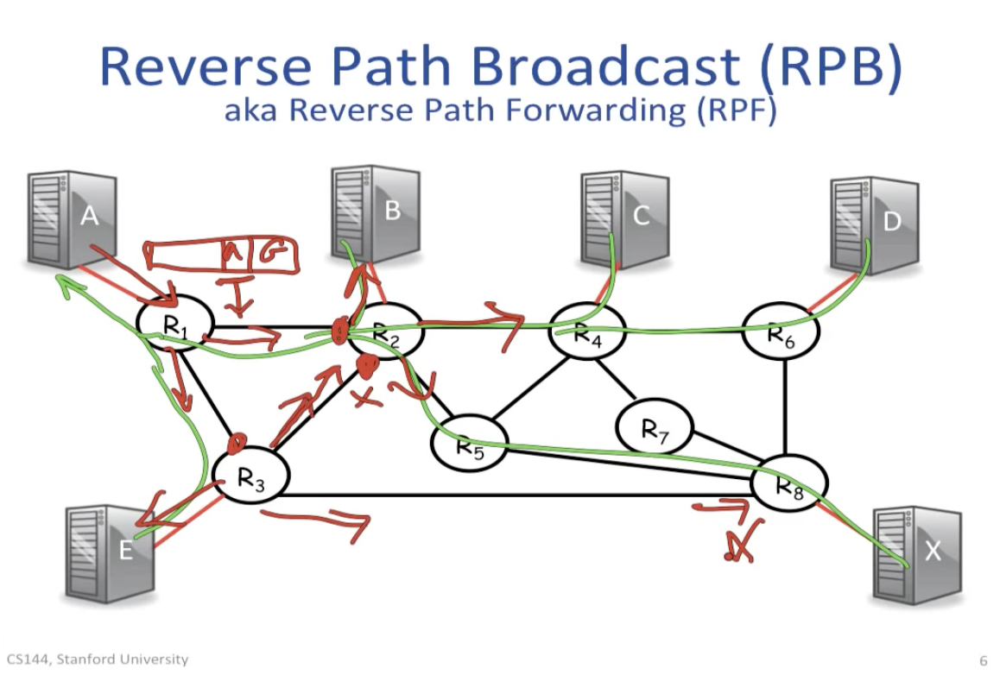

*图：反向路径广播（RPB / Reverse Path Forwarding, RPF）示意：路由器检查多播数据包到达的接口是否是自己单播回程去源时使用的接口——是则从其他接口继续复制转发，否则丢弃，从而避免环路，让数据包仅沿着已建好的最短路径树流动。*

---

<h4 style="font-size: 1.5em; font-weight: bold;">反向路径广播（RPB）与修剪（Prune）</h4>

反向路径广播（RPB）本身是广播，会把数据发给所有人。但多播只想发给“组内的主机”，所以需要修剪。

修剪的做法：如果某个路由器下面没有主机对这个多播组感兴趣，它就向上游发送"修剪消息"，意思是："别再给我发这个组的数据了"，这样就把不需要的分支从树上剪掉。

缺点：一开始所有路由器都会收到数据，然后才修剪。网络很大时，这个"先发再剪"的过程比较浪费。

---

<h4 style="font-size: 1.5em; font-weight: bold;">源特定树与汇聚点</h4>

为了让每个源发出的数据都能沿着到目的地的最短路径转发，就需要为每个源单独建一棵树。

- 以 A 为根的树，是 A 到所有多播目的地的最短路径树。
- 以 B 为根的树，是 B 到所有多播目的地的最短路径树。

这样，每个源都有自己的一棵最短路径树，这种树就叫"源特定最短路径树"。

但在实际通信中，如果多播组的成员数量非常少，就不一定要为每个源都建一棵树。这时可以选一个路由器作为汇聚点，比如 R5。

所有发送者先把数据发给 R5，R5 再负责把数据转发给组里的其他人。这样，R5 只需要建一棵到所有接收者的最短路径树即可，其他人则用普通单播路由把数据送到 R5。

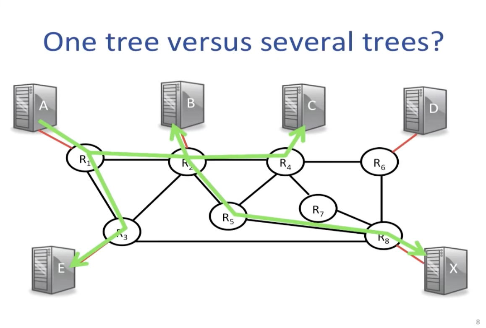

*图：一棵共享树还是多棵源特定树？示意：当为多个源（A、B、…）各自建立一棵源特定最短路径树时，每棵树都需要独立维护——问题在于是否可以仅维护一棵"共享树"供所有源共用以减少开销。*

---

<h4 style="font-size: 1.5em; font-weight: bold;">多播地址</h4>

多播地址就是一个"组地址"，发往它的数据会被转发给所有加入了这个组的主机，而不是只发给某一台主机。

可以这样理解：

- 单播地址：一对一，发给某一个具体的主机。
- 广播地址：一对所有，发给同一网络里的所有主机。
- 多播地址：一对一组，发给"加入了某个多播组"的那些主机。

多播地址的核心特点是

1. 一个多播地址对应一个多播组。谁加入了这个组，谁就能收到发往这个地址的数据。
2. 源主机只管把数据发到某个多播地址，网络和路由器负责把数据转发给组里的成员。
3. 主机通过 IGMP 等协议告诉路由器："我想加入这个多播组。"如果没人表示感兴趣，这个组的状态就会过期，路由器就不再转发。
4. 在 IPv4 中，多播地址的前 4 位固定为 1110，用来标识这是一个多播地址。多播地址范围是：
```text
224.0.0.0 ~ 239.255.255.255
```
5. 它常用于一对多、多对多的通信场景，比如 IPTV、视频会议、在线直播、路由协议中的邻居发现等。


---

<h3 style="font-size: 2em; font-weight: bold;">6.7 路由：生成树协议（Spanning Tree）</h3>

---

<h4 style="font-size: 1.5em; font-weight: bold;">生成树协议（Spanning Tree）概述</h4>

生成树协议（Spanning Tree Protocol，STP）是一种数据链路层的协议，主要目的是防止交换机之间形成环路，导致广播帧在环路中无限循环。

STP 的最终效果是：把交换机之间有环的物理拓扑变成无环的逻辑树，既防止了广播风暴和 MAC 表震荡，又保留了冗余链路的故障恢复能力。

---

<h4 style="font-size: 1.5em; font-weight: bold;">交换机转发数据包的流程</h4>

具体过程分为以下几个关键步骤：

1. 学习源 MAC 地址
当交换机从某个端口收到一个数据帧时，它会把数据帧的源 MAC 地址和入端口的对应关系记入 MAC 地址表。
2. 查找目的 MAC 地址
根据帧中的目的 MAC 地址去查路由器的 MAC 地址表，决定从哪个端口转发。
3. 按情况转发
MAC 地址表中能找到目的 MAC → 单播转发，只从对应端口发出。
MAC 地址表中找不到目的 MAC → 泛洪，从除入端口外的所有端口发出。
目的 MAC 是广播/组播 → 泛洪，广播 MAC：FF:FF:FF:FF:FF:FF，表示"发给本网段所有设备"，组播 MAC：以 01:00:5E 等开头的特殊地址，表示"发给一组设备"。
4. 老化与更新
MAC 地址表条目有老化时间，长时间不用的条目会被删除，以适应网络变化。

---

<h4 style="font-size: 1.5em; font-weight: bold;">生成树协议（STP）的工作机制</h4>

具体过程分为以下几个关键步骤：

1\. 选举根桥（Root Bridge）

- 每台交换机启动时都认为自己是根桥，发送 BPDU。
- BPDU 里含桥 ID = 优先级 + MAC 地址。
- 所有交换机比较桥 ID，最小的成为根桥。
- 整个网络只有一台根桥。

2\. 选举根端口（Root Port）

- 每台非根交换机选一个到根桥开销最小的端口作为根端口。
- 比较顺序：根路径开销 → 对端桥 ID → 对端端口 ID → 自己端口 ID。
- 每台非根交换机有且只有 1 个根端口。

3\. 选举指定端口（Designated Port）

- 在每个网段（链路）上选一个指定端口，负责该网段向下转发。
- 比较网段上各端口谁到根桥开销最小，小者当选。
- 根桥上的端口全是指定端口。
- 每个网段有且只有 1 个指定端口。

4\.阻塞剩余端口

- 既不是根端口，也不是指定端口的端口 → 阻塞（Blocking）。
- 阻塞端口不转发数据，只收 BPDU，随时准备备用。

<table>
<tr>
<td align="center">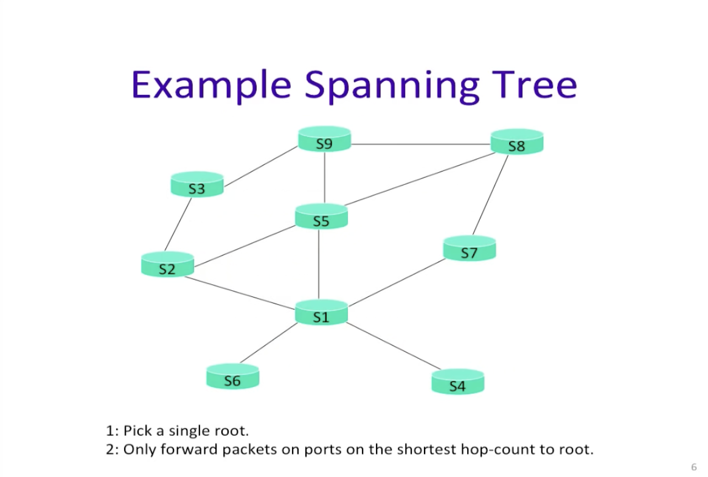</td>
<td align="center">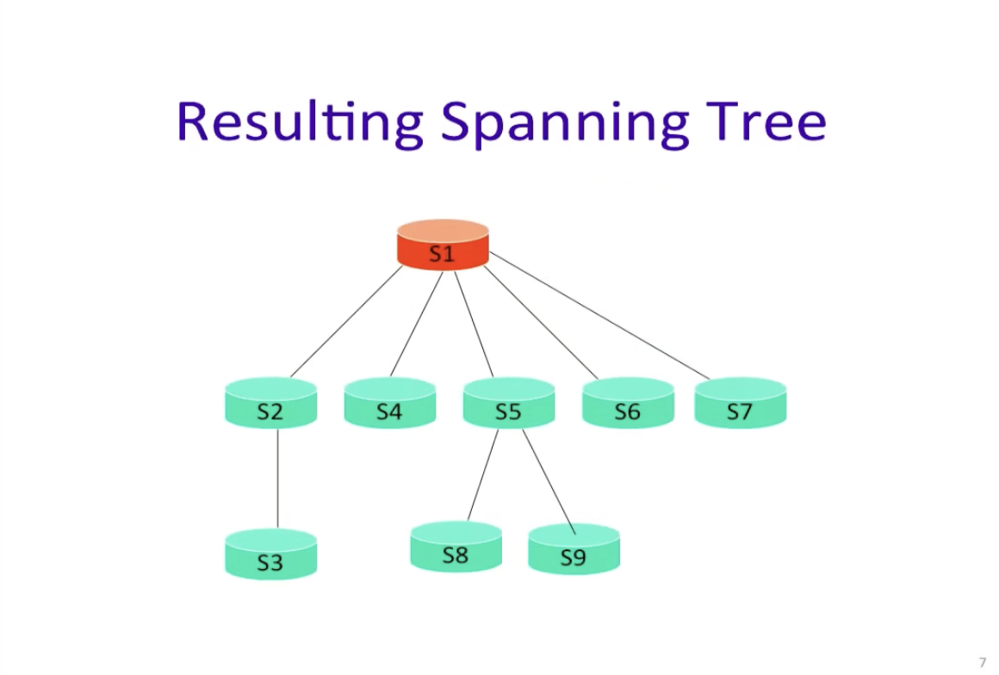</td>
</tr>
</table>

---

<h4 style="font-size: 1.5em; font-weight: bold;">生成树协议概述</h4>

路由通常被认为在网络层（IP 层）运行，但广义上，任何将数据包从源点沿选定路径发送到目的地的机制都可视为路由。

以太网交换机根据以太网地址转发数据包，通过"学习"地址来知道如何转发。但学习过程中，广播消息可能导致网络环路；以太网帧没有 TTL 字段，广播包可能无限循环。STP 就是为了解决这个问题而发明的。

<h3 style="font-size: 2em; font-weight: bold;">6.8 路由：IPv6</h3>

---

<h4 style="font-size: 1.5em; font-weight: bold;">IPv6 概述</h4>

IPv4 地址是 32 位，理论上约有：$2^{32} \approx 43$ 亿个地址。

早期设备少，43 亿看起来够用。但现在手机、电脑、服务器、物联网设备都需要 IP，IPv4 地址就不够用了。而且任何编号方案都不可能 100% 用完，IPv4 实际利用率大约只有 35%，但依然面临地址枯竭。所以：IPv6 就是为了解决 IPv4 地址不够用的问题。

---

<h4 style="font-size: 1.5em; font-weight: bold;">IPv6 地址格式</h4>

IPv6 地址长度：128 位，地址数量：$2^{128} \approx 3.4 \times 10^{38}$

一个 IPv6 地址分为两部分：

| 部分 | 长度 | 作用 |
|---|---|---|
| 子网前缀 | n 位 | 标识网络 |
| 接口 ID | 128 - n 位 | 标识子网中的特定设备 |

---

<h4 style="font-size: 1.5em; font-weight: bold;">IPv6 地址的写法</h4>

IPv4 使用"点分十进制"，例如：192.168.1.1

IPv6 使用：十六进制 + 冒号分隔

完整格式是 8 组，每组 16 位，也就是每组 4 个十六进制数字，例如：2001:0db8:85a3:0000:0000:8a2e:0370:7334

---

<h4 style="font-size: 1.5em; font-weight: bold;">IPv6 前缀长度</h4>

IPv6 地址后面常跟 /数字，表示前缀长度。在 IPv6 中，一个地址总共 128 位。

如果前缀长度是 /64，说明：

- 前 64 位 = 子网前缀，用来标识网络。
- 后 64 位 = 接口 ID，用来标识这个子网里的具体设备。

---

<h3 style="font-size: 2em; font-weight: bold;">6.9 路由：路由基础回顾</h3>

---

<h4 style="font-size: 1.5em; font-weight: bold;">单播数据包路由的四种方法对比</h4>

| 方法 | 做法 | 特点 | 缺点 / 注意事项 |
|------|------|------|----------------|
| **广播（Broadcast）**  | 路由器把数据包复制到除接收接口外的所有接口，让包传遍整个网络 | 简单直接，能确保到达所有主机 | 效率极低，成本高，容易造成无限循环，需配合防循环机制 |
| **源路由（Source Routing）** | 源主机在数据包头部写好完整路径（一串跳点），路由器照着走 | 路由器不用维护转发表，符合"端到端原则" | 源主机必须知道整个网络拓扑；安全性差，需暴露网络完整拓扑，实践中很少使用 |
| **使用转发表（Forwarding Table）** | 路由器自己维护一张表，记录"去某个目的地，该从哪个接口转发" | 不需要源主机提供路由信息，路由器自己决定；当今主流做法 | 路由器需维护转发表，但这是值得的优化 |
| **生成树路由（Spanning Tree）** | 构建一棵以目的地为根的生成树——无环路，且所有源主机都能到达目的地 | 无环路，所有源主机都能到达目的地；通常构建"最小成本生成树"，尽量少跳数、低延迟、短距离 | 需要构建和维护生成树，通常通过填充转发表来实现 |

---

<h4 style="font-size: 1.5em; font-weight: bold;">构建转发表的两大核心算法及其对应协议</h4>

构建转发表的两大核心算法：

- 贝尔曼-福特算法（距离向量） → 用于 RIP 协议
- 最短路径优先算法 → 用于 OSPF 协议

IGP（内部网关协议）与 BGP（边界网关协议）：互联网分层路由体系

- RIP 和 OSPF 都是 IGP（内部网关协议），用于自治系统（AS）内部的路由。
- OSPF 是 AS 内部的主流路由协议，依靠链路状态数据库和 Dijkstra 算法计算最短路径。
- OSPF（AS 内）与 BGP（AS 间）配合，构成互联网路由的完整体系。

|  | 贝尔曼-福特算法（距离向量） | 最短路径优先算法 |
|--|------------------------------|------------------|
| **怎么做** | 每个路由器维护到所有其他路由器的距离向量，不断和邻居交换，逐步找到最近的路，迭代有限次后收敛得到转发表 | 每个路由器先通过交换链路状态信息拿到完整网络拓扑，然后自己计算转发表 |
| **用在哪儿** | RIP 协议 | OSPF 协议 |
| **现状** | 大部分已被 OSPF 取代 | 今天企业和校园网广泛使用 |
| **一句话** | 像互相打听路况，慢慢拼出最短路线，但消息传得慢 | 像先拿到完整地图，再自己算最优路线，快又准 |

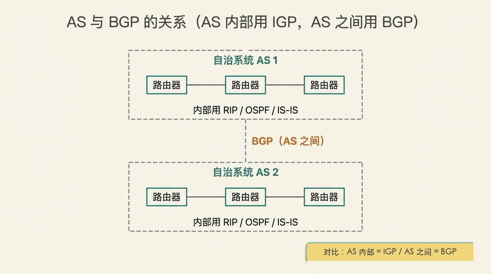

*图：AS 与 BGP 的关系示意：每个自治系统（AS）内部使用 IGP（RIP / OSPF / IS-IS），自治系统之间使用 BGP 互联。*

---

<h4 style="font-size: 1.5em; font-weight: bold;">路由的其他重要方面</h4>

1\. 分层路由

互联网把路由问题拆成两层，分别处理：

- AS 内部：使用域内路由算法，如 OSPF。
- AS 之间：使用 BGP（边界网关协议）交换路由信息。

例如，斯坦福大学校园内用 OSPF，对外用 BGP 与其他 AS 交换信息。BGP 是当今互联网上 AS 之间交换路由信息的唯一标准方式：每个 AS 向邻居通告自己可达的 IP 前缀，数据包就能通过一系列 AS 路径到达互联网上的任何目的地。

2\. 多播路由

多播是一种优化，目的是避免源主机向一组目的地重复发送相同的数据包。

3\. 生成树协议

生成树协议并不是真正的互联网路由协议，而是以太网用来创建无环路拓扑的机制。它让一组交换机构建一棵单一的生成树，从而避免广播风暴。

链路层需要生成树协议，IP 层没有也不需要生成树协议

- 以太网（链路层 ）：转发靠 MAC 地址，帧头没有 TTL，一旦拓扑有环，帧可能永久循环 → 需要生成树协议（STP）主动构建无环拓扑。
- IP 层（网络层）：转发靠路由表，且 IP 头有 TTL，即使出现临时环路，数据包也会被 TTL 耗尽丢弃 → 不需要生成树协议。


