# 第 7 章：物理层与链路层原理

<h3 style="font-size: 2em; font-weight: bold;">7.1 香农容量与调制（Shannon Capacity and Modulation）</h3>

---

<h4 style="font-size: 1.5em; font-weight: bold;">香农极限（Shannon Limit）</h4>

任何通信信道都有一个理论传输极限，称为香农极限，由克劳德·香农确立。信道容量（每秒能发送的比特数）近似公式：

<div align="center">

$C = B \times \log_2\left(1 + \frac{S}{N}\right)$

</div>

其中：

- C：信道容量（bps，每秒能传多少比特）
- B：带宽（Hz，频率范围大小）
- S/N：信噪比，有用信号功率 与 噪声功率 的比值

数据量与带宽成正比，并受信噪比影响。提高信噪比或带宽都能提升容量，但工程代价高昂，所以无法轻易实现任意高速通信。

香农公式定上限，带宽和信噪比决定容量。

---

<h4 style="font-size: 1.5em; font-weight: bold;">模拟信号的基本属性</h4>

信息在物理层通常通过正弦波表示，关键属性有：

- 振幅：信号强度或"音量"
- 波长：一个完整波的长度，与频率关系为 $c = \lambda \times f$
- 频率：每秒波周期数，单位 Hz；频率范围大小就是带宽
- 相位：波形在特定时间点的位置

通信就是通过改变振幅、频率、相位来编码信息。

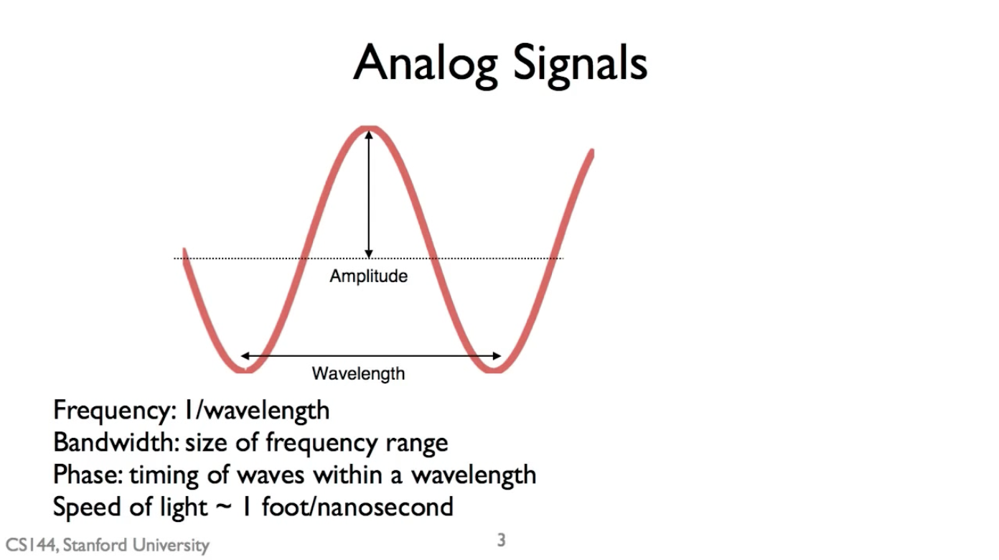

*图：模拟信号（Analog Signals）示意：图中标注了一个正弦波的振幅（Amplitude）和波长（Wavelength）。下方说明 Frequency（频率）= 1 / wavelength、Bandwidth（带宽）= 频率范围大小、Phase（相位）= 波在一个波长内的时序位置，以及光速约 1 foot/nanosecond。*

---

<h4 style="font-size: 1.5em; font-weight: bold;">调制技术：把比特变成信号</h4>

调制 = 把数据比特转换为适合信道传输的波形信号。三种基本数字调制：

| 调制方式 | 改变什么 | 例子 |
|---|---|---|
| ASK | 振幅 | 小振幅 = 0，大振幅 = 1 |
| FSK | 频率 | 一个频率 = 0，另一个频率 = 1 |
| PSK | 相位 | 0 度 = 0，180 度 = 1（BPSK） |

ASK：简单，有线网络（如以太网）常用。

PSK：抗信号强度变化，无线网络、DSL 常用，因为相位变化比幅度变化更易检测。

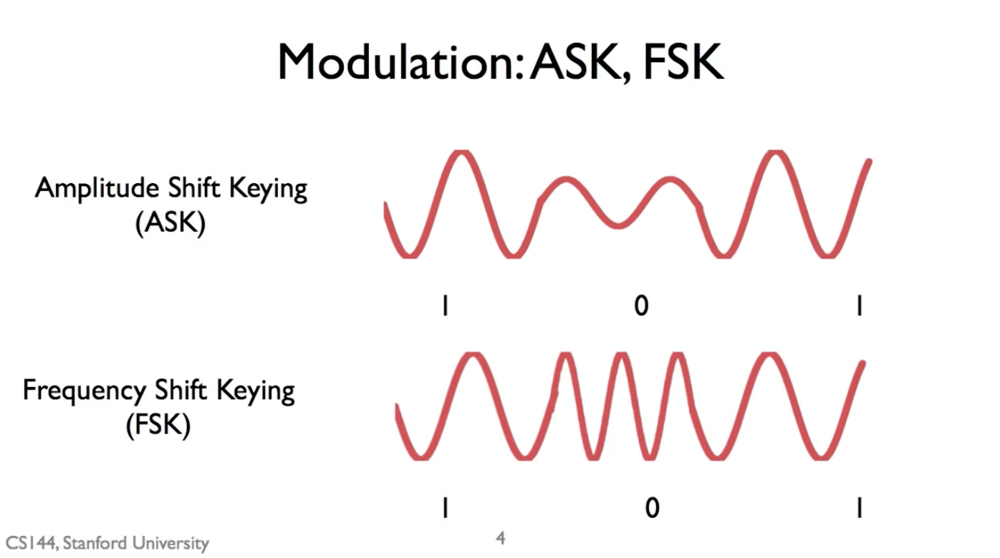

*图：Modulation: ASK, FSK 示意：ASK（Amplitude Shift Keying，振幅键控）通过大振幅/小振幅区分 1/0；FSK（Frequency Shift Keying，频率键控）通过一个频率/另一个频率区分 1/0。两者都把比特流变成波形信号在信道传输。*

---

<h4 style="font-size: 1.5em; font-weight: bold;">正交调制（Quadrature Modulation）</h4>

单一调制方式存在局限。为了在单个符号中传输更多比特，现代通信系统常将**相位调制**与**幅度调制**结合使用，由此引出正交调制的概念。任何具有中间相位的信号，都可以由两个相位相差 90°（正交）的基准信号——I 路和 Q 路——的线性组合来生成：

$$\text{信号} = I \cdot \cos(\omega t) + Q \cdot \sin(\omega t)$$

其中，I 和 Q 是系数。通过调整 I、Q 的取值，即可合成出具有任意幅度和相位的信号。这种 IQ 调制方法在硬件上非常容易实现。

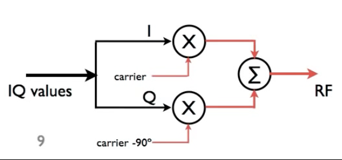

*图：IQ 调制原理示意：IQ values 拆分为 I 路和 Q 路两条支路，I 路与 carrier（载波）相乘、Q 路与 carrier 移相 -90° 后相乘，两路结果送入 Σ 求和得到 RF 输出。硬件上只需 2 个乘法器和 1 个加法器即可实现任意幅度和相位的信号合成。*

---

<h4 style="font-size: 1.5em; font-weight: bold;">IQ 星座图</h4>

在 IQ 星座图中：

- 点的角度 → 代表信号的相位
- 点到原点的距离 → 代表信号的幅度

BPSK 星座图

```text
            Q
            ↑
            |
            |
(−1, 0)     |     (+1, 0)
   ●——————-—+———————●————→ I
            |
            |
```

只有两个点，都在 I 轴上。每个点代表 1 bit，具体对应关系:

| 比特 | 星座点 | I | Q | 相位 | 波形 | 幅度 |
|---|---|---|---|---|---|---|
| 0 | (+1, 0) | +1 | 0 | 0° | $\cos(\omega t)$ | 1 |
| 1 | (−1, 0) | −1 | 0 | 180° | $-\cos(\omega t)$ | 1 |

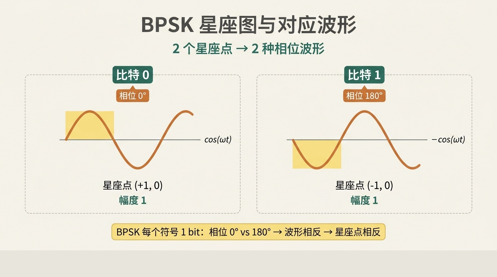

*图：BPSK 星座图与对应波形示意：2 个星座点 → 2 种相位波形。比特 0 = (+1,0) 相位 0° cos(ωt)；比特 1 = (-1,0) 相位 180° -cos(ωt)。BPSK 每个符号编码 1 bit，两个波形相位相反 → 星座点相反。*

QPSK 星座图

```text
          Q
          ↑
          |
   (0,+1) ●
          |
          |
●—————————+—————————●————→ I
(−1,0)    |         (+1,0)
          |
          ● (0,−1)
          |
```

四个点均匀分布在 I 轴和 Q 轴上，形成"十字"形状。每个点代表 2 bit，对应一个符号，即一段波形。具体对应关系如下：

| 比特 | 星座点 | I | Q | 相位 | 波形 | 幅度 |
|---|---|---|---|---|---|---|
| 00 | (+1, 0) | +1 | 0 | 0° | $\cos(\omega t)$ | 1 |
| 01 | (0, +1) | 0 | +1 | 90° | $\sin(\omega t)$ | 1 |
| 11 | (−1, 0) | −1 | 0 | 180° | $-\cos(\omega t)$ | 1 |
| 10 | (0, −1) | 0 | −1 | 270° | $-\sin(\omega t)$ | 1 |

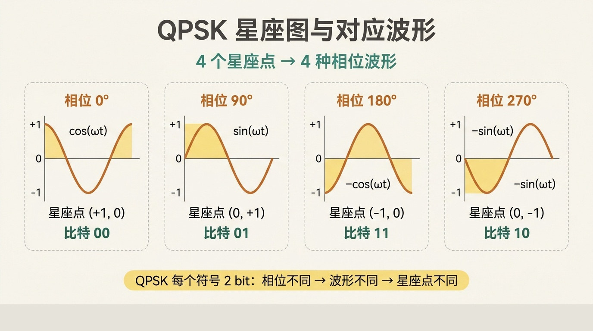

*图：QPSK 星座图与对应波形示意：4 个星座点 → 4 种相位波形。比特 00 = (+1,0) 相位 0° cos(ωt)；比特 01 = (0,+1) 相位 90° sin(ωt)；比特 11 = (-1,0) 相位 180° -cos(ωt)；比特 10 = (0,-1) 相位 270° -sin(ωt)。QPSK 每个符号编码 2 bit。*

---

<h4 style="font-size: 1.5em; font-weight: bold;">从帧到波形：物理层的调制与解调</h4>

从帧到波形的过程：

- 链路层交出帧（比特流），物理层按每 N 比特映射成星座图上的符号，再调制（Modulation）成持续 $T_s$ 的波形发到信道上。
- 接收端在每个 $T_s$ 内解调（Demodulation）波形、判决出符号、还原成比特，最后组装成帧交回链路层。
- 整条链路由一个个 $T_s$ 首尾相接，串起整个比特流。
- 链路层传比特组成的帧，物理层传符号；一个符号能带几个比特看调制方式；QAM 越密越快，但越怕噪声。

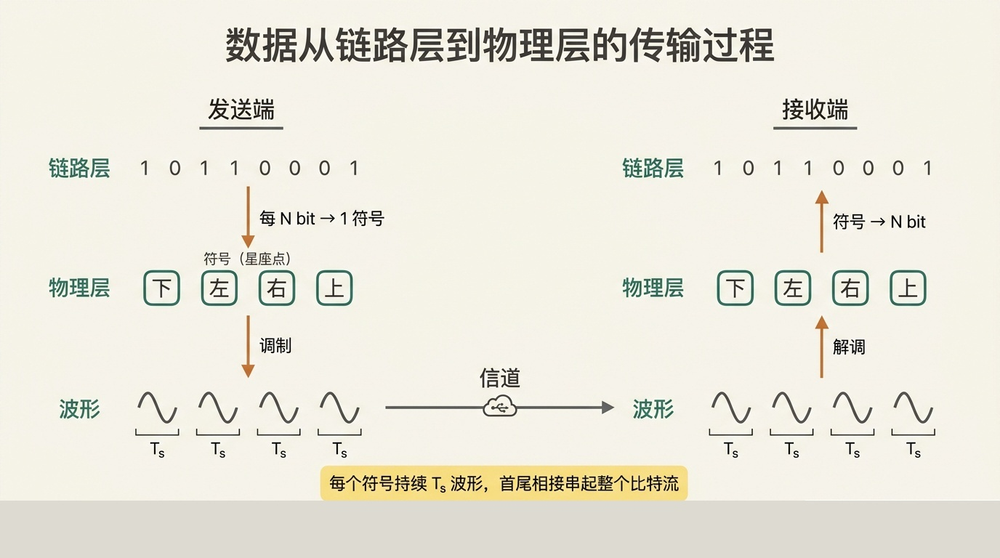

*图：数据从链路层到物理层的传输过程。发送端：链路层把比特流交给物理层，物理层按每 N bit 映射成 1 个符号（星座点），再调制为持续 $T_s$ 的波形送入信道。接收端：在每个 $T_s$ 内解调波形、判决符号、还原 N bit，重新组装成帧交回链路层。整条链路由一个个 $T_s$ 首尾相接，串起整个比特流。*


---

<h4 style="font-size: 1.5em; font-weight: bold;">16-QAM</h4>

16-QAM 是正交幅度调制（QAM）的一种，核心特点是：每个符号携带 4 个比特，共有 16 个星座点。

信号写成：

$$s(t) = I \cos(\omega t) + Q \sin(\omega t)$$

其中：

- I：同相分量，取 −3，−1，+1，+3
- Q：正交分量，取 −3，−1，+1，+3
- ω：载波角频率，通常固定

它可以合并成：

$$s(t) = A \cos(\omega t - \varphi)$$

其中：

$$A = \sqrt{I^2 + Q^2}$$

$$\varphi = \arctan\left(\frac{Q}{I}\right)$$

$$I, Q \; \text{确定} \Rightarrow A, \varphi \; \text{确定} \Rightarrow \; \text{波形确定}$$

| 比特 | 星座点 | I | Q | 相位 | 波形 | 幅度 |
|---|---|---:|---:|---:|---|---:|
| 0000 | (+1, +1) | +1 | +1 | 45° | $\cos(\omega t) + \sin(\omega t)$ | $1/\sqrt{5}$ |
| 0001 | (+1, +3) | +1 | +3 | 71.565° | $\cos(\omega t) + 3\sin(\omega t)$ | $1/\sqrt{2}$ |
| 0011 | (+3, +3) | +3 | +3 | 45° | $3\cos(\omega t) + 3\sin(\omega t)$ | $3/\sqrt{5}$ |
| 0010 | (+3, +1) | +3 | +1 | 18.435° | $3\cos(\omega t) + \sin(\omega t)$ | $1/\sqrt{2}$ |
| 0110 | (+3, −1) | +3 | −1 | −18.435° | $3\cos(\omega t) - \sin(\omega t)$ | $1/\sqrt{2}$ |
| 0111 | (+3, −3) | +3 | −3 | −45° | $3\cos(\omega t) - 3\sin(\omega t)$ | $3/\sqrt{5}$ |
| 0101 | (+1, −3) | +1 | −3 | −71.565° | $\cos(\omega t) - 3\sin(\omega t)$ | $1/\sqrt{2}$ |
| 0100 | (+1, −1) | +1 | −1 | −45° | $\cos(\omega t) - \sin(\omega t)$ | $1/\sqrt{5}$ |
| 1100 | (−1, −1) | −1 | −1 | −135° | $-\cos(\omega t) - \sin(\omega t)$ | $1/\sqrt{5}$ |
| 1101 | (−1, −3) | −1 | −3 | −108.435° | $-\cos(\omega t) - 3\sin(\omega t)$ | $1/\sqrt{2}$ |
| 1111 | (−3, −3) | −3 | −3 | −135° | $-3\cos(\omega t) - 3\sin(\omega t)$ | $3/\sqrt{5}$ |
| 1110 | (−3, −1) | −3 | −1 | −161.565° | $-3\cos(\omega t) - \sin(\omega t)$ | $1/\sqrt{2}$ |
| 1010 | (−3, +1) | −3 | +1 | 161.565° | $-3\cos(\omega t) + \sin(\omega t)$ | $1/\sqrt{2}$ |
| 1011 | (−3, +3) | −3 | +3 | 135° | $-3\cos(\omega t) + 3\sin(\omega t)$ | $3/\sqrt{5}$ |
| 1001 | (−1, +3) | −1 | +3 | 108.435° | $-\cos(\omega t) + 3\sin(\omega t)$ | $1/\sqrt{2}$ |
| 1000 | (−1, +1) | −1 | +1 | 135° | $-\cos(\omega t) + \sin(\omega t)$ | $1/\sqrt{5}$ |

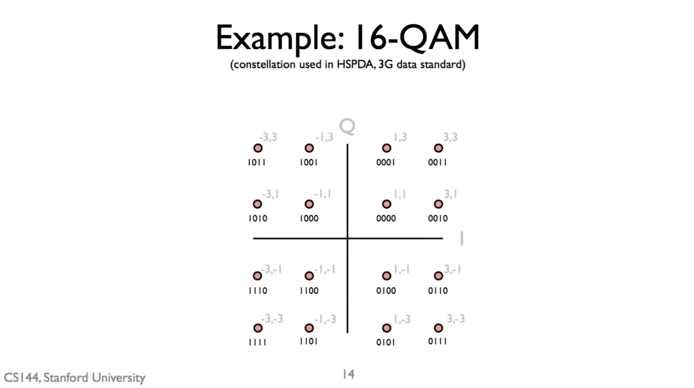

*图：16-QAM 星座图（Stanford slide，CSI44，Stanford University）。16 个星座点规则排布在 I-Q 平面上：横坐标 I ∈ {−3, −1, +1, +3}，纵坐标 Q ∈ {−3, −1, +1, +3}，每个点对应一个 4 bit 比特串（如 1011、0001 等）。该星座图用于 HSPDA / 3G 数据标准。*

---

<h3 style="font-size: 2em; font-weight: bold;">7.2 位错误（Bit Error）</h3>

---

<h4 style="font-size: 1.5em; font-weight: bold;">香农极限与信道容量</h4>

通信信道的理论容量：

<div align="center">

$C = B \times \log_2\left(1 + \frac{S}{N}\right)$

</div>

- C：信道容量（bit/s）
- B：带宽（Hz）
- S/N：信噪比

结论：

- 带宽通常固定，所以系统主要想办法提高信噪比。

- 信噪比越高，能传的数据率越高。这是理论极限，只告诉你能做到多好，不告诉你怎么做到。

- 提高信噪比后，可以：

  - 缩短符号传输时间
  - 或每个符号携带更多比特（更高阶调制）

---

<h4 style="font-size: 1.5em; font-weight: bold;">噪声如何导致位错误</h4>

在理想的无噪声系统中，接收到的信号会精确地落在调制星座图的某个点上。然而，现实中的硬件电路和环境总会引入噪声。

- 在低噪声环境（高信噪比）下，接收到的信号点会在理想点周围轻微波动，但仍能清晰识别。

- 在高噪声环境（低信噪比）下，噪声可能导致接收到的信号具有完全不同的相位和幅度，从而可能被误判为星座图中的另一个点。

例如，本应被解读为比特序列 0000 的符号，可能因为噪声被误判为 0011 或 1010。这就是位错误的引入过程：当信噪比低到一定程度，某些符号就会被错误地记录或解读。

<table>
<tr>
<td>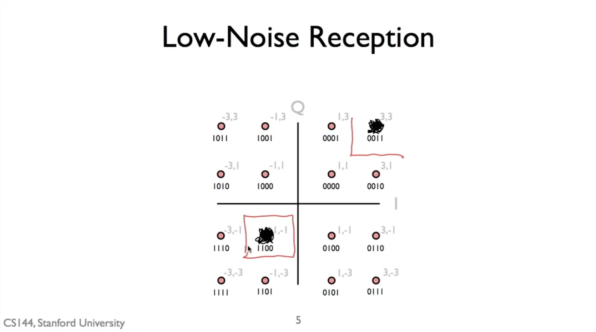</td>
<td>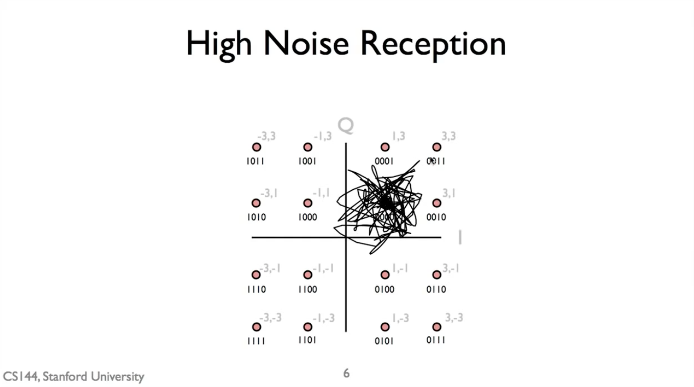</td>
</tr>
</table>

*图：Low-Noise Reception 与 High Noise Reception 对比（Stanford slide，CSI44，Stanford University）。左图：低噪声下 16-QAM 接收点仍清晰聚拢在理想星座点附近；右图：高噪声下接收点散布范围严重扩大，跨越多个判决区域 → 大量符号被误判为其它点 → 位错误率急剧上升。*

关键点：

- 星座点越密集，越容易被噪声干扰。
- BPSK：2 个点，距离远，抗噪强
- 16-QAM：16 个点，距离近，更容易出错

给定调制方式和信噪比，可以算出预期位错误率。

---

<h4 style="font-size: 1.5em; font-weight: bold;">信道编码：对抗位错误的策略</h4>

因为位错误概率永远不为零，直接把数据比特映射到调制符号并不高效。为了防住偶发的噪声峰值，系统只能保守选择调制方案，结果实际速率远低于香农极限。

因此，在实际的物理层处理中，我们会在发送数据前引入冗余，这个过程称为信道编码。

以下是其工作流程：

1. 原始数据（例如"Hello"的 ASCII 码）组成数据包。
2. 通过错误纠正码对数据包进行编码，生成一个更长的比特序列。例如，48 位的原始数据可能被编码为 60 位，增加了 12 位冗余。
3. 编码后的比特映射到物理层调制符号发送。
4. 接收端利用冗余，即使错几个比特，也能恢复原始数据。

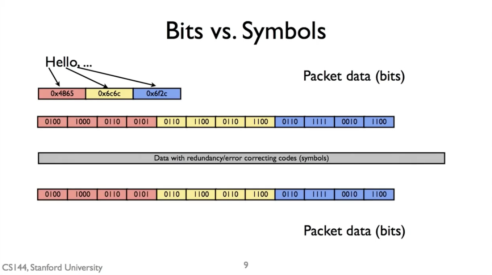

*图：Bits vs. Symbols 示意（Stanford slide，CSI44，Stanford University）。上半：原始"Hello..." 的 ASCII 字节拆成 12 个 4-bit 字段，作为 Packet data (bits)。中间：Data with redundancy / error correcting codes (symbols) — 编码符号层，对原始比特加入冗余（此处用灰色长条代表整体编码符号）。下半：接收端在解调 + 解码后还原的 Packet data (bits)。*

---

<h4 style="font-size: 1.5em; font-weight: bold;">编码增益 / 码率</h4>

码率定义：

$$R = \frac{\text{链路层比特数}}{\text{物理层比特数}}$$

例子：

- 1/2 码率：n 位链路层数据 → 2n 位物理层数据
- 3/4 码率：3 位链路层数据 → 4 位物理层数据

好处：虽然发送的比特变多了，但：

- 能纠错
- 允许使用更高阶调制，即每个符号承载更多比特。
- 整体吞吐量反而提升

---

<h4 style="font-size: 1.5em; font-weight: bold;">实例分析：IEEE 802.15.4（ZigBee）</h4>

802.15.4使用一种非常简单的编码：它将每4个链路层比特，映射到32个物理层“码片”。这些码片再通过QPSK（每个符号2比特）调制发送出去。

码率：

$$R = \frac{4}{32} = \frac{1}{8}$$

计算：

- 链路层速率：250 kbps
- 物理层速率：250 kbps × 8 = 2 Mbps
- 符号率：2 Mbps / 2 = 1 Msymbol/s

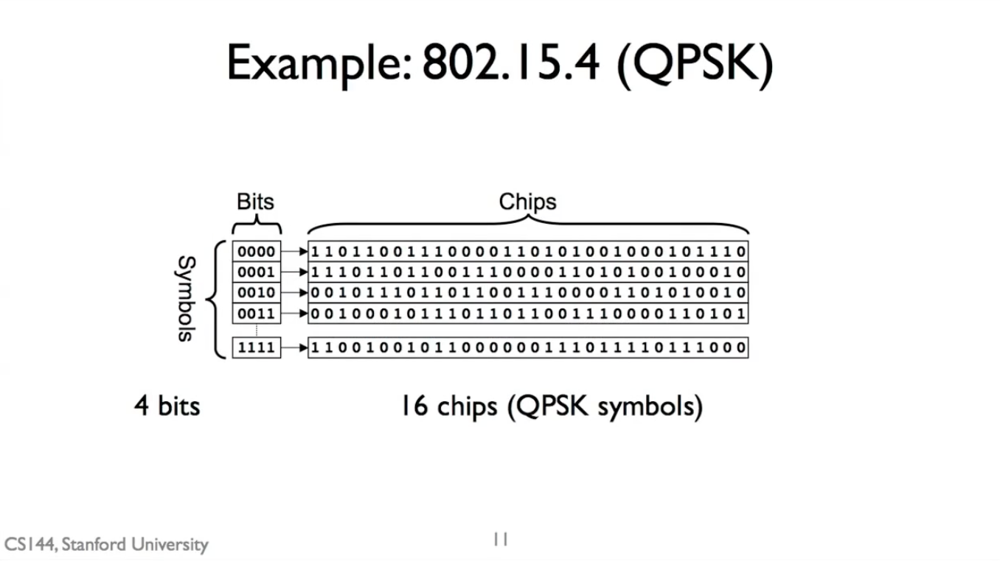

*图：Example: 802.15.4 (QPSK) 示意（Stanford slide，CSI44，Stanford University）。每 4 个链路层比特（如 0000、0001、0010、0011、1111）映射到 16 个 QPSK chips，形成 IEEE 802.15.4 / ZigBee 的扩频表，配合 250 kbps 链路层速率 → 2 Mbps chip 速率 → 1 Msymbol/s 符号率的转换链路，对应 1/8 码率。*

---

<h3 style="font-size: 2em; font-weight: bold;">7.3 时钟与时钟恢复原理（Clock and Clock Recovery Principles）</h3>

---

<h4 style="font-size: 1.5em; font-weight: bold;">数据传输与时钟的基本问题</h4>

数据传输 = 按固定速率发送比特，即每个比特的时间：

$$T_b = \frac{1}{\text{数据速率}}$$

具体例子：

- 10 Mbps → 每比特持续 100 纳秒
- 1 Gbps → 每比特持续 1 纳秒

发送方必须使用一个本地时钟来精确控制每个比特的发送时刻。

接收方也需要知道这个时钟，才能准确判断一个比特的结束和另一个比特的开始，从而正确解码数据。

核心问题：发送方和接收方没有完全相同的时钟参考，接收方必须自己从信号中"找出"发送方的时钟。

---

<h4 style="font-size: 1.5em; font-weight: bold;">异步通信（Asynchronous Communication）：短消息的简单可靠传输方案</h4>

发送方和接收方各自用自己的时钟收发数据，两个时钟频率不完全一样（比如偏差 ±100 ppm），时间一长，接收方的采样点就会逐渐偏移，可能采到比特边界附近，导致解码错误。

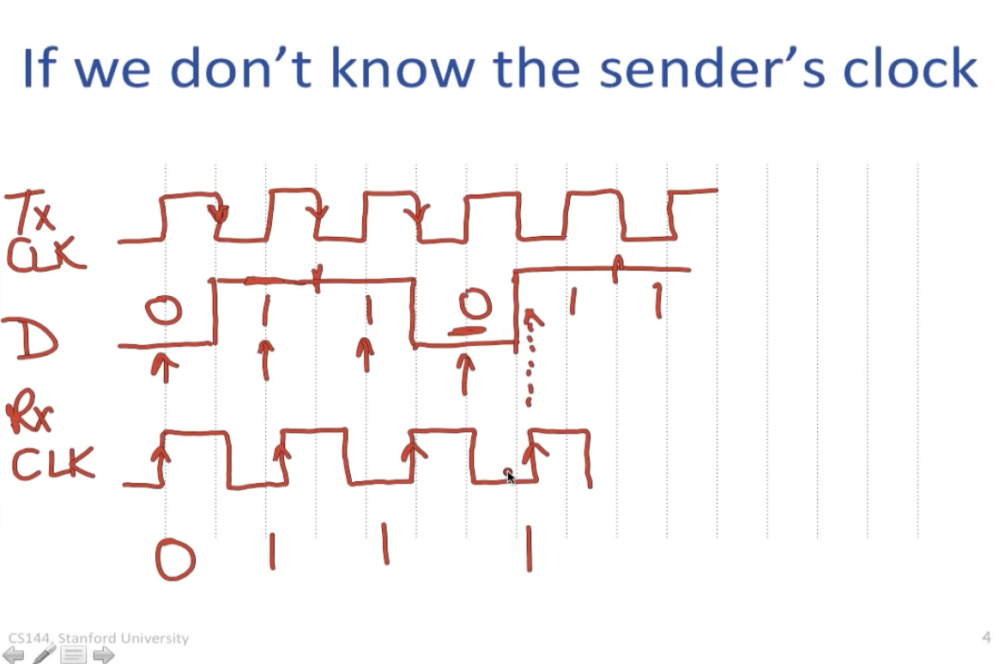

*图：随着时间推移，滞后的采样点可能错过比特中间的稳定区域，从而在比特边界附近采样，导致解码错误（例如，漏掉一个0比特）*

既然时钟会漂移，那就别传太长——把数据切成短包，在漂移造成错误之前就传完。异步通信正是通过控制数据包长度来规避这个问题，因此常用于短消息传输，比如红外遥控或传统串行总线。

异步数据包的典型结构：

- 起始位是一个显著的电平变化，标志数据包开始
- 数据位是有效载荷
- 停止位标志数据包结束。

接收方检测到起始位后，等待半个比特时间开始第一次采样，之后每个比特周期采样一次。只要数据包足够短，在时钟漂移累积到足以导致采样错误之前，传输就已经结束了。

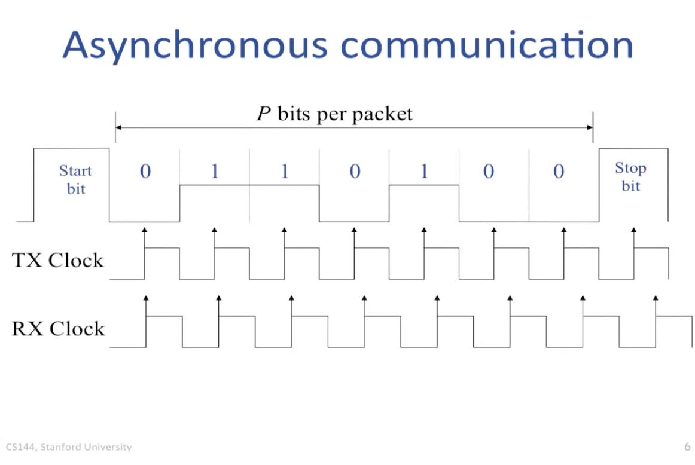

*图：Asynchronous communication 帧结构示意（Stanford slide，CSI44，Stanford University）。每个字符包由 Start bit（1 位，0，表示空闲→数据的下降沿）+ 数据位 0110100（P 位，有效载荷）+ Stop bit（1 位，1，表示数据→空闲的上升沿）组成。下方显示 TX Clock 与 RX Clock：每一 bit 对应一个时钟周期，RX Clk 在 Start bit 边沿重新对齐后即可正确采样 P 位；只要包长 P 受限，时钟漂移累积不超过 1 bit，采样窗口内便能稳定判定 0/1。本图与上方文字"等待半比特时间开始第一次采样，之后每个比特周期采样一次"对应，正是 UART 等异步串行协议的物理层实现。*

---

<h4 style="font-size: 1.5em; font-weight: bold;">同步通信（Synchronous Communication）：无时钟线</h4>

在实际网络（如以太网）中，我们使用同步通信。同步通信系统的核心挑战是：只通过一根线发送数据，接收方必须从中恢复出发送方的时钟。

系统框图包含以下两个关键部分：

- **时钟恢复单元**
  - 接收输入信号，通过检测信号中的跳变（边沿即信号电平从高→低 或 低→高的变化）来确定发送方使用的时钟频率和相位。
  - 常用电路包括锁相环（PLL）或延迟锁定环（DLL）。
- **弹性缓冲区**
  - 这是一个特殊的 FIFO（先进先出）缓冲区。
  - 使用恢复出的发送方时钟写入数据，使用接收方本地时钟读出数据。
  - 其作用是吸收两个时钟之间的频率差异，实现从"发送方时钟域"到"接收方本地时钟域"的安全过渡。

整个流程为：编码数据 → 传输 → 时钟恢复单元提取时钟 → 用该时钟采样数据并写入弹性缓冲区 → 用本地时钟从缓冲区读出数据。

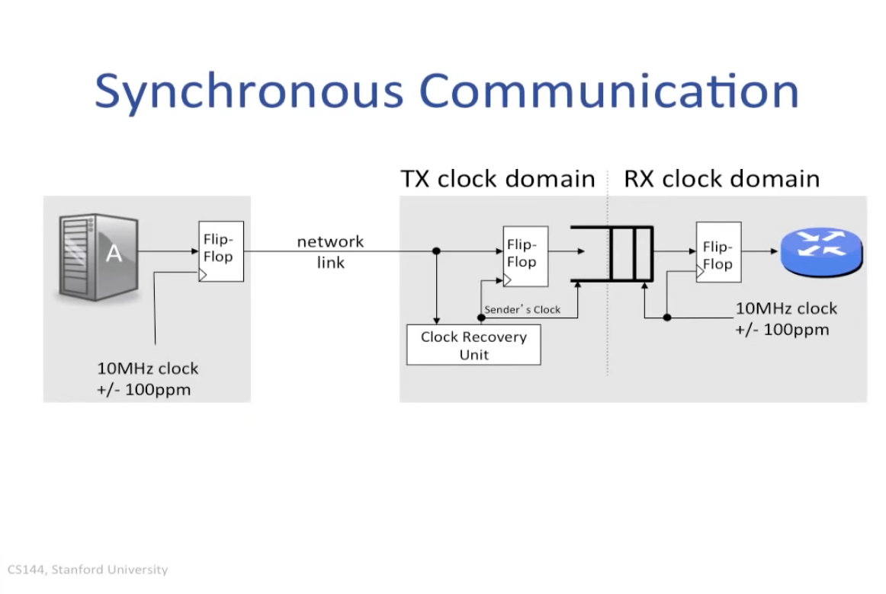

*图：Synchronous Communication 框图（Stanford slide，CSI44，Stanford University）。左侧：发送方用 10 MHz ±100 ppm 本地时钟经 Flip-Flop 编码后输出到一根 network link。右侧：Clock Recovery Unit 从信号跳变中恢复出"Sender's Clock"，用该时钟采样 Flip-Flop 并写入弹性 FIFO；接收方本地 10 MHz ±100 ppm 时钟从弹性 FIFO 读出，再经 Flip-Flop 输出给上层。虚线分隔 Tx clock domain 与 Rx clock domain，弹性 FIFO 跨接两侧，吸收 ±100 ppm 频率差异。本图清晰展示同步通信"没有独立时钟线、靠 CDR 提取时钟、靠弹性缓冲区跨时钟域"的工程实现。*

---

<h4 style="font-size: 1.5em; font-weight: bold;">数据编码：为时钟恢复提供"线索"</h4>

数据为什么需要编码？

- 时钟恢复单元需要信号中有足够的电平跳变才能工作。
- 如果发送一长串连续的 1 或 0，接收方无法确定时钟。
- 因此，发送前需要对数据进行编码。

---

<h4 style="font-size: 1.5em; font-weight: bold;">曼彻斯特编码（Manchester encoding）</h4>

曼彻斯特编码的核心就是：一个比特时间内，保证有一次跳变。编码时先按每个比特单独生成波形，再首尾拼接成完整信号。由于每个比特内部都保证有一次跳变，接收端就可以从接收到的信号中持续检测跳变，从而恢复出与发送端同步的时钟。

编码规则：

| 比特 | 编码规则 | 跳变方向 |
|---|---|---|
| 0 | 从高电平到低电平的跳变 | 下降沿 |
| 1 | 从低电平到高电平的跳变 | 上升沿 |

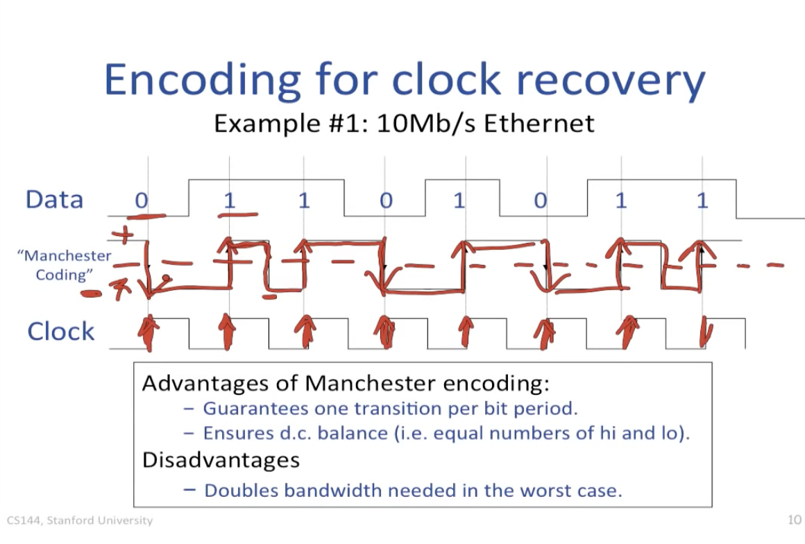

---

<h4 style="font-size: 1.5em; font-weight: bold;">4B/5B 块编码</h4>

曼彻斯特编码虽然能保证跳变、便于时钟恢复，但带宽效率低（最坏情况下跳变频率是数据速率的 2 倍）。

为了提高带宽效率，可以使用块编码，如 4B/5B 编码。

**4B/5B 块编码工作原理**：

- 将每 4 位原始数据映射为一个 5 位码字。
- 5 位共有 $2^5 = 32$ 种可能码字。
- 只选用其中**跳变足够多的码字**（例如：避免连续超过 3 个相同比特）。
- 其余未使用的码字可用于传输控制信息。

通过曼彻斯特编码或 4B/5B 等编码，我们在**数据流中嵌入了时钟信息**，**使接收端的时钟恢复成为可能**。

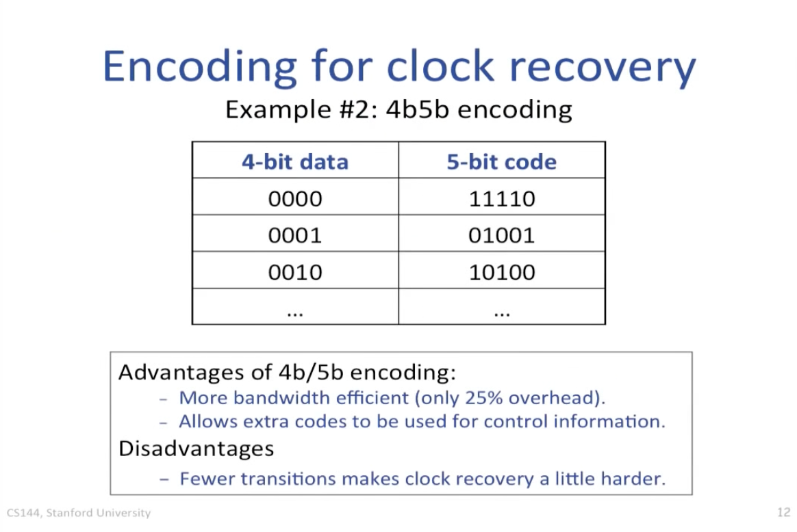

---

<h4 style="font-size: 1.5em; font-weight: bold;">同步通信系统（无时钟线）工作完整流程</h4>

**一、发送方**

1\. **使用本地时钟**：发送方以自己的本地时钟为基准，控制数据的发送节奏。

2\. **数据编码**：数据经过编码（如 4B/5B 或 Manchester 编码），确保信号中有足够的跳变，便于接收端恢复时钟。

3\. **通过链路发送**：编码后的数据通过通信链路发送出去。

**二、接收方**

4\. **时钟恢复**：接收方的时钟恢复单元分析接收到的信号跳变，从中恢复出发送端的时钟。

5\. **数据采样**：使用恢复出的时钟，对接收到的信号进行采样，得到数据比特。

6\. **写入弹性缓冲区**：采样后的数据先写入弹性缓冲区，用于缓冲发送时钟与接收时钟之间的微小差异。

7\. **本地时钟读出**：接收方使用自己的本地时钟，从弹性缓冲区中安全地读出数据，完成接收。

总结：发送方用本地时钟编码发送；接收方从跳变中恢复发送时钟，用它采样数据并写入弹性缓冲区，最后用本地时钟读出，完成同步通信。

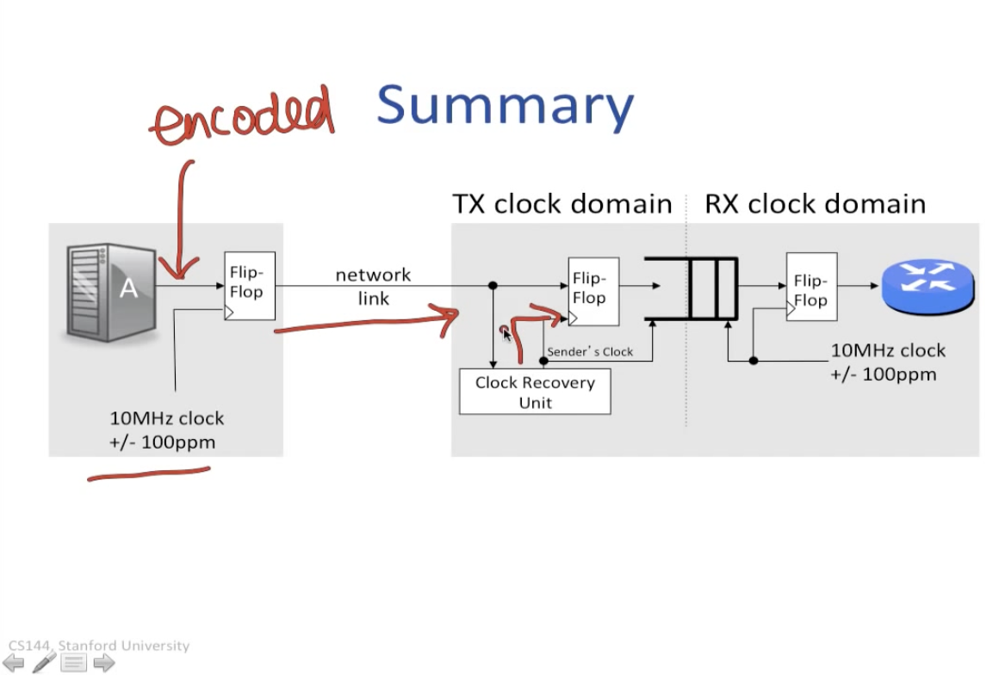

---

<h3 style="font-size: 2em; font-weight: bold;">7.4 前向纠错与里德-所罗门码（Forward Error Correction and Reed-Solomon Codes）</h3>

---

<h4 style="font-size: 1.5em; font-weight: bold;">为什么需要前向纠错？（Forward Error Correction）</h4>

- 信号传输中，比特错误永远无法完全避免。
- 如果完全不纠错，为了达到极低错误率，需要非常高的信号质量或调制密度，效率很低。
- 解决思路：主动添加冗余数据，让接收方能够自行纠错。

---

<h4 style="font-size: 1.5em; font-weight: bold;">前向纠错的核心思想</h4>

- 发送方主动添加冗余。
- 接收方不需要请求重传，可自行解码和纠错。
- 好处：减少信令开销，提高吞吐量。

---

<h4 style="font-size: 1.5em; font-weight: bold;">编码增益</h4>

表示链路层比特与物理层比特的比例：

| 码率 | 含义 |
|---|---|
| 1/2 | 1 个链路层比特 → 2 个物理层比特 |
| 3/4 | 3 个链路层比特 → 4 个物理层比特 |

---

<h4 style="font-size: 1.5em; font-weight: bold;">里德-所罗门码（Reed-Solomon Code）</h4>

应用广泛：CD、DVD、DSL、RAID-6 等，核心数学基础：多项式。

关键思想：一个 $k-1$ 次多项式，可以由 $k$ 个点唯一确定，例如：二次多项式 $ax^2 + bx + c$，需要 3 个点确定。

**RS 编码过程**:

1. 取 $k$ 个数据符号，作为多项式的系数。
2. 在该多项式上计算 $n$ 个点，且 $n > k$。
3. 发送方发送这 $n$ 个点，而不是原始数据。

**RS 解码过程**：

1. 接收方只要收到任意 $k$ 个正确的点，就能重构多项式。
2. 从而恢复原始 $k$ 个数据符号。

实际运算在有限域中进行，保证数值可用有限比特表示。

```text
原始数据符号：  2, 5, 7
              ↓
当作系数：  a = 2, b = 5, c = 7
              ↓
多项式：    f(x) = 2x² + 5x + 7
              ↓
选任意 n 个不同的 x（不一定要连续）：
x = 0, 2, 5, 9, 10, 20, 50
              ↓
代入计算 y：
(0,7), (2,25), (5,82), (9,214), (10,257), (20,907), (50,5257)
              ↓
          发送这些点
              ↓
接收方只要收到任意 3 个正确点，就能还原多项式
              ↓
恢复原始数据：2, 5, 7
```

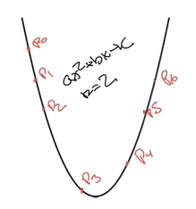 0$) 上 $n=8$ 个评估点 $Q_0$ 至 $Q_7$，只要任意 $k=3$ 个正确就能还原多项式" style="display: block;">

---

<h4 style="font-size: 1.5em; font-weight: bold;">RS 码纠错能力</h4>

RS 码将 $k$ 个数据符号编码为 $n$ 个码字符号，$n > k$。

| 错误类型 | 含义 | 可纠正数量 |
|---|---|---|
| 擦除 | 知道错误位置 | 最多 $n-k$ 个符号 |
| 错误 | 不知道错误位置 | 最多 $(n-k)/2$ 个符号 |

---

<h4 style="font-size: 1.5em; font-weight: bold;">RS 码常见例子</h4>

RS(255, 223)

- RS(255,223) 工作在 GF(256) 中，每个数据符号、码字符号都是 1 字节。
- 取 223 个数据符号，编码为 255 个码字符号
- n - k = 255 - 223 = 32
- 可纠正：
  - 最多 32 个符号的擦除
  - 最多 16 个符号的错误

概念性流程：

- 将数据分成 223 个数据符号，视为一个 222 次多项式的系数。
- 计算该多项式在 255 个点上的值（在有限域中计算，每个符号表示为 1 字节），并发送这 255 个码字符号。
- 只要接收到至少 223 个正确的值，或错误符号不超过 16 个，就能恢复原始数据。

---

RS(7,5) 编码示例：48 比特数据如何编码为 84 比特

- RS(7,5) 工作在 GF(8) 中，每个数据符号、码字符号都是 3 字节。
- 48 比特数据加填充位变成 60 比特，即 20 个数据符号，再按每组 5 个数据符号分成 4 组。
- 每组 5 个数据符号进行 RS(7,5) 编码，得到每组 7 个码字符号。
- 4 组 × 7 = 28 个码字符号
- 28 × 3 比特 = 84 比特
- 接收方把收到的符号流按照每组 n 个符号拆分，独立 RS 译码，即可还原原始数据。

---

RS(7,5) 编码纠错能力

- \(n = 7\)
- \(k = 5\)
- \(n - k = 2\)

| 错误类型 | 最多可纠正 |
|---|---|
| 错误 | 1 个 |
| 擦除 | 2 个 |

RS(7,5) 每组可纠正 1 个错误或 2 个擦除。错误分散时能全部纠正；两个错误落在同一组时，该组无法纠正。整体抗错能力仍远强于不编码。

---

<h4 style="font-size: 1.5em; font-weight: bold;">交织技术</h4>

物理层错误有时会集中爆发，形成连续的错误串，这比分散的随机错误更难处理。

不使用交织时：码字按块顺序发送，比如：

```text
A0 A1 A2 ... A20 B0 B1 B2 ... B20 ...
```

一个长的突发错误可能损坏同一个编码块中的多个码字，导致超出其纠错能力。

用交织：发送时把不同码字的符号交替排列，比如：

```text
A0 B0 C0 D0 A1 B1 C1 D1 ...
```

这样即使信道出现连续突发错误，落到每个 RS 码字里的错误符号数也会被分散，每组只错少量符号，仍在 RS 纠错能力范围内。


